# Learning illustrations — independent review copy

Review every entry against current primary sources, its presentation and linked media. Record judgement in `IMAGE_REVIEW_TRACKER.csv`; do not approve by sampling.

## dft-red-ring — Red ring restriction

Content SHA-256: `68bd785ff5c582a687a86042c1f2bbb37e6e227d56951361582fa160b8b55221`

Caption: Red ring restriction

Unanswered accessible description: White circle with a red rim

File: `src/assets/dft-signs/red-ring.png`

File SHA-256: `4b860514b9fb6280fc910e11bae4d85db2366d05f9b4232251e3f4f0a52fc9be`

---

## dft-blue-circle — Blue mandatory instruction circle

Content SHA-256: `04c87f0bd4abde1a67e9f0d0702953fa7588e242016497ce14a86fa1eed561f1`

Caption: Blue mandatory instruction circle

Unanswered accessible description: Plain blue circle with a white rim

File: `src/assets/dft-signs/blue-circle.png`

File SHA-256: `3baec44d0f31034689d84bb25121076767720f60c7ed4e15e2d3705e6278a421`

---

## dft-stop — STOP sign

Content SHA-256: `07cc39995bdc5b33ce6ba570d680d2dbb35f4faffe79e7c6241b7e1a60614449`

Caption: STOP sign

Unanswered accessible description: Red octagonal sign bearing white STOP lettering

File: `src/assets/dft-signs/stop.png`

File SHA-256: `6878c730b895e53ff9686d29bec3aa458c632568fe718524e0cb01b78b925ab2`

---

## dft-give-way — GIVE WAY sign

Content SHA-256: `6413568f4aa681161bfc879affa1664603f12649016267d95ba6de59b52ae325`

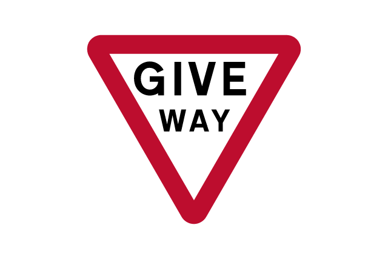

Caption: GIVE WAY sign

Unanswered accessible description: Downward-pointing white triangle with a red border

File: `src/assets/dft-signs/give-way.png`

File SHA-256: `697a6fdb5f262ec2464fe9944f2bbffaf7ba6bac6545f7f392c666640c760d95`

---

## dft-no-u-turn — No U-turn

Content SHA-256: `d1d760c8ee8d0e50b84b7cd1d2915cd587ed2e6ca57286f992438991679e2a51`

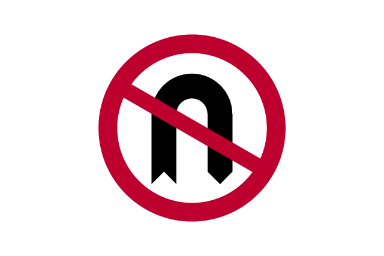

Caption: No U-turn

Unanswered accessible description: Red-bordered white circle with a crossed-out U-shaped arrow

File: `src/assets/dft-signs/no-u-turn.png`

File SHA-256: `bbcd2772cec2c2cea64ce060481b37fecb91a202444142e3ff5ded410f4cba08`

---

## dft-warning-triangle — Triangle shape schematic

Content SHA-256: `492da3278f961f75b6a327333b45021f4aa76eab3b1c19f30fca986662e808c0`

Caption: Triangle shape schematic

Unanswered accessible description: Black outlined upright triangle

File: `src/assets/dft-signs/warning-triangle.png`

File SHA-256: `429ef53f05843e6b4e93e05d279a30361270c4396954877f30795ac338953f22`

---

## dft-bend-right — Bend to the right

Content SHA-256: `ea774090416146936f5a623a6725839aa16ab4c88fe1197738dce99549dfdcfc`

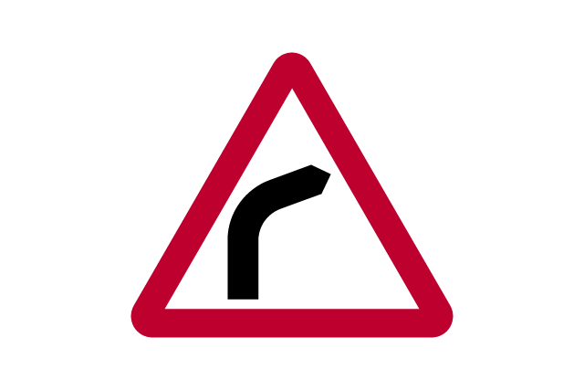

Caption: Bend to the right

Unanswered accessible description: Red-bordered triangle enclosing a black curved line bending right

File: `src/assets/dft-signs/bend-right.png`

File SHA-256: `4462fa1090e8a4b9220eba1fcaddee81b1e80ac1d135f1f4f11a57f44d24ca2c`

---

## dft-crossing-warning — Zebra crossing ahead

Content SHA-256: `ac3d729aac1450f090337c4a3a56cd4a74c9711848f9d537914d2dfceba6ba67`

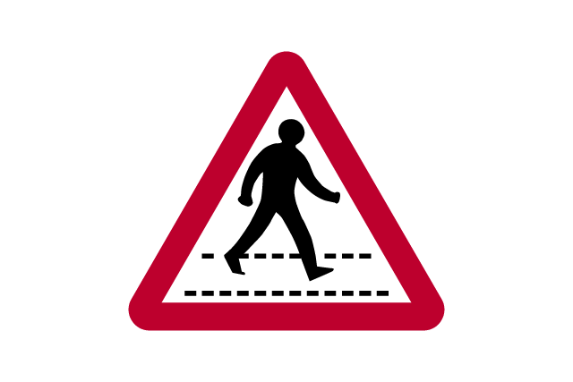

Caption: Zebra crossing ahead

Unanswered accessible description: Red-bordered triangle with a pedestrian walking on stripes

File: `src/assets/dft-signs/crossing-warning.png`

File SHA-256: `01f159255ba4562044fbacb5ae5a5398852ebf0e73681523ef6bf86b49169803`

---

## dft-motorway-direction — Blue direction-sign background

Content SHA-256: `3f3aaf2b78ae13360ee17abe6a740b3647bd663e2e4b826de3b26c9af69ea829`

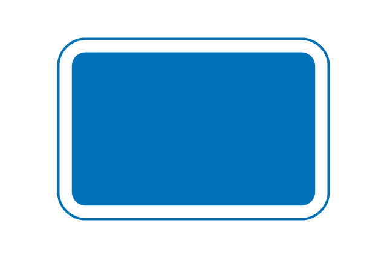

Caption: Blue direction-sign background

Unanswered accessible description: Plain blue rounded rectangle with a white border

File: `src/assets/dft-signs/motorway-direction.png`

File SHA-256: `19aed6d6d67d8aea636e70de841e143239cd8386c2b5344f0c3f0c1754317a2a`

---

## dft-primary-direction — Green direction-sign background

Content SHA-256: `aa924e319e7f9428cf8dacac8ca039c4d7be84cad720ce9657acd617c35fa38a`

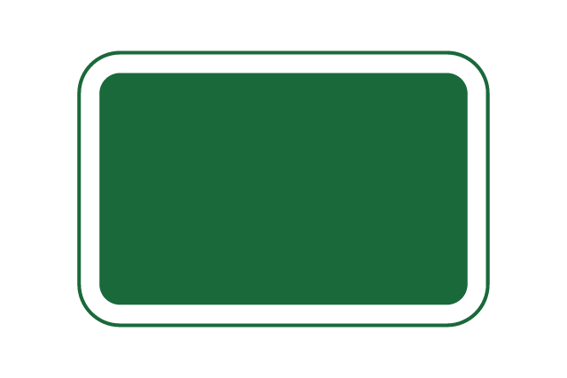

Caption: Green direction-sign background

Unanswered accessible description: Plain green rounded rectangle with a white border

File: `src/assets/dft-signs/primary-direction.png`

File SHA-256: `547a4000503ab62ca977d7c5e5f8e2dcaaf0e6cf136d44c195376d70f3d60650`

---

## dft-nonprimary-direction — White direction-sign background

Content SHA-256: `be9a649364ee3c07a063629b222226132dc3f0fd94769e8d9726bb7c36e9d1bc`

Caption: White direction-sign background

Unanswered accessible description: Plain white rounded rectangle with a black border

File: `src/assets/dft-signs/nonprimary-direction.png`

File SHA-256: `d006f400897c0eabd7e53af45602ee691b14f19e45cfb89cd20be5599c587ce5`

---

## dft-no-entry — No entry

Content SHA-256: `4aeb7cfbec4256716596ed4c591fc6503e07a31e55aa7146dd50f30e3f997c93`

Caption: No entry

Unanswered accessible description: Red circular sign with a horizontal white bar

File: `src/assets/dft-signs/no-entry.png`

File SHA-256: `f5a842891867864030ed0a76d4a1917af303645bfcb67adbc531c7dd0e516d77`

---

## dft-keep-left — Keep left

Content SHA-256: `af987e230967174f46734bc938f58bf2e727e9413b811d5ac304f30a55b3714b`

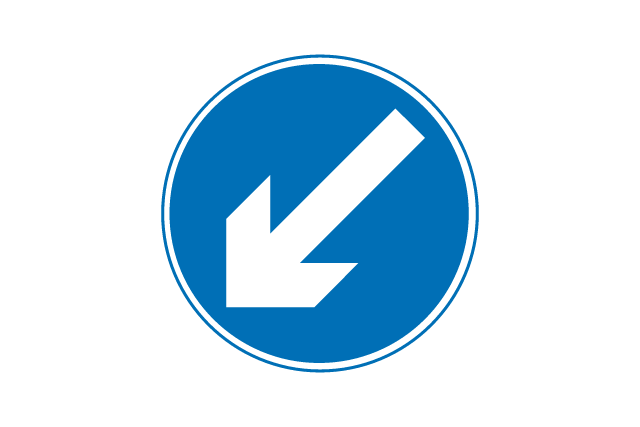

Caption: Keep left

Unanswered accessible description: Blue circle with a white arrow pointing diagonally down to the left

File: `src/assets/dft-signs/keep-left.png`

File SHA-256: `a132e5572eae4cacf02faf287acfa5e9a9f61cced546f3e2c7e90a1142e0f2d3`

---

## dft-signals-ahead — Traffic signals ahead

Content SHA-256: `8c3c82a3aa409e2e9b37a9c7ec851618bc1a8e9a06c86eddd72a08b17c27928d`

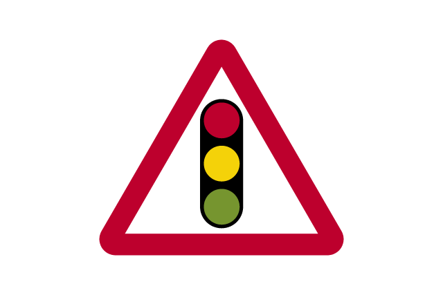

Caption: Traffic signals ahead

Unanswered accessible description: Upright red-bordered triangle containing a traffic-light symbol

File: `src/assets/dft-signs/signals-ahead.png`

File SHA-256: `08ea254035dcd36e8d769dea63d07ef6bfa8647804b341d9820806944e058f55`

---

## dft-national-speed-limit — National speed limit applies

Content SHA-256: `de337bf23aa7f204fe3834455e2585abda7eca939d0d2e8559a62863d154321a`

Caption: National speed limit applies

Unanswered accessible description: White circular sign with a black diagonal stripe

File: `src/assets/dft-signs/national-speed-limit.png`

File SHA-256: `da34db86353d4b5618292901bbc9ab959aebde88d8351ccacbfab13219274041`

---

## dft-speed-40 — 40 mph maximum speed

Content SHA-256: `4615e8a2622418f3e46b43db4fd6b38e3cca5be2bd77b039732255d9f307cd2f`

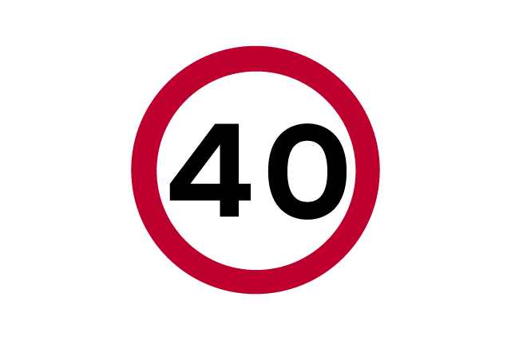

Caption: 40 mph maximum speed

Unanswered accessible description: White circular sign with a red border and black number 40

File: `src/assets/dft-signs/speed-40.png`

File SHA-256: `27af2cddbeda8474f52f22acdf0f478f43c5eac805d8e162a5ba177abc633bcb`

---

## dft-no-motor-vehicles — No motor vehicles

Content SHA-256: `afe0088175d868de304dfe25dc1f7d5d63fa9291d0359e05e4c912ee685a6fa5`

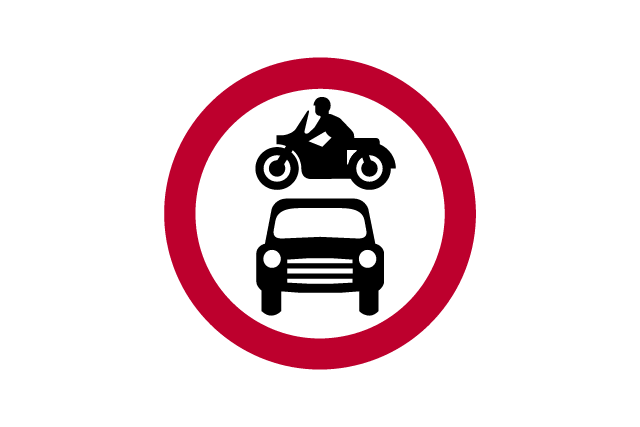

Caption: No motor vehicles

Unanswered accessible description: Red-bordered circle with a car and motorcycle symbol

File: `src/assets/dft-signs/no-motor-vehicles.png`

File SHA-256: `b92b98ff0f6167badfd15d7b6d7b3facf7e7a3bc27354d1adf874760734c8845`

---

## dft-no-overtaking — No overtaking

Content SHA-256: `56edb548de4ebc496cb78862148e09a0412e6fc705da56428ffea0fe76be3bd4`

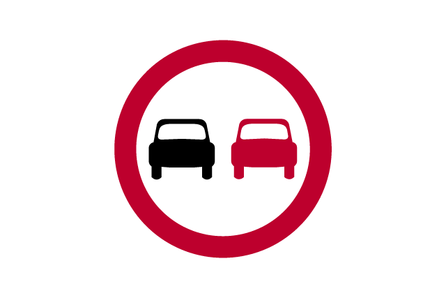

Caption: No overtaking

Unanswered accessible description: Red-bordered circle with a red car beside a black car

File: `src/assets/dft-signs/no-overtaking.png`

File SHA-256: `97a259c3434f9ae3af3940c4b5e31efaff6182b3385eb29c13788ff3540614b1`

---

## dft-oncoming-priority — Give way to oncoming vehicles

Content SHA-256: `2a8192f7416d2e532e9f0a2720388b99153e3eb7fee551a2c1ac6689f7b4664a`

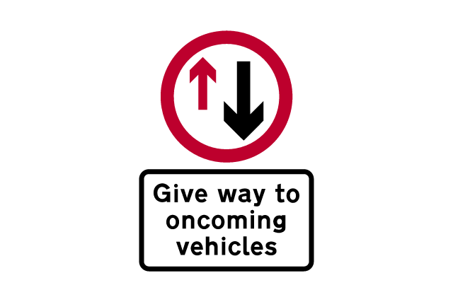

Caption: Give way to oncoming vehicles

Unanswered accessible description: Red-bordered circle with a red upward arrow and black downward arrow

File: `src/assets/dft-signs/oncoming-priority.png`

File SHA-256: `902d75e38609a0a6069ecb2347b0d18d0eaa7462551c7b209c6812eeb9d797f1`

---

## dft-turn-left — Turn left ahead

Content SHA-256: `5a4f5c9762e36df78778f688374a543bdd7d6a858170001c38239b38cf1d93ba`

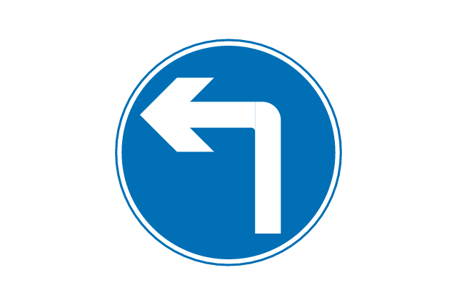

Caption: Turn left ahead

Unanswered accessible description: Blue circle with a white arrow bending left

File: `src/assets/dft-signs/turn-left.png`

File SHA-256: `635a4395be90ef35cab33721e656c5ceab146dacc65c9b579d2c4e8c10a97759`

---

## dft-crossroads — Crossroads ahead

Content SHA-256: `2e3e1531a8496325edb512421695aeca1e77a0ca46aca6f80b17708b99a2bc26`

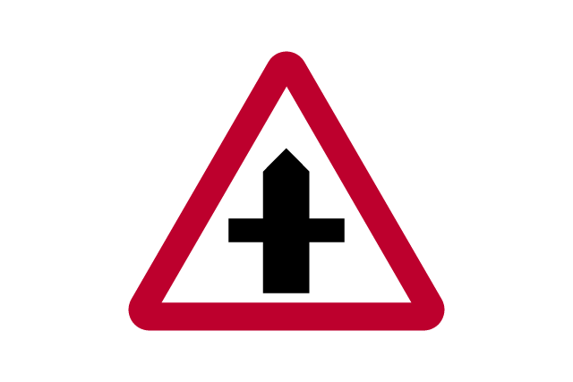

Caption: Crossroads ahead

Unanswered accessible description: Red-bordered triangle enclosing a black cross

File: `src/assets/dft-signs/crossroads.png`

File SHA-256: `ea9f5b03443c2c1ae16b25f3e0acd0a63523e6c665d62745e57d8e6cbb973d4d`

---

## dft-t-junction — T-junction ahead

Content SHA-256: `4f5b425bbdc298f0095cf772b8c3b4e7971b7fada871097814b37aa6a782d39c`

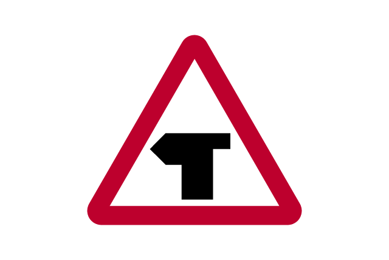

Caption: T-junction ahead

Unanswered accessible description: Red-bordered triangle enclosing a black T-shaped junction

File: `src/assets/dft-signs/t-junction.png`

File SHA-256: `cab7723ba8e5a7c52e414c181232829f2bd25701c67b962981a8ebd934c239b0`

---

## dft-roundabout — Roundabout ahead

Content SHA-256: `3003ef64e36470a17cb39277646999c4795c125c26384317b096e1fbb2cde98b`

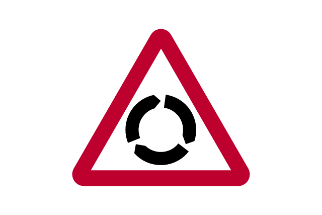

Caption: Roundabout ahead

Unanswered accessible description: Red-bordered triangle enclosing three black circular arrows

File: `src/assets/dft-signs/roundabout.png`

File SHA-256: `c8212589e733afcc284cfe10cd50133279cd774ba8ca8697eb84f58b6813f25f`

---

## dft-road-narrows — Road narrows on both sides

Content SHA-256: `f90e86529065bb064cfb86f0b70331c861752014960dc5ef48c616264c75111c`

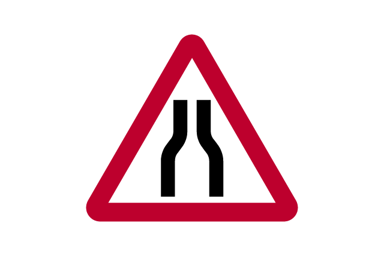

Caption: Road narrows on both sides

Unanswered accessible description: Red-bordered triangle with two black lines narrowing towards the top

File: `src/assets/dft-signs/road-narrows.png`

File SHA-256: `75bb00df017d17d995da5c2fad75a8ffee2371ebf82ac3b2611505ea8b97d3f4`

---

## dft-two-way — Two-way traffic

Content SHA-256: `c0af2eeb077305149a747518d8434cf80258537894ec49813d0eeec93c51e64b`

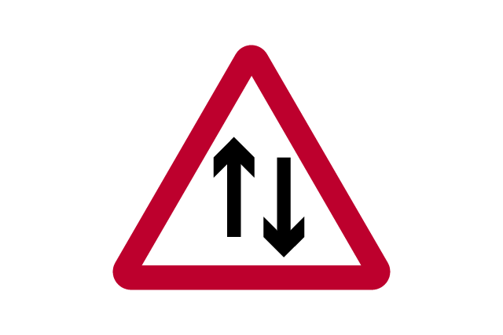

Caption: Two-way traffic

Unanswered accessible description: Red-bordered triangle enclosing opposing black arrows

File: `src/assets/dft-signs/two-way.png`

File SHA-256: `f50cc840659f129dc85aa8b643d908ffcf475305505ffa77849cf34e4a258e4f`

---

## dft-slippery-road — Slippery road

Content SHA-256: `743f461cb979d61365140eb5de76a0e75e98071161b0d20fb090c502ea3237b0`

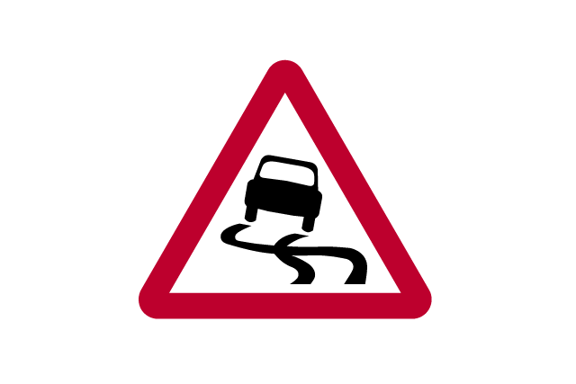

Caption: Slippery road

Unanswered accessible description: Red-bordered triangle with a skidding car symbol

File: `src/assets/dft-signs/slippery-road.png`

File SHA-256: `d855b08a52f1d3f3e32d126b1eccac84f1edb11f3acdf9f3e2ab6f6cab1f5026`

---

## dft-school — Children going to or from school

Content SHA-256: `194211bc27bcce39bd820d9d033cb35433b30b3ffee9316206ab6fb7b1301c45`

Caption: Children going to or from school

Unanswered accessible description: Red-bordered triangle with two children

File: `src/assets/dft-signs/school.png`

File SHA-256: `754fe2f9289e49b72e939f59437c88f099214b4fc90900cb94e8f57878b907b2`

---

## dft-no-through-road — No through road

Content SHA-256: `f9eba45ab2704aa3d677caaa7b133ce9e80d2a60aaee1e2a40435b6af8bf5651`

Caption: No through road

Unanswered accessible description: Blue rectangular sign with a white upright line capped by a red bar

File: `src/assets/dft-signs/no-through-road.png`

File SHA-256: `bc07308a4c3cf0c8547674762d6bd6b12d7b9afc2326acd48f8b6fd8015f87ab`

---

## dft-parking — Parking place

Content SHA-256: `d470b879185d52880267f813b1003b9ca000ab8b3410fa75695410ed4c37bdb7`

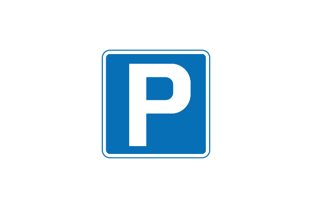

Caption: Parking place

Unanswered accessible description: Blue square sign with a white P

File: `src/assets/dft-signs/parking.png`

File SHA-256: `356d0d9d4e843b366c86f900836c3d4689bb46520c2d650615be77e4aa1682ce`

---

## dft-motorway-start — Start of motorway regulations

Content SHA-256: `eb897112a6b667c2ed0929650c19404b569c351a82c1532d50600449b27cd102`

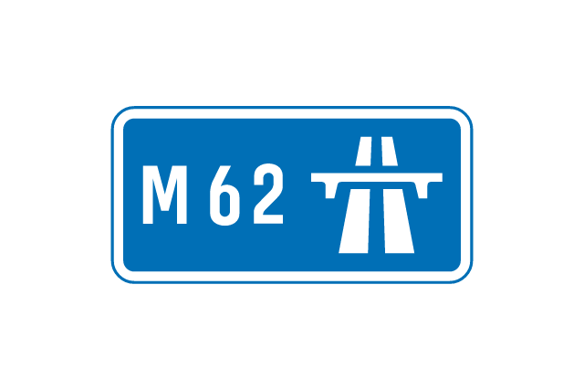

Caption: Start of motorway regulations

Unanswered accessible description: Blue rectangular sign bearing M62 and a white motorway symbol

File: `src/assets/dft-signs/motorway-start.png`

File SHA-256: `318db3687419582b0f01a3713d9f7f93f2c0303a8894b5a4cc659e094a4c0c5c`

---

## head-restraint — Head restraint adjustment

Content SHA-256: `422d32d33cf673e546791eaba70c8dc520daf7b5c5f70421be823c49e0eb2f3d`

Caption: Head restraint adjustment

Unanswered accessible description: Head restraint beside the back of a seated person's head

File: `src/assets/illustrations-v2/images/vehicle_head_restraint_position_original_02.png`

File SHA-256: `b0eaacd72a5e4f7a85a011f82d6bfbd7a87c8d08836407b9228e8faaaaf0aef1`

---

## tyre-tread — Check tyre tread depth

Content SHA-256: `72cc839c6709ae263bf21b2415c3bbc70be62c9f967847dfe87b701d01c68b83`

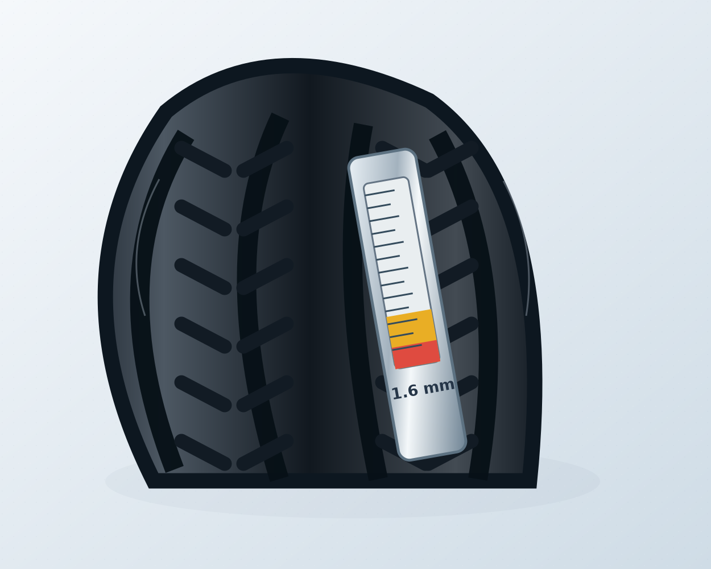

Caption: Check tyre tread depth

Unanswered accessible description: Tread depth gauge measuring a tyre groove

File: `src/assets/illustrations-v2/images/vehicle_tyre_tread_depth_original_01.png`

File SHA-256: `6961e67961478d8e213a5065ce04a46c30b8bf514f3f6c5107293f7ae7d2e349`

---

## tyre-pressure — Check tyre pressures

Content SHA-256: `7d386124048c296051268a6ab0cda55d9c474a9e42d89dfc442ec6cc610283c1`

Caption: Check tyre pressures

Unanswered accessible description: Pressure gauge connected to a tyre valve

File: `src/assets/illustrations-v2/images/vehicle_tyre_pressure_check_original_01.png`

File SHA-256: `58d0234b727bfdc3269823ec1cc659c2e4915098a46e01240044b5aa66b633b1`

---

## coolant — Engine coolant reservoir

Content SHA-256: `e3846830fe9f0bdddcc7ca8eb49bac1ebc1e51c9ee6f59a78f1295e051d8abae`

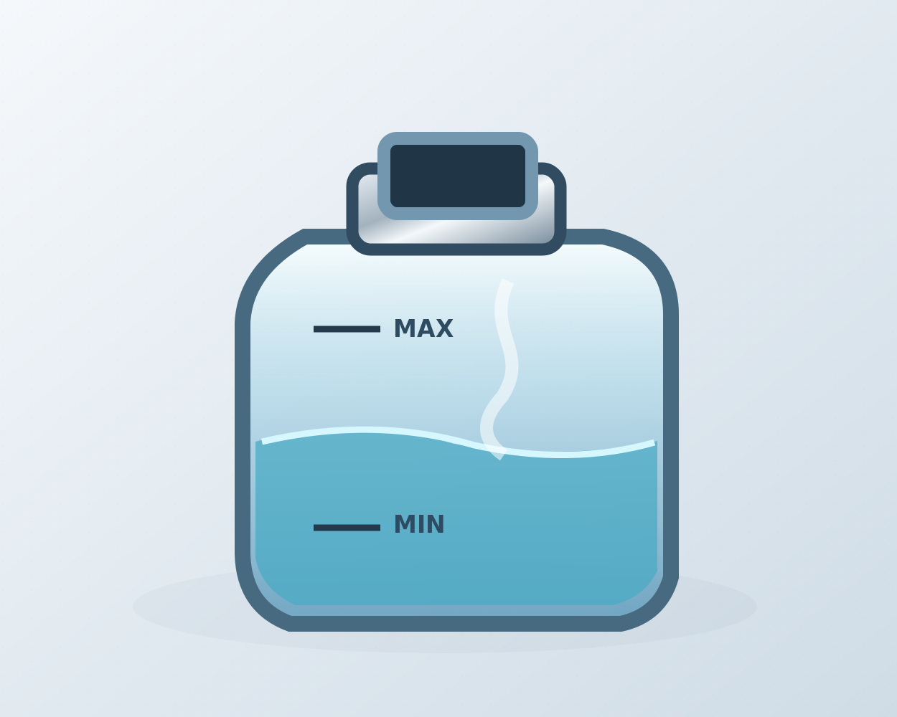

Caption: Engine coolant reservoir

Unanswered accessible description: Illustration of a vehicle coolant reservoir

File: `src/assets/illustrations-v2/images/vehicle_coolant_reservoir_original_01.png`

File SHA-256: `43ae15c6afa3573e82691e4fb4943bf920485d37c47e219c8c558e5aab527a8c`

---

## brake-lights — Working brake lights

Content SHA-256: `d47e7358047fcabb3668a5161b163eca572e5d6c9dab9f0ea01945cef6e8c50a`

Caption: Working brake lights

Unanswered accessible description: Rear of a car with brake lamps illuminated

File: `src/assets/illustrations-v2/images/vehicle_brake_lights_original_02.png`

File SHA-256: `c4e4a0ae0cea4e412a6aa17f3a766c665693a8f8377fff76268aed29dbf28f3d`

---

## motorway-join — Joining traffic gives way

Content SHA-256: `7c1e91ba39d77cda6eb9b1c70ad97ef45c0b6c71c5a44277b7e1df22cfe3c770`

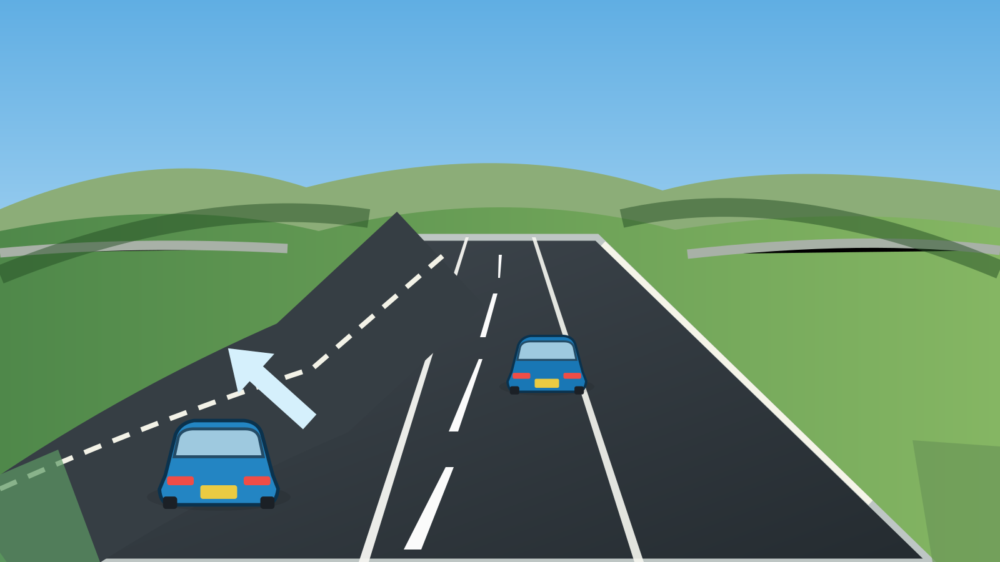

Caption: Joining traffic gives way

Unanswered accessible description: Slip road joining a motorway carriageway

File: `src/assets/illustrations-v2/images/motorway_joining_slip_road_original_01.png`

File SHA-256: `dc9774f93e34a497ae6979840cad9cb4bfdff975231e9992d088977939676793`

---

## following-gap — Leave at least two seconds in dry conditions

Content SHA-256: `f4a551c5988a90206e4d0ae4aa16a9175ff236c85937b1df05a786a0c14e9d1d`

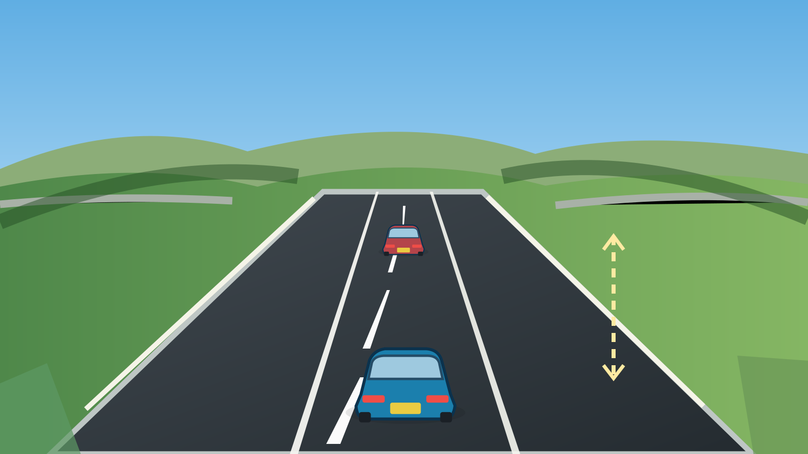

Caption: Leave at least two seconds in dry conditions

Unanswered accessible description: Two cars separated by a following gap

File: `src/assets/illustrations-v2/images/motorway_two_second_gap_original_01.png`

File SHA-256: `dd7a421f12ce795383a32b09309b20942ca9a65c91087b150125b02045e791e3`

---

## dash-oil — Oil pressure warning

Content SHA-256: `78557e159d865b3771e7ba4a0ecc9bb0b1bf2bc1bdff2ac1a9f11ff17f84f005`

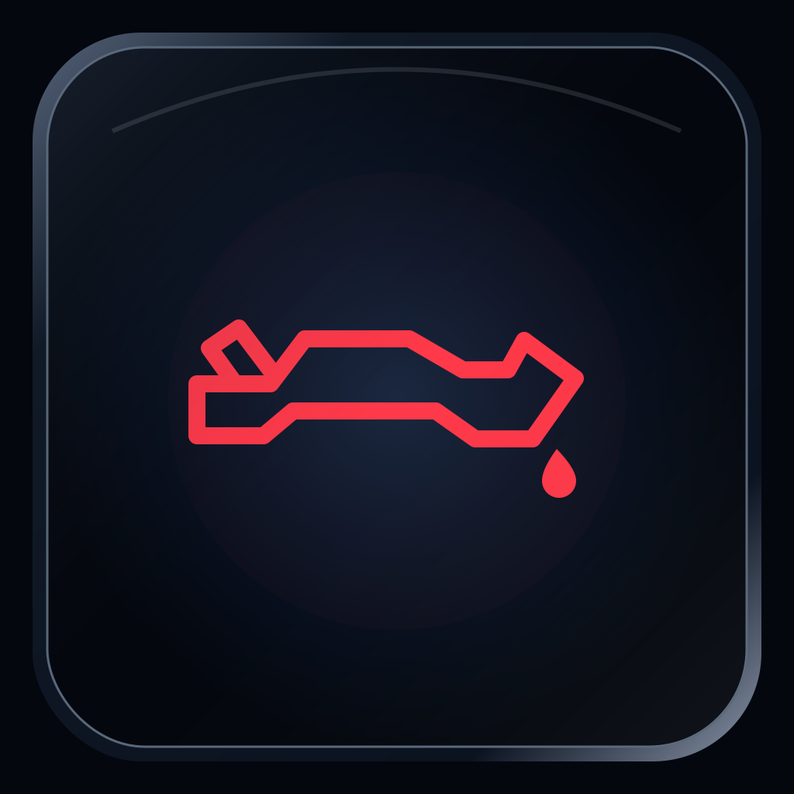

Caption: Oil pressure warning

Unanswered accessible description: Red oil-can outline with a droplet

File: `src/assets/illustrations-v2/images/dash_oil_pressure_individual_01.png`

File SHA-256: `caeb1476d5fd154f7fb69f946b4967f21a90fd523ef11b42a292d71414c0d702`

---

## dash-battery — Charging-system warning

Content SHA-256: `c366efb8b02f84dd640f010efd01e636ca5eac6c558e9ee8d550a56c93d69348`

Caption: Charging-system warning

Unanswered accessible description: Red rectangle with plus and minus markings

File: `src/assets/illustrations-v2/images/dash_battery_individual_01.png`

File SHA-256: `2b28f18dd2bfdd20551792013622544e603c3ca926e80eb12d03210564e3d0f6`

---

## dash-abs — Anti-lock braking system warning

Content SHA-256: `c38e28dda80ecbeb37268eef7e1e55957a502b362d8bc4243dc9dad6543115d9`

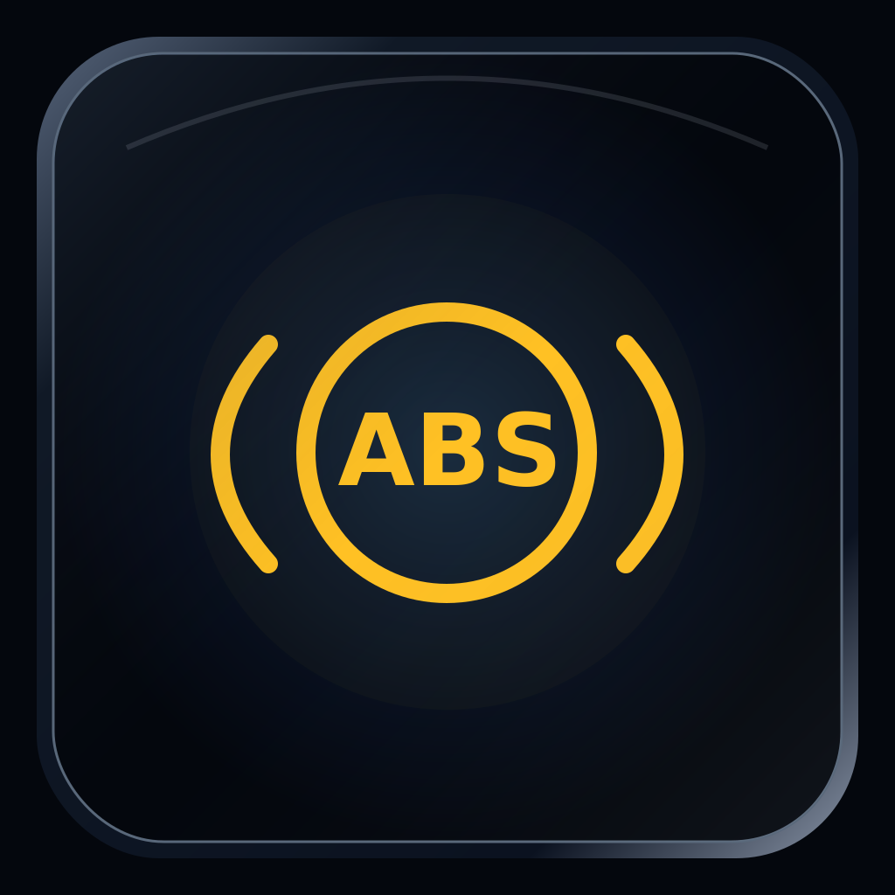

Caption: Anti-lock braking system warning

Unanswered accessible description: Amber circle containing the letters ABS

File: `src/assets/illustrations-v2/images/dash_abs_individual_01.png`

File SHA-256: `8ab8f2354f785dc8642838ef1cad7b26608581e14821884da355af1345fdddeb`

---

## dash-tyres — Tyre-pressure monitoring warning

Content SHA-256: `800c58d915575926d9834e709c5ceecacd253bf6a434c6c05fe806b6709b77a8`

Caption: Tyre-pressure monitoring warning

Unanswered accessible description: Amber open-topped outline containing an exclamation mark

File: `src/assets/illustrations-v2/images/dash_tyre_pressure_individual_01.png`

File SHA-256: `2dc8219859f7aa4eef78740fa1a1d54b9942d42eeae87d98130f244fff7494b8`

---

## dash-engine — Engine-management warning

Content SHA-256: `4199ab41977fba07066d4291d6c79bb589666c8527bed02a090d213a65f3787d`

Caption: Engine-management warning

Unanswered accessible description: Amber outline with a rectangular centre and a projecting side

File: `src/assets/illustrations-v2/images/dash_engine_management_individual_01.png`

File SHA-256: `e13e50b2011f35ab91f10445291918745910336d4fe3a1dd3f53a0f796313b13`

---

## dash-brakes — Brake-system warning

Content SHA-256: `93dc458f963bfb21d860afa21353ea8fdd27801a41b6e8a35d1d40943b690b33`

Caption: Brake-system warning

Unanswered accessible description: Red circle with an exclamation mark and curved brackets

File: `src/assets/illustrations-v2/images/dash_brake_system_individual_01.png`

File SHA-256: `7e676cdf244c9087d950751361d129bb23f3854eb4e6a1110cdfd7bf4c9ee9d7`

---

## dash-temperature — Engine temperature warning

Content SHA-256: `df16edb43c380bcd3ac8c1c89078c7cc49f9eac42b8222a18c3b4041a86d320a`

Caption: Engine temperature warning

Unanswered accessible description: Red thermometer above wavy lines

File: `src/assets/illustrations-v2/images/dash_coolant_temperature_individual_01.png`

File SHA-256: `d6d0aa12f0b6435a30b5c2c21fc72483734195e6d3d6abffa5efea3b9852a002`

---

## dash-airbag — Airbag-system warning

Content SHA-256: `0821395bd0563d727483a1e89660d668d458b520e3616fc5ad585d375d653714`

Caption: Airbag-system warning

Unanswered accessible description: Amber seated figure with a large circle in front

File: `src/assets/illustrations-v2/images/dash_airbag_individual_01.png`

File SHA-256: `82943f36816ef8b308316890dc3517933d9f8088482ec39263b0c1168b316ab6`

---

## dash-seatbelt — Seat-belt reminder

Content SHA-256: `34441ddb1e0b7e815d3b01b3a444c218c08de0b0faf1248c8b72db508c8147e7`

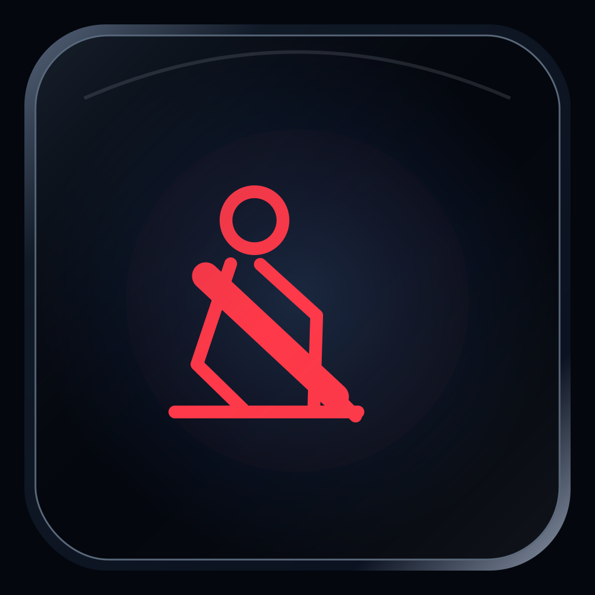

Caption: Seat-belt reminder

Unanswered accessible description: Red seated figure with a diagonal strap

File: `src/assets/illustrations-v2/images/dash_seatbelt_individual_01.png`

File SHA-256: `d07363255b4e5e677fcfe09c54cf24a5911aec09bf1c5de7959fd947220bac57`

---

## dash-stability — Stability and traction control

Content SHA-256: `b7283efb0646d400febba588b7b0edb5d195befaf62d590a4121b8926650de83`

Caption: Stability and traction control

Unanswered accessible description: Amber vehicle outline above two wavy tracks

File: `src/assets/illustrations-v2/images/dash_traction_control_individual_01.png`

File SHA-256: `e079b9c96c955296ee0777b8d52233fff9a3ed6f12bcb4ed17a63172d1a455b3`

---

## dash-fuel — Low fuel warning

Content SHA-256: `1b8e220efe4e23e68f9abbbd01707767136b74b8faefe5e48e30ba75e05e1b4a`

Caption: Low fuel warning

Unanswered accessible description: Amber rectangular pump outline with a hose

File: `src/assets/illustrations-v2/images/dash_low_fuel_individual_01.png`

File SHA-256: `80218463dc7c09491a6dc22590b03bd8e18710924674106def7a41a76fe34109`

---

## dash-main-beam — Main-beam indicator

Content SHA-256: `acb3c6e47ffdf0656f79f7df774426ab077ecd6d7ca53087aee0605a34954881`

Caption: Main-beam indicator

Unanswered accessible description: Blue lamp outline with straight horizontal rays

File: `src/assets/illustrations-v2/images/dash_main_beam_individual_01.png`

File SHA-256: `77c1cfc730c81a0f2b099e991d06155e51acdf4b9106ed2118daf06ad08f38c7`

---

## oil-dipstick — Checking engine oil with a dipstick

Content SHA-256: `ac7c62316de14cc180da98423b4f20143cdd08a30b07396978b04b1d2ad25727`

Caption: Checking engine oil with a dipstick

Unanswered accessible description: Yellow-handled rod beside an engine housing

File: `src/assets/illustrations-v2/images/vehicle_engine_oil_dipstick_original_01.png`

File SHA-256: `6bfe7d494860e5702178428b26c90e66ea106fc9c662c7ae0c48b434d2ed643c`

---

## brake-fluid — Checking the brake-fluid reservoir

Content SHA-256: `cfb6de010fc9067081a304f4e2740780e06f65f935e16eb937a6cbc8ecdc77b0`

Caption: Checking the brake-fluid reservoir

Unanswered accessible description: Small translucent fluid container with upper and lower marks

File: `src/assets/illustrations-v2/images/vehicle_brake_fluid_reservoir_original_01.png`

File SHA-256: `3d3a87ac7f810dd8e0e105bc1691aead0ee7a0e7a266fc28627cdeea2917ffb2`

---

## screenwash — Windscreen washer reservoir

Content SHA-256: `c17265692bd889c9e6943b88ab6b283642dcac7b05f057cf9e0ed809b61b69f3`

Caption: Windscreen washer reservoir

Unanswered accessible description: Fluid container with a drop-and-spray marking

File: `src/assets/illustrations-v2/images/vehicle_screenwash_reservoir_original_02.png`

File SHA-256: `5ebe4ea91de12f5c78e27a2f1e563e31e6c3ddf06396e84a4f6418760827ecf2`

---

## wiper-blade — Clear vision through the windscreen

Content SHA-256: `a1b77828125377a1c0646c74c07ca1596ac4179309305efdd50b15066f2bf271`

Caption: Clear vision through the windscreen

Unanswered accessible description: Single wiper blade across a wet windscreen

File: `src/assets/illustrations-v2/images/vehicle_windscreen_wipers_original_01.png`

File SHA-256: `75448af7596c384658e784c782acf03064521ace6d9285dd89b8b45579753add`

---

## seatbelt-fit — Wear the fitted seat belt correctly

Content SHA-256: `cd661eb8184a7c597ff26dd507c9a9978ad9d37a840d425d996e7fcd9b37bd17`

Caption: Wear the fitted seat belt correctly

Unanswered accessible description: Seated person with a diagonal belt and a buckle

File: `src/assets/illustrations-v2/images/vehicle_seatbelt_fastened_original_01.png`

File SHA-256: `9b7f390f6107a3d16bcd5b6e9b3452f69612c0c5d27fe332d57822a1968e03dd`

---

## child-harness — A correctly fitted child restraint

Content SHA-256: `6a49a9d69f0b0d2182157dee99d14691f6fe6086dcfc762ed9aa934b0a2cd746`

Caption: A correctly fitted child restraint

Unanswered accessible description: Child seated in a restraint with a shoulder harness

File: `src/assets/illustrations-v2/images/vehicle_child_seat_harness_original_02.png`

File SHA-256: `ceb594c1edaf23109f0b8e0c7e0a110f88dff6e4911cce1dabfe00bca40c004c`

---

## secure-luggage — Secure luggage before travelling

Content SHA-256: `04ea0b14cc5a2f722e8d3d159d18a9e1aa53dabc6f0d1ab15d47cb3d64ea6780`

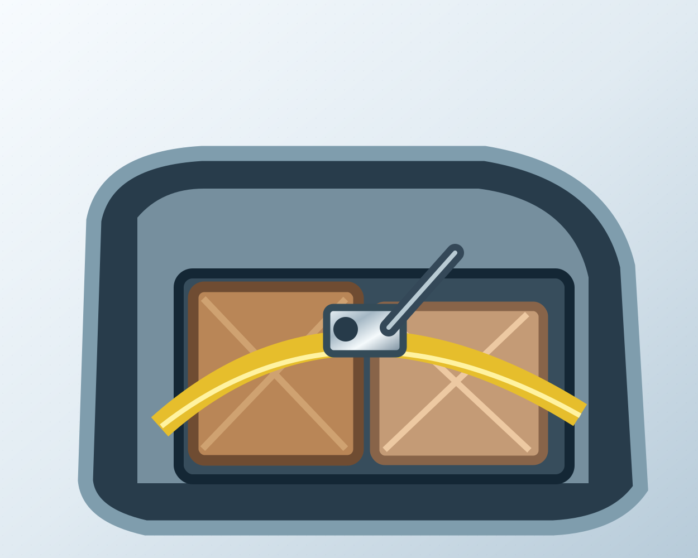

Caption: Secure luggage before travelling

Unanswered accessible description: Luggage in an open boot held by straps

File: `src/assets/illustrations-v2/images/vehicle_secure_boot_load_original_02.png`

File SHA-256: `40f0eaca6c828d8a9b6d2b490f288ac71e9ed0c99c7277b2f7c0460b71f18475`

---

## rearview-adjustment — Adjust mirrors before moving

Content SHA-256: `f93298b526a55c9846562a954268469101a52ea039ef277ab4cc49afa226ace9`

Caption: Adjust mirrors before moving

Unanswered accessible description: Interior mirror showing a vehicle behind

File: `src/assets/illustrations-v2/images/vehicle_rearview_mirror_original_02.png`

File SHA-256: `1d29ee669e6b26a5ce76ec90051dd42f66756bacf8485f344d1bc9895d6b462e`

---

## headlights-example — Check and use the vehicle lights correctly

Content SHA-256: `5abc8c9eddcd9b0b87dd502f2040a641a9a17d4da89b70937b47e5867f647455`

Caption: Check and use the vehicle lights correctly

Unanswered accessible description: Illustration of a vehicle headlamp

File: `src/assets/illustrations-v2/images/vehicle_headlight_dipped_beam_original_01.png`

File SHA-256: `43625940dbb201b14c371b8cae5611f09e4fd7fe1053ca00cf784a610f31e59b`

---

## zebra-priority-example — Give way to people using a zebra crossing

Content SHA-256: `8f4b23267f0e54a0f2b34553ea246bc04e38c49eb2fa1adbde521e3ac44cff58`

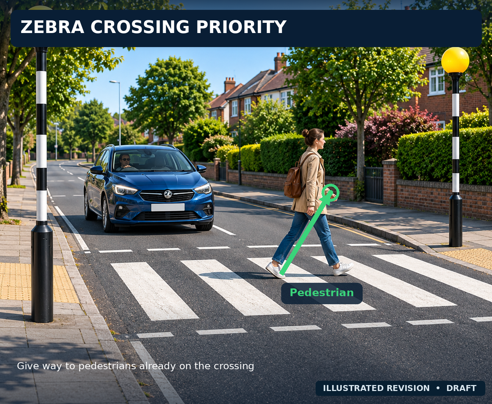

Caption: Give way to people using a zebra crossing

Unanswered accessible description: Annotated crossing scene with a pedestrian and a waiting vehicle

File: `src/assets/illustrations-v2/images/crossing_zebra_pedestrian_priority_explanation_01.png`

File SHA-256: `f2206d2ad2fbd8e8098a63adb780c3789f09ee02cec8659143f7e1ca5404f272`

---

## stop-example — STOP: stop at the line before proceeding safely

Content SHA-256: `5f89fb34fd8219feab4df74b29b2bcd92a120b5591a15a9038de2fc94c8f81ac`

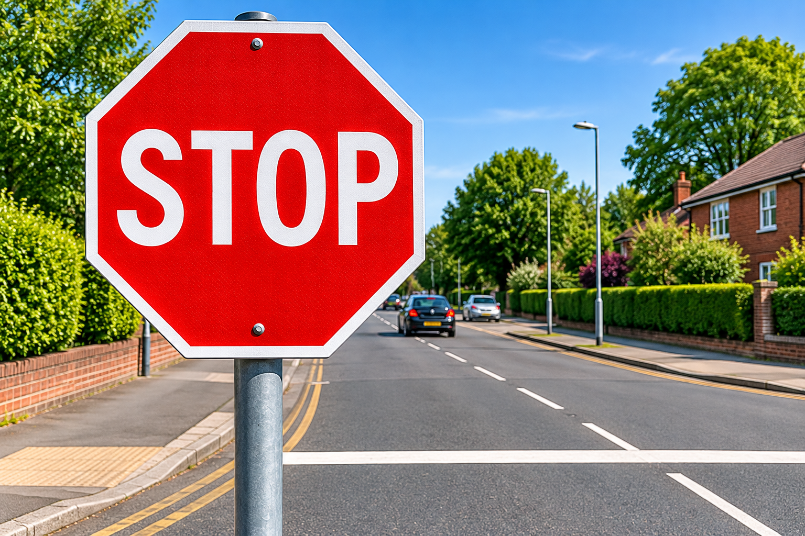

Caption: STOP: stop at the line before proceeding safely

Unanswered accessible description: Roadside red octagonal sign beside an approach

File: `src/assets/illustrations-v2/images/reg_stop_roadside_scene_01.png`

File SHA-256: `603e2adc2b5095e2561865b9ec78bf3c577a368b3f634eb8fa64df1702f16861`

---

## give-way-example — Give way to traffic on the major road

Content SHA-256: `ae2985ff528c323e8f087b645d6db60d03095d4622a88c10c19d5d6d4e38f008`

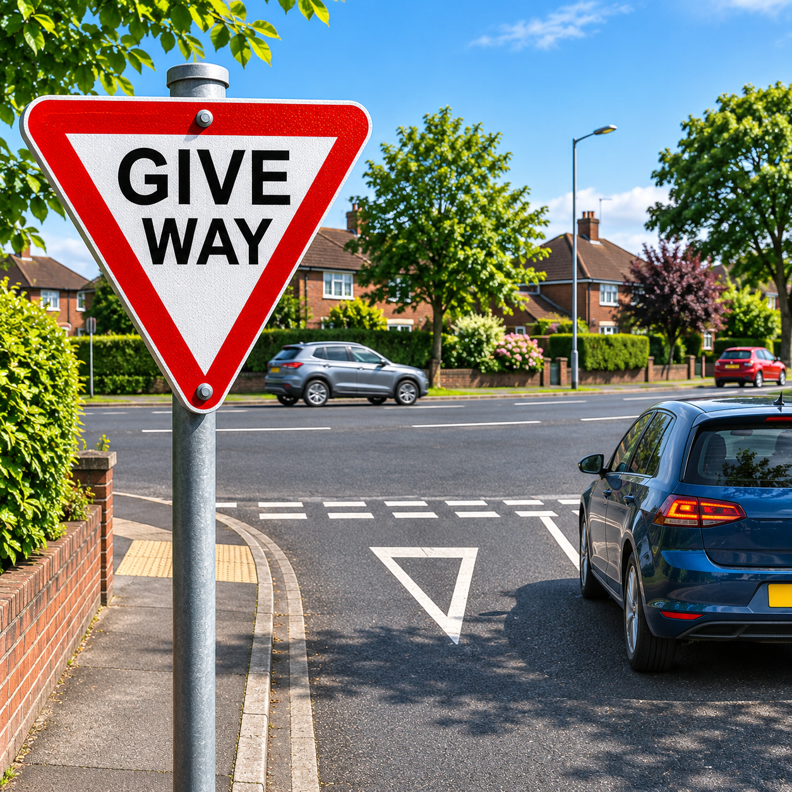

Caption: Give way to traffic on the major road

Unanswered accessible description: Inverted triangular roadside sign beside junction markings

File: `src/assets/illustrations-v2/images/reg_give_way_roadside_scene_01.png`

File SHA-256: `f867bbf9e7b2d99c8e4749c2d04ae0f80948f7d49469259249d6f980e6b5969e`

---

## box-junction-example — Keep the box clear; check the right-turn exception

Content SHA-256: `410196ff5c8e05a4aed0e2484fabba70435f0d76e28979b5e12681d3883cdfbb`

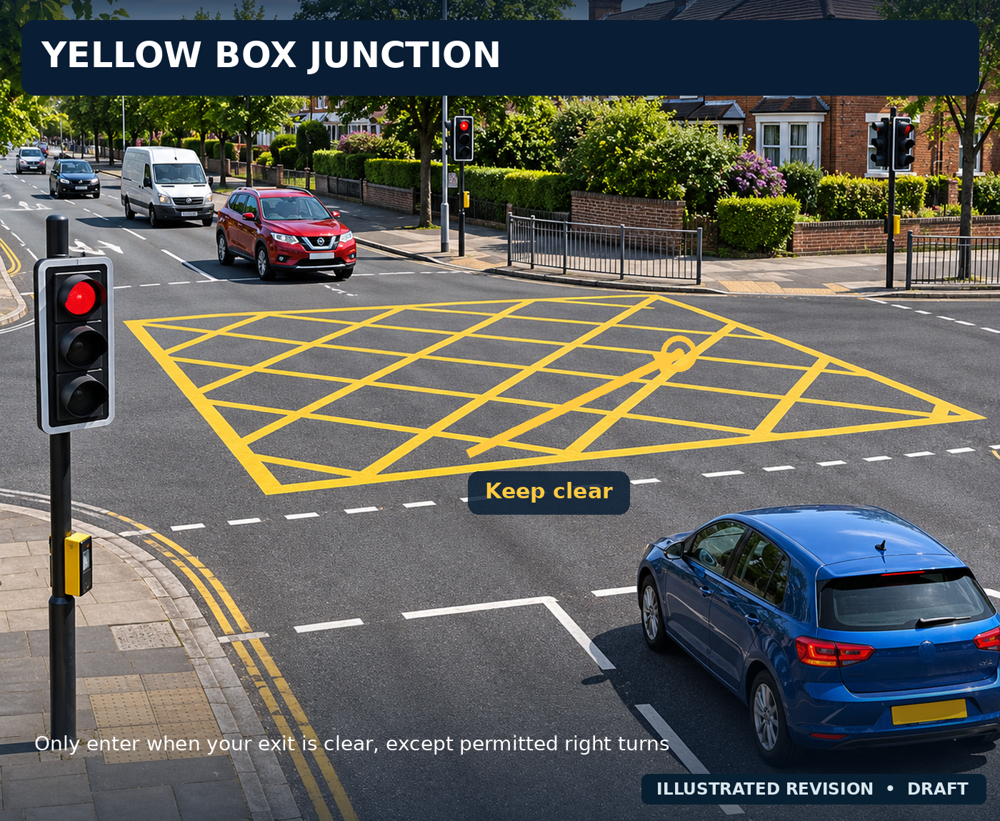

Caption: Keep the box clear; check the right-turn exception

Unanswered accessible description: Annotated yellow box junction and traffic

File: `src/assets/illustrations-v2/images/junction_yellow_box_exit_clear_explanation_01.png`

File SHA-256: `b9c46a74cc32b45a43fdfd91f5b319973d472f9e07466d844d5210c2a7a64664`

---

## no-entry-example — No entry for vehicular traffic

Content SHA-256: `7fed3e9c6fcfabb720083607ed6da2acfcaf6d133f7e9856c86c81ee2b727535`

Caption: No entry for vehicular traffic

Unanswered accessible description: Roadside red circular sign with a horizontal white bar

File: `src/assets/illustrations-v2/images/reg_no_entry_roadside_scene_01.png`

File SHA-256: `54f77a11a68592b627451dc4aefada58e84d179023126e24635c7e2dbb9cd145`

---

## no-motor-example — No motor vehicles

Content SHA-256: `4e13d3541723e711189d8dfb96e627b8f5fefd5cd331eec04594d4caa53edd8d`

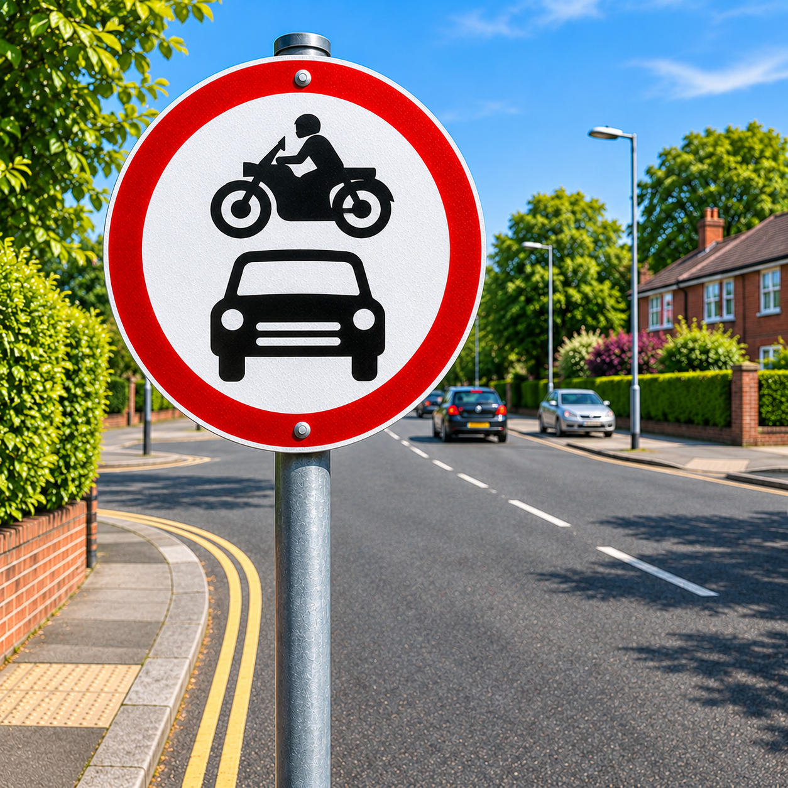

Caption: No motor vehicles

Unanswered accessible description: Red-bordered circular sign containing car and motorcycle symbols

File: `src/assets/illustrations-v2/images/reg_no_motor_vehicles_scene_01.png`

File SHA-256: `2072f553952c8e2cfd2207ad71620ee76c5b3cc39048b7cd95231de2d78c70eb`

---

## ahead-example — Follow the ahead-only instruction

Content SHA-256: `7f838f6ca094ae5926a1ca283243dd9a03bf9d5ed6aa378def5c519950cd5ee5`

Caption: Follow the ahead-only instruction

Unanswered accessible description: Blue circular roadside sign with a white upward arrow

File: `src/assets/illustrations-v2/images/reg_ahead_only_scene_01.png`

File SHA-256: `4138d309fa87a8f4b92f4a776a465fd4bf73f6eadecb951d1a9fd581658dac94`

---

## no-overtaking-example — No overtaking restriction

Content SHA-256: `e777e47f170335d32b15fe5dedd901a27249dffde0853140a7fbd0d9c276cc80`

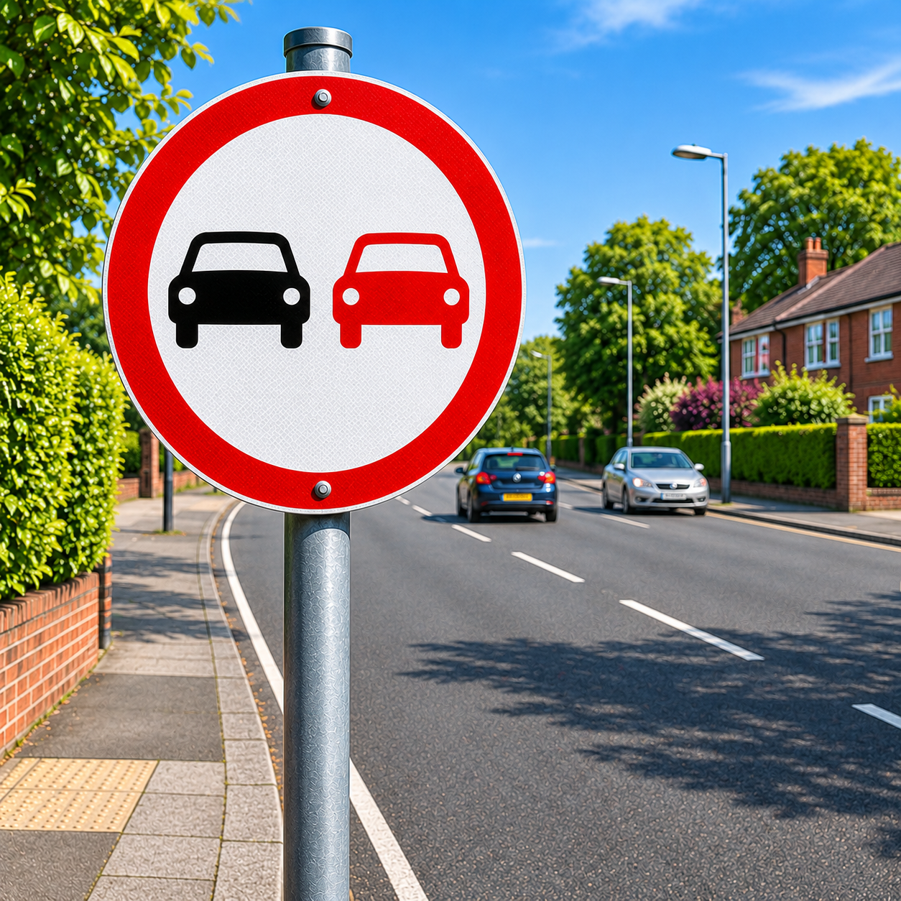

Caption: No overtaking restriction

Unanswered accessible description: Red-bordered roadside sign showing two cars

File: `src/assets/illustrations-v2/images/reg_no_overtaking_scene_01.png`

File SHA-256: `57afa5b2fe4b16e72f7f72d1154f4083accd5194446481a01a6e180384e34fcf`

---

## narrowing-example — Road narrows on both sides

Content SHA-256: `24b55892c2b8054599e674d46fbbb328ae0a251adeaa6349d51942b9c338e78f`

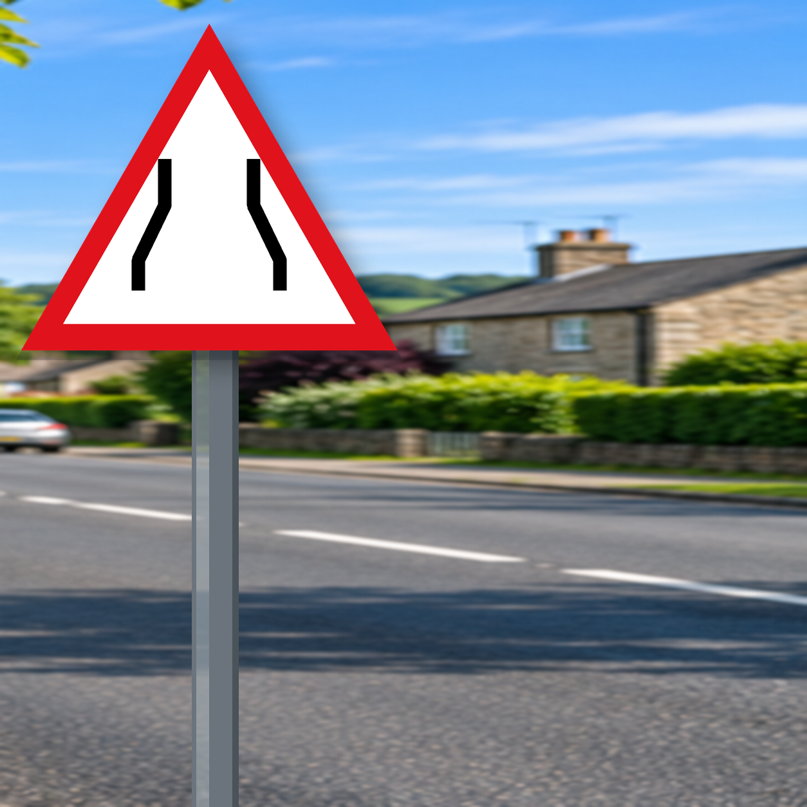

Caption: Road narrows on both sides

Unanswered accessible description: Triangular warning sign with two lines converging

File: `src/assets/illustrations-v2/images/warn_road_narrows_both_scene_01.png`

File SHA-256: `5feb64fb7fe0ff95a774e1119335417b1efe8a1060954226620b04c8ca134357`

---

## double-bend-example — Double bend, first to the left

Content SHA-256: `1f214d571a10db6379cf8a588a69717a166a5bc376eb6f39b69f5ffa4d7edf2e`

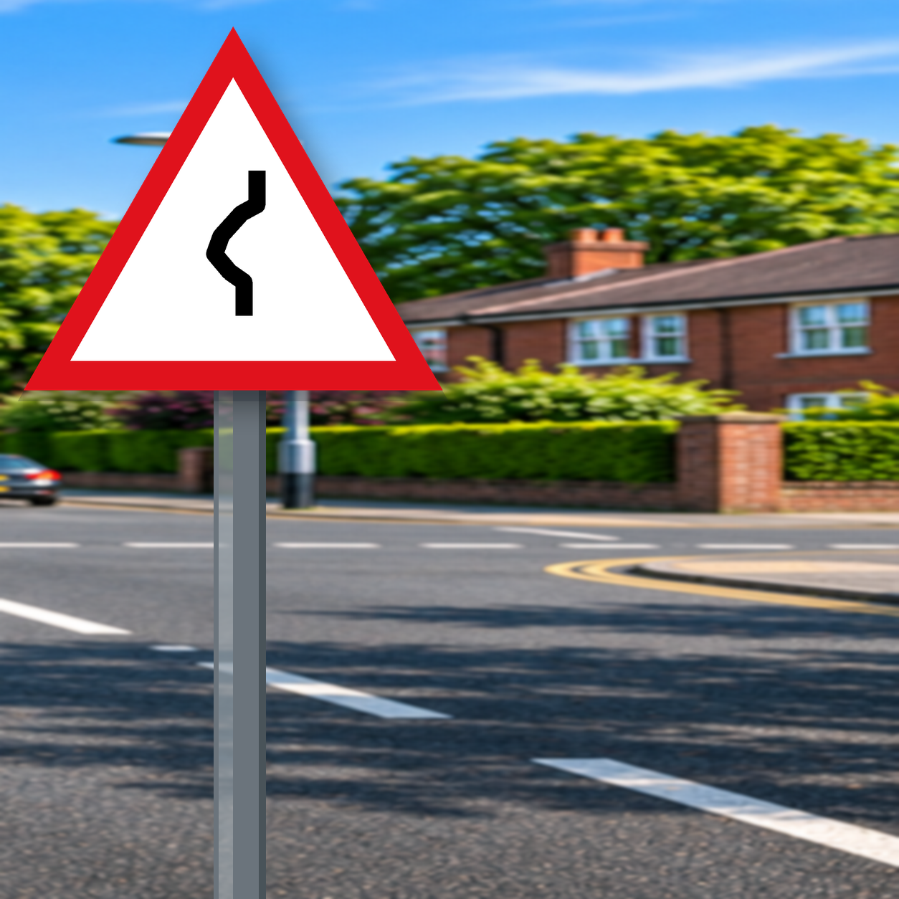

Caption: Double bend, first to the left

Unanswered accessible description: Triangular warning sign containing a winding line

File: `src/assets/illustrations-v2/images/warn_double_bend_scene_01.png`

File SHA-256: `8cba84651e9d9e5dcb8e404e105655673bdd93d7aea660e909095b2a1721c924`

---

## steep-descent-example — Prepare for a steep descent

Content SHA-256: `70bdc3437973d2562d7591f4ee4cbb2ac75634eaa8110226ac0427f02d90d6ef`

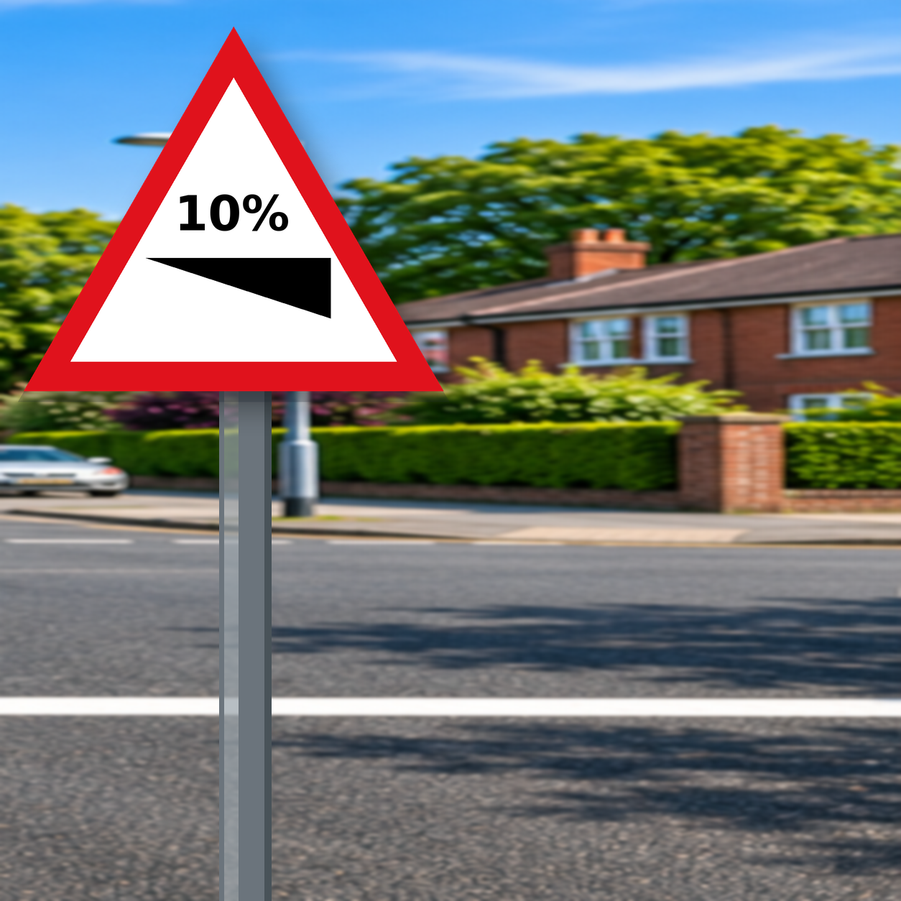

Caption: Prepare for a steep descent

Unanswered accessible description: Triangular roadside sign with a downward slope and percentage

File: `src/assets/illustrations-v2/images/warn_steep_hill_down_scene_01.png`

File SHA-256: `5c776d588444a82c780538fb760ff5407f67189fea6541bfbd34df9351584d5e`

---

## speed-30-example — 30 mph maximum speed

Content SHA-256: `f6cd74083fa8d7c9e128035b561dd952f6d9ebb072240e789395fabe698e287e`

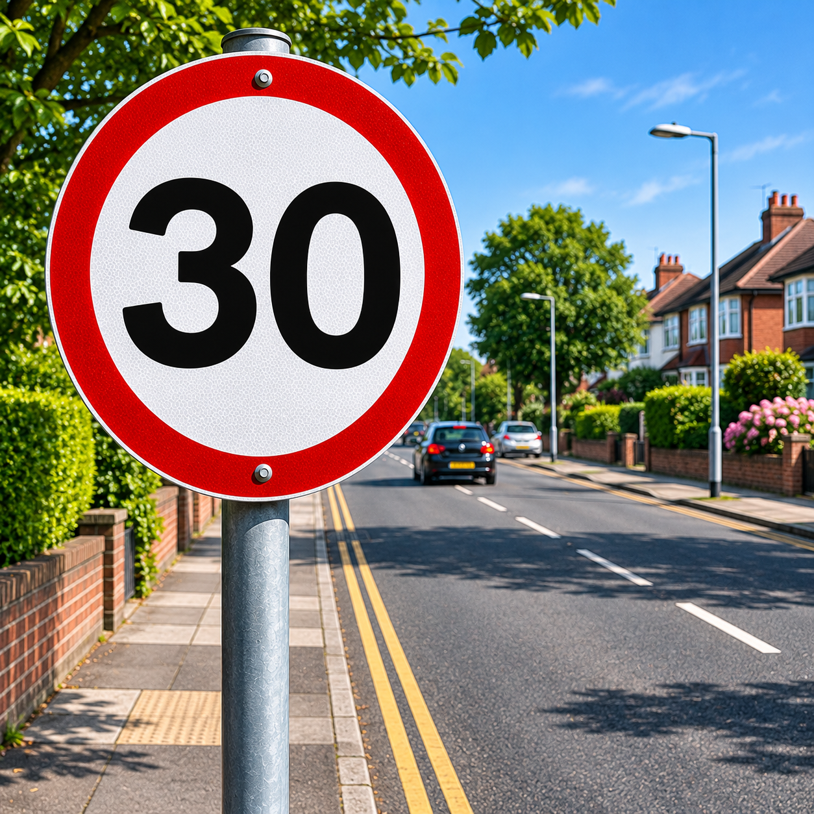

Caption: 30 mph maximum speed

Unanswered accessible description: Red-bordered circular roadside sign displaying 30

File: `src/assets/illustrations-v2/images/reg_speed_limit_30_roadside_scene_01.png`

File SHA-256: `ff4d08fd4a6d486725cbe8c5e96b1502119c48678e185c27c7c23594cedd8e3b`

---

## speed-50-example — 50 mph maximum speed

Content SHA-256: `7ebf25d8bfe0ebdaafdba8fa0062001787a26aa1552857d6a5f40a7142741ac2`

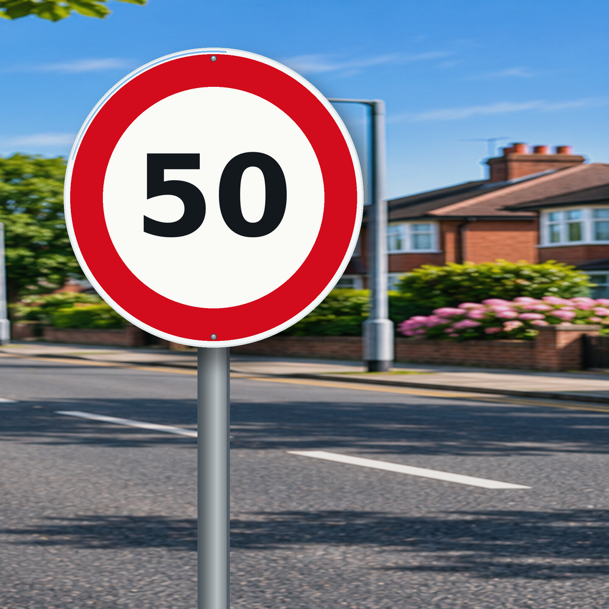

Caption: 50 mph maximum speed

Unanswered accessible description: Red-bordered circular roadside sign displaying 50

File: `src/assets/illustrations-v2/images/reg_speed_limit_50_roadside_scene_01.png`

File SHA-256: `d205709feb27fb23774f42afce3cdf3988bbcb4c732b55aa278247fdef0990a8`

---

## national-limit-example — National speed limit applies

Content SHA-256: `14e3f909e0962c68e8d134528b6373c38914916a0849cc525e9bd442fd0115a5`

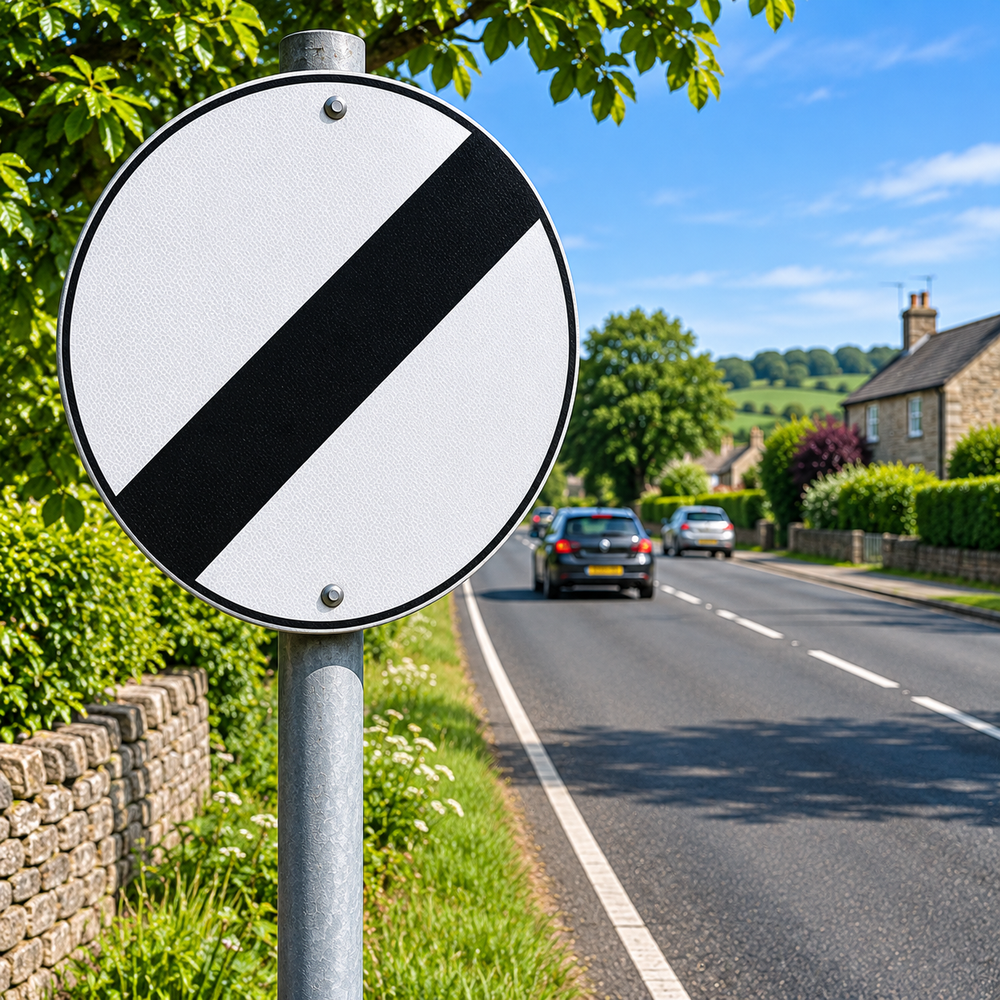

Caption: National speed limit applies

Unanswered accessible description: Roadside white circle with a diagonal black stripe

File: `src/assets/illustrations-v2/images/reg_national_speed_limit_roadside_scene_01.png`

File SHA-256: `929e55bb08572f37745b9ad920027fec59dd844a5af1fe07aba7de05f2322e6e`

---

## keep-left-example — Pass to the left of the obstruction

Content SHA-256: `6dbbf350a5dee952eee059e47244c69da6d596bf82cd23e724a67ff8b8fa536c`

Caption: Pass to the left of the obstruction

Unanswered accessible description: Blue circular arrow on a traffic-island bollard

File: `src/assets/illustrations-v2/images/reg_keep_left_bollard_scene_01.png`

File SHA-256: `d4bac4aa5e9f7408ff32a68fb8ab0334e327f7ca223349acd4dc0479a76f4fa7`

---

## signals-example — Traffic signals ahead

Content SHA-256: `3c7bf60837c4ec1e00ac4c0b792d71db34e3b58be71ccc309835fb2d1b4133c0`

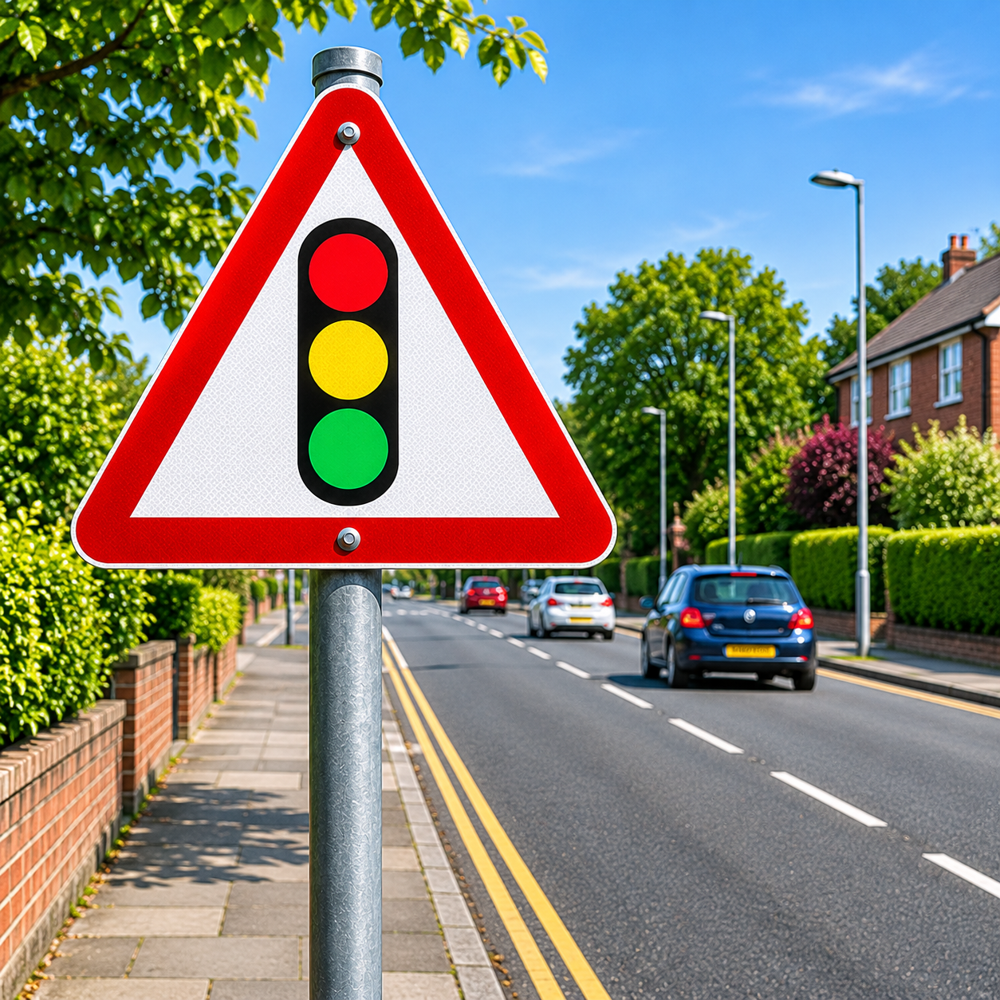

Caption: Traffic signals ahead

Unanswered accessible description: Triangular roadside sign showing a three-lamp signal

File: `src/assets/illustrations-v2/images/warn_traffic_signals_ahead_roadside_scene_01.png`

File SHA-256: `c26f22382e2962b7a5f1ac30fc9f8178e9b5c6a308e8ea1a3d206d2c0f91b551`

---

## no-u-turn-example — No U-turn restriction

Content SHA-256: `885758219b6049de7b68bda891cc7fd89f47a18b6ec13caf526aad5875e4fc50`

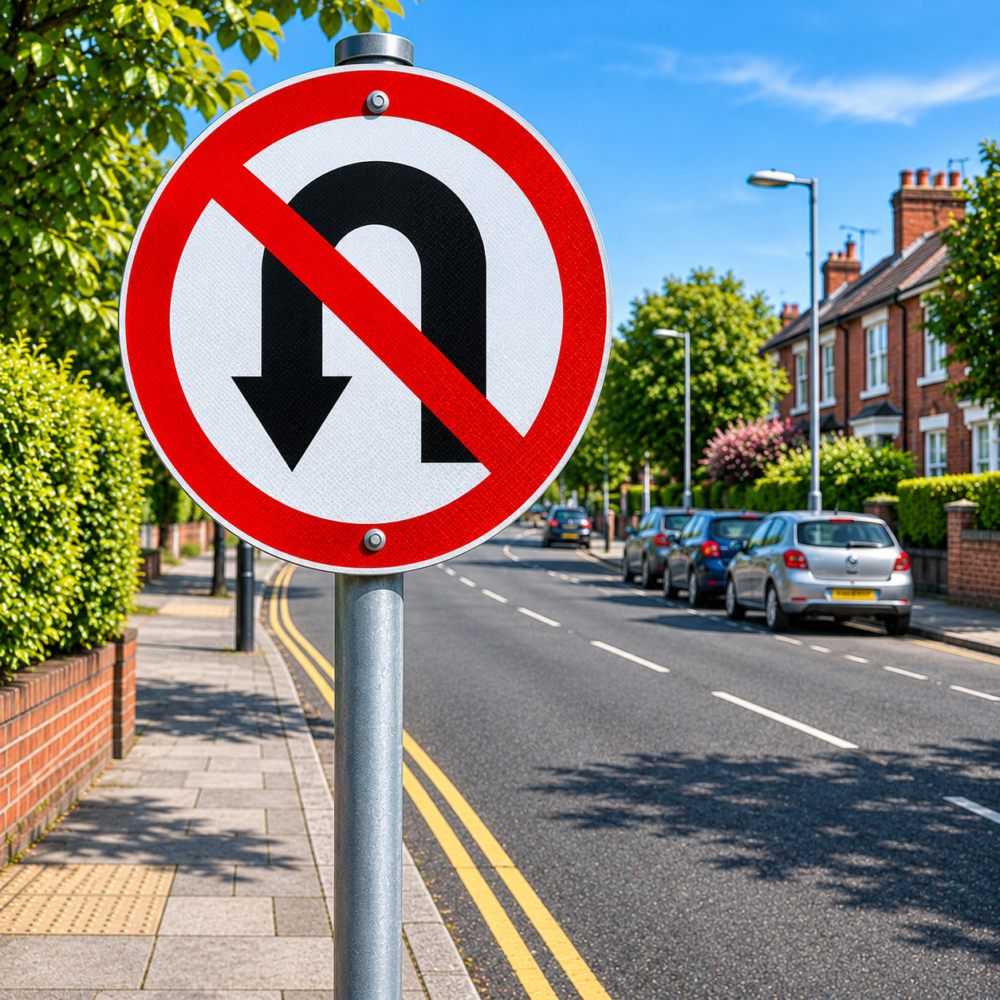

Caption: No U-turn restriction

Unanswered accessible description: Roadside red-bordered sign with a crossed turning arrow

File: `src/assets/illustrations-v2/images/reg_no_u_turn_scene_01.png`

File SHA-256: `2d533ce85cdf099fadaec34c4fa193f541393df3d7e4a356404f80eb456a1ed7`

---

## bend-right-example — Bend to the right ahead

Content SHA-256: `073abbca965d172dcac2bf65df5e9ee624af47b036376d89923b881de3669b72`

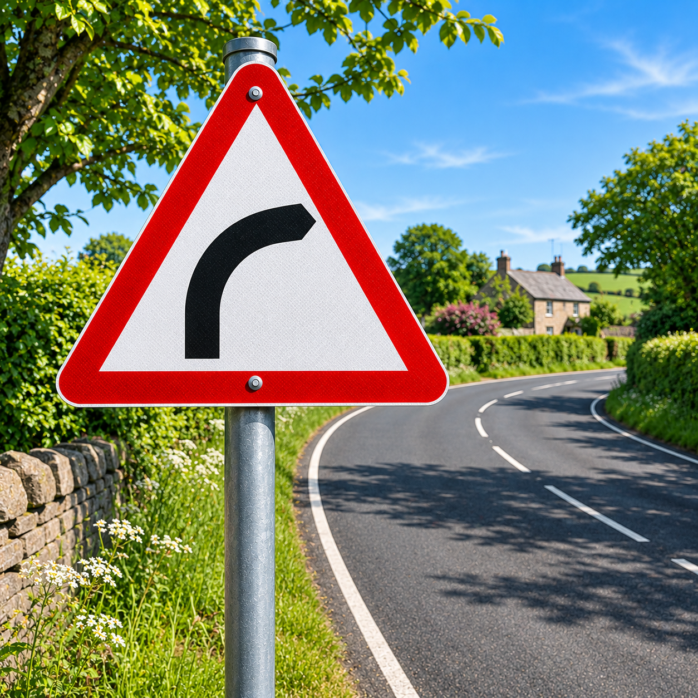

Caption: Bend to the right ahead

Unanswered accessible description: Triangular warning sign with a line bending right

File: `src/assets/illustrations-v2/images/warn_right_bend_scene_01.png`

File SHA-256: `2646989cff9832dbea3baaedec86568e0ee5038b25e82faf70466d0f84b2dafd`

---

## slippery-example — Slippery road warning

Content SHA-256: `e7d839546f45984a8c9fb3ff20f7fe39a2f505ae212250a97bb2d1ada1d0624c`

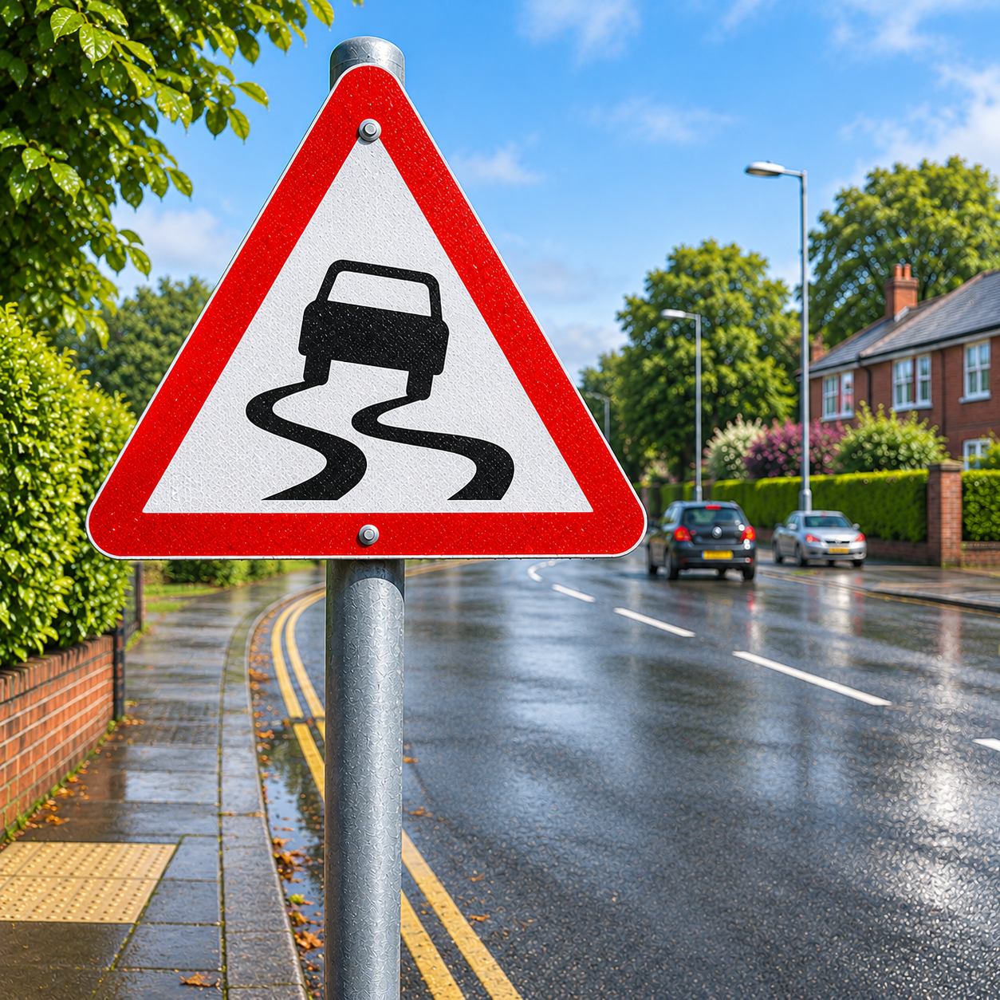

Caption: Slippery road warning

Unanswered accessible description: Triangular sign with a car and two winding tracks

File: `src/assets/illustrations-v2/images/warn_slippery_road_scene_01.png`

File SHA-256: `cd6b2cd83f5fc3268a99bfee82f88a709a7762abbaabdd07d5a5557ab6a8ee7b`

---

## school-example — Children going to or from school

Content SHA-256: `6b14b571ba769daecf2e47c3566e988404eca0fac4d34c4135ef2f9a7ba15381`

Caption: Children going to or from school

Unanswered accessible description: Triangular warning sign showing two children

File: `src/assets/illustrations-v2/images/warn_school_children_scene_01.png`

File SHA-256: `100ebba3a2246d477200d0d01b3f88feb5978dc86d2327228b1838c2270907d0`

---

## speed-40-example — 40 mph maximum speed

Content SHA-256: `e2a42c603d8b7606ef8ae8c455f40cdbc286ad40326c74a76c85b6edf3f67553`

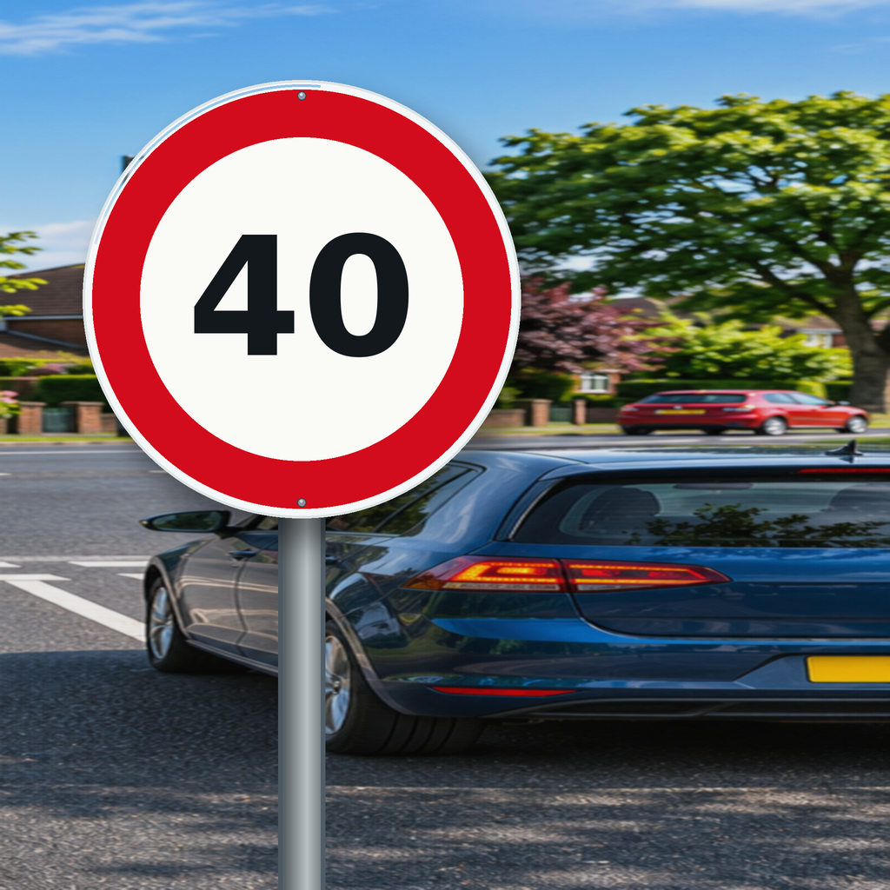

Caption: 40 mph maximum speed

Unanswered accessible description: Red-bordered circular roadside sign displaying 40

File: `src/assets/illustrations-v2/images/reg_speed_limit_40_roadside_scene_01.png`

File SHA-256: `b71ef0e4f1bc7a8cf2854aa741eb71017a584a1d8c225079cd5acd294e9eadfc`

---

## turn-left-example — Turn left as directed

Content SHA-256: `c50fbc5093ea16866015aedecbe05320719a23814b53b907151b9f6651fa645d`

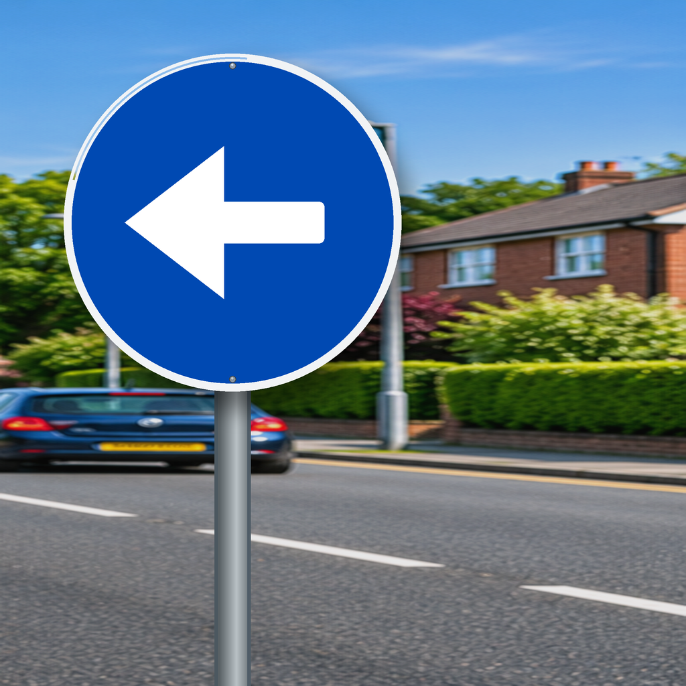

Caption: Turn left as directed

Unanswered accessible description: Blue circular roadside sign with a left-pointing arrow

File: `src/assets/illustrations-v2/images/reg_turn_left_only_roadside_scene_01.png`

File SHA-256: `a36cd19dfb4e6e0ed3679bb230e1ff82ae08b1733d811e4da01061302e34421d`

---

## crossroads-example — Crossroads ahead

Content SHA-256: `ee2fcd08402b662ae164d542c272397822aec3a4f00a3e88aa9274d7072b4514`

Caption: Crossroads ahead

Unanswered accessible description: Triangular warning sign containing a black cross

File: `src/assets/illustrations-v2/images/warn_crossroads_scene_01.png`

File SHA-256: `980d38876718bdd927246c455ed0df36b9089974de2b1f561afecf4d9943591c`

---

## two-way-example — Two-way traffic warning

Content SHA-256: `e0244bb18f43c4c331e899657274a25b271d315d0ef42024af3cbab44c899061`

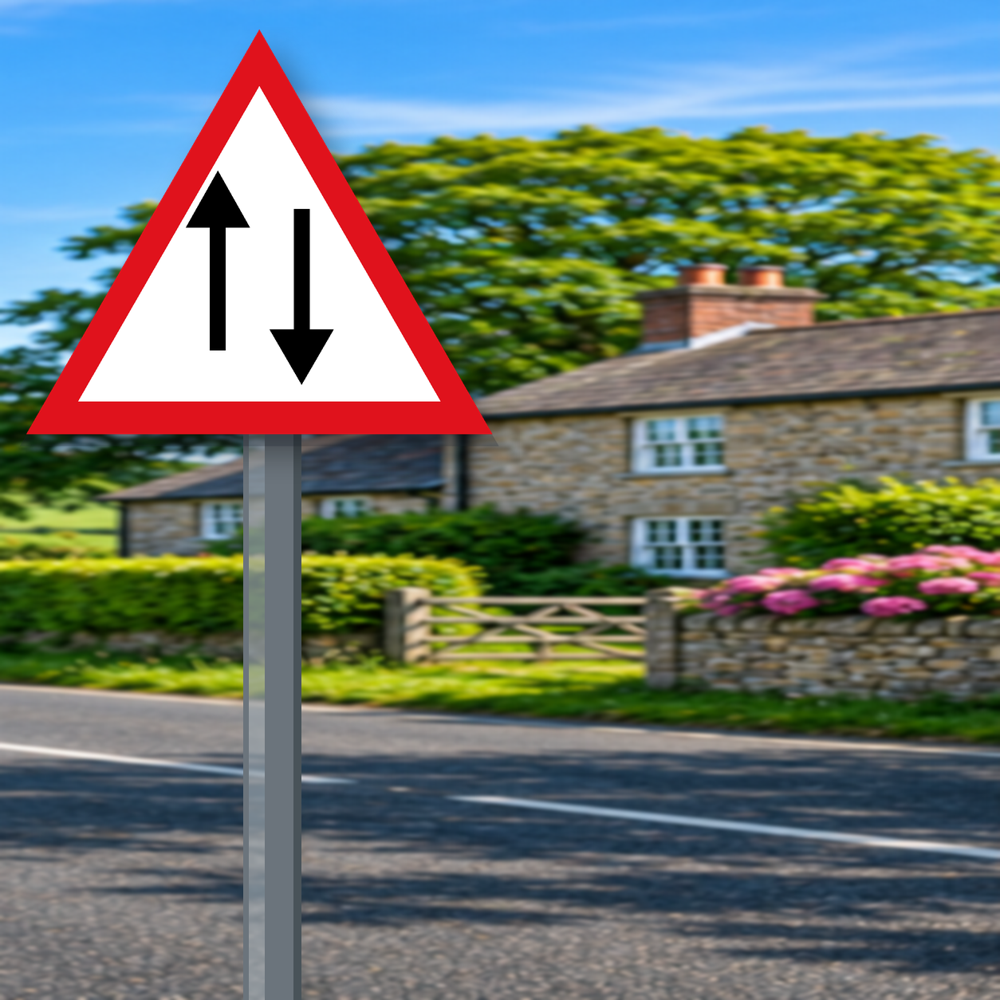

Caption: Two-way traffic warning

Unanswered accessible description: Triangular sign with two arrows pointing in opposite directions

File: `src/assets/illustrations-v2/images/warn_two_way_traffic_scene_01.png`

File SHA-256: `cd256d2236d923fd22c48e3e06aee5a9b527c933ae251b00baddb260e6176786`

---

## zebra-crossing — Zebra crossing illustration

Content SHA-256: `e9d86687acc0982327094cffd00a34c456c0cca601d80d5a6699745d8ef1fee2`

Caption: Zebra crossing illustration

Unanswered accessible description: Road with striped pedestrian crossing

File: `src/assets/zebra-crossing.png`

File SHA-256: `955cd8d6aa932c3418e04b48cf428c60d08a3d50da80e0f08e1eae6f5fb2a5e1`

---

## no-entry — No entry

Content SHA-256: `4aeb7cfbec4256716596ed4c591fc6503e07a31e55aa7146dd50f30e3f997c93`

Caption: No entry

Unanswered accessible description: Red circular sign with a horizontal white bar

File: `src/assets/dft-signs/no-entry.png`

File SHA-256: `f5a842891867864030ed0a76d4a1917af303645bfcb67adbc531c7dd0e516d77`

---

## stop-sign — STOP sign

Content SHA-256: `07cc39995bdc5b33ce6ba570d680d2dbb35f4faffe79e7c6241b7e1a60614449`

Caption: STOP sign

Unanswered accessible description: Red octagonal sign bearing white STOP lettering

File: `src/assets/dft-signs/stop.png`

File SHA-256: `6878c730b895e53ff9686d29bec3aa458c632568fe718524e0cb01b78b925ab2`

---

## give-way — GIVE WAY sign

Content SHA-256: `6413568f4aa681161bfc879affa1664603f12649016267d95ba6de59b52ae325`

Caption: GIVE WAY sign

Unanswered accessible description: Downward-pointing white triangle with a red border

File: `src/assets/dft-signs/give-way.png`

File SHA-256: `697a6fdb5f262ec2464fe9944f2bbffaf7ba6bac6545f7f392c666640c760d95`

---

## speed-limit-30 — 30 mph maximum speed sign

Content SHA-256: `0303f77a78bde1b3dcea81fb594560a3128c94fb0dc533771915fe791ec79edc`

Caption: 30 mph maximum speed sign

Unanswered accessible description: White circular sign with a red border and black number 30

File: `src/assets/speed-limit-30.png`

File SHA-256: `44a7878d22b5a046acc3919d79235f2202fe910c929ef248bb9c1c64dec9b781`

---

## speed-limit-50 — 50 mph maximum speed sign

Content SHA-256: `747c62b0f09e6e131b1fff01ab9f1ff589a7f1c88878e219c035f73b679a640c`

Caption: 50 mph maximum speed sign

Unanswered accessible description: White circular sign with a red border and black number 50

File: `src/assets/speed-limit-50.png`

File SHA-256: `fe8109643e95f2be88400db16b4735b6d219924818e462538af899067ddcd34c`

---

## national-speed-limit — National speed limit applies

Content SHA-256: `de337bf23aa7f204fe3834455e2585abda7eca939d0d2e8559a62863d154321a`

Caption: National speed limit applies

Unanswered accessible description: White circular sign with a black diagonal stripe

File: `src/assets/dft-signs/national-speed-limit.png`

File SHA-256: `da34db86353d4b5618292901bbc9ab959aebde88d8351ccacbfab13219274041`

---

## keep-left — Keep left

Content SHA-256: `af987e230967174f46734bc938f58bf2e727e9413b811d5ac304f30a55b3714b`

Caption: Keep left

Unanswered accessible description: Blue circle with a white arrow pointing diagonally down to the left

File: `src/assets/dft-signs/keep-left.png`

File SHA-256: `a132e5572eae4cacf02faf287acfa5e9a9f61cced546f3e2c7e90a1142e0f2d3`

---

## signals-ahead — Traffic signals ahead

Content SHA-256: `8c3c82a3aa409e2e9b37a9c7ec851618bc1a8e9a06c86eddd72a08b17c27928d`

Caption: Traffic signals ahead

Unanswered accessible description: Upright red-bordered triangle containing a traffic-light symbol

File: `src/assets/dft-signs/signals-ahead.png`

File SHA-256: `08ea254035dcd36e8d769dea63d07ef6bfa8647804b341d9820806944e058f55`

