# Lessons — independent review copy

Review every entry against current primary sources, its presentation and linked media. Record judgement in `LESSON_REVIEW_TRACKER.csv`; do not approve by sampling.

## lesson-driver-fitness — Being fit to drive

Content SHA-256: `e02c6abc70462dfaa4e3c062ed28728f4d5e08b327d6b1488200443caa62747d`

Module: `module-foundations` · content version 1 · estimated 2 minutes

### Objectives

- Recognise when health, tiredness or substances make driving unsafe.
- Plan a safe response before the journey starts.

### Start with the driver

A safe car cannot compensate for a driver who cannot concentrate or control it. Assess your sleep, vision, health and medicines before collecting the keys. Feeling determined to finish a journey is not evidence of fitness. A heavy meal, a warm cabin and a monotonous road can make tiredness harder to recognise. Plan a realistic journey rather than treating rest as something to earn after arrival. If you are already tired, postpone the drive or arrange another driver.

### Know the legal duties

You MUST meet the eyesight requirement and wear glasses or contact lenses while driving if you need them to meet it. You MUST report to DVLA a health condition likely to affect driving. You MUST NOT drive while impaired by alcohol, drugs or medicines. Scotland has lower legal alcohol limits than England and Wales; counting drinks is not a reliable test of safety. Alcohol can still impair you the next morning, and coffee does not remove it from your body.

### Manage the journey

The Highway Code recommends a break of at least 15 minutes after every two hours of driving. That is planning advice, not permission to continue until two hours have passed when you become sleepy sooner. Stop somewhere suitable, such as a service area or designated parking place. A hard shoulder or emergency area is not a rest stop. Ask a pharmacist or doctor about a medicine that may affect driving; a legal prescription does not make impaired driving safe.

At night or in poor visibility, do not use tinted glasses, lenses or visors if they restrict your vision.

### Put it into practice

You slept poorly and are due to drive for several hours. Before leaving, you arrange a later departure and a rested driver rather than relying on an open window. If sleepiness develops on the road, you look for a safe stopping place instead of pushing on to the planned break.

### Recap

- Decide fitness before moving.
- Treat sleepiness as a reason to stop safely.
- Follow eyesight, medical-reporting and impairment requirements.

### Sources

- [Highway Code, Rules 90 to 97](https://www.gov.uk/guidance/the-highway-code/rules-for-drivers-and-motorcyclists-89-to-102)

Mapped questions: `gb-safety-002`, `gb-safety-003`, `gb-safety-004`, `gb-safety-005`, `gb-safety-006`, `gb-safety-007`

---

## lesson-documents — Licence, insurance and legal readiness

Content SHA-256: `7b6fb96e264475d60180b476d3a395e32390de98926e5827ba4bc853b24e628b`

Module: `module-foundations` · content version 1 · estimated 2 minutes

### Objectives

- Check that the driver and vehicle are legally ready for the trip.
- Distinguish a certificate from ongoing roadworthiness.

### Permission belongs to this journey

Before driving, confirm that your licence covers the vehicle category and that valid insurance covers your use of that vehicle. A friend owning an insured car does not automatically make you an insured borrower. Ask about restrictions instead of assuming that comprehensive cover allows every person to drive every car. You MUST hold the appropriate valid licence and insurance. Keep your licence details up to date and notify DVLA when your name or address changes.

### The vehicle must remain roadworthy

An ordinary car normally needs its first MOT after three years and then annually, with exceptions for some vehicles. Check the current requirement for the particular vehicle rather than memorising an exception as a general rule. A valid MOT is a record of a test, not a promise that a tyre, light or brake cannot subsequently become defective. The car must be legal and roadworthy whenever used. Tax or an applicable exemption, registration duties and insurance are separate responsibilities.

### Learning has conditions

A car learner needs a valid provisional licence and an eligible supervisor. For ordinary private supervision, the supervisor must be at least 21 and have held the suitable full licence for at least three years. Learner plates must be clearly displayed front and rear; red D plates are an alternative in Wales. A theory pass alone does not allow unsupervised driving. Motorway learning has additional instructor and dual-control requirements. If police request documents, comply with the production instructions, including the seven-day arrangement when applicable.

For road use, the legal minimum is third-party insurance covering your use of the vehicle for injury or damage caused to others; an MOT certificate or breakdown membership is not insurance.

### Put it into practice

A relative offers their spare car for an afternoon lesson. You check your provisional entitlement, the supervisor’s eligibility, learner plates and insurance for your use. Although its MOT is current, a damaged tyre means the lesson waits until the car is roadworthy. No single document replaces the other checks.

### Recap

- Check licence and insurance for the specific use.
- Treat MOT, roadworthiness and tax as separate checks.
- A theory pass does not remove supervision requirements.

### Sources

- [Highway Code, Annex 3](https://www.gov.uk/guidance/the-highway-code/annex-3-motor-vehicle-documentation-and-learner-driver-requirements)
- [Highway Code, Rule 97](https://www.gov.uk/guidance/the-highway-code/rules-for-drivers-and-motorcyclists-89-to-102)

Mapped questions: `course-foundations-001`, `course-foundations-002`, `course-foundations-003`, `course-foundations-004`, `course-foundations-005`, `course-foundations-006`, `course-foundations-007`, `course-foundations-008`

---

## lesson-observation-attitude — Observation, attitude and developing hazards

Content SHA-256: `34a0033baf811bb5b3bf52deec245e65b55a86bf0bedd4fc61a8440e64216aea`

Module: `module-foundations` · content version 1 · estimated 2 minutes

### Objectives

- Turn visible clues into a plan before danger develops.
- Respond calmly to uncertainty and other people’s mistakes.

### Look for what could happen

Observation is more than spotting objects directly ahead. Scan the distance, the middle of your route and the space nearby, while checking mirrors often enough to understand what is beside and behind you. Parked vehicles can hide a child, a junction can hide a cyclist, and a bus can hide a crossing pedestrian. Ask what could enter your path and what space you would need to respond. A potential hazard becomes urgent when it starts affecting your intended route.

### Check before changing your plan

Use mirrors before changing speed or direction and check the relevant blind spot when necessary. Before moving off, make an all-round final check and move only when safe. Another person’s indicator may have been left on, while a headlight flash only draws attention to the vehicle’s presence. Neither grants you priority. Reduce uncertainty by waiting for a clear view and a genuinely safe gap, rather than substituting an assumed signal for observation.

### Keep a useful attitude

Pressure and anger encourage rushed decisions. If someone tailgates or behaves aggressively, keep your own driving calm, avoid retaliation and preserve space ahead. Never try to teach another driver a lesson by blocking or braking sharply. Some people cannot see or hear your approach, so do not assume a horn or eye contact guarantees a response. Put phones and distractions aside before moving; waiting at a red light is still part of driving, not a routine opportunity to handle a phone.

Choose a speed that lets you stop well within the distance you can see to be clear; a posted limit does not guarantee that distance is available.

### Put it into practice

A ball rolls from behind a parked van while a driver behind is close to your bumper. You ease your speed early and create time to stop for a possible child. You do not wait for a child to emerge, and you do not accelerate to satisfy the following driver. The clue, not the pressure, controls your plan.

### Recap

- Look for hidden people as well as visible vehicles.
- A signal does not guarantee another person’s action.
- Create time and space instead of reacting with anger.

### Sources

- [Highway Code, Rules 103 to 106, 147 to 150](https://www.gov.uk/guidance/the-highway-code/general-rules-techniques-and-advice-for-all-drivers-and-riders-103-to-158)
- [Highway Code, Rules 159 to 161](https://www.gov.uk/guidance/the-highway-code/using-the-road-159-to-203)
- [Highway Code, Rules 204 to 213](https://www.gov.uk/guidance/the-highway-code/road-users-requiring-extra-care-204-to-225)

Mapped questions: `course-foundations-009`, `course-foundations-010`, `course-foundations-011`, `course-foundations-012`, `course-foundations-013`, `course-foundations-014`, `course-foundations-015`, `course-foundations-016`

---

## lesson-planning-environment — Planning a considerate, efficient journey

Content SHA-256: `a5a8082f57de234896923819f849221261c4b6aff27163f4b918896336aed175`

Module: `module-foundations` · content version 1 · estimated 2 minutes

### Objectives

- Prepare route, breaks, fuel or charge before setting off.
- Use economical habits that also preserve control.

### Remove pressure before departure

Check the route, traffic and weather, then allow enough time for delays and breaks. Know where the controls are before entering traffic and set navigation while safely parked. A long journey needs enough fuel or charge and realistic places to replenish it; motorway emergency areas are not routine refuelling or charging stops. Consider postponing a non-essential journey during severe snow or ice. Changing the plan before departure is often safer than trying to solve a foreseeable problem at speed.

### Drive smoothly without losing control

Looking ahead lets you ease off early rather than alternate hard acceleration with late braking. Keep a safe following gap so that minor speed changes ahead do not force sudden reactions. Check cold tyre pressures against the manufacturer’s guidance for the load, and avoid carrying unnecessary weight. These habits support efficient operation as well as control. Do not coast in neutral or hold the clutch down to save fuel: removing engine braking can make downhill speed and vehicle control harder to manage.

### Respect people and the environment

You MUST NOT leave an unattended parked vehicle with its engine running or run it unnecessarily while stationary on a public road. Rule 123 distinguishes unnecessary idling from waiting in traffic or diagnosing a fault. For a longer parked wait, switching off reduces noise and emissions. Keep exhaust and other vehicle systems maintained. Secure luggage and charging cables so that an efficient trip does not create hazards for passengers or pedestrians. Avoid changing navigation equipment while driving; stop somewhere safe first.

Satnav directions never override signs, restrictions or the conditions you can see. If a direction conflicts with a No entry sign, obey the sign and find a lawful route.

### Put it into practice

You plan an unfamiliar motorway trip in an electric car. You choose a charging stop with reserve charge, build in a break and set the route before moving. During a delay, you keep a safe gap and adjust the arrival plan instead of speeding later. At the destination, you park close enough to the charger to avoid a trailing cable across the walkway.

### Recap

- Plan for delays, rest and fuel or charge.
- Smooth driving is different from coasting.
- Avoid unnecessary parked idling and unsecured loads.

### Sources

- [Highway Code, Rules 91, 97 and 98](https://www.gov.uk/guidance/the-highway-code/rules-for-drivers-and-motorcyclists-89-to-102)
- [Highway Code, Rules 122, 123, 149 and 150](https://www.gov.uk/guidance/the-highway-code/general-rules-techniques-and-advice-for-all-drivers-and-riders-103-to-158)
- [Highway Code, Annex 6](https://www.gov.uk/guidance/the-highway-code/annex-6-vehicle-maintenance-safety-and-security)

Mapped questions: `course-foundations-017`, `course-foundations-018`, `course-foundations-019`, `course-foundations-020`, `course-foundations-021`, `course-foundations-022`, `course-foundations-023`, `course-foundations-024`

---

## lesson-cockpit-restraints — Controls, visibility and restraints

Content SHA-256: `c003286d83f391678f2f4233bde1e7400c8d5d18473a94d784080fa3b8676e06`

Module: `module-vehicle-care` · content version 1 · estimated 2 minutes

### Objectives

- Prepare a driving position that gives control and a clear view.
- Protect occupants with suitable restraints and secure luggage.

### Set up before moving

In an unfamiliar car, find the lights, indicators, wipers, demisters and hazard switch while parked. Adjust the seat so that you can operate the pedals and steering comfortably without stretching. Position mirrors to give the best available view, while remembering that blind spots remain. Adjust the head restraint correctly to reduce injury risk. Clean and demist windows and mirrors; a small clear patch is not adequate observation. Footwear and clothing should allow proper control throughout the journey.

### Use protection correctly

You MUST use seat belts where required, even on a short journey. Children need the restraint appropriate to the legal requirements and to their size, with fitting instructions followed carefully. A rear-facing baby seat MUST NOT be used in a seat protected by an active frontal airbag. Check the vehicle and restraint instructions rather than improvising a fitting. A loose or twisted belt, an unsuitable seat or an incorrect installation may leave someone poorly protected even though a restraint is present.

### Keep the cabin safe

Stow luggage securely so it cannot move into people or controls during a sharp stop. Keep the driver’s view and mirrors usable, and do not let a phone or navigation mount obstruct essential vision. Passengers, particularly children, should normally leave on the kerb side when safe. Before opening a door, look all around for cyclists and other passing people. Preparing the cabin is part of driving responsibility, not a task to finish while pulling away from the kerb.

### Put it into practice

Before driving a borrowed car, you adjust the seat and mirrors, find the demister and fit a child restraint according to its instructions. A bag on the rear shelf is moved into secure storage. You check the child can leave safely on arrival instead of waiting until traffic is passing the open door.

### Recap

- Adjust controls and visibility while parked.
- Use and fit restraints correctly for every trip.
- Secure loose items and check before opening doors.

### Sources

- [Highway Code, Rules 97, 99 to 102](https://www.gov.uk/guidance/the-highway-code/rules-for-drivers-and-motorcyclists-89-to-102)
- [Highway Code, Annex 6](https://www.gov.uk/guidance/the-highway-code/annex-6-vehicle-maintenance-safety-and-security)
- [Highway Code, Rule 239](https://www.gov.uk/guidance/the-highway-code/waiting-and-parking-238-to-252)

Mapped questions: `safety-001`, `gb-safety-008`, `gb-safety-011`, `gb-safety-012`, `illustrated-vehicle-005`, `illustrated-vehicle-006`, `illustrated-vehicle-007`, `illustrated-vehicle-008`

---

## lesson-checks-tyres-fluids — Tyres, brakes, lights and fluids

Content SHA-256: `7ad2fe1d626e8f6a90c3945b287ad3bb90cf204947dda780a2323c613ccd2bc7`

Module: `module-vehicle-care` · content version 1 · estimated 2 minutes

### Objectives

- Recognise checks that support roadworthiness.
- Respond to a defect without relying on an old certificate.

### Use a regular checking routine

Take time to inspect tyres, lights, windows and the area around the car before a journey. The car and any trailer MUST be roadworthy. Check that lights, indicators, brakes, steering, wipers, washers and demisters operate, and keep lights, number plates and windows clean and unobstructed. A current MOT does not cancel this responsibility. A defect that appears between tests still needs attention; discovering it early is preferable to finding it while joining fast traffic or approaching a crossing.

### Understand the contact with the road

For ordinary cars, tyres MUST have at least 1.6 millimetres of tread across the central three-quarters and around the entire circumference. They must be inflated to the manufacturer’s specification for the load. Check pressures when cold, because heat can make readings misleading. Look for damage and uneven wear as well as depth. A car pulling to one side while braking may have a fault that needs professional attention. Do not use one symptom as proof that a journey is safe to continue.

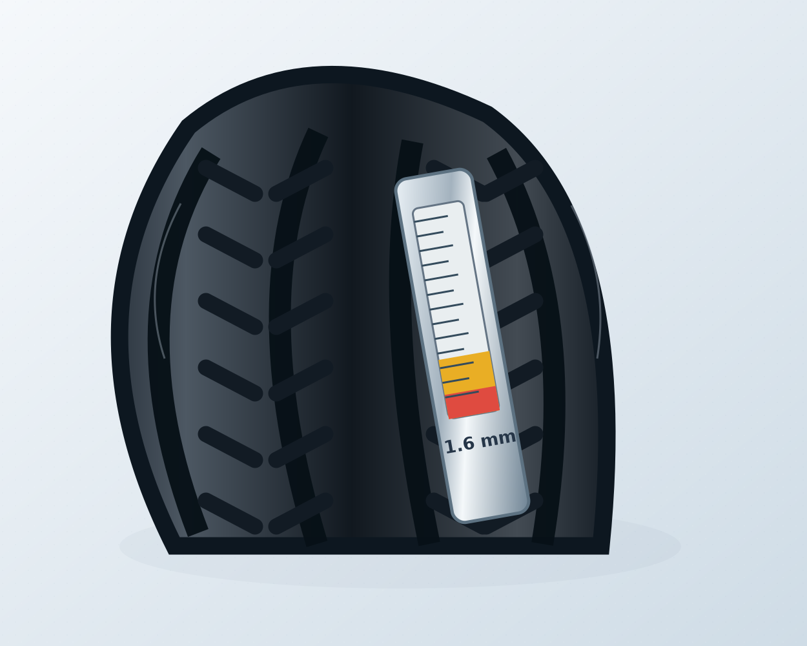

### Check fluids without creating danger

Follow the handbook for oil, coolant, brake-fluid and washer checks, including the correct level marks and vehicle conditions. Do not open a hot coolant filler cap: heat and pressure can cause serious injury. Low brake fluid or a persistent warning can indicate a serious problem rather than a simple need to top up. If a check is unfamiliar or a defect affects safety, obtain competent assistance. Keep the vehicle out of use until the fault has been assessed and made safe.

### Put it into practice

You notice low tread on one tyre and a brake warning after start-up. Instead of relying on last month’s MOT, you arrange inspection and alternative transport. The next day, with the car cool and safely parked, you use the handbook to check the recommended pressures and fluid levels rather than guessing from another vehicle.

### Recap

- MOT validity does not guarantee present roadworthiness.
- Check tyre depth, damage and cold pressures.
- Use the handbook and treat brake or overheating faults seriously.

### Sources

- [Highway Code, Rules 89 and 97](https://www.gov.uk/guidance/the-highway-code/rules-for-drivers-and-motorcyclists-89-to-102)
- [Highway Code, Annex 6](https://www.gov.uk/guidance/the-highway-code/annex-6-vehicle-maintenance-safety-and-security)

Mapped questions: `gb-safety-001`, `gb-safety-013`, `gb-safety-014`, `gb-safety-015`, `gb-safety-016`, `illustrated-vehicle-001`, `illustrated-vehicle-002`, `illustrated-vehicle-003`, `illustrated-vehicle-004`

---

## lesson-loading-towing — Carrying loads and towing safely

Content SHA-256: `e62e3e78b184a228afbb3effc6dc935c60efdbe4745b27a15bc1c888ca3fa3e0`

Module: `module-vehicle-care` · content version 1 · estimated 2 minutes

### Objectives

- Check limits, secure loads and maintain visibility.
- Allow for a trailer’s extra weight and length.

### Plan for the entire load

Adding people, luggage or a roof carrier changes the vehicle, even before a trailer is attached. You MUST NOT overload the car or trailer, and you must remain within licence entitlement and vehicle limits. Check current towing entitlement and the manufacturer’s figures for the proposed combination rather than relying on a friend’s licence or an old rule about test dates. Roof carriers have their own fitting and load limits. Make these checks before accepting a load, not after reaching the roadside.

### Distribute and secure it

Heavy items in a caravan or trailer should be distributed evenly around the axle area, within the specified overall and tow-ball limits. Too much weight at the rear can encourage instability. Secure items against braking, cornering and movement; passengers holding a loose bag is not reliable restraint. Keep adequate vision through mirrors, fitting suitable towing mirrors if the trailer blocks the required rear view. Adjust tyre pressures for the load using the vehicle’s instructions, and check trailer tyres, brakes and lights.

### Drive as a combination

Allow more time and room to accelerate, brake, turn and pass other road users. A gap that fits a solo car may be too short for a towing combination. Trailer speed limits and motorway lane restrictions differ from those for a solo car, so check the relevant rules and signs. If the combination becomes unstable, do not assume that driving faster will cure it. Stop safely and have loading, equipment or other causes assessed before continuing. Loading is part of safe control, not merely a storage problem.

### Put it into practice

A holiday trailer hides your normal rear view and most of the luggage is piled behind its axle. You check entitlement and vehicle limits, redistribute and secure the load and fit appropriate mirrors before departure. On the road you select a larger gap and earlier braking points for the combination, rather than driving as though the trailer were not attached.

### Recap

- Check entitlement and manufacturer limits.
- Distribute weight, secure it and preserve the required view.
- Use combination-appropriate gaps, speeds and lane choices.

### Sources

- [Highway Code, Rule 98](https://www.gov.uk/guidance/the-highway-code/rules-for-drivers-and-motorcyclists-89-to-102)
- [Highway Code, Rules 124 and 160](https://www.gov.uk/guidance/the-highway-code/general-rules-techniques-and-advice-for-all-drivers-and-riders-103-to-158)
- [Highway Code, motorway lane discipline](https://www.gov.uk/guidance/the-highway-code/motorways-253-to-273)

Mapped questions: `course-loading-001`, `course-loading-002`, `course-loading-003`, `course-loading-004`, `course-loading-005`, `course-loading-006`, `course-loading-007`, `course-loading-008`, `gb-safety-009`, `gb-safety-010`, `gb-motorway-013`, `illustrated-vehicle-007`

---

## lesson-urgent-warnings — Warnings that need prompt action

Content SHA-256: `b58cdb48e6913712f5415f90fe5610c0d8d2171bf3d63de223fb1474f86a183e`

Module: `module-dashboard` · content version 1 · estimated 2 minutes

### Objectives

- Distinguish a start-up check from a warning during a journey.
- Choose a safe stopping response rather than a guessed repair.

### Read the warning in context

Many lamps illuminate briefly when the car performs its start-up check. A light that remains on, returns while driving or appears with a message may mean something different. Learn the controls and warning displays in the vehicle’s handbook before departure. Colour is a useful attention cue, but it is not a diagnosis: a symbol, accompanying message and the manufacturer’s instructions determine the response. The same general symbol can have different details in different cars, so avoid relying on a photograph alone.

### Protect people before investigating

A red oil-pressure or temperature warning can signal a problem that makes continued running damaging or unsafe. A red brake warning that remains after the parking brake is released requires serious attention. Reduce speed in a controlled way and find a safe place to stop, following the vehicle’s instructions. Do not stop abruptly in a live lane merely to look at the dashboard when a safer stopping place is reachable. If the car cannot reach relative safety, use the breakdown procedure and call for appropriate help.

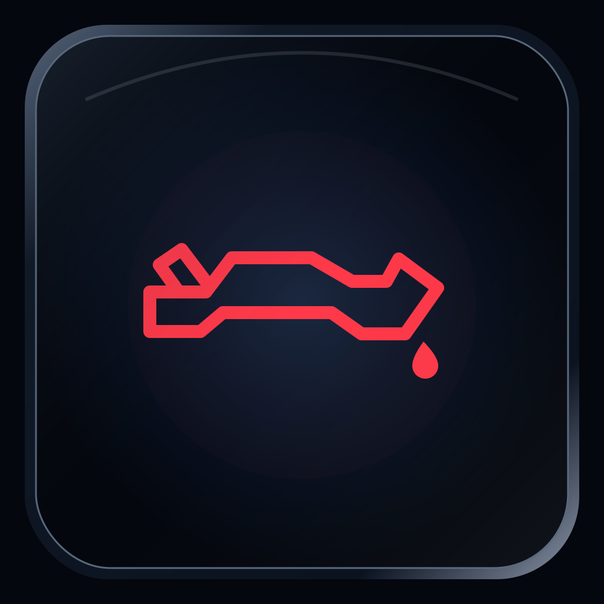

### Do not confuse a check with a repair

A charging warning may mean the electrical system is not charging, rather than simply identifying a flat battery. A low fluid warning may reflect a leak or other fault. Repeatedly restarting, ignoring a warning because the car still moves, or topping up without understanding the fault can make matters worse. Do not remove a hot coolant cap. Arrange competent assessment and use the handbook’s instructions for that exact vehicle. Roadside revision cannot replace professional diagnosis or a safe repair.

### Put it into practice

A red temperature symbol appears during a journey. You keep control, find a suitable safe stopping place and follow the handbook rather than continuing to the destination. You do not open the hot cooling system. If stopping leaves you exposed to high-speed traffic, protecting the occupants and getting help takes priority over examining the engine.

### Recap

- Read the symbol, message and handbook together.
- Stop safely for serious warnings; avoid abrupt unsafe stops.
- A lamp identifies a concern, not a complete diagnosis.

### Sources

- [Highway Code, Annex 6: Warning displays and fluids](https://www.gov.uk/guidance/the-highway-code/annex-6-vehicle-maintenance-safety-and-security)
- [Highway Code, Rules 275 to 279](https://www.gov.uk/guidance/the-highway-code/breakdowns-and-incidents-274-to-287)
- [Example manufacturer guidance: Ford C-MAX warning lamps (use your own vehicle handbook)](https://www.fordservicecontent.com/Ford_Content/vdirsnet/OwnerManual/Home/Content?ProcUid=G1298234&Uid=G1276543&buildtype=web&countryCode=USA&div=f&languageCode=en&moidRef=G539493&userMarket=GBR&vFilteringEnabled=False&variantid=2263)

Mapped questions: `illustrated-dashboard-001`, `illustrated-dashboard-002`, `illustrated-dashboard-006`, `illustrated-dashboard-007`, `gb-safety-001`, `gb-safety-016`

---

## lesson-systems-indicators — System warnings and normal indicators

Content SHA-256: `f8fea2092b2520c6c3e0967c623f023d4d5787b276a59fcdaec1f31abb504136`

Module: `module-dashboard` · content version 1 · estimated 2 minutes

### Objectives

- Recognise common safety-system alerts and operating indicators.
- Use a persistent warning to guide a safe next action.

### Notice when a system is reporting trouble

Amber ABS, engine-management, tyre-pressure or restraint-system warnings commonly draw attention to a system that needs checking. The exact response depends on the vehicle, whether the lamp is steady or flashing, and any other warning or change in behaviour. A car appearing to drive normally does not prove that every safety system is available. Read the message and handbook, adjust the journey if required and seek competent advice. Never remove a warning lamp’s power or cover it to avoid the concern.

### Separate intervention from a persistent fault

A traction or stability symbol may flash while a system responds to reduced grip, whereas a persistent warning can indicate a fault or a disabled function. Neither is permission to drive beyond the conditions. If tyres are losing grip, make your own inputs smoother and increase space instead of relying on electronics to solve the problem. A tyre-pressure alert calls for a safe opportunity to assess the tyres according to instructions, not an attempt to investigate while moving in traffic.

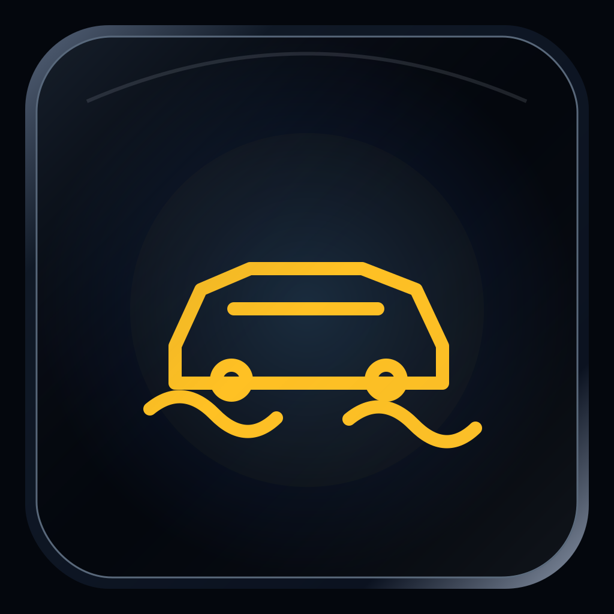

### Recognise reminders and status

Not every illuminated symbol is a fault. A seat-belt reminder means occupants and restraints need attention before continuing. A low-fuel indication should prompt a sensible refuelling plan before the car becomes stranded. A blue main-beam indicator shows a lighting mode; dip the headlights when necessary to avoid dazzling others. These examples teach a method: identify what is active, connect it with the driving situation, then take the appropriate action. Do not memorise one colour as meaning that every journey may continue unchanged.

### Put it into practice

On a wet bend the stability symbol flashes briefly, so you ease your inputs and allow more room. Later, an amber symbol stays on during ordinary driving. You treat that as a different situation, find a safe place to read the message and handbook, and arrange a check rather than assuming it is still a normal intervention.

### Recap

- A flashing intervention and a persistent warning may differ.
- Driver assistance does not create grip or remove responsibility.
- Know normal indicators as well as fault warnings.

### Sources

- [Highway Code, Annex 6: Warning displays](https://www.gov.uk/guidance/the-highway-code/annex-6-vehicle-maintenance-safety-and-security)
- [Highway Code, Rules 113 to 116 and 120](https://www.gov.uk/guidance/the-highway-code/general-rules-techniques-and-advice-for-all-drivers-and-riders-103-to-158)
- [Example manufacturer guidance: Ford C-MAX warning lamps (use your own vehicle handbook)](https://www.fordservicecontent.com/Ford_Content/vdirsnet/OwnerManual/Home/Content?ProcUid=G1298234&Uid=G1276543&buildtype=web&countryCode=USA&div=f&languageCode=en&moidRef=G539493&userMarket=GBR&vFilteringEnabled=False&variantid=2263)

Mapped questions: `illustrated-dashboard-003`, `illustrated-dashboard-004`, `illustrated-dashboard-005`, `illustrated-dashboard-008`, `illustrated-dashboard-009`, `illustrated-dashboard-010`, `illustrated-dashboard-011`, `illustrated-dashboard-012`

---

## lesson-signals-and-lights — Signals, lights and clear communication

Content SHA-256: `643e0c383eb96ac6c19a2e2028a3da0604172fa70a34f6cb70e144621f910cb5`

Module: `module-road-rules` · content version 1 · estimated 2 minutes

### Objectives

- Give signals that inform without misleading.
- Use lights and warnings for their proper purpose.

### Communicate a plan, not a demand

Check mirrors and the situation around you before signalling a change of direction or position. Signal early enough to help others, but not so early that a different turn appears intended. If you plan to turn just beyond a side road, an early indicator may persuade someone at that side road to emerge. Cancel the signal after use. A signal explains your intention; it does not give priority or make a manoeuvre safe. Continue observing while the manoeuvre develops.

### Interpret other people cautiously

Another vehicle’s indicator may have been left on. A headlight flash is a warning of that vehicle’s presence, not a promise that the driver will wait or that every other lane is clear. Never transfer responsibility for a decision to an assumed invitation. You MUST obey traffic lights, signs giving orders and directions from authorised people. Temporary controls at road works deserve the same attention as permanent controls. Wait for a clear view and a safe situation rather than guessing from someone else’s signal.

### Use warnings without creating another hazard

Use headlights at night when required and avoid dazzling other road users. You MUST use headlights when visibility is seriously reduced; front or rear fog lights may be used in such conditions, but MUST be switched off when visibility improves. Use the horn as a warning of presence, not to express impatience. Hazard lights have specific warning uses: they do not authorise illegal parking or excuse poor lane discipline. Learn the controls while parked so that searching for a switch does not distract you from the road.

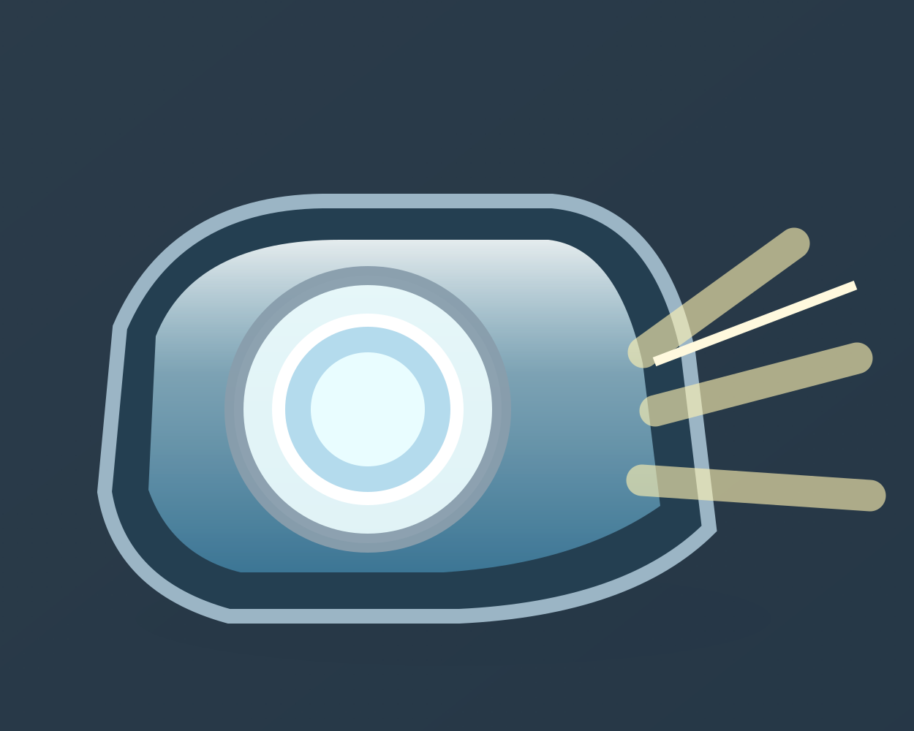

### Put it into practice

You intend to turn left immediately after a side street. You check behind and delay the indicator until it will no longer suggest the first turn. A driver at the junction flashes headlights. You continue to assess the road yourself rather than assuming the flash guarantees a safe path or changes the traffic lights.

### Recap

- Time signals so they are useful and unambiguous.
- A flash or indicator is not a guarantee of another person’s action.
- Use lights and warnings correctly, including switching fog lights off again.

### Sources

- [Highway Code, Rules 103 to 116](https://www.gov.uk/guidance/the-highway-code/general-rules-techniques-and-advice-for-all-drivers-and-riders-103-to-158)
- [Highway Code, Rule 226](https://www.gov.uk/guidance/the-highway-code/driving-in-adverse-weather-conditions-226-to-237)

Mapped questions: `gb-rules-001`, `gb-rules-002`, `gb-rules-003`, `gb-rules-004`, `gb-rules-005`, `gb-rules-006`, `gb-rules-007`, `gb-rules-008`, `gb-rules-009`

---

## lesson-speed-space-control — Choosing speed, space and control

Content SHA-256: `47bef6288c493e7f98ddc3a8c73581f3b5f034dfffc17198a2ff47deca07ec29`

Module: `module-road-rules` · content version 1 · estimated 2 minutes

### Objectives

- Distinguish a maximum speed from a safe speed.
- Create time to stop and use smooth, effective control.

### Choose a speed for the view

A speed limit is a maximum, not a target. You MUST NOT exceed the limit for the road or vehicle, but bends, parked cars, pedestrians, weather and restricted views may require much less. For ordinary cars without trailers, national limits are 60 mph on single carriageways and 70 mph on dual carriageways and motorways. Different vehicle types and towing combinations have different limits. Street-lit roads generally have a 30 mph limit in England and Scotland and 20 mph in Wales, unless signs show otherwise.

### Make space work for you

Drive at a speed that allows you to stop within the distance visible to be clear. On high-speed roads in dry conditions, the Highway Code advises at least a two-second following gap. Choose a fixed roadside point and compare when each vehicle passes it. Wet conditions require at least double the normal gap; poor grip or visibility may need considerably more. A larger gap also improves the view beyond a tall vehicle. If someone follows you too closely, increase space ahead so you can slow progressively rather than retaliating.

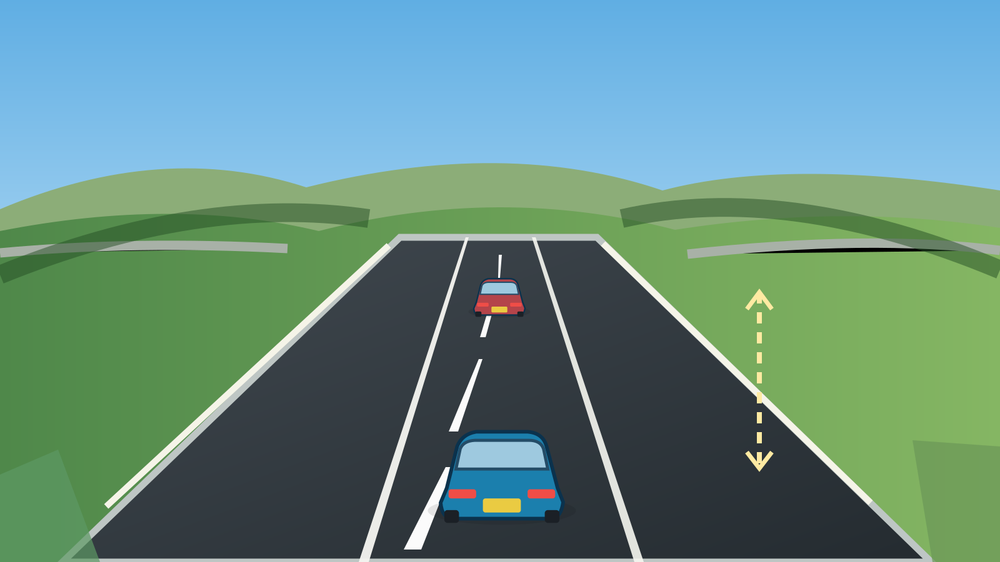

### Keep control while slowing

Look well ahead and brake in good time with smooth inputs for ordinary slowing. An emergency may require immediate firm braking. With ABS, follow the handbook; the usual emergency advice is firm footbrake pressure held until sufficiently slowed, not pumping the pedal. ABS helps steering control but does not guarantee a shorter stop. Avoid coasting in neutral or with the clutch held down, because it removes engine braking and can reduce control. Harsh steering, braking or acceleration can exceed available grip and cause a skid.

### Put it into practice

On a dark road with a national limit, your headlights reveal a bend well before its exit becomes visible. You slow below the limit so you can stop within your clear view. Rain begins, so you increase the gap to the car ahead. You keep a suitable gear rather than coasting downhill toward the bend.

### Recap

- Use the lower of the legal maximum and the speed conditions allow.
- Measure a useful time gap and increase it when conditions worsen.
- Smooth ordinary control and effective emergency braking are different skills.

### Sources

- [Highway Code, Rules 117 to 126](https://www.gov.uk/guidance/the-highway-code/general-rules-techniques-and-advice-for-all-drivers-and-riders-103-to-158)

Mapped questions: `gb-rules-010`, `gb-rules-011`, `gb-rules-012`, `gb-rules-013`, `gb-rules-014`, `course-handling-001`, `course-handling-003`, `course-handling-004`, `course-handling-005`, `course-handling-006`, `course-handling-007`, `course-handling-008`

---

## lesson-markings-road-layout — Reading markings and the road layout

Content SHA-256: `28a2ffa12e7597ce76caa65b4d6bb3e31c428dbdda7be8bc4c18366ce54ba1a3`

Module: `module-road-rules` · content version 1 · estimated 2 minutes

### Objectives

- Use lines, studs and physical layout as early information.
- Check the road type without relying on lane count or navigation.

### Read the road before reaching a hazard

Painted lines and lane arrows help explain the road ahead, often before the hazard itself is visible. A broken centre line whose markings grow longer and gaps shorter warns of a hazard ahead. Start checking your speed, view and position instead of treating it as decoration. Lane arrows and destination markings help you choose a lane early. Do not make a sudden move simply because a navigation instruction arrived late; a missed turn is safer to correct by a new route.

### Understand separation and restrictions

A dual carriageway has a central reservation separating opposing traffic; two lanes in each direction without that separation are not enough to make it one. This matters when interpreting national limits, but the maximum still depends on the vehicle and any lower signs. Different centre-line arrangements carry different overtaking and crossing restrictions. Read them together with signs and your view rather than assuming that every long straight road permits a pass. Never use a clear marking as a substitute for checking people and traffic.

### Use night-time clues carefully

Reflective studs help show the road’s shape and boundaries in darkness. Amber studs mark the central-reservation edge of a motorway or dual carriageway. Other colours identify different edges and lane features; learn their meaning rather than following the lights of the vehicle ahead. Wet surfaces, glare and road works may make markings harder to interpret. Reduce speed when information is unclear, follow temporary layouts and keep a stopping margin. A familiar route can change, so continue looking for current signs and markings on every journey.

### Put it into practice

An unfamiliar road has two lanes each way but no central reservation. You do not assume it has the same national limit as a dual carriageway. Farther ahead, longer broken centre markings warn of a hazard. You ease speed and inspect the view before considering any lane change, despite the sat nav asking for a turn.

### Recap

- Read markings as early clues to hazards and lane choice.
- A central reservation, not lane count, defines a dual carriageway.
- Use studs and markings alongside signs, visibility and observation.

### Sources

- [Highway Code, Rules 127 to 143](https://www.gov.uk/guidance/the-highway-code/general-rules-techniques-and-advice-for-all-drivers-and-riders-103-to-158)
- [Highway Code, Rule 124](https://www.gov.uk/guidance/the-highway-code/general-rules-techniques-and-advice-for-all-drivers-and-riders-103-to-158)

Mapped questions: `gb-rules-015`, `gb-rules-016`, `course-handling-002`, `sign-recognition-006`, `gb-signs-001`

---

## lesson-sign-language — The language of traffic signs

Content SHA-256: `25cbd93e6385f3ee007cb2c271e935f0b412286c267e0bbba1466b5995c3ac7a`

Module: `module-signs` · content version 1 · estimated 2 minutes

### Objectives

- Recognise the main sign families before reading their detail.
- Connect shape, colour and symbol with the required driving decision.

### Start with the sign family

Traffic signs use a visual language so that a driver can recognise a function quickly. Circles usually give orders, upright triangles usually warn and rectangles usually provide information. Colour adds meaning: a red ring normally restricts an action, while a blue circle generally gives a positive instruction or identifies a route for particular road users. These are useful starting clues, not a licence to guess an unfamiliar symbol. Look at the whole sign, including any text or additional plate, before deciding what it means.

### Learn the important exceptions

The eight-sided STOP sign and the inverted GIVE WAY triangle stand out from the usual families. Their shapes help recognition even before lettering is read. A red-bordered speed sign states a maximum, while the national-speed-limit sign directs you to the limit for that road and vehicle class; it is not one universal number. A blue circular arrow differs from a triangular warning showing a bend: one gives an instruction, while the other alerts you to a change or danger ahead.

### Turn recognition into a safe action

Reading a sign correctly is only the first step. Ask what it requires you to change: stop, give way, choose a permitted route, reduce speed for a hazard or plan an exit. You MUST obey signs giving orders. Warnings and information still need an appropriate response, even though their purpose differs. A sign does not remove the need to observe people, traffic and surface conditions. Practise recognising the symbol and explaining the action in your own words, rather than remembering only a colour or an answer letter.

### Put it into practice

You see an upright red triangle before a bend and later a blue circle with a left arrow on a traffic island. For the first, you inspect the bend and adjust speed to the conditions. For the second, you plan to pass the island on the instructed side. Recognising the families prevents you treating both arrows as the same type of message.

### Recap

- Use shape and colour as clues, then read the symbol and plates.
- Learn STOP and GIVE WAY as distinctive exceptions.
- Explain the driving action, not just the sign’s name.

### Sources

- [DfT Know Your Traffic Signs: The signing system](https://www.gov.uk/government/publications/know-your-traffic-signs/the-signing-system)
- [Highway Code, Rule 109](https://www.gov.uk/guidance/the-highway-code/general-rules-techniques-and-advice-for-all-drivers-and-riders-103-to-158)

Mapped questions: `signs-001`, `gb-signs-004`, `gb-signs-016`, `sign-recognition-003`

---

## lesson-orders-and-limits — Orders, restrictions and speed limits

Content SHA-256: `aee74733038b97b3813a27434802da79b1732a5da8a051dfe3af0c9a363ba618`

Module: `module-signs` · content version 1 · estimated 2 minutes

### Objectives

- Apply common regulatory signs without confusing similar symbols.
- Check restrictions against the vehicle, route and additional plates.

### Read exactly what is restricted

Red-bordered signs can prohibit entry, a turn, overtaking or a class of vehicle. The familiar No entry sign has a horizontal white bar on red; the car-and-motorcycle symbol means No motor vehicles. Do not substitute one meaning for the other just because both prevent some traffic proceeding. Supplementary plates may define times, exceptions or other details. Read them when deciding whether a restriction applies to you, and choose a safe alternative if the road is not available.

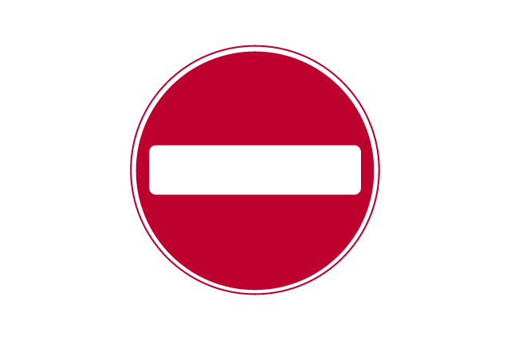

### Respect instructions and limits

A blue circular arrow may require a direction or the side on which to pass an obstruction. STOP requires a complete stop before crossing the stop line, followed by a proper check before entering the major road. GIVE WAY requires priority to traffic on the major road; stop if that is necessary to give way safely. Height, width and weight restrictions must be considered before reaching a narrowing or bridge. Know the relevant dimensions and limits of the vehicle and load rather than relying on the vehicle ahead.

### Keep maximum and suitable speed separate

A red-ring speed sign sets a maximum in miles per hour, if it is safe to travel that fast. Larger terminal signs mark a change; smaller repeaters may remind you of a limit where provided. A 20 mph zone can include traffic-calming features, so continue looking for road humps, pedestrians and narrowings. A national-limit sign means the appropriate limit for your vehicle and road type. Even with no other traffic visible, a signed maximum does not promise that the next bend or weather condition is safe at that speed.

### Put it into practice

You approach an unfamiliar street and notice a red restriction sign with a supplementary plate. Instead of following a van through, you check whether your own vehicle is permitted and use another route if not. At a later STOP sign you stop at the line, check both the main road and the area you will enter, and move only when safe.

### Recap

- Similar shapes can carry different restrictions.
- Read plates and know the relevant vehicle or load limits.
- Obey maximum speeds and choose a lower speed when needed.

### Sources

- [DfT Know Your Traffic Signs: Regulatory signs](https://www.gov.uk/government/publications/know-your-traffic-signs/regulatory-signs)
- [DfT Know Your Traffic Signs: Speed limit signs](https://www.gov.uk/government/publications/know-your-traffic-signs/speed-limit-signs)
- [Highway Code, Rule 171](https://www.gov.uk/guidance/the-highway-code/using-the-road-159-to-203)

Mapped questions: `gb-signs-001`, `gb-signs-002`, `gb-signs-003`, `gb-signs-004`, `gb-signs-005`, `gb-signs-006`, `gb-signs-007`, `gb-signs-008`, `gb-signs-009`, `sign-recognition-001`, `sign-recognition-002`, `sign-recognition-003`, `sign-recognition-004`, `sign-recognition-005`, `sign-recognition-006`, `sign-recognition-007`

---

## lesson-warnings-and-directions — Warnings, information and route planning

Content SHA-256: `113e2a4f3683d023887b5d888897f812cbdc7b2f1f9d47d6846ec0be608a2dda`

Module: `module-signs` · content version 1 · estimated 2 minutes

### Objectives

- Use warning signs to plan before reaching the hazard.
- Read direction information early without making sudden manoeuvres.

### Prepare for the hazard ahead

An upright red-bordered triangle warns rather than grants priority. Its symbol tells you what to look for: a bend, narrowing, junction, pedestrian activity, slippery surface or another feature. Reduce speed and choose a position that leaves time and room to respond. A bend symbol does not tell you an exact safe speed or guarantee a clear road beyond it. A steep-descent warning is a cue to plan speed and a suitable gear early, not to wait until the car is gathering speed downhill.

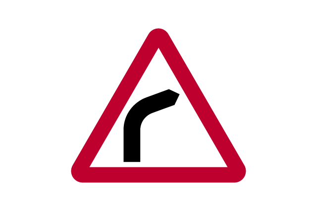

### Read the supporting information

A plate can show distance to a hazard or explain the warning. A junction diagram may indicate the road arrangement, but it cannot show every road user arriving now. A crossing warning asks you to search for people and prepare to stop; it is different from the traffic control at the crossing itself. Pay attention to signs for level crossings and water or quay edges. If information is unclear, slow sufficiently to investigate from safety rather than committing to a manoeuvre you cannot complete.

### Plan the route without being trapped by it

Direction-sign backgrounds help identify the route network: motorway direction signs use blue, primary-route directions green and non-primary directions white. Other information signs have their own purposes, including parking, a no-through road or a change in road layout. Read destinations and lane information early, then use mirrors and signals for any necessary move. A sign or sat nav may help choose the route, but neither justifies a sharp cut across another lane. If you miss the turn, continue safely and find another route.

### Put it into practice

A warning sign shows a double bend before a direction sign for your destination. You slow for the limited view and read the lane information early. A following vehicle occupies the lane you would need, so you continue on the safe route instead of cutting across it. The direction sign helps planning; it does not make your chosen exit compulsory at any cost.

### Recap

- Warnings are cues for observation and early adjustment.
- Read plates and assess the actual hazard, not only the picture.
- Missing a turn is preferable to a sudden unsafe lane change.

### Sources

- [DfT Know Your Traffic Signs: Warning signs](https://www.gov.uk/government/publications/know-your-traffic-signs/warning-signs)
- [DfT Know Your Traffic Signs: The signing system](https://www.gov.uk/government/publications/know-your-traffic-signs/the-signing-system)
- [DfT Know Your Traffic Signs: Information signs](https://www.gov.uk/government/publications/know-your-traffic-signs/information-signs)

Mapped questions: `gb-signs-010`, `gb-signs-011`, `gb-signs-012`, `gb-signs-013`, `gb-signs-014`, `gb-signs-015`, `gb-signs-016`, `sign-recognition-008`

---

## lesson-junction-priority — Approaching junctions and giving way

Content SHA-256: `639395aca2fb7e522344719908581489425d2dc96e0838f4133399295ea37e7e`

Module: `module-junctions` · content version 1 · estimated 2 minutes

### Objectives

- Identify the control and make a safe observation plan.
- Choose a gap that fits the whole manoeuvre and vehicle.

### Prepare before the line

Read signs and markings early, check mirrors and adjust speed so you can assess the junction without rushing. Look for pedestrians, cyclists and motorcycles as well as larger vehicles. Buildings, hedges, parked cars and a large turning vehicle can hide another road user. An indicator on an approaching car may be incorrect or left on. Wait until the situation is genuinely clear rather than treating the signal, a headlight flash or another person’s wave as permission to emerge.

### Respect STOP and GIVE WAY

At a STOP sign with its solid stop line, you MUST come to a complete stop before crossing the line. Then check carefully and move only when the way is clear. At a Give Way line you MUST give way to traffic on the major road; stopping may be needed, but the sign does not itself demand a fixed pause of a particular number of seconds. A large vehicle turning into your road may need extra space. Keep back and wait rather than trying to squeeze alongside its turning path.

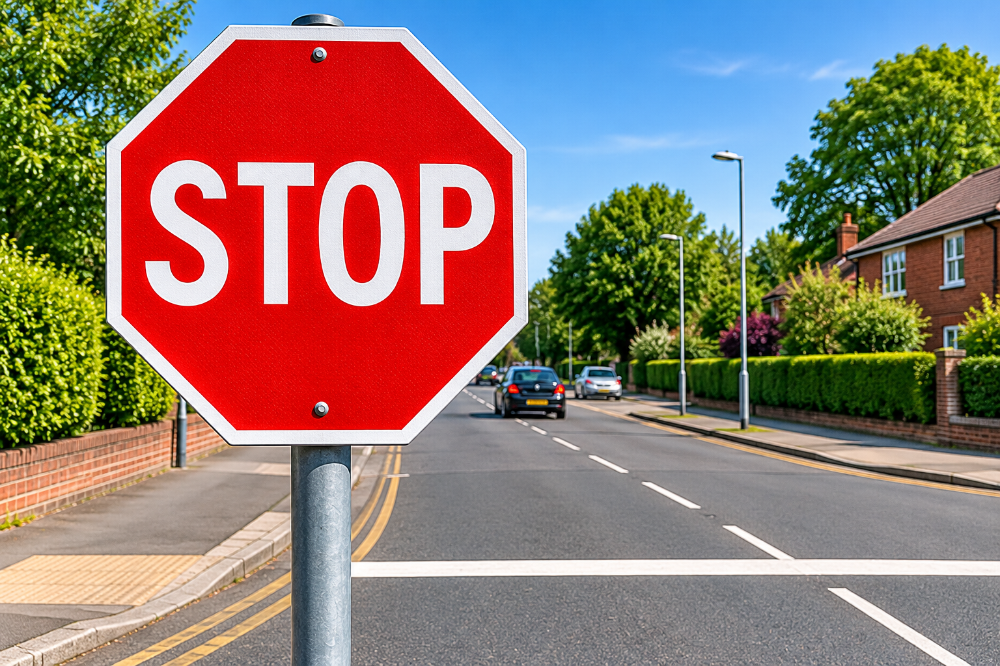

### Check the space beyond the first gap

A safe gap must last long enough for your whole vehicle to complete the move without forcing another road user to alter course or speed. When crossing or turning right at a dual carriageway, assess the central reservation. If it is wide enough to hold the entire vehicle safely, the manoeuvre may be treated in stages. If it cannot hold the whole vehicle, wait for a safe opportunity to complete the full crossing. Include the length of any trailer, not merely the car, when assessing the space.

### Put it into practice

You intend to emerge from a side road while a lorry turns into it. The lorry blocks your view of a motorcycle beyond it and uses much of the entrance. You stay behind the line until it has passed and your view is clear. You then select a gap for the whole manoeuvre instead of following the lorry’s signal.

### Recap

- Stop fully where required and give way to the main-road traffic.
- Look for people hidden by vehicles or the roadside.
- Assess a central reservation against the whole vehicle’s length.

### Sources

- [Highway Code, Rules 170 to 173](https://www.gov.uk/guidance/the-highway-code/using-the-road-159-to-203)
- [DfT Know Your Traffic Signs: Regulatory signs](https://www.gov.uk/government/publications/know-your-traffic-signs/regulatory-signs)

Mapped questions: `junction-001`, `gb-junction-001`, `gb-junction-002`, `gb-junction-003`, `gb-junction-004`, `gb-junction-005`

---

## lesson-turning-and-people — Turning while protecting other road users

Content SHA-256: `86a8dfb6c78ce391bc2dede40e0585c877b8364cb234aaf7f7aa85d0cf5e4750`

Module: `module-junctions` · content version 1 · estimated 2 minutes

### Objectives

- Plan position, observation and signals before a turn.
- Give pedestrians and cyclists the room and priority they need.

### Plan the path before turning

Use mirrors, a clear signal and an appropriate position so others can understand your intention. A right turn from an ordinary two-way road normally starts near the centre of the road without cutting the corner. A left turn should not sweep across someone travelling alongside. Slow enough to make the final observations properly, and check the road you will enter as well as the road you are leaving. Signalling does not remove the responsibility to make a safe turn.

### Look where someone could be hidden

Cyclists and motorcyclists may approach alongside slow traffic or be obscured by another vehicle. Look for them again before completing a right turn. Do not turn across a cyclist going straight ahead if that would make the cyclist stop or swerve. A cycle track can carry cyclists approaching from either direction, so check both ways before crossing it. Avoid overtaking a cyclist just before a left turn and then cutting across their route. Leave space and wait behind instead when necessary.

### Include pedestrians in the decision

At a junction, you should give way to pedestrians crossing or waiting to cross the road into or from which you are turning. This includes the entrance or exit of the road, not only a marked pedestrian crossing. Slow sufficiently to recognise people waiting near the kerb and allow time for older or disabled people to cross. Do not hurry them with the vehicle or a horn. Priority is guidance for preventing conflict, not a reason to force your way through an unsafe situation.

### Put it into practice

You signal left into a side street. A cyclist continues straight along the road on your left, and a pedestrian waits at the side street’s mouth. You remain behind the cyclist rather than overtaking and cutting across. You give the pedestrian time to cross and turn only after checking that both the route and the receiving road are clear.

### Recap

- Observe both roads and the full path of the turn.
- Do not cut across a cyclist continuing ahead.
- Give way to pedestrians crossing or waiting at the junction.

### Sources

- [Highway Code, Rules 170, 179 to 183](https://www.gov.uk/guidance/the-highway-code/using-the-road-159-to-203)
- [Highway Code, Rules 206 and 211](https://www.gov.uk/guidance/the-highway-code/road-users-requiring-extra-care-204-to-225)

Mapped questions: `junction-002`, `gb-junction-013`, `gb-junction-014`, `gb-junction-015`

---

## lesson-lights-and-boxes — Traffic lights, box junctions and waiting areas

Content SHA-256: `38502dc46a59169c35730dc3cac31464dde8fb2c5549b119916dbd166ced222d`

Module: `module-junctions` · content version 1 · estimated 2 minutes

### Objectives

- Respond to lights without entering a space you cannot clear.
- Apply the box-junction exception accurately.

### Understand the traffic signal

You MUST stop at red. Amber also means stop unless you have already crossed the stop line or are so close that stopping might cause a collision. Do not accelerate merely to beat a changing light. A green signal means you may proceed if the way is clear; it does not authorise blocking the junction or taking priority over someone still crossing. A green filter arrow permits the indicated direction when appropriate, while you continue to check the path and other road users.

### Check the exit before entering

You MUST NOT enter a yellow box junction until your exit road or lane is clear. There is a specific exception when turning right and prevented only by oncoming traffic or other vehicles waiting to turn right. Do not stretch that exception to cover a stationary queue blocking the road you want to enter. Look beyond the first car and allow room for your whole vehicle. A following driver’s impatience or a green light does not make a blocked exit acceptable.

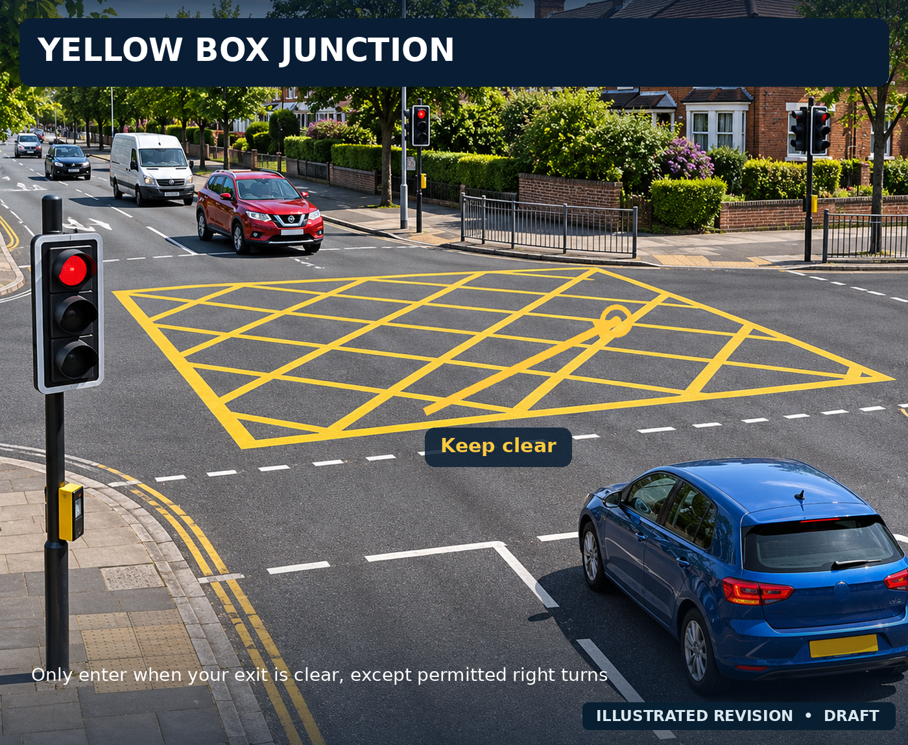

### Respect waiting areas and uncertainty

At lights with an advanced cyclist waiting area, a driver must normally stop at the first stop line and leave the marked area for cyclists. Do not use it to gain a better position in the queue. Keep watching for people on both sides of the road as the signal changes. If traffic lights fail, treat the junction with great caution, assess the other traffic and proceed only when safe. Do not assume that your usual green phase or main-road status makes the failed signals harmless.

### Put it into practice

Your signal turns green, but the queue beyond the yellow box has not moved far enough to fit your car. You wait before the box. Later, when turning right, the exit is clear but oncoming vehicles prevent completion; that is the different situation covered by the right-turn exception. You keep checking pedestrians and cyclists while waiting.

### Recap

- Green does not mean enter a blocked junction.
- Use the right-turn box exception only in its stated situation.
- Leave cyclist waiting areas clear and treat failed signals cautiously.

### Sources

- [Highway Code, Rules 174 to 178](https://www.gov.uk/guidance/the-highway-code/using-the-road-159-to-203)
- [Highway Code, Rule 109](https://www.gov.uk/guidance/the-highway-code/general-rules-techniques-and-advice-for-all-drivers-and-riders-103-to-158)

Mapped questions: `gb-junction-006`, `gb-junction-007`, `gb-junction-008`, `gb-junction-009`, `gb-junction-010`, `gb-junction-011`, `gb-junction-012`

---

## roundabout-approach — Approaching a roundabout with a plan

Content SHA-256: `62fea23ad2d528ed8b75f0001f35ee5ba8df72379c2f5f8ec0ca156b63cd17cb`

Module: `module-roundabouts` · content version 1 · estimated 3 minutes

### Objectives

- Choose an approach lane from signs and markings.
- Distinguish the usual priority rule from a controlled entry.
- Check the vehicle ahead before moving.

### Read the layout before the give-way line

A roundabout is a sequence of decisions, not a single glance to the right. First identify your exit, then read the approach signs, lane arrows and any signals. Choose your lane early enough to avoid a last-second swerve. If local markings differ from a familiar layout, use the information at this junction rather than a memorised lane rule. A navigation instruction helps you choose a destination; it does not override road markings.

Use your mirrors before changing speed or position. Reduce speed to give yourself time to assess the entry and select a suitable gear. Your approach should leave you able to stop smoothly when there is no safe opportunity to join. A vehicle behind you does not make a doubtful gap suitable.

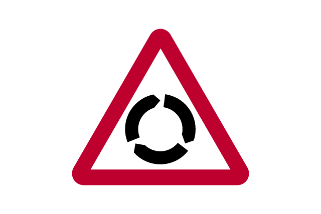

### Check the entry and the traffic around it

At an ordinary entry, give priority to traffic approaching from the right unless signs, markings or traffic lights direct otherwise. Observe vehicles already circulating, including ones with unclear signals. An indicator is a useful clue, but compare it with the vehicle’s position and movement. Do not enter simply because a driver appears to be signalling to leave.

Keep alternating your view between the circulating traffic and the space immediately ahead. The driver in front may begin to move and then stop. If you keep looking right while your own car rolls forward, you can run into that vehicle even though you correctly identified a gap.

### Use clear signals for the first exit

For the first exit to the left, the usual approach is the left-hand lane with a left signal, unless signs or markings specify another arrangement. Keep an appropriate left position as you circulate and continue the signal to leave. Signal timing should help others understand your actual route, not suggest you are turning into an earlier entrance.

### Work through the situation

You are behind a car at a small roundabout. It rolls forward while you look right, but you then see its brake lights. Keep your own car stopped and reassess both views. When the space ahead is clear and a suitable entry opportunity exists, make a final forward check before moving. The apparent gap on the roundabout was only one part of the decision.

### Recap

- Read the exit, lane guidance and controls early.
- Judge movements as well as indicators.
- A final forward check prevents a common queue collision.

### Sources

- [Highway Code: roundabouts, Rules 184–186](https://www.gov.uk/guidance/the-highway-code/using-the-road-159-to-203)

Mapped questions: `roundabout-001`, `roundabout-002`, `gb-roundabout-001`, `gb-roundabout-002`, `gb-roundabout-003`, `gb-roundabout-004`, `gb-roundabout-005`, `gb-roundabout-006`

---

## roundabout-circulation — Circulating, leaving and sharing the roundabout

Content SHA-256: `feb9a18d33418070020141ecd085ac22b14f9568130f4f3d5eb0b2fbb8375cbd`

Module: `module-roundabouts` · content version 1 · estimated 3 minutes

### Objectives

- Time exit signals and lane changes safely.
- Allow for cyclists, horses and long vehicles.
- Apply the normal approach to mini-roundabouts.

### Prepare to leave without cutting across someone

For an exit to the right, or a full circuit, the usual approach is a right signal and the right-hand lane unless local guidance says otherwise. Keep that position until you need to change lanes for your exit. For an intermediate exit, choose the appropriate approach lane and normally give no approach signal. In both cases, signal left after passing the exit before yours.

A left signal does not create a clear route across another lane. Check mirrors and the area beside you before changing course. Follow the road’s lane guidance and leave only when you can do so safely. If a planned move would force another road user to brake or swerve, continue safely and find another route rather than forcing the exit.

### Expect other road users to take different paths

Cyclists, horse riders and horse-drawn vehicles may remain in the left-hand lane while continuing around the roundabout. Do not assume that their lane position means they will take the next exit. Give cyclists priority, allow room for their route and do not overtake them within their lane. A right signal from a rider may indicate that they are continuing around.

Long vehicles can need more than one lane to negotiate the curve. Stay out of the narrowing space beside them. Also check the approach and exit roads for people crossing. Give way to people crossing the exit road, and be ready to stop rather than concentrating only on circulating vehicles.

### Treat each mini-roundabout as its own decision

A painted central circle is still a roundabout. Most vehicles must pass around its markings; the exception is a large vehicle physically unable to do so. Space is limited, so plan early and avoid a U-turn. At a pair or series of mini-roundabouts, reassess priority and traffic separately at each one. Getting through the first does not settle the second.

### Work through the situation

You intend to leave at the third exit. A cyclist in the left lane continues beyond the second exit while a lorry occupies extra space ahead. Do not squeeze between them or turn across the cyclist. Keep a safe position, observe their movements, and leave only when your path is clear. Follow the lane guidance and take a safe alternative route if that exit cannot be taken without a conflict.

### Recap

- Check the lane beside you before leaving.
- Left-lane riders may be continuing around.
- Reassess every mini-roundabout separately.

### Sources

- [Highway Code: roundabouts, Rules 186–190](https://www.gov.uk/guidance/the-highway-code/using-the-road-159-to-203)
- [Highway Code: pedestrian priority, Rule H2](https://www.gov.uk/guidance/the-highway-code/introduction)

Mapped questions: `gb-roundabout-007`, `gb-roundabout-008`, `gb-roundabout-009`, `gb-roundabout-010`, `gb-roundabout-011`, `gb-roundabout-012`, `gb-roundabout-013`, `gb-roundabout-014`, `gb-roundabout-015`

---

## overtaking-decisions — Deciding whether an overtake is worth starting

Content SHA-256: `e9fb93b36e5ceb394903034f04f1ef043fc22c8d9a675f2a439715feb3d56e70`

Module: `module-overtaking` · content version 1 · estimated 3 minutes

### Objectives

- Check the complete route past a slower vehicle.
- Recognise locations where an overtake is unsafe or prohibited.
- Respond safely when another driver passes you.

### Plan the complete manoeuvre

Before an overtake, identify both the space for moving out and the space for returning. You need enough clear road ahead, a suitable gap beyond the vehicle you will pass, and a check that someone behind is not already overtaking you. Use mirrors and any necessary blind-spot observation before moving. An empty patch beside your car is not proof that the whole manoeuvre can be completed.

Following a lorry too closely reduces your view and makes the decision harder. Increase your separation so that you can see more of the road ahead. Remember that a long vehicle takes more time and distance to pass. Another car’s successful overtake does not reserve a second opportunity for you.

### Recognise a clear reason to wait

Do not attempt an overtake when a bend, hill crest or other obstruction prevents a clear assessment of the road ahead. A narrowing road or a nearby junction can create a conflict before you have returned safely. Where a no-overtaking sign applies, do not overtake until the restriction is cancelled. Observe the relevant road markings too. A straight stretch alone is not permission to disregard them.

When a parked vehicle or another obstruction is on your side, give way to approaching traffic before moving around it. Waiting behind the obstruction can be the complete, correct plan. Avoid committing yourself to a position that depends on the oncoming driver rescuing the situation.

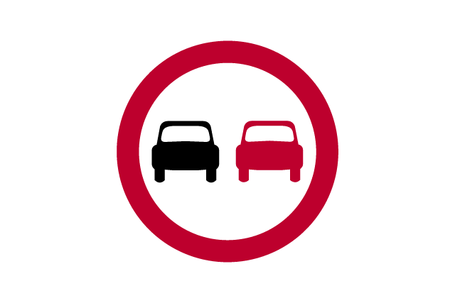

### Make room for other people’s decisions

When someone overtakes you, keep a steady course and do not accelerate to compete. If they move into your following space, rebuild a safe gap without an aggressive response. Drivers of slow vehicles should consider a safe opportunity to let a queue pass, rather than holding traffic unnecessarily. Cooperation does not require a sudden stop or an unsafe pull-in.

### Work through the situation

A car ahead pulls out to pass a tractor near the brow of a hill. From your position you cannot see a return gap beyond the tractor. Stay back instead of following the car out. It may use the only available space, meet approaching traffic or abandon its own attempt. Your independent view must justify your manoeuvre; its movement cannot do that for you.

### Recap

- Check the road ahead, behind and beyond the slower vehicle.
- An uncertain view is a reason to wait.
- Never turn another driver’s overtake into a race.

### Sources

- [Highway Code: overtaking, Rules 162–169](https://www.gov.uk/guidance/the-highway-code/using-the-road-159-to-203)

Mapped questions: `overtaking-001`, `overtaking-002`, `gb-overtaking-001`, `gb-overtaking-002`, `gb-overtaking-006`, `gb-overtaking-007`, `gb-overtaking-008`, `gb-overtaking-010`, `gb-overtaking-011`, `gb-overtaking-012`, `gb-overtaking-014`, `gb-overtaking-015`

---

## overtaking-vulnerable-users — Giving people enough room when you pass

Content SHA-256: `593211ac554ab47c41d0b01dd97938e9262fa40044abc4e7a811270d84407a3d`

Module: `module-overtaking` · content version 1 · estimated 3 minutes

### Objectives

- Use the Highway Code clearance guidance.
- Explain when to wait instead of passing.
- Avoid passing conflicts at turns and crossings.

### Plan speed and sideways clearance together

A person on a cycle or horse, or walking in the carriageway, has little protection if a vehicle passes too closely. Treat the space beside them as part of your overtaking plan. At speeds up to 30 mph, the Highway Code gives at least 1.5 metres as guidance for passing a cyclist; allow more room at higher speeds. That distance is not a target that makes every pass safe in every condition.

Pass a horse rider or horse-drawn vehicle below 10 mph, allowing at least 2 metres. For someone walking in the road, keep your speed low and allow at least 2 metres. Allow extra space in bad weather or darkness. If the road and approaching traffic do not let you provide suitable clearance, wait behind. Do not turn the guidance into an excuse to force a gap.

### Understand why a rider may change position

A cyclist may use the centre of a narrow lane or move out to avoid a drain, pothole or parked vehicle. Riding two abreast can help a group’s safety and visibility. A shoulder check may be an early clue that a rider intends to change direction. Leave time for that movement rather than accelerating into the space they need.

Before turning left, do not overtake a cyclist travelling straight ahead and then cut across them. The delay you avoid would come at the cost of a serious conflict. Likewise, do not pass the nearest vehicle stopped to let someone use a pedestrian crossing: the person may be hidden in front of it.

[Play original case study: A road with parked vehicles](../../src/assets/case-studies/cyclist-and-parked-vehicles.mp4)

### Complete the pass without another conflict

When an opportunity becomes suitable, make the manoeuvre deliberately and within the speed limit. Return to your normal road position only after there is enough separation from the person you passed. Avoid sharp steering or acceleration near a horse, and be ready to wait longer if the rider signals for you to slow down or stop.

### Work through the situation

You follow a cyclist past parked cars while a vehicle approaches from the opposite direction. There is not enough road width for your car to pass with suitable clearance. Hold back at a safe following distance. When the oncoming vehicle has passed, reassess the complete route and the cyclist’s position. Waiting has created a safer opportunity; it has not made an immediate overtake compulsory.

### Recap

- Clearance and low speed both matter.
- Wait when there is not enough room.
- Never pass a cyclist merely to turn across their route.

### Sources

- [Highway Code: passing clearances and restrictions, Rules 163–165](https://www.gov.uk/guidance/the-highway-code/using-the-road-159-to-203)
- [Highway Code: cyclists and horses, Rules 211–215](https://www.gov.uk/guidance/the-highway-code/road-users-requiring-extra-care-204-to-225)

Mapped questions: `gb-overtaking-003`, `gb-overtaking-004`, `gb-overtaking-005`, `gb-overtaking-009`, `gb-overtaking-013`

---

## crossings-zebra-parallel — Reading zebra and parallel crossings

Content SHA-256: `b2fbe1db85a5d4c65b7bbdcc4d48b62e00b181809cf4f7826750aac991c07e82`

Module: `module-crossings` · content version 1 · estimated 3 minutes

### Objectives

- Identify the responsibilities for waiting and crossing users.
- Keep crossing approaches and the crossing itself clear.
- Explain why a wave is not a safe invitation.

### Look for people on both sides

A crossing is a place where someone’s route may intersect yours within seconds. Scan the pavement on both sides as well as the stripes ahead. Reduce speed early enough to stop smoothly. A parked van, a queue or darkness may conceal someone approaching the crossing. Treat a blocked view as a reason for extra care, not as evidence that no one is there.

The zig-zag area helps protect visibility around the crossing. You must not park on the crossing or within its zig-zag markings. You must not overtake the moving vehicle nearest the crossing, or the nearest vehicle stopped to give way. Passing it can put you directly into the path of a person you could not previously see.

### Distinguish waiting from crossing

At a zebra crossing you should give way to a person waiting to cross; once a pedestrian has entered the crossing, giving way is a legal requirement. A parallel crossing adds a cycle route alongside the pedestrian stripes. Apply the corresponding waiting and crossing responsibilities to both pedestrians and cyclists there.

Your own stopped car does not make the opposite lane safe. Do not wave, flash headlights or sound the horn to invite someone across. They must assess the whole road, including vehicles you may not see. Let an older or disabled person finish at their own pace, without edging towards them.

[Play original case study: A town road](../../src/assets/case-studies/town-crossing.mp4)

### Leave a usable path through the crossing

In a queue, wait before the crossing unless you can clear it completely. Stopping across it forces people into an awkward route between vehicles. A zebra or parallel crossing divided by a central island is treated as two crossings. This does not remove the need to observe people approaching either part, and it must not be confused with the different rule for a straight-through pelican crossing.

### Work through the situation

A delivery van partly hides the far end of a zebra crossing. The car ahead stops, but you cannot yet see why. Stay behind it and prepare to stop rather than using the empty lane to pass. A pedestrian then appears from in front of the van. After that person finishes, check both approaches again before moving; another person may already be about to use the crossing.

### Recap

- Look beyond the crossing surface to both pavements.
- Do not overtake a vehicle nearest a crossing.
- Leave crossing space clear in queues.

### Sources

- [Highway Code: pedestrian crossings, Rules 191–195](https://www.gov.uk/guidance/the-highway-code/using-the-road-159-to-203)
- [Highway Code: waiting and crossing priority, Rule H2](https://www.gov.uk/guidance/the-highway-code/introduction)

Mapped questions: `rules-001`, `crossings-001`, `gb-crossings-001`, `gb-crossings-002`, `gb-crossings-003`, `gb-crossings-004`, `gb-crossings-005`, `gb-crossings-006`, `gb-crossings-007`, `gb-crossings-008`, `gb-crossings-009`, `gb-crossings-010`

---

## crossings-signals — Understanding signals and central islands

Content SHA-256: `3670b4b71d336cef7321e173761f9652ecbbf329feba46156ea46fc7503b2742`

Module: `module-crossings` · content version 1 · estimated 3 minutes

### Objectives

- Apply the pelican flashing-amber rule correctly.
- Give way to anyone still crossing when your light changes.
- Recognise crossing types with different signal sequences.

### Observe people as well as the light

At a signal-controlled crossing, read the vehicle signal and the physical situation together. Red requires you to stop at the line. A green signal permits movement only when the route is clear; it is not an instruction to drive at someone still crossing. Keep checking the full crossing area before releasing the brake and moving.

The first vehicle in a queue has a particularly important final observation to make. Drivers behind may be responding to its movement rather than seeing the pedestrian for themselves. Move off deliberately after the crossing is clear, rather than letting pressure from behind decide when you start.

### Use flashing amber only where it exists

A pelican crossing has a flashing-amber stage after red. During flashing amber, you must give way to any pedestrian still on the crossing. If no one remains on it, you may proceed cautiously. The permission is conditional on what you can actually see. A person screened by another vehicle has not become safe to ignore.

Puffin, toucan and equestrian crossings do not use that flashing-amber stage. Their vehicle lights follow the ordinary traffic-light sequence. A toucan accommodates people cycling as well as walking, so watch for both. Avoid making decisions from the crossing’s nickname alone; follow its actual signals and markings.

### Check whether the island divides the crossing

A pelican crossing that runs straight across the road is one crossing even when it has a central island. You must wait for pedestrians coming from its other side. This differs from a zebra crossing split by an island. At every crossing, give way to someone still crossing after your signal becomes green. If signals are not working, approach with extreme caution, and do not enter unless you can clear the crossing completely.

### Work through the situation

At a straight-through pelican crossing, your signal begins flashing amber. A person has reached the island from the opposite side and continues across. Remain stopped: the island has not created a separate crossing that lets you move first. When that person has finished and you can see the crossing is clear, proceed cautiously if flashing amber remains. At a puffin crossing, do not wait for a flashing-amber stage that will never appear.

### Recap

- Flashing amber is a conditional pelican stage.
- A green light does not cancel a person’s crossing.
- A straight-through pelican remains one crossing across an island.

### Sources

- [Highway Code: signal-controlled crossings, Rules 196–199](https://www.gov.uk/guidance/the-highway-code/using-the-road-159-to-203)
- [Highway Code: traffic-light meanings](https://www.gov.uk/guidance/the-highway-code/light-signals-controlling-traffic)
- [Highway Code: pedestrian and toucan crossing guidance](https://www.gov.uk/guidance/the-highway-code/rules-for-pedestrians-1-to-35)

Mapped questions: `gb-crossings-011`, `gb-crossings-012`, `gb-crossings-013`, `gb-crossings-014`, `gb-crossings-015`

---

## sharing-people — Anticipating people whose needs are easy to miss

Content SHA-256: `7e84247223224062c4ad10bf80d4afd3719cf4d578fd7046690275fcf48453dc`

Module: `module-sharing` · content version 1 · estimated 3 minutes

### Objectives

- Apply greater responsibility without assuming other people will act predictably.
- Recognise circumstances needing extra time and observation.
- Give riders, children and pedestrians room to act safely.

### Build a picture beyond the car in front

A car’s size and speed mean its driver can cause substantial harm. The hierarchy of road users asks those able to cause the greatest harm to take greater care; it does not remove anyone else’s responsibility. Use that principle before a conflict develops. In a shopping street, scan gaps between parked cars and around stopped buses. A child concentrating on a friend or an ice-cream van may not be watching traffic.

Before crossing a pavement or cycle route to reach a driveway, give way to pedestrians using the pavement and cyclists using the cycle lane or track. When reversing, inspect the area all around, including the space a turning front corner will sweep through. Do not assume that a person who was visible a moment ago remains clear of the vehicle.

### Make allowance without demanding a response

Someone’s sight, hearing or mobility needs may not be obvious. An older pedestrian or someone using a walking aid may require extra time to cross. Do not hurry them with the car’s position or engine noise. A white cane with a red band may indicate deafblindness; a horn or hand gesture may not be understood.

Near schools and playgrounds, search for children. Flashing amber lights below a school warning sign call for very slow driving until clear of the area. A stopped school bus is another cue to look for children. A school crossing patrol displaying its stop sign requires you to stop. Look beyond the sign bearer for people still crossing, rather than treating the sign as the only hazard.

### Make space for riders and animals

Cyclists can use the centre of a narrow lane and may ride two abreast for safety. A glance over a shoulder can precede a change of position. Check for cycles and motorcycles filtering beside slow traffic before turning across it. Pass horses calmly, below 10 mph and with at least 2 metres of clearance when safe; otherwise wait. When animals block a road, be prepared to stop; if a herd blocks it, stop and switch off the engine until it clears. Noise and impatience can make their movement harder to predict.

### Work through the situation

You are waiting to turn right through a gap in a slow-moving queue. A driver waves you across, but the queue hides the route beside it. Do not accept the wave as proof of safety. Check for a filtering cyclist or motorcycle and for pedestrians crossing the side road. Wait until you can assess the whole route, then make the turn without forcing another person to change course.

### Recap

- Scan the spaces where people may emerge.
- Allow additional time without intimidation.
- A helpful wave cannot replace your own observation.

### Sources

- [Highway Code: hierarchy, Rules H1–H3](https://www.gov.uk/guidance/the-highway-code/introduction)
- [Highway Code: people requiring extra care, Rules 204–218](https://www.gov.uk/guidance/the-highway-code/road-users-requiring-extra-care-204-to-225)

Mapped questions: `pedestrians-001`, `pedestrians-002`, `gb-vulnerable-001`, `gb-vulnerable-002`, `gb-vulnerable-003`, `gb-vulnerable-004`, `gb-vulnerable-005`, `gb-vulnerable-006`, `gb-vulnerable-007`, `gb-vulnerable-008`, `gb-vulnerable-009`, `gb-vulnerable-010`, `gb-vulnerable-011`, `gb-vulnerable-012`, `gb-vulnerable-013`, `gb-vulnerable-014`

---

## sharing-large-special-vehicles — Sharing with buses, large vehicles and emergency traffic

Content SHA-256: `dc62b3d546c49579002386e9ddf3286e7c43f57d632383a1b4411d36fbd64c37`

Module: `module-sharing` · content version 1 · estimated 3 minutes

### Objectives

- Allow for large-vehicle blind spots and turning paths.
- Respond calmly to emergency vehicles while obeying controls.
- Anticipate quiet, slow and special vehicles.

### Leave room for size and limited visibility

A large vehicle may need to start a turn farther from the kerb or occupy extra road width as it turns. Do not enter the gap beside it merely because that space looks temporarily empty. Its path can narrow that gap as the turn develops, and its driver may not be able to see your car.

Increase your following separation behind a lorry or coach when its body blocks your view. More distance gives you a better picture of junctions, hazards and possible stopping points ahead. Be patient with a lower travelling speed: many large vehicles have different speed limits or a speed limiter. The speed allowed for your car does not tell you what that vehicle is permitted or able to do.

### Recognise vehicles with different movement patterns

Give buses, coaches and trams priority when you can do so safely, particularly when they signal to leave a stop. Check for passengers who may cross nearby. A tram cannot steer away from a conflict, and quiet electric movement may be difficult to detect by sound alone. Observe the track and route rather than relying on engine noise.

A flashing amber beacon can warn of a slow or stationary vehicle, recovery work or a large load. Reduce speed and find out what space is available before passing. A small mobility vehicle may not show an amber beacon on an ordinary road; absence of a flashing light is not evidence that everything ahead is travelling at normal traffic speed.

### Help emergency traffic without another danger

When an emergency vehicle approaches, assess its likely route and make room calmly where safe. Its presence does not itself authorise you to cross a red light or mount the pavement. Avoid harsh braking or stopping where a bend, crest or narrow section creates a fresh hazard. Check mirrors and surroundings before pulling aside; the emergency driver may already have chosen a route around you.

### Work through the situation

You are first at a red signal when an ambulance approaches from behind. Keep behind the stop line rather than entering the junction just to create space. Observe its position and the surrounding traffic. When lawful and safe movement becomes possible, make space deliberately without cutting across someone else. Helping means reducing the overall risk, not transferring it to pedestrians or crossing traffic.

### Recap

- A temporary gap beside a turning lorry can disappear.
- Use distance to improve a blocked view.
- Emergency traffic still needs your calm, lawful response.

### Sources

- [Highway Code: other vehicles, Rules 219–225](https://www.gov.uk/guidance/the-highway-code/road-users-requiring-extra-care-204-to-225)
- [Highway Code: traffic-light meanings](https://www.gov.uk/guidance/the-highway-code/light-signals-controlling-traffic)

Mapped questions: `course-sharing-001`, `course-sharing-002`, `course-sharing-003`, `course-sharing-004`, `course-sharing-005`, `course-sharing-006`, `course-sharing-007`, `course-sharing-008`

---

## motorways-joining-and-leaving — Joining and leaving a motorway

Content SHA-256: `ea7aa4f27905466e667dc5fa8a32836b6b8a1426e3fae9acb8ea4e2b03f0b0ff`

Module: `module-motorways` · content version 1 · estimated 3 minutes

### Objectives

- Join without forcing existing traffic to change course.
- Recognise an added lane and plan an exit early.
- Recover safely after missing a junction.

### Prepare before the slip road

Motorway traffic can close a gap much faster than it appears to from a side road. Plan your route before setting off so that lane decisions do not compete with reading a map. A learner car driver may use a motorway only with an approved driving instructor in a dual-controlled car displaying red L plates, or D plates in Wales. Once on the slip road, look well ahead and use mirrors to build a picture of the left lane, rather than staring at one vehicle. Adjust speed to fit a safe gap while staying within the limit.

### Join the flow, not a race

Traffic already on the motorway has priority. A signal tells other drivers what you intend; it does not reserve a gap or require them to move aside. Keep checking the gap as it develops, including any blind area relevant to a sideways move. Do not cross solid white lines or treat the hard shoulder as an extension of the slip road. If your slip road becomes an extra motorway lane, normally remain in that lane instead of making an unnecessary immediate lane change.

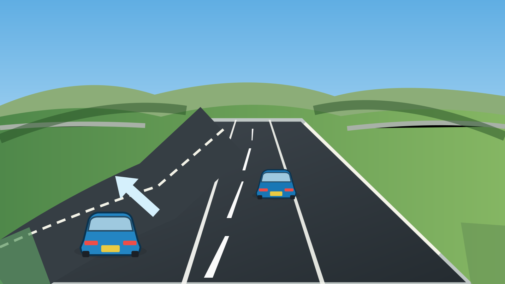

### Leave with time and space

After joining, remain in the left lane long enough to settle into the traffic before considering an overtake. For an exit, read the signs early, get into the appropriate lane in good time and signal your intention. Reduce speed on the slip road as required by its shape and signs; a motorway cruising speed can feel deceptively slow after a long journey. If you miss the exit, continue to the next junction. Never reverse, cross the central reservation or turn back against the traffic flow.

### Put it into practice

Your planned exit appears while you are overtaking two vehicles. There is no safe gap back to the left before the exit. Continue safely past the junction and re-plan at the next exit. Losing a few minutes is preferable to cutting across lanes at the last moment.

### Recap

- Existing motorway traffic has priority.
- An added lane does not require an immediate merge.
- A missed exit means continuing to the next one.

### Sources

- [Highway Code, Rules 253–263 and 272–273](https://www.gov.uk/guidance/the-highway-code/motorways-253-to-273)

Mapped questions: `gb-motorway-001`, `gb-motorway-002`, `gb-motorway-007`, `gb-motorway-008`, `gb-motorway-011`, `gb-motorway-016`

---

## motorways-lanes-and-signals — Lane discipline and motorway signals

Content SHA-256: `ee15117244d62e6b8a1f443fdd04c69229301b1a38ce9be00dbbb4e56fd09fbd`

Module: `module-motorways` · content version 1 · estimated 3 minutes

### Objectives

- Choose lanes according to the task, not their apparent speed.
- Respond correctly to warnings, mandatory limits and red X closures.
- Check safely before changing lanes.

### Use the left lane as the normal lane

The motorway's lanes are not divided into slow drivers and fast drivers. Keep left unless overtaking, then return left when it is safe. Before moving, use mirrors, assess traffic ahead and behind, and check any blind area that could hide a vehicle. Give a useful signal and move smoothly into a genuine gap. Leaving a safe following distance still matters while overtaking. A vehicle towing a trailer must not normally use the right-hand lane of a motorway with three or more lanes.

### Treat information as an early warning

Motorway signs may warn of a hazard that is still beyond your view. Amber flashing signals are a reason to reduce speed and prepare for what lies ahead, not to wait until the obstruction becomes visible. A speed limit shown inside a red circle is compulsory. Follow advance instructions before a lane closure so that you can change lanes safely rather than braking or swerving beneath the final sign. The presence of a warning does not remove your responsibility to choose an appropriate speed for the actual conditions.

### A closed lane is not spare road space

A red X with flashing red lights means the lane is closed. Do not drive in it; hazards and people may be present even if the first stretch looks empty. Emergency services may also need that lane to reach an incident. A closure of the left lane at an exit can make that exit unavailable. In congestion, stay in your lane when queues are moving at different speeds; do not weave between lanes to gain a few car lengths. Reassess every move rather than following another driver through a restriction.

### Put it into practice

You are approaching a red X over the left lane and your satnav says to use that lane for the next exit. Follow the motorway signs and move safely to an open lane. Let the route change rather than entering a closed lane because a navigation instruction is inconvenient.

### Recap

- Keep left except when overtaking.
- Red-circle speed limits and red X closures must be obeyed.
- Plan lane changes early and check the blind area.

### Sources

- [Highway Code, Rules 255–258 and 264–268](https://www.gov.uk/guidance/the-highway-code/motorways-253-to-273)

Mapped questions: `gb-motorway-003`, `gb-motorway-004`, `gb-motorway-005`, `gb-motorway-006`, `gb-motorway-009`, `gb-motorway-012`, `gb-motorway-013`, `gb-motorway-014`, `gb-motorway-015`

---

## motorways-stopping-and-emergencies — Stopping, fatigue and motorway emergencies

Content SHA-256: `715d0006ca6244a5dc5c6d55d6cc236a75b7abc3d04107edb2db474088a83003`

Module: `module-motorways` · content version 1 · estimated 3 minutes

### Objectives

- Distinguish a rest stop from an emergency stop.
- Choose a place of relative safety.
- Explain what to do when safe exit is impossible.

### Stop for the right reason in the right place

Motorway monotony can make you sleepy even when traffic is light. Plan breaks and use a service area or leave at an exit if you need rest. A hard shoulder or emergency area is not a place for a telephone call, a route check or a short sleep. Do not use a hard shoulder as an extra running lane unless the signs permit it. If a problem develops but the vehicle can continue safely, aim for the next service area or leave the motorway rather than stopping beside fast traffic.

### Go left, then get safe

If continuing is not possible, move left and use an emergency area or hard shoulder if you can. Stop as far left as possible, turn the wheels left and switch on hazard warning lights. Use sidelights if darkness or poor visibility requires them. If it is safe and possible, leave by the side away from traffic and move well away from the vehicle and carriageway, behind a safety barrier where available. Check the ground beyond a barrier for drops or other hazards. Keep passengers together and children under control.

### Get help without creating another emergency

If you cannot reach relative safety and cannot leave the vehicle safely, stay inside with seat belts and hazard lights on and call 999 for the police, or use the vehicle's SOS button. Explain your location and direction of travel. Do not attempt roadside repairs on a motorway or walk into a live lane to retrieve an object. Never place a warning triangle on a motorway. From an emergency area, use its emergency telephone and follow the operator's instructions before attempting to rejoin; a lane may need to be closed first.

### Put it into practice

An engine warning appears just before a service-area entrance. The car can still be driven safely. Use the service area rather than stopping on the hard shoulder. If the car instead loses power in a live lane and no safe exit is possible, keep belts on, use hazards and summon urgent help.

### Recap

- Use services for rest; emergency areas are for emergencies.
- Stay away from moving traffic if safe exit is possible.
- If safe exit is impossible, stay belted and call 999.

### Sources

- [Highway Code, Rules 262 and 269–270](https://www.gov.uk/guidance/the-highway-code/motorways-253-to-273)
- [Highway Code, Rules 275–279](https://www.gov.uk/guidance/the-highway-code/breakdowns-and-incidents-274-to-287)

Mapped questions: `motorway-001`, `gb-motorway-010`, `gb-motorway-011`, `course-incidents-001`, `course-incidents-002`, `course-incidents-003`, `course-incidents-004`, `course-incidents-006`, `course-incidents-007`

---

## weather-rain-and-following-space — Rain, grip and following space

Content SHA-256: `15b8e5dfcf7ea39c01666b1ed01fcde1776caf1e9a2580e76115d8be62af4dbd`

Module: `module-weather` · content version 1 · estimated 3 minutes

### Objectives

- Explain how wet weather changes stopping and observation.
- Choose a suitable following gap.
- Respond smoothly when tyres lose contact with the road.

### Plan for less grip and a poorer view

A wet road gives the tyres less grip, so the distance needed to stop is at least double the dry-road distance. Rain and spray can also hide the hazard that would make you brake. Reduce speed to suit the view and leave enough space to see past the vehicle ahead. Take extra care near pedestrians, cyclists and motorcyclists, whose position or stability may change around water. After a long dry spell, the first rain can make the surface particularly slippery; familiar roads still need a fresh assessment.

### Use time, then increase it for conditions

At high speed, a dry-road following gap should be at least two seconds. Choose a fixed roadside feature, note when the vehicle ahead passes it, and count until your own vehicle reaches it. On a wet road, at least double that gap. Four seconds is therefore a minimum starting point in wet high-speed conditions, not a promise that every speed and surface is safe. Increase the space further when visibility or grip is worse. Dropping back also improves the chance of seeing a brake-light warning early.

[Play original case study: A wet dual carriageway](../../src/assets/case-studies/wet-following-gap.mp4)

### Avoid sudden reactions to surface water

If steering becomes unusually light or unresponsive in heavy rain, water may be preventing the tyres from gripping the road. Ease off the accelerator and slow gradually rather than making an abrupt steering or braking input. Look well ahead so that reducing speed happens before deep water or a bend whenever possible. A shiny diesel spill can be extremely slippery, especially when wet. Do not assume that a large vehicle ahead will uncover every hazard for you; its spray can make following closely both less visible and less controllable.

### Put it into practice

A van ahead throws spray over your windscreen. Instead of staying close to use its tail-lights as a guide, increase the gap and reduce speed until you can see enough clear road. If the van brakes suddenly, the extra space gives you time to react and stop.

### Recap

- Wet stopping distances are at least double dry distances.
- At least double the two-second high-speed gap in rain.
- Ease off smoothly if steering loses response in water.

### Sources

- [Highway Code, Rule 126](https://www.gov.uk/guidance/the-highway-code/general-rules-techniques-and-advice-for-all-drivers-and-riders-103-to-158)
- [Highway Code, Rule 227](https://www.gov.uk/guidance/the-highway-code/driving-in-adverse-weather-conditions-226-to-237)

Mapped questions: `weather-001`, `weather-003`, `gb-weather-001`, `gb-weather-002`, `gb-weather-003`, `gb-weather-012`

---

## weather-visibility-wind-and-heat — Fog, wind and bright weather

Content SHA-256: `ce1aa9d9890d2c004c00c34dcda085a51f84c4bc9c19a8c688a6c449bf3aec88`

Module: `module-weather` · content version 1 · estimated 3 minutes

### Objectives

- Choose lights that help without dazzling others.
- Anticipate sudden changes in wind and visibility.
- Respond safely to glare and heat-related fatigue.

### Drive within the view you actually have

Before entering fog, check mirrors and reduce speed. A clear patch after a fog warning does not mean the whole route has cleared; another bank may appear suddenly. Keep a gap that allows you to stop within the distance you can see is clear. Do not simply follow the red lights ahead, because their apparent visibility can encourage an unsafe speed or gap. Use wipers and demisters to keep the windscreen clear. If another driver follows too closely, do not accelerate into a view you cannot safely use.

### Use lights for conditions, then change them back

When visibility is seriously reduced, generally when you cannot see beyond 100 metres, headlights must be used. Front or rear fog lights may also be used in those conditions, but must be switched off when visibility improves. Unnecessary fog lights can dazzle and make brake lights harder to distinguish. At a junction in fog, stop correctly, look and listen carefully before emerging. Once you know it is safe, move positively without stopping where you would block the path of approaching traffic. Lighting is an aid to observation, not a substitute for it.

### Expect movement you cannot predict exactly

Crosswinds can push a car or vulnerable road user sideways. Be especially prepared on exposed bridges, open stretches and gaps in hedges. Passing a large vehicle may change the wind pressure around you, and a motorcyclist can be especially affected by that turbulence. Give space rather than trying to pass closely. In hot weather, ventilation can improve comfort but does not cure tiredness: arrange a safe rest stop if you become sleepy. If low sun dazzles you, reduce speed and, if necessary, stop safely rather than driving without an adequate view.

### Put it into practice

A fog bank clears as you reach an exposed bridge. Reassess both problems: switch off unnecessary fog lights, but keep enough space for the gusts that may affect you or the motorcyclist ahead. Better visibility does not remove the separate risk from wind.

### Recap

- Use headlights in seriously reduced visibility.
- Switch fog lights off when the conditions improve.
- Allow extra room for gusts, glare and unstable road users.

### Sources

- [Highway Code, Rules 226 and 232–237](https://www.gov.uk/guidance/the-highway-code/driving-in-adverse-weather-conditions-226-to-237)

Mapped questions: `weather-002`, `wind-001`, `gb-weather-004`, `gb-weather-005`, `gb-weather-006`, `gb-weather-007`, `gb-weather-008`, `gb-weather-009`, `gb-weather-010`, `gb-weather-011`, `gb-weather-013`

---

## winter-prepare-before-driving — Preparing for snow and ice

Content SHA-256: `5bb08e3b728cda8b49a4045685a19a3e87445414605f37904e9d51f76fb36349`

Module: `module-winter` · content version 1 · estimated 3 minutes

### Objectives

- Decide whether a winter journey is necessary.
- Clear the vehicle properly before departure.
- Prepare for delays and changing route conditions.

### Decide before the car moves

Snow and ice can make a normally simple journey difficult to control or complete. Check local forecasts and travel warnings rather than judging only the road outside your home. The Highway Code advises against driving in these conditions unless the journey is essential. If it is essential, allow more time, consider the route and identify safer alternatives or stopping places. A time commitment does not make an unsafe journey necessary; changing an appointment may be the safer decision. Tell someone your plan when there is a realistic chance of becoming stranded.

### Clear more than a small viewing hole

You must be able to see, so remove snow and ice from every window, not just a patch in front of the steering wheel. Clear mirrors and demist the inside of the glass thoroughly. Lights must be clean and number plates visible and legible. Remove snow that could fall from the vehicle into the path of other road users, including snow on the roof that might slide across your own view when braking. Complete these jobs while parked safely, before expecting the ventilation or wipers to solve them on the move.

### Carry help and keep checking the plan

For an essential winter journey, take items that help if you are delayed: de-icer and scraper, warm clothing and boots, a torch, first-aid kit, jump leads and a shovel, with food and a warm drink. Prepare the vehicle for the conditions rather than relying only on an emergency bag. Check that the intended route is not already blocked and that more severe weather is not forecast. Once travelling, listen to travel information and variable signs. Conditions may change over a short distance, so be willing to stop safely or revise the plan.

### Put it into practice

You have cleared the windscreen but the side windows, lights and roof remain covered. The destination is only a mile away. Finish clearing the vehicle before departure, then reassess whether the journey is essential. A short distance still requires visibility and must not shed a hazard behind you.

### Recap

- Avoid non-essential journeys in snow or ice.
- Clear windows, mirrors, lights, plates and loose roof snow.
- Prepare for delays and reassess the route.

### Sources

- [Highway Code, Rules 228–230](https://www.gov.uk/guidance/the-highway-code/driving-in-adverse-weather-conditions-226-to-237)

Mapped questions: `gb-winter-001`, `gb-winter-002`, `gb-winter-003`, `gb-winter-004`, `gb-winter-005`, `gb-winter-006`, `gb-winter-010`

---

## winter-control-and-stopping — Maintaining control on ice

Content SHA-256: `6b9c4717f1fc5b1251c7b41a8e7caac5fcd65d00f2ae2c1eb255ebcbdda1c160`

Module: `module-winter` · content version 1 · estimated 3 minutes

### Objectives

- Explain why stopping space must grow greatly.
- Use gentle inputs before bends and when starting.
- Recognise that treatment does not guarantee grip.

### Leave room for a much longer stop

Ice can reduce grip so much that stopping distances may be ten times the dry-road distance. Leave a very large gap rather than copying the distance used by a driver ahead. Drive carefully even where a road has been treated: gritting is not a guarantee that every shaded patch, bridge or junction is clear. Conditions can vary within a short stretch, and information signs may warn of hazards you have not reached. Reduce demands on the tyres before the difficult surface rather than waiting for the car to slide.

### Make acceleration, braking and steering gentle

Avoid sudden actions, because a tyre needs grip to change speed or direction. In a manual car, use a suitably high gear at a slow, safe speed and accelerate gently to reduce the chance of wheelspin. Before a bend, brake progressively while travelling straight, then steer smoothly around it at the reduced speed. Do not brake hard only after entering the bend. Vehicle controls and transmission instructions vary, so use the manufacturer's advice alongside the general principle of avoiding sharp changes in force. Extra technology cannot create grip where the surface provides very little.

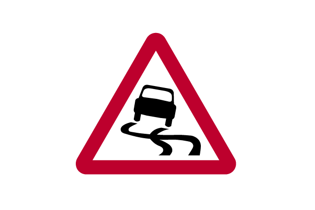

### Observe the surface and the vehicles treating it

Very little tyre noise can be a clue that the road is icy. If you are uncertain about grip, only test it by gentle braking in a safe place where that action will not put anyone at risk. A winter maintenance vehicle may be spreading salt or throwing snow into adjoining space, so keep clear and be cautious around it. Do not pass a snowplough unless the lane you intend to use has been cleared. Progress is secondary to having a safe path, a useful view and enough stopping room.

### Put it into practice

A gritted main road leads into a shaded bend and the tyre noise becomes unusually quiet. Ease speed down on the straight, keep a much larger following gap and steer gently. Do not interpret the earlier grit treatment as permission to keep the same speed through a potentially icy bend.

### Recap

- Stopping on ice may require ten times the dry-road distance.
- Slow before bends and avoid sudden controls.
- Treated roads and snow-clearing vehicles still need caution.

### Sources

- [Highway Code, Rules 230–231](https://www.gov.uk/guidance/the-highway-code/driving-in-adverse-weather-conditions-226-to-237)

Mapped questions: `winter-001`, `gb-winter-007`, `gb-winter-008`, `gb-winter-009`, `gb-winter-011`, `gb-winter-012`, `gb-winter-013`, `gb-winter-014`, `gb-winter-015`

---

## parking-restrictions-and-access — Reading parking restrictions

Content SHA-256: `65c2e1d5b250adab1ad74dd264fe7fb8f7f6308650dee33812c4198280d61857`

Module: `module-parking` · content version 1 · estimated 3 minutes

### Objectives

- Distinguish waiting restrictions from stopping restrictions.
- Read zone signs, markings and reserved bays together.
- Keep crossings, junctions and access routes usable.

### Read the whole restriction

Yellow lines control waiting, and their operating times come from nearby plates or the signs at a Controlled Parking Zone entrance. Double yellow lines mean no waiting at any time even without a separate upright sign. A stopping restriction is stricter than a waiting restriction: do not assume that remaining in the driver's seat makes a brief stop acceptable. Clearways and signed school entrance markings require particular attention. Look for the complete combination of lines, signs and local conditions before deciding where a passenger can get out or a delivery can be made.

### Use bays only for their stated purpose

A marked parking place may have conditions concerning time, payment or eligible users. A Blue Badge bay is reserved for those entitled to use it; a vacant bay is not general permission. Controlled-zone entry signs can supply the usual waiting times, while particular bays may have their own instructions. Do not park in an operating tram lane that is not available to your vehicle. In London and Scotland, pavement parking is prohibited, with exceptions only in limited circumstances. Elsewhere, you should not park on the pavement unless signs permit it. Pavement parking can obstruct wheelchair users, people with visual impairments and people with pushchairs.

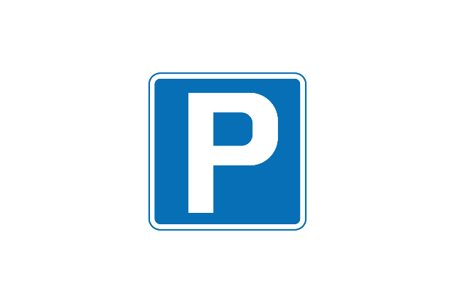

### Think about the space others need

A space can be physically large enough for your car but still unsafe or unlawful to use. Keep the zig-zag approaches to pedestrian crossings clear. Do not stop or park opposite or within 10 metres of a junction unless in an authorised parking space. Do not obstruct emergency access, a fire-station entrance or an entrance that others need to use. Look beyond the length of your own car: a wheelchair user, an emergency vehicle or a driver emerging from a junction may need the space you would remove. Choose an off-street parking area or a suitable marked bay wherever possible.

### Put it into practice

There is a car-sized gap beside double yellow lines near a junction. A passenger says you can wait there because you will remain in the vehicle. Check the restriction and the junction position; staying at the wheel does not turn waiting into unrestricted parking. Choose a lawful place that preserves visibility and access.

### Recap

- Check signs and markings together, including zone entry signs.
- A free space is not automatically a permitted space.
- Keep crossings, junctions and emergency access clear.

### Sources

- [Highway Code, Rules 238–245](https://www.gov.uk/guidance/the-highway-code/waiting-and-parking-238-to-252)

Mapped questions: `parking-001`, `parking-002`, `gb-parking-005`, `gb-parking-006`, `gb-parking-007`, `gb-parking-008`, `gb-parking-009`, `gb-parking-010`, `gb-parking-011`, `gb-parking-012`

---

## parking-secure-and-visible — Leaving a parked vehicle safely

Content SHA-256: `8b1ec5ea7c372c0e0195b9159d04ef16c6456b2384a7642bf78682378288b9d6`

Module: `module-parking` · content version 1 · estimated 3 minutes

### Objectives

- Secure a parked car and protect passing road users.
- Check the night-parking lighting rules.
- Avoid hazards caused by doors, passengers or charging leads.

### Complete the stop before leaving

Roadside parking should normally face with the traffic flow and be close to the side. Before leaving, switch off the engine, headlights and fog lights and apply the parking brake. Make the vehicle secure and put valuables out of sight. On a hill, combine the parking brake with the appropriate gear and wheel position: uphill, a forward gear and wheels away from the kerb; downhill, reverse and wheels towards the kerb. Use Park for an automatic. Follow the vehicle's instructions for its controls rather than assuming the parking brake alone completes every situation.

### Doors and passengers create moving hazards

You must not hit another road user when opening a door. Check all around, including mirrors and the view over your shoulder, for cyclists and other traffic. Where possible, using the hand farther from the door encourages the body to turn and improves that shoulder check. Passengers, especially children, are generally safer leaving on the kerb side. Do not place the car so close to a Blue Badge vehicle that its occupants lose needed space. At an electric charger, keep cables from becoming a trip hazard and replace them neatly when finished.

### A parked car must still be visible

At night, do not park facing against traffic unless in a recognised parking space. Parking lights are required on a road or lay-by where the speed limit is greater than 30 mph. Some vehicles, including ordinary cars, can be parked without lights on roads limited to 30 mph or less only under the conditions in the Code, such as a recognised parking place or being close to the kerb, facing with traffic and at least 10 metres from a junction. Do not apply that exception to every vehicle or projecting load. Parking on a road in fog is particularly hazardous; if unavoidable, leave parking lights or sidelights on.

### Put it into practice

You park after dark on a 40 mph road. Switching off the headlights does not remove the requirement for parking lights. After securing the car, check the lighting rule and look for passing cyclists before opening the door. Ask a child passenger to leave on the kerb side.

### Recap

- Secure the vehicle and use the correct parking procedure.
- Check before opening any door.
- Night parking has direction and lighting requirements.

### Sources

- [Highway Code, Rules 239 and 248–252](https://www.gov.uk/guidance/the-highway-code/waiting-and-parking-238-to-252)

Mapped questions: `parking-003`, `parking-002`, `gb-parking-001`, `gb-parking-002`, `gb-parking-003`, `gb-parking-004`, `gb-parking-013`

---

## incidents-breakdown-response — Responding to a breakdown

Content SHA-256: `6f896b4828de8c270e2f8938e6e4e16b15dc0f5a556202a8a7adceb52449049d`

Module: `module-incidents` · content version 1 · estimated 3 minutes

### Objectives

- Choose a safer stopping place before calling recovery.
- Explain the safe-exit and unsafe-exit responses.
- Give useful location information and avoid dangerous retrieval.

### Think about relative safety first

When a vehicle develops a problem, the first decision is where people and the vehicle will be least exposed to moving traffic. A service area or another place designed for parking is safer than a hard shoulder beside high-speed traffic. If you can continue safely to an exit or service area, do so. If not, move left towards an emergency area or hard shoulder where possible, stop far left with wheels turned left and use hazard lights. Do not continue driving a vehicle that cannot be controlled safely just to reach a preferred stopping place.

### Choose the response that is actually safe

If safe and possible, leave on the side away from traffic and get passengers well away from the vehicle and carriageway, behind a barrier where available. Do not stand where the car could be forced into you. If you cannot reach a place of relative safety and cannot exit safely, remain inside with belts and hazards on and call 999 for the police or use the SOS button. A disability may prevent safe exit even where another person could get out. Explain that situation urgently rather than attempting an unsafe transfer into traffic.

### Help rescuers find you without entering danger

Give the road, direction and location as accurately as possible. Motorway marker posts, driver location signs and an appropriate mapping application can help; quote visible numbers rather than guessing a junction. An emergency telephone can provide assistance, and recovery operators should know if you are a vulnerable motorist. Never place a warning triangle on a motorway or retrieve luggage from a live lane. If an object falls onto a motorway, reach relative safety and call 999. Before leaving an emergency area after recovery, use its telephone and follow the operator's instructions for a safe rejoin.

### Put it into practice

A suitcase comes off a roof rack onto a motorway lane. Do not run back to collect it, even if it appears close. Stop in a place of relative safety and call the emergency services with the road, direction and best available location details so traffic can be managed safely.

### Recap

- Reach relative safety where possible.
- If safe exit is impossible, stay belted and call 999.
- Do not retrieve objects or put a triangle on a motorway.

### Sources

- [Highway Code, Rules 275–280](https://www.gov.uk/guidance/the-highway-code/breakdowns-and-incidents-274-to-287)

Mapped questions: `course-incidents-001`, `course-incidents-002`, `course-incidents-003`, `course-incidents-004`, `course-incidents-005`, `course-incidents-006`, `course-incidents-007`, `course-incidents-008`

---

## incidents-collision-duties — At a collision: protect, report and exchange details

Content SHA-256: `15d76f19f90bc35138c748b74b472f448205570f8eb6f63fdbc70c2703e76ab8`

Module: `module-incidents` · content version 1 · estimated 3 minutes

### Objectives

- Reduce the risk of a second collision.
- Recognise dangerous-goods hazards.
- State the duty to stop and provide or report details.

### Avoid becoming part of the incident

Flashing emergency lights may be the first warning of an incident beyond a bend or over a crest. Reduce speed and be ready to stop or change lane safely. Follow police and traffic-officer directions. Workers, debris and stationary vehicles may occupy space that normally carries traffic. When an incident is on the other carriageway, keep attention on your own road rather than slowing unnecessarily to look. That distraction can create another collision or a queue. Treat every approach as a changing scene and preserve enough room to respond.

### Protect people without adding hazards

If you are involved or stop to help, use a place of relative safety where possible and warn others with hazard lights. Ask for engines to be switched off and for nobody to smoke. Move uninjured people away from vehicles and moving traffic if that can be done safely. A vehicle marked for dangerous goods may create hazards that are not visible, including flammable material. Keep well away and tell emergency services what markings can be read from a safe place. Do not approach a leaking load or use a mobile phone close to a vehicle carrying flammable goods.

### Stopping and reporting are separate responsibilities

After a collision causing injury or damage to another person, vehicle, animal or property, you must stop. Give your own and the vehicle owner's name and address and the vehicle registration to someone with reasonable grounds to request them. If required name and address details are not given at the time, report to police as soon as reasonably practicable and within 24 hours. Where another person is injured and the insurance certificate is not produced as required at the scene, the Code also requires police reporting as soon as possible and within 24 hours, and production of the certificate within seven days.

### Put it into practice

After a low-speed collision, both drivers can move safely out of the road and nobody appears injured. Do not simply drive away because the damage is small. Stop, exchange the required details and follow reporting requirements if those details cannot be provided. Remain alert to other traffic while dealing with the situation.

### Recap

- Approach incidents cautiously and follow official directions.
- Keep clear of dangerous goods and prevent smoking.
- Stop, exchange required details and report when required.

### Sources

- [Highway Code, Rules 281–287](https://www.gov.uk/guidance/the-highway-code/breakdowns-and-incidents-274-to-287)

Mapped questions: `course-incidents-009`, `course-incidents-010`, `course-incidents-011`, `course-incidents-012`, `course-incidents-013`, `course-incidents-014`, `course-incidents-015`, `course-incidents-016`

---

## incidents-helping-casualties — Helping people while emergency services respond

Content SHA-256: `45cceeaf38f7397785310976f7e5a92dbb311a24290a159e507c3f1aa7b3c436`

Module: `module-incidents` · content version 1 · estimated 3 minutes

### Objectives

- Put scene safety before approaching a casualty.
- Give clear information to an emergency call handler.
- Avoid harmful movement and recognise the limits of this lesson.

### Check danger before giving help

A person needing help can draw attention away from fast traffic, broken glass, spilled fuel or a vehicle that may move. Check that it is safe to approach, and keep yourself and uninjured people away from the path of traffic. If possible, use other bystanders to help without creating a crowd around the casualty. Have someone call 999 or 112 promptly. Give the exact location, direction of travel and number of vehicles, then describe what is actually observed: for example, someone trapped, heavy bleeding, breathing difficulty or no response when spoken to.

### Do not improvise treatment

Do not normally move an injured person from a vehicle unless there is immediate danger. Do not remove a motorcyclist's helmet unless it is essential and you are trained to do so. Reassure casualties, keep them warm and dry where possible, and do not give food or drink. Stay with them if it is safe, watch for changes and pass those changes to the emergency service. An untrained helper should follow the call handler's instructions, explaining clearly what they can and cannot do rather than guessing at a medical technique.

### Use training and professional guidance

If someone does not respond, tell the emergency call handler immediately and follow their questions and directions about breathing and urgent care. Do not delay calling because you are trying to diagnose an injury yourself. First-aid skills can make a difference, but a short driving lesson is not a replacement for practical first-aid training. The Highway Code's first-aid annex is a general guide and any help at the roadside is temporary until professional care arrives. Keep your own safety under review throughout: a change in traffic or fire risk may change what assistance is possible.

### Put it into practice

A motorcyclist is injured but the immediate position is safe. A bystander proposes taking off the helmet and giving water. Keep the helmet in place unless essential and appropriately trained, give no food or drink, call for emergency help and follow the call handler's guidance while reassuring the casualty.

### Recap

- Check danger, summon help and describe observations clearly.
- Avoid unnecessary movement, helmet removal, food or drink.
- Follow emergency guidance; seek practical first-aid training.

### Sources

- [Highway Code, Rule 283](https://www.gov.uk/guidance/the-highway-code/breakdowns-and-incidents-274-to-287)
- [Highway Code, Annex 7: First aid on the road](https://www.gov.uk/guidance/the-highway-code/annex-7-first-aid-on-the-road)

Mapped questions: `course-incidents-017`, `course-incidents-018`, `course-incidents-019`, `course-incidents-020`, `course-incidents-021`, `course-incidents-022`, `course-incidents-023`, `course-incidents-024`

