# Questions — independent review copy

Review every entry against current primary sources, its presentation and linked media. Record judgement in `QUESTION_REVIEW_TRACKER.csv`; do not approve by sampling.

## rules-001 — You are approaching a zebra crossing and a pedestrian is waiting to cross. What should you do?

Content SHA-256: `6a579bb28997489b0b445266d8a0b3ab79f19efb4198d7a784b95ce0ce42c1f0`

You are approaching a zebra crossing and a pedestrian is waiting to cross. What should you do?

A. Maintain your speed unless they step onto the crossing
B. Give way and be prepared to stop
C. Sound your horn to warn them
D. Wave them across while continuing to drive

**Correct:** B — Give way and be prepared to stop

You should give way to pedestrians waiting to cross at a zebra crossing. Never wave or signal them across because another vehicle may not have seen them.

Source: [Highway Code, Rule 195](https://www.gov.uk/guidance/the-highway-code/using-the-road-159-to-203)

Unanswered question: zebra-crossing; visible caption: (hidden); accessible description: Road with striped pedestrian crossing

Answer review: zebra-priority-example; visible caption: Give way to people using a zebra crossing; accessible description: Give way to people using a zebra crossing

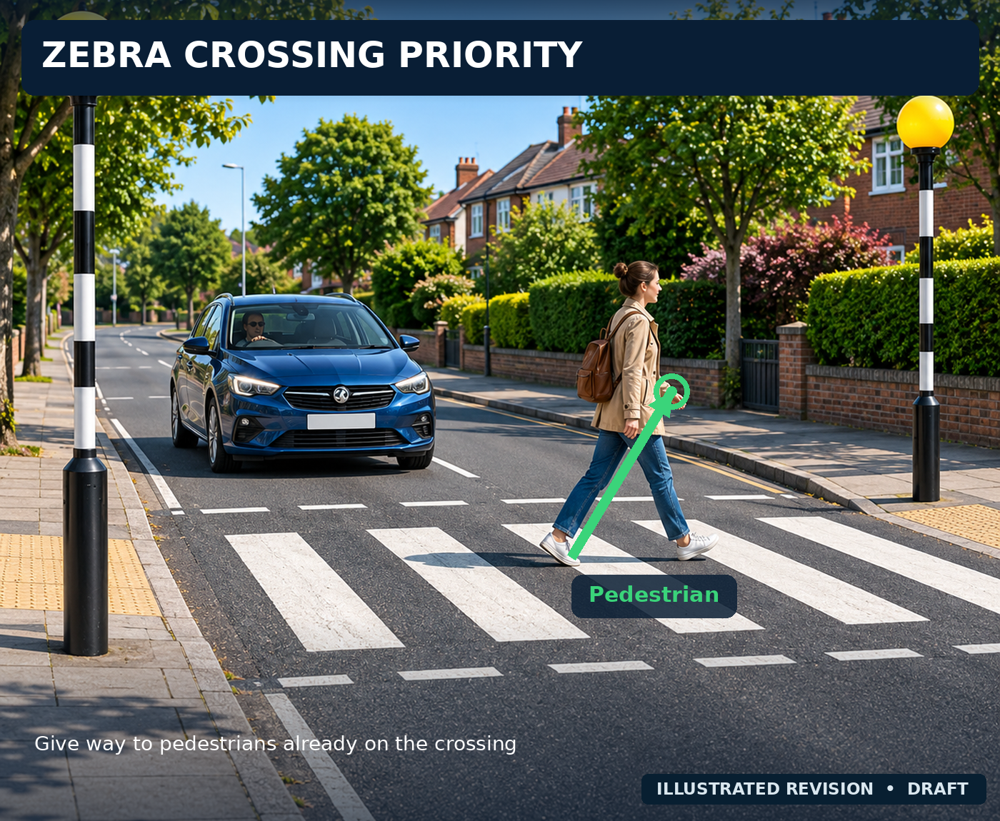

---

## motorway-001 — When may you use a motorway hard shoulder?

Content SHA-256: `085d59b4d4f12a4a25f65034eb4382655eeab1f5684c624ba6746d51c7abbd9e`

When may you use a motorway hard shoulder?

A. To make a phone call
B. To overtake slow traffic
C. In an emergency or when directed by an authorised signal or person
D. Whenever traffic is congested

**Correct:** C — In an emergency or when directed by an authorised signal or person

You must not use a hard shoulder except in an emergency or when directed by the police, traffic officers or a traffic sign. Some motorways have a hard shoulder that can be opened as a running lane when signs permit.

Source: [Highway Code, Rule 269](https://www.gov.uk/guidance/the-highway-code/motorways-253-to-273)

---

## safety-001 — What is the main purpose of a correctly adjusted head restraint?

Content SHA-256: `e5090e3f8225b8ae60d81681dc2d0e88fb4f5bebec1ae68017965bc83de22d58`

What is the main purpose of a correctly adjusted head restraint?

A. To make the seat more comfortable
B. To reduce the risk of neck injury in a collision
C. To support luggage on the back seat
D. To improve rear visibility

**Correct:** B — To reduce the risk of neck injury in a collision

A correctly adjusted head restraint helps reduce the risk of neck injury, particularly whiplash, in a collision.

Source: [Highway Code, vehicle safety guidance](https://www.gov.uk/guidance/the-highway-code/annex-6-vehicle-maintenance-safety-and-security)

Answer review: head-restraint; visible caption: Head restraint adjustment; accessible description: Head restraint adjustment

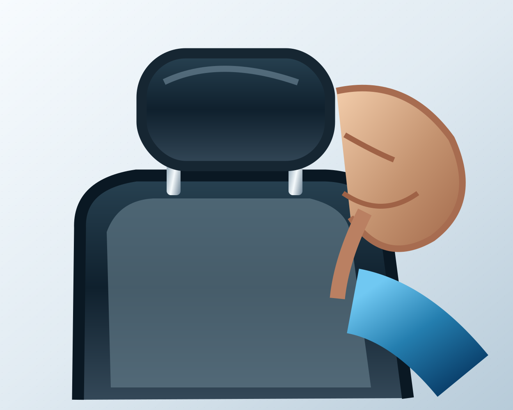

---

## weather-001 — On a high-speed road in wet weather, how should you change the normal two-second following gap?

Content SHA-256: `61d9ffc844041a831cb14b8c53e0d8f220d9936607d4c77c91fd631c344035f3`

On a high-speed road in wet weather, how should you change the normal two-second following gap?

A. Keep it at two seconds
B. At least double it
C. Reduce it to one second
D. Increase it only at night

**Correct:** B — At least double it

The Highway Code advises that the gap should be at least doubled on wet roads. Wet conditions also increase stopping distances.

Source: [Highway Code, Rule 126](https://www.gov.uk/guidance/the-highway-code/general-rules-techniques-and-advice-for-all-drivers-and-riders-103-to-158)

---

## signs-001 — What does a red circular road sign generally indicate?

Content SHA-256: `d4eb866946f1facded08552a2eb729a766d32793d08159672fe01118ce326998`

What does a red circular road sign generally indicate?

A. An order or restriction
B. A tourist attraction
C. A warning of a hazard only
D. A motorway service area

**Correct:** A — An order or restriction

Circular signs generally give orders. Red circles are commonly used for prohibitions and restrictions.

Source: [Know Your Traffic Signs, regulatory signs](https://www.gov.uk/guidance/the-highway-code/traffic-signs)

Unanswered question: no-entry; visible caption: (hidden); accessible description: Red circular sign with a horizontal white bar

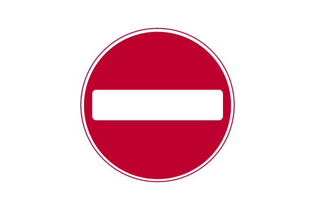

Answer review: no-entry; visible caption: No entry; accessible description: No entry

---

## junction-001 — You reach a STOP sign and a solid white line at a junction. What must you do?

Content SHA-256: `f410789dd43a4950f52c5f9a04dc0a6410edbe852ccaf2e5a08353b18211a4c3`

You reach a STOP sign and a solid white line at a junction. What must you do?

A. Stop behind the line and wait for a safe gap
B. Slow down and continue if the road seems clear
C. Stop only if another driver sounds a horn
D. Stop after the line so you can see better

**Correct:** A — Stop behind the line and wait for a safe gap

You must stop behind the solid white line at a STOP sign, then wait until there is a safe gap before moving off.

Source: [Highway Code, Rule 171](https://www.gov.uk/guidance/the-highway-code/using-the-road-159-to-203)

Unanswered question: stop-sign; visible caption: (hidden); accessible description: Red octagonal sign bearing white STOP lettering

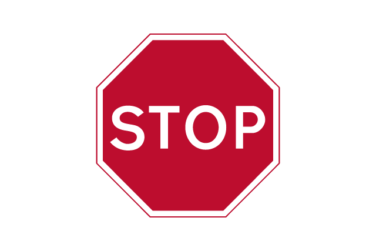

Answer review: stop-example; visible caption: STOP: stop at the line before proceeding safely; accessible description: STOP: stop at the line before proceeding safely

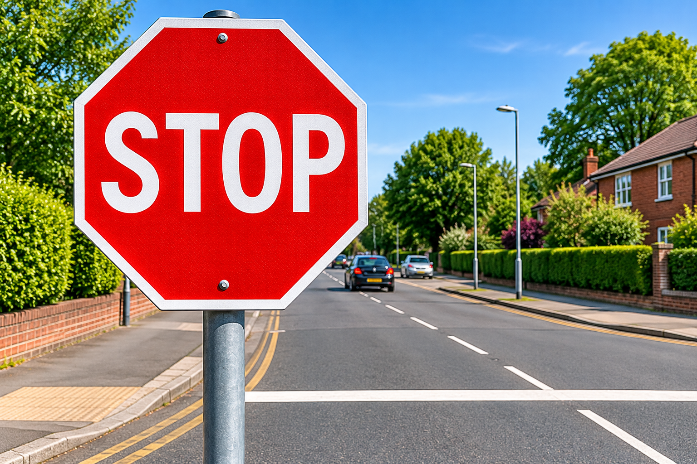

---

## junction-002 — You are turning into a side road. A pedestrian is waiting to cross that road. What should you do?

Content SHA-256: `6f68d82c7c7aa7d9c3303d56a78b542534a75b1664ce0b366e285225771a0962`

You are turning into a side road. A pedestrian is waiting to cross that road. What should you do?

A. Turn quickly before the pedestrian steps out
B. Give way to the pedestrian waiting to cross
C. Sound your horn to signal your intention
D. Wave them to wait and continue

**Correct:** B — Give way to the pedestrian waiting to cross

When turning at a junction, you should give way to pedestrians crossing or waiting to cross the road into which you are turning.

Source: [Highway Code, Rule 170](https://www.gov.uk/guidance/the-highway-code/using-the-road-159-to-203)

---

## roundabout-001 — At a normal roundabout with no signs telling you otherwise, which traffic generally has priority?

Content SHA-256: `4a3a1450c3d7ad86f8d2e75ba37cd56650f31eee11275bc253da45595eb78606`

At a normal roundabout with no signs telling you otherwise, which traffic generally has priority?

A. Traffic approaching from your left
B. Traffic approaching from your right
C. Vehicles entering fastest
D. Only buses and taxis

**Correct:** B — Traffic approaching from your right

Give priority to traffic approaching from your right unless road signs, signals or markings direct otherwise.

Source: [Highway Code, Rule 185](https://www.gov.uk/guidance/the-highway-code/using-the-road-159-to-203)

---

## roundabout-002 — You intend to take the first exit left at a roundabout, and signs do not say otherwise. What is the usual approach?

Content SHA-256: `01f315f0b0777a0091f80e64a3441794976d9a817118e251124218ad2e2380aa`

You intend to take the first exit left at a roundabout, and signs do not say otherwise. What is the usual approach?

A. Signal right and use the right lane
B. Enter without indicating
C. Signal left and approach in the left-hand lane
D. Use either lane but never indicate

**Correct:** C — Signal left and approach in the left-hand lane

For the first exit left, normally signal left and approach in the left-hand lane; continue signalling left to leave.

Source: [Highway Code, Rule 186](https://www.gov.uk/guidance/the-highway-code/using-the-road-159-to-203)

---

## overtaking-001 — You are approaching a blind bend. What is the safest choice about overtaking?

Content SHA-256: `a2c65eb9ee980b4c141bcfaffdcfdbbd372281d98bd3770d0ba802b064cf1443`

You are approaching a blind bend. What is the safest choice about overtaking?

A. Overtake if the vehicle ahead is slow
B. Overtake only while sounding your horn
C. Wait until you can see far enough ahead and it is safe
D. Drive closer to the vehicle ahead and then overtake

**Correct:** C — Wait until you can see far enough ahead and it is safe

Do not overtake if you cannot see far enough ahead to be sure it is safe, such as near a bend or the brow of a hill.

Source: [Highway Code, Rule 166](https://www.gov.uk/guidance/the-highway-code/using-the-road-159-to-203)

---

## overtaking-002 — Another driver is overtaking your car. How should you normally respond?

Content SHA-256: `dcb9990f3e0756699b979e71872b62c0f4e4fbffe92741af48885e214ef170f6`

Another driver is overtaking your car. How should you normally respond?

A. Accelerate so they cannot get past
B. Maintain a steady course and speed, slowing if necessary
C. Move closer to the centre line
D. Flash your headlights continually

**Correct:** B — Maintain a steady course and speed, slowing if necessary

Do not obstruct a driver who is overtaking you. Maintain a steady course and speed, and slow down if needed to let them pass safely.

Source: [Highway Code, Rule 168](https://www.gov.uk/guidance/the-highway-code/using-the-road-159-to-203)

---

## crossings-001 — What is prohibited on the zig-zag lines approaching a pedestrian crossing?

Content SHA-256: `97d49f9f5ee8650bb8c0ea5ac957b208230509518ad32588b2ed5915c5e05684`

What is prohibited on the zig-zag lines approaching a pedestrian crossing?

A. Parking and overtaking the vehicle nearest the crossing
B. Driving under 20 mph
C. Checking your mirrors before stopping
D. Giving way to pedestrians

**Correct:** A — Parking and overtaking the vehicle nearest the crossing

You must not park on the crossing or its zig-zag lines, or overtake the moving vehicle nearest the crossing or one stopped for pedestrians.

Source: [Highway Code, Rule 191](https://www.gov.uk/guidance/the-highway-code/using-the-road-159-to-203)

---

## pedestrians-001 — You are passing a stopped bus in a busy shopping street. What should you anticipate?

Content SHA-256: `d452bfde83929410626c3ef3f5384f9c29b7810fa328e5af40476dc77dd2b05f`

You are passing a stopped bus in a busy shopping street. What should you anticipate?

A. Pedestrians may step out unexpectedly
B. The road must be clear because the bus has stopped
C. The bus will always signal before a pedestrian crosses
D. Pedestrians cannot cross near a bus stop

**Correct:** A — Pedestrians may step out unexpectedly

Drive slowly and carefully near bus and tram stops: pedestrians may appear suddenly from behind or in front of the vehicle.

Source: [Highway Code, Rule 206](https://www.gov.uk/guidance/the-highway-code/road-users-requiring-extra-care-204-to-225)

---

## pedestrians-002 — You are driving across a pavement and cycle lane to enter a private driveway. Who should you give way to?

Content SHA-256: `3ad6c7c734485123227289f4a74b786908a0df0eb2547d2bd45290a1823ab0c0`

You are driving across a pavement and cycle lane to enter a private driveway. Who should you give way to?

A. Only cars on the road
B. Pedestrians and cyclists using the pavement and cycle lane
C. Only vehicles behind you
D. Nobody because you are entering private land

**Correct:** B — Pedestrians and cyclists using the pavement and cycle lane

When crossing a pavement, cycle lane or cycle track to reach a driveway, give way to pedestrians and cyclists using those facilities.

Source: [Highway Code, Rule 206](https://www.gov.uk/guidance/the-highway-code/road-users-requiring-extra-care-204-to-225)

---

## weather-002 — Fog has reduced visibility to less than about 100 metres. Which lighting rule applies?

Content SHA-256: `71bc740b262e50359c632e5821ee22f94e4075ce710a9b73ee97632f51e0fa11`

Fog has reduced visibility to less than about 100 metres. Which lighting rule applies?

A. Use your headlights
B. Switch off all lights to reduce reflection
C. Use hazard warning lights continuously while moving
D. Only use your sidelights

**Correct:** A — Use your headlights

You must use headlights when visibility is seriously reduced, generally when you cannot see farther than 100 metres.

Source: [Highway Code, Rule 226](https://www.gov.uk/guidance/the-highway-code/driving-in-adverse-weather-conditions-226-to-237)

---

## weather-003 — In heavy rain your steering suddenly feels unresponsive. What should you do first?

Content SHA-256: `1443ca64af967157d71565b9acc12abc54d31fc6af603d5f4fea78e6cd37129f`

In heavy rain your steering suddenly feels unresponsive. What should you do first?

A. Brake sharply and turn hard
B. Ease off the accelerator and slow gradually
C. Accelerate to regain steering
D. Switch off the engine immediately

**Correct:** B — Ease off the accelerator and slow gradually

Water can prevent tyres gripping the road. The Highway Code advises easing off the accelerator and slowing down gradually.

Source: [Highway Code, Rule 227](https://www.gov.uk/guidance/the-highway-code/driving-in-adverse-weather-conditions-226-to-237)

---

## winter-001 — In icy conditions, stopping distances may be how much greater than on dry roads?

Content SHA-256: `e0703e8f8e2f5cb4f07a85a892d5618d0db7a870ae1dbdfb943a41fd95267022`

In icy conditions, stopping distances may be how much greater than on dry roads?

A. The same as in dry weather
B. Up to twice as great
C. Up to ten times as great
D. Always exactly three times as great

**Correct:** C — Up to ten times as great

Stopping distances on icy or snowy roads can be ten times greater than in dry conditions. Increase separation and avoid harsh controls.

Source: [Highway Code, Rule 230](https://www.gov.uk/guidance/the-highway-code/driving-in-adverse-weather-conditions-226-to-237)

---

## parking-001 — What do double yellow lines generally mean?

Content SHA-256: `e12ada5f7db2a9274c8b637748f302e0ca34a1a4963a1279abcb4f99095f5685`

What do double yellow lines generally mean?

A. No waiting at any time, subject to applicable exemptions
B. No waiting only during the evening
C. Parking is always allowed for up to one hour
D. Only commercial vehicles may wait

**Correct:** A — No waiting at any time, subject to applicable exemptions

Double yellow lines indicate a prohibition of waiting at any time even without an upright sign, subject to legal exemptions.

Source: [Highway Code, Rule 238](https://www.gov.uk/guidance/the-highway-code/waiting-and-parking-238-to-252)

---

## parking-002 — Except in an authorised parking space, how close to a junction does the Highway Code advise you not to stop or park?

Content SHA-256: `4d72eb146af47e064afbd2f20708ca94056ba9da54f7e0b9342bd86eccad6972`

Except in an authorised parking space, how close to a junction does the Highway Code advise you not to stop or park?

A. Within 2 metres
B. Within 5 metres
C. Within 10 metres
D. Within 25 metres

**Correct:** C — Within 10 metres

Rule 243 advises drivers not to stop or park opposite or within 10 metres of a junction, except in an authorised parking space.

Source: [Highway Code, Rule 243](https://www.gov.uk/guidance/the-highway-code/waiting-and-parking-238-to-252)

---

## parking-003 — At night, when may you park on a road facing against the traffic flow?

Content SHA-256: `282f64c61b9d27a5357a3b1799f51e37bda4613f4841c08b40a9d7ee4b9cba01`

At night, when may you park on a road facing against the traffic flow?

A. Whenever the road is quiet
B. Only when using a recognised parking space
C. Only if the headlights are on full beam
D. Whenever you leave the engine running

**Correct:** B — Only when using a recognised parking space

You must not park on a road at night facing against the flow of traffic unless you are in a recognised parking space.

Source: [Highway Code, Rule 248](https://www.gov.uk/guidance/the-highway-code/waiting-and-parking-238-to-252)

---

## wind-001 — Where could strong crosswinds cause particularly sudden gusts?

Content SHA-256: `0a7ac1638024074371250ac04acd794d3e80a95753904f75494324dcf2e3603a`

Where could strong crosswinds cause particularly sudden gusts?

A. Only in town-centre tunnels
B. Open roads, bridges and gaps in hedges
C. Only in underground car parks
D. Only when driving behind a bicycle

**Correct:** B — Open roads, bridges and gaps in hedges

Strong gusts can blow cars and other road users off course, especially on exposed roads and near gaps in hedges or bridges.

Source: [Highway Code, Rule 232](https://www.gov.uk/guidance/the-highway-code/driving-in-adverse-weather-conditions-226-to-237)

---

## gb-rules-001 — You plan to turn just after a side street. When should you indicate?

Content SHA-256: `6d820f7f5e8742dc2f49c8d0f6e08c337c3501827cc003722a62a26a5e10ba6c`

You plan to turn just after a side street. When should you indicate?

A. Well before the side street regardless of confusion
B. Only while making the turn
C. After passing the side street, when your signal cannot mislead anyone
D. Only after you have stopped

**Correct:** C — After passing the side street, when your signal cannot mislead anyone

Signalling too early could suggest you intend to enter the side street; time the signal so your intention is clear.

Source: [Highway Code, Rule 103](https://www.gov.uk/guidance/the-highway-code/general-rules-techniques-and-advice-for-all-drivers-and-riders-103-to-158)

---

## gb-rules-002 — A car ahead is signalling left but continuing straight. How should you respond?

Content SHA-256: `f138b22670b7b0229099c9328dc63f3505bdd9f7b4c2ac98332bd2c828f0411b`

A car ahead is signalling left but continuing straight. How should you respond?

A. Pull out because the indicator gives you priority
B. Sound your horn and pass on the left
C. Assume the driver has deliberately cancelled a turn
D. Do not assume it will turn; wait until its actual movement makes the situation safe

**Correct:** D — Do not assume it will turn; wait until its actual movement makes the situation safe

Indicators can remain on by mistake. Look for the vehicle's position and movement rather than trusting a signal alone.

Source: [Highway Code, Rule 104](https://www.gov.uk/guidance/the-highway-code/general-rules-techniques-and-advice-for-all-drivers-and-riders-103-to-158)

---

## gb-rules-003 — Temporary traffic lights are operating at road works. What should you do?

Content SHA-256: `c2fd4235ba21ab3e7d3609f6f35650e3027a77bc2d87b61caedd88975ce914e5`

Temporary traffic lights are operating at road works. What should you do?

A. Ignore them if workers are not visible
B. Follow them in the same way as other traffic lights
C. Only stop if a police officer is present
D. Give way only to vehicles larger than yours

**Correct:** B — Follow them in the same way as other traffic lights

Temporary traffic controls are binding; a quiet work site does not remove the requirement to obey them.

Source: [Highway Code, Rule 109](https://www.gov.uk/guidance/the-highway-code/general-rules-techniques-and-advice-for-all-drivers-and-riders-103-to-158)

---

## gb-rules-004 — A driver flashes their headlights while approaching. What should you infer from the flash?

Content SHA-256: `8737327bb8df32ffb688f9278aff8facc8d94c0f68ba7300d2ce4eba923e8d8f`

A driver flashes their headlights while approaching. What should you infer from the flash?

A. They may be drawing attention to their presence, not granting you permission to move
B. They are definitely giving you priority
C. You must speed up to pass them
D. They are instructing you to stop immediately

**Correct:** A — They may be drawing attention to their presence, not granting you permission to move

Flashing headlights should be used to make others aware of a vehicle, not as a guaranteed invitation to proceed.

Source: [Highway Code, Rule 110](https://www.gov.uk/guidance/the-highway-code/general-rules-techniques-and-advice-for-all-drivers-and-riders-103-to-158)

---

## gb-rules-005 — At a busy junction, an approaching vehicle flashes its headlights. What is the safest response?

Content SHA-256: `0839bc9cba5b171f925ada0653c75122f7e394ccfa6535830c787008e21e0deb`

At a busy junction, an approaching vehicle flashes its headlights. What is the safest response?

A. Enter immediately because the flash means it is safe
B. Judge the gap and priority yourself before moving
C. Stop indefinitely until the other driver waves
D. Follow the vehicle in front without looking

**Correct:** B — Judge the gap and priority yourself before moving

A headlight flash is ambiguous. The driver pulling out remains responsible for checking the road is clear.

Source: [Highway Code, Rule 111](https://www.gov.uk/guidance/the-highway-code/general-rules-techniques-and-advice-for-all-drivers-and-riders-103-to-158)

---

## gb-rules-006 — You are stationary in a built-up road at midnight and another driver is slow to move. When may you use your horn?

Content SHA-256: `69996e5f98f743b781fd4e8061e13a2f74bfa9830ec8064834ace75d24b280e5`

You are stationary in a built-up road at midnight and another driver is slow to move. When may you use your horn?

A. Only if a road user creates a danger that warrants a warning
B. To tell the driver the traffic lights have changed
C. Whenever you feel delayed
D. Continuously to attract their attention

**Correct:** A — Only if a road user creates a danger that warrants a warning

The horn is for warning of presence or danger, not expressing irritation; restrictions apply when stationary and at night in built-up areas.

Source: [Highway Code, Rule 112](https://www.gov.uk/guidance/the-highway-code/general-rules-techniques-and-advice-for-all-drivers-and-riders-103-to-158)

---

## gb-rules-007 — You are driving at night along an unlit rural road. Which lighting is normally required?

Content SHA-256: `af0dd1732807726b264cf64c659f82d3249dca1400952d3b531481358ed814a9`

You are driving at night along an unlit rural road. Which lighting is normally required?

A. Headlights, adjusted so that other road users are not dazzled
B. Parking lights only
C. Rear fog lights instead of headlights
D. Hazard lights continuously

**Correct:** A — Headlights, adjusted so that other road users are not dazzled

Roads without street lighting require proper headlight use at night while avoiding dazzling oncoming traffic.

Source: [Highway Code, Rule 113](https://www.gov.uk/guidance/the-highway-code/general-rules-techniques-and-advice-for-all-drivers-and-riders-103-to-158)

Answer review: headlights-example; visible caption: Check and use the vehicle lights correctly; accessible description: Check and use the vehicle lights correctly

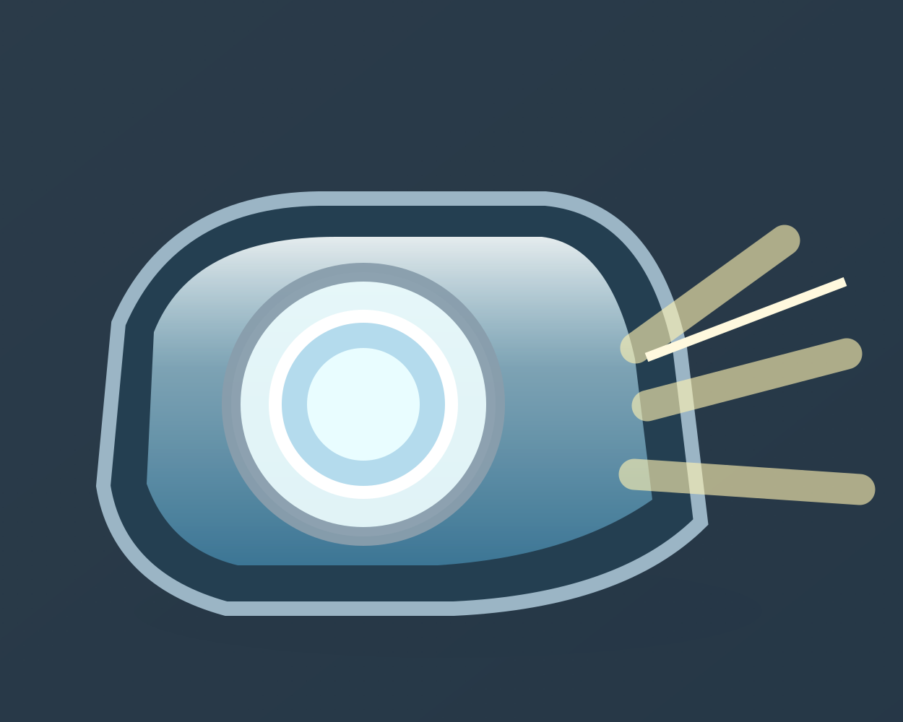

---

## gb-rules-008 — A dense fog lifts and you can see clearly again. What should you do with the rear fog lights?

Content SHA-256: `00c0eca5415421c044a8309389547e4a54a7368b1f4cd11c1e85b8d27efd355b`

A dense fog lifts and you can see clearly again. What should you do with the rear fog lights?

A. Keep them on until the engine is switched off
B. Use them instead of brake lights
C. Switch them off so they do not dazzle drivers behind
D. Switch off your dipped headlights instead

**Correct:** C — Switch them off so they do not dazzle drivers behind

Fog lamps can dazzle and obscure brake lamps once visibility improves, so they should not remain on without need.

Source: [Highway Code, Rule 114](https://www.gov.uk/guidance/the-highway-code/general-rules-techniques-and-advice-for-all-drivers-and-riders-103-to-158)

---

## gb-rules-009 — When may you use hazard warning lights while driving on a motorway?

Content SHA-256: `22af237fd1478ba419e61e66b918ef0951ac240b9918a8e6349e86a77a022e29`

When may you use hazard warning lights while driving on a motorway?

A. Whenever you exceed the speed limit
B. As a substitute for indicating lane changes
C. To ask the driver ahead to speed up
D. Briefly to warn traffic behind about a hazard or obstruction ahead

**Correct:** D — Briefly to warn traffic behind about a hazard or obstruction ahead

The Highway Code allows this limited moving-vehicle use on motorways or unrestricted dual carriageways to alert following drivers.

Source: [Highway Code, Rule 116](https://www.gov.uk/guidance/the-highway-code/general-rules-techniques-and-advice-for-all-drivers-and-riders-103-to-158)

---

## gb-rules-010 — You see a red light ahead with enough distance to brake normally. How should you slow down?

Content SHA-256: `8df01bfc4f56a48de6e8df5065cc2f0b79aad1a659020a336810014506a2a6f0`

You see a red light ahead with enough distance to brake normally. How should you slow down?

A. Wait and brake hard at the last moment
B. Pull the handbrake while moving
C. Brake gently early, increase pressure as needed, then ease off just before stopping
D. Switch off the engine to slow down

**Correct:** C — Brake gently early, increase pressure as needed, then ease off just before stopping

Progressive braking helps maintain control and avoids an unnecessarily jerky stop.

Source: [Highway Code, Rule 117](https://www.gov.uk/guidance/the-highway-code/general-rules-techniques-and-advice-for-all-drivers-and-riders-103-to-158)

---

## gb-rules-011 — You face an unexpected emergency and must stop quickly. What should you do first?

Content SHA-256: `2467deb75b52c730c3a1b33b442d9de7d0dc6ac708cd625f7ec50204d7426c5b`

You face an unexpected emergency and must stop quickly. What should you do first?

A. Turn the ignition off before braking
B. Use the parking brake as your first response
C. Accelerate to pass the danger
D. Apply the brakes immediately while trying to retain steering control

**Correct:** D — Apply the brakes immediately while trying to retain steering control

Emergency braking should begin promptly; harsh braking that locks the wheels can remove directional control.

Source: [Highway Code, Rule 118](https://www.gov.uk/guidance/the-highway-code/general-rules-techniques-and-advice-for-all-drivers-and-riders-103-to-158)

---

## gb-rules-012 — Your car's rear begins to slide to the left on a bend. Which steering response helps correct the skid?

Content SHA-256: `2db13c701507e4aa54ffc14bafa8d52f0df8eb7460632ab05edf945fa4bc6f2e`

Your car's rear begins to slide to the left on a bend. Which steering response helps correct the skid?

A. Steer sharply to the right regardless of conditions
B. Accelerate hard with the wheels straight
C. Apply full handbrake immediately
D. Steer towards the left while easing off the action that caused the skid

**Correct:** D — Steer towards the left while easing off the action that caused the skid

The Highway Code advises steering in the direction of a rear-wheel skid while removing excessive braking or acceleration.

Source: [Highway Code, Rule 119](https://www.gov.uk/guidance/the-highway-code/general-rules-techniques-and-advice-for-all-drivers-and-riders-103-to-158)

---

## gb-rules-013 — A road has a 60 mph limit, but a narrow bend is partly hidden by trees. What speed should you choose?

Content SHA-256: `9143f52880cb0909d16a61a356362dd9670df527bebb981ef60d82799e8d4e77`

A road has a 60 mph limit, but a narrow bend is partly hidden by trees. What speed should you choose?

A. Exactly 60 mph because that is the posted limit
B. A lower speed that lets you negotiate the hazard and stop within your visible distance
C. The speed of the fastest car around you
D. 60 mph unless it is raining

**Correct:** B — A lower speed that lets you negotiate the hazard and stop within your visible distance

A legal speed limit is a maximum, not a target; road layout and visibility govern the safe speed.

Source: [Highway Code, Rule 125](https://www.gov.uk/guidance/the-highway-code/general-rules-techniques-and-advice-for-all-drivers-and-riders-103-to-158)

---

## gb-rules-014 — You are following a car at motorway speeds on a dry road. Which minimum time gap is recommended?

Content SHA-256: `234adc120fdbef72e0a2ce0deeaaa631e01533f565a65b505a59b319a3513aff`

You are following a car at motorway speeds on a dry road. Which minimum time gap is recommended?

A. Half a second if you have good brakes
B. Exactly one second at all speeds
C. At least two seconds, increased when conditions require
D. No gap if traffic is flowing smoothly

**Correct:** C — At least two seconds, increased when conditions require

At least a two-second following interval gives time to perceive and react to a vehicle slowing ahead.

Source: [Highway Code, Rule 126](https://www.gov.uk/guidance/the-highway-code/general-rules-techniques-and-advice-for-all-drivers-and-riders-103-to-158)

Answer review: following-gap; visible caption: Leave at least two seconds in dry conditions; accessible description: Leave at least two seconds in dry conditions

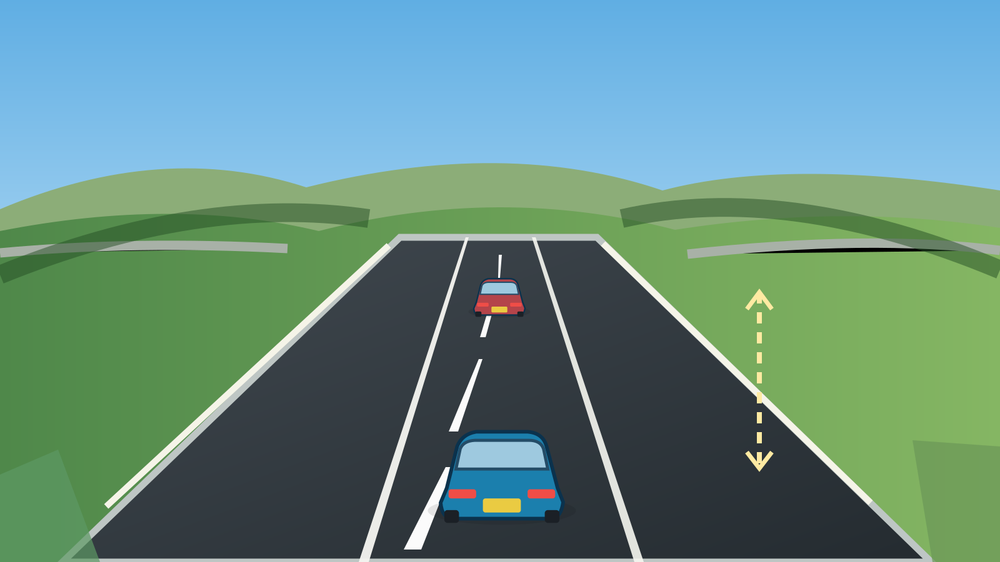

---

## gb-rules-015 — A broken centre line becomes longer with shorter gaps as you drive ahead. What does this suggest?

Content SHA-256: `a9898f04a4c9ee5be50f58f3069dfaa4b01707e8365778547ece45d5b365f795`

A broken centre line becomes longer with shorter gaps as you drive ahead. What does this suggest?

A. The road is becoming a motorway
B. You must speed up immediately
C. The road has no passing restrictions anywhere
D. A hazard may lie ahead, so take extra care before crossing the line

**Correct:** D — A hazard may lie ahead, so take extra care before crossing the line

Longer white dashes and shorter gaps indicate a hazard-warning centre-line pattern.

Source: [Highway Code, Rule 127](https://www.gov.uk/guidance/the-highway-code/general-rules-techniques-and-advice-for-all-drivers-and-riders-103-to-158)

---

## gb-rules-016 — On a motorway, what do amber reflective road studs mark?

Content SHA-256: `8d1ae8fe91fabd1a21483dc7bbe2a21470fed7635cc034fff13c116e1ea079a5`

On a motorway, what do amber reflective road studs mark?

A. The left-hand edge of the carriageway
B. The edge beside the central reservation
C. The edge of a slip road
D. A temporary bus lane

**Correct:** B — The edge beside the central reservation

Amber studs are positioned on the central-reservation side; red studs typically mark the left edge.

Source: [Highway Code, Rule 132](https://www.gov.uk/guidance/the-highway-code/general-rules-techniques-and-advice-for-all-drivers-and-riders-103-to-158)

---

## gb-motorway-001 — A learner car driver wants to practise on a motorway. Which arrangement is permitted?

Content SHA-256: `f0fe352333a54eece564f2f06e01ed54a43c5bddc7a5aaab798497aae8057095`

A learner car driver wants to practise on a motorway. Which arrangement is permitted?

A. Drive alone once the theory test has been passed
B. Travel with any licensed family member in an ordinary car
C. Travel with a friend who has held a licence for two years
D. Travel with a DVSA-approved driving instructor in a dual-control car displaying L plates, or D plates in Wales

**Correct:** D — Travel with a DVSA-approved driving instructor in a dual-control car displaying L plates, or D plates in Wales

Provisional car drivers may enter motorways only with an approved instructor in a suitably equipped, correctly plated car.

Source: [Highway Code, Rule 253](https://www.gov.uk/guidance/the-highway-code/motorways-253-to-273)

---

## gb-motorway-002 — Why should you check your mirrors and scan further ahead than usual on a motorway?

Content SHA-256: `2852026d256f152464c958e0954713b3a1fdf9be420860f597e3dd217575b9d3`

Why should you check your mirrors and scan further ahead than usual on a motorway?

A. Mirror checks are only needed when leaving the motorway
B. Cars are less likely to change lanes at high speeds
C. Vehicles usually travel faster, leaving less time to notice and react to changes
D. You have priority regardless of other drivers

**Correct:** C — Vehicles usually travel faster, leaving less time to notice and react to changes

Higher approach speeds shorten the time available to respond, making early observation essential.

Source: [Highway Code, Rule 254](https://www.gov.uk/guidance/the-highway-code/motorways-253-to-273)

---

## gb-motorway-003 — An overhead motorway message warns of debris ahead that you cannot yet see. What is the sensible response?

Content SHA-256: `ccd9542a6c195a97fc98e5407799c616a27c9fa0cba5faf18e314a17a53a65a9`

An overhead motorway message warns of debris ahead that you cannot yet see. What is the sensible response?

A. Assume the message is out of date until you see debris
B. Treat the warning seriously and prepare to adjust your speed and lane as directed
C. Drive faster to pass the affected stretch
D. Stop on the hard shoulder to inspect the message

**Correct:** B — Treat the warning seriously and prepare to adjust your speed and lane as directed

Motorway warnings can describe hazards beyond your present view; prepare before reaching them.

Source: [Highway Code, Rule 255](https://www.gov.uk/guidance/the-highway-code/motorways-253-to-273)

---

## gb-motorway-004 — Amber motorway lights are flashing above your route. What should you do?

Content SHA-256: `44a886fe5412a0469a6f5485df6e5e2dceba43154281a8054ed60d42c4aea955`

Amber motorway lights are flashing above your route. What should you do?

A. Move into the hard shoulder at once
B. Ignore them if you can still see the road
C. Treat them as permission to exceed the limit
D. Ease off and prepare for a hazard, following later signs before returning to normal speed

**Correct:** D — Ease off and prepare for a hazard, following later signs before returning to normal speed

Flashing amber warnings signal possible danger ahead; respond by reducing speed and assessing the situation.

Source: [Highway Code, Rule 257](https://www.gov.uk/guidance/the-highway-code/motorways-253-to-273)

---

## gb-motorway-005 — A red X is displayed above the lane you are driving in. What must you do?

Content SHA-256: `2efb33d2fd35f63b4fae2d17e3e314c685966c23b0e1f90bf339949b36f59a39`

A red X is displayed above the lane you are driving in. What must you do?

A. Move safely into an open lane and do not continue along the closed one
B. Carry on if no workers are visible
C. Use that lane only when overtaking
D. Stop beneath the sign and wait for it to change

**Correct:** A — Move safely into an open lane and do not continue along the closed one

A red X identifies a lane closure and driving through that lane is prohibited.

Source: [Highway Code, Rule 258](https://www.gov.uk/guidance/the-highway-code/motorways-253-to-273)

---

## gb-motorway-006 — A red X closes the left lane at a motorway exit. What does that indicate about the exit?

Content SHA-256: `b6bd354f4c0da6135b146c50211d4a0cbe0251174240017854eaa48d8233d15b`

A red X closes the left lane at a motorway exit. What does that indicate about the exit?

A. The exit cannot be used while that closure applies
B. The exit is reserved for cars only
C. You may use the shoulder to reach the exit
D. All vehicles must leave by that exit

**Correct:** A — The exit cannot be used while that closure applies

A left-lane closure at the exit slip road means traffic must not use that exit while it remains closed.

Source: [Highway Code, Rule 258](https://www.gov.uk/guidance/the-highway-code/motorways-253-to-273)

---

## gb-motorway-007 — As you join a motorway from a slip road, who should you give priority to?

Content SHA-256: `16c85a804a1ea0f92f9e14648890d0a3fae9f60c7bbb66da2f6b432efa6dd8fe`

As you join a motorway from a slip road, who should you give priority to?

A. Drivers still behind you on the slip road
B. Only cars travelling faster than the speed limit
C. No one, because slip-road traffic has priority
D. Vehicles already travelling on the motorway

**Correct:** D — Vehicles already travelling on the motorway

Joining drivers must judge a safe gap, adjust speed and avoid forcing established motorway traffic to brake.

Source: [Highway Code, Rule 259](https://www.gov.uk/guidance/the-highway-code/motorways-253-to-273)

Answer review: motorway-join; visible caption: Joining traffic gives way; accessible description: Joining traffic gives way

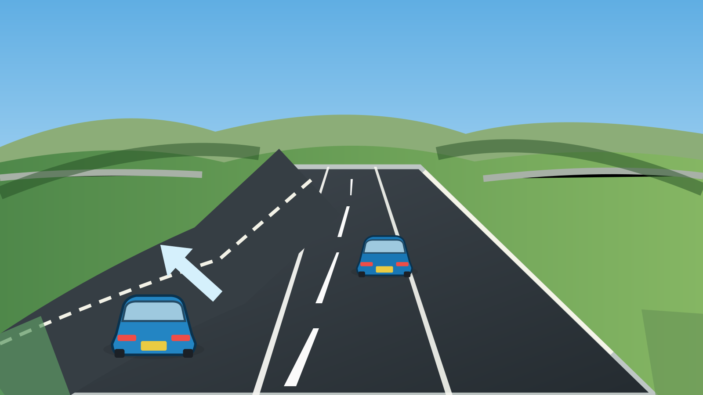

---

## gb-motorway-008 — The slip road you used continues as a new lane on the motorway. What should you normally do?

Content SHA-256: `8dcfb161f8a170b86656e9b86d9a31b4865d00431eecd5d82d1e62cee17dc18a`

The slip road you used continues as a new lane on the motorway. What should you normally do?

A. Cut across all lanes as quickly as possible
B. Stop at the end of the merge markings
C. Stay in the continuing lane while settling into the traffic flow
D. Drive on the hard shoulder until you find a gap

**Correct:** C — Stay in the continuing lane while settling into the traffic flow

If the slip road becomes an added motorway lane, remain in it rather than cutting unnecessarily into another lane.

Source: [Highway Code, Rule 259](https://www.gov.uk/guidance/the-highway-code/motorways-253-to-273)

---

## gb-motorway-009 — An electronic motorway sign displays a 50 mph limit within a red circle. What does it mean?

Content SHA-256: `b0028a3742d718236f290e1df4e7e6f4e004eb3dbe18dad54194db371804d1fe`

An electronic motorway sign displays a 50 mph limit within a red circle. What does it mean?

A. It is advice only if the normal limit is 70 mph
B. It applies only to goods vehicles
C. You must not exceed 50 mph while that signed limit applies
D. You may ignore it outside rush hour

**Correct:** C — You must not exceed 50 mph while that signed limit applies

Red-circled electronic speed limits are enforceable and override a higher usual maximum while active.

Source: [Highway Code, Rule 261](https://www.gov.uk/guidance/the-highway-code/motorways-253-to-273)

---

## gb-motorway-010 — You feel sleepy during a long motorway journey. What is the best plan?

Content SHA-256: `fff5ccb475e181b2d1c8617a7cf0340e7ebb90ce83faeca682a890147acb35e4`

You feel sleepy during a long motorway journey. What is the best plan?

A. Open a window and keep driving for another hour
B. Drive faster so the journey ends sooner
C. Leave at a safe opportunity and take a proper break at a service area
D. Stop directly on the carriageway to sleep

**Correct:** C — Leave at a safe opportunity and take a proper break at a service area

Monotonous high-speed driving can worsen fatigue; motorway services provide places for safe rest.

Source: [Highway Code, Rule 262](https://www.gov.uk/guidance/the-highway-code/motorways-253-to-273)

---

## gb-motorway-011 — You accidentally pass the motorway junction you needed. What should you do?

Content SHA-256: `c4b0a181324c33f8bc3421fa2b62f51df0d7f4025051ea73cac08653e1489d05`

You accidentally pass the motorway junction you needed. What should you do?

A. Continue to the next available exit and re-plan your route
B. Reverse carefully along the hard shoulder
C. Turn across the central reservation
D. Stop in the live lane and ask for directions

**Correct:** A — Continue to the next available exit and re-plan your route

Reversing and crossing the central reservation are prohibited; use the next exit rather than an unsafe manoeuvre.

Source: [Highway Code, Rule 263](https://www.gov.uk/guidance/the-highway-code/motorways-253-to-273)

---

## gb-motorway-012 — Traffic is light and you are not overtaking. Which motorway lane should you normally use?

Content SHA-256: `cee6f13550aa21863611c59af77fb46afb9cf68df5acd2b4fb61ccc2915a603f`

Traffic is light and you are not overtaking. Which motorway lane should you normally use?

A. The left lane, moving right only when necessary and safe
B. The centre lane to leave space for joining traffic
C. Whichever lane has the best road surface
D. The right lane to maintain a steady speed

**Correct:** A — The left lane, moving right only when necessary and safe

The default position is the left-hand lane, with other lanes mainly used to overtake.

Source: [Highway Code, Rule 264](https://www.gov.uk/guidance/the-highway-code/motorways-253-to-273)

---

## gb-motorway-013 — You tow a caravan on a motorway with three lanes. Can you normally use the far-right lane?

Content SHA-256: `4925e783261319ef54287d35e617e17cff8ac09d374eebcfd29be559f736374e`

You tow a caravan on a motorway with three lanes. Can you normally use the far-right lane?

A. Yes, if the trailer is small
B. Yes, if you signal first
C. No, vehicles drawing a trailer are generally prohibited from that lane
D. Only when the traffic in all lanes is stationary

**Correct:** C — No, vehicles drawing a trailer are generally prohibited from that lane

The Highway Code prohibits trailers in the far-right lane of motorways with three or more lanes, apart from prescribed exceptions.

Source: [Highway Code, Rule 265](https://www.gov.uk/guidance/the-highway-code/motorways-253-to-273)

---

## gb-motorway-014 — Before changing lanes to overtake on a motorway, what extra check helps detect a hidden vehicle?

Content SHA-256: `01bfdd67b356b14ff2051ec554d017f273484a156619f05f1fd1297e00036592`

Before changing lanes to overtake on a motorway, what extra check helps detect a hidden vehicle?

A. A brief sideways glance towards the blind spot after checking mirrors
B. Only looking at the interior mirror
C. Counting to three without looking
D. Flashing your headlights continuously

**Correct:** A — A brief sideways glance towards the blind spot after checking mirrors

Mirrors do not show every area around the vehicle; a blind-spot check helps confirm the lane is clear.

Source: [Highway Code, Rule 267](https://www.gov.uk/guidance/the-highway-code/motorways-253-to-273)

---

## gb-motorway-015 — In heavy motorway congestion, the left lane moves slightly faster than the right. What should you do?

Content SHA-256: `42b226b48bc2532946d23eb84ecac9b6292b15363eb66b6978c69b739934b477`

In heavy motorway congestion, the left lane moves slightly faster than the right. What should you do?

A. Keep switching lanes whenever one moves quicker
B. Use the hard shoulder to get ahead
C. Brake sharply so nobody can pass you on the left
D. Stay in your lane with the traffic, without weaving between lanes to gain places

**Correct:** D — Stay in your lane with the traffic, without weaving between lanes to gain places

Queuing traffic may pass traffic to its right as lanes advance differently, but deliberate weaving to overtake is discouraged.

Source: [Highway Code, Rule 268](https://www.gov.uk/guidance/the-highway-code/motorways-253-to-273)

---

## gb-motorway-016 — Your motorway exit is coming up. Which approach is recommended?

Content SHA-256: `3cac482aa654e7ab5ce7f49caee4291fb16d3f6aab7657b3ffa813dafe30d404`

Your motorway exit is coming up. Which approach is recommended?

A. Brake sharply in the right-hand lane then cross to the exit
B. Stop on the carriageway until a gap appears
C. Move into the left lane in good time, signal left and slow on the slip road as needed
D. Leave your indicator off until after entering the slip road

**Correct:** C — Move into the left lane in good time, signal left and slow on the slip road as needed

Early lane planning and signalling allow a safe, predictable exit without late manoeuvres.

Source: [Highway Code, Rule 273](https://www.gov.uk/guidance/the-highway-code/motorways-253-to-273)

---

## gb-safety-001 — Before driving a borrowed car, you notice a brake warning and a damaged rear lamp. What is the sensible action?

Content SHA-256: `4fd38027edf0d8683fad7836c03cf3cae978e750a037ec56763f590d7e594d11`

Before driving a borrowed car, you notice a brake warning and a damaged rear lamp. What is the sensible action?

A. Drive only on streets with low limits
B. Do not drive until the car is confirmed roadworthy
C. Switch on the hazard warning lights and continue
D. Trust the next MOT to identify the faults

**Correct:** B — Do not drive until the car is confirmed roadworthy

The driver must use a vehicle that meets roadworthiness and lighting requirements; warning signs and defective lights need attention.

Source: [Highway Code, Rule 89](https://www.gov.uk/guidance/the-highway-code/rules-for-drivers-and-motorcyclists-89-to-102)

Answer review: brake-lights; visible caption: Working brake lights; accessible description: Working brake lights

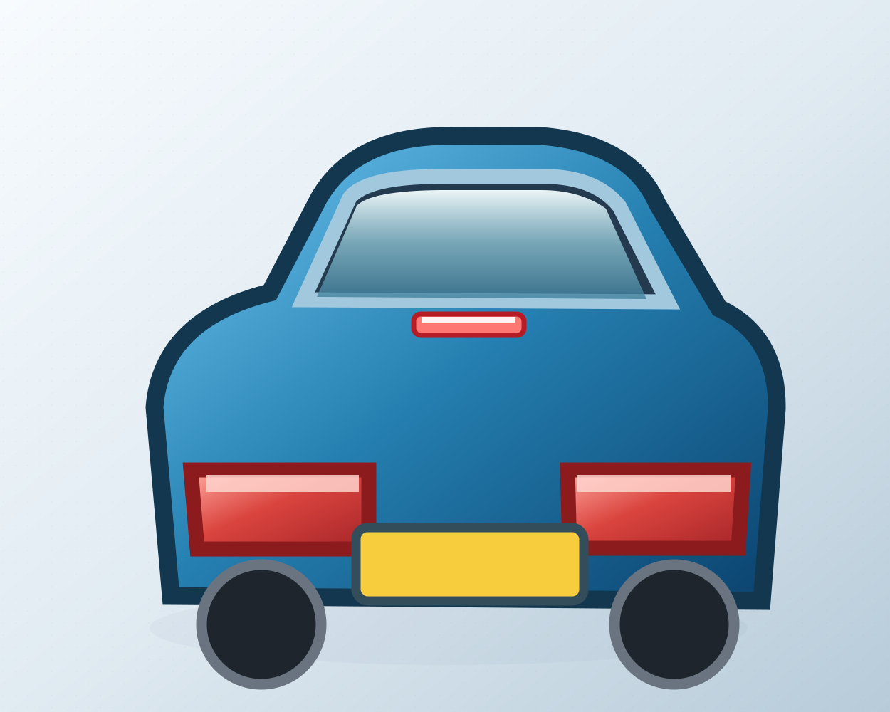

---

## gb-safety-002 — A medical condition may make you unable to control your vehicle safely. What should you do?

Content SHA-256: `c284445640a7bebf2d5627a9e284f0b0d98f82610ca48ab4b8abbad25cb99ea0`

A medical condition may make you unable to control your vehicle safely. What should you do?

A. Keep driving until the licence expires
B. Tell only your passengers
C. Inform the DVLA as required and seek medical advice about driving
D. Avoid reporting the condition if you drive short distances

**Correct:** C — Inform the DVLA as required and seek medical advice about driving

Drivers must notify the licensing authority of health conditions likely to affect their driving.

Source: [Highway Code, Rule 90](https://www.gov.uk/guidance/the-highway-code/rules-for-drivers-and-motorcyclists-89-to-102)

---

## gb-safety-003 — You are planning an eight-hour drive. What break pattern does the Highway Code recommend?

Content SHA-256: `76c7d8cd284c1d72b8105ce5de6c496b3f15a1e2cb9ace4a1fe5da20a25d47f6`

You are planning an eight-hour drive. What break pattern does the Highway Code recommend?

A. At least a 15-minute break after every two hours of driving
B. No breaks unless you need fuel
C. One break of five minutes at the end
D. A rest only after six hours

**Correct:** A — At least a 15-minute break after every two hours of driving

Fatigue impairs reactions; plan regular breaks of at least fifteen minutes at roughly two-hour intervals.

Source: [Highway Code, Rule 91](https://www.gov.uk/guidance/the-highway-code/rules-for-drivers-and-motorcyclists-89-to-102)

---

## gb-safety-004 — You need glasses to read a modern number plate clearly from 20 metres. What must you do while driving?

Content SHA-256: `6aa2c30e8ac05e5e63a1aab0906e5a02e088e47f1555502b7010c845301440d8`

You need glasses to read a modern number plate clearly from 20 metres. What must you do while driving?

A. Use them only when parking
B. Drive closer to the vehicle ahead to read its plate
C. Wear the required glasses or contact lenses at all times
D. Carry them in the glovebox without wearing them

**Correct:** C — Wear the required glasses or contact lenses at all times

Drivers must meet the number-plate eyesight standard and wear corrective lenses whenever those lenses are needed to meet it.

Source: [Highway Code, Rule 92](https://www.gov.uk/guidance/the-highway-code/rules-for-drivers-and-motorcyclists-89-to-102)

---

## gb-safety-005 — You drive on a dark country lane wearing heavily tinted glasses. What is the problem?

Content SHA-256: `660ec89e44348a8b7f6608ea0f78bfbb80c54a0b8d4b2be747c03fa5c4b5dbba`

You drive on a dark country lane wearing heavily tinted glasses. What is the problem?

A. Tinted lenses automatically improve night vision
B. They only affect your ability to read the speedometer
C. Tinted glasses remove headlight glare without any drawback
D. They may reduce your ability to see hazards in already poor visibility

**Correct:** D — They may reduce your ability to see hazards in already poor visibility

Avoid tinted lenses at night or in poor visibility when they make it harder to see the road.

Source: [Highway Code, Rule 94](https://www.gov.uk/guidance/the-highway-code/rules-for-drivers-and-motorcyclists-89-to-102)

---

## gb-safety-006 — You drank alcohol late in the evening and plan to drive early next morning. What should concern you?

Content SHA-256: `65933a2ffa74868b6abb93cfc86ead858f07ebccfa168782b7b314bc8a433793`

You drank alcohol late in the evening and plan to drive early next morning. What should concern you?

A. Alcohol may still impair your driving the following morning
B. Sleep always removes all alcohol from the body
C. Coffee instantly restores safe reactions
D. You may drive if you feel confident

**Correct:** A — Alcohol may still impair your driving the following morning

Alcohol takes time to leave the body, and judgement or reaction time can remain impaired well after drinking.

Source: [Highway Code, Rule 95](https://www.gov.uk/guidance/the-highway-code/rules-for-drivers-and-motorcyclists-89-to-102)

---

## gb-safety-007 — A prescribed medicine makes you drowsy. What is the safest approach to driving?

Content SHA-256: `c799e51e635df5f250d92bab7bfea0bd0d8c538605325e5ed0e3cdac617b415a`

A prescribed medicine makes you drowsy. What is the safest approach to driving?

A. Check medical advice and do not drive while your ability is impaired
B. Drive normally because the medicine is legal
C. Take extra medicine to stay alert
D. Only avoid motorways and continue on other roads

**Correct:** A — Check medical advice and do not drive while your ability is impaired

Legal medicines can still affect safe driving. Follow doctor or pharmacist advice and do not drive when impaired.

Source: [Highway Code, Rule 96](https://www.gov.uk/guidance/the-highway-code/rules-for-drivers-and-motorcyclists-89-to-102)

---

## gb-safety-008 — You are setting off in a car you have never driven. What should you do before leaving?

Content SHA-256: `98a0435b6a1c00c432ab2d83fd29e92e6cf84b3f2532eba2c62851146eba7231`

You are setting off in a car you have never driven. What should you do before leaving?

A. Adjust the navigation screen while joining traffic
B. Leave the head restraint low to improve visibility
C. Depend on the first junction to learn the controls
D. Locate the controls and adjust the seat and mirrors

**Correct:** D — Locate the controls and adjust the seat and mirrors

Knowing the controls and adjusting driving position and mirrors before moving improves control and awareness.

Source: [Highway Code, Rule 97](https://www.gov.uk/guidance/the-highway-code/rules-for-drivers-and-motorcyclists-89-to-102)

---

## gb-safety-009 — A trailer blocks the rear view from your towing vehicle. What equipment might be required?

Content SHA-256: `1861abcccac8b27b45d1dc354537c6186ea463ecb9dd52c93b52b28435c52cd3`

A trailer blocks the rear view from your towing vehicle. What equipment might be required?

A. Additional towing mirrors giving an adequate view behind
B. Extra front fog lamps
C. A second horn fitted to the trailer
D. Only a reflective sticker on the boot

**Correct:** A — Additional towing mirrors giving an adequate view behind

When a load or trailer obstructs rearward visibility, suitable towing mirrors are required.

Source: [Highway Code, Rule 98](https://www.gov.uk/guidance/the-highway-code/rules-for-drivers-and-motorcyclists-89-to-102)

---

## gb-safety-010 — A caravan sways because heavy luggage has been placed at the back. What should you do before towing?

Content SHA-256: `fdb6902f8e79f64ec032285c83fe04a706ef496e64aaf7b25515617ec2d0b480`

A caravan sways because heavy luggage has been placed at the back. What should you do before towing?

A. Redistribute and secure the load according to the maker's guidance
B. Accelerate sharply so the caravan straightens
C. Remove the safety coupling
D. Increase the weight above the permitted trailer limit

**Correct:** A — Redistribute and secure the load according to the maker's guidance

Poor load distribution can produce dangerous snaking; heavy items should be placed appropriately over the axles with safe nose weight.

Source: [Highway Code, Rule 98](https://www.gov.uk/guidance/the-highway-code/rules-for-drivers-and-motorcyclists-89-to-102)

---

## gb-safety-011 — Where is it dangerous to fit a rear-facing child seat?

Content SHA-256: `17fb816e74c442ab822309be7350db8bb59794a22ad30c394e6073ed898d82f1`

Where is it dangerous to fit a rear-facing child seat?

A. On a rear seat with a suitable restraint
B. In a vehicle fitted with rear windows
C. In front of an active frontal airbag
D. In a car with a passenger-side mirror

**Correct:** C — In front of an active frontal airbag

An active frontal airbag can strike a rear-facing child seat in a collision, causing severe injury.

Source: [Highway Code, Rule 101](https://www.gov.uk/guidance/the-highway-code/rules-for-drivers-and-motorcyclists-89-to-102)

---

## gb-safety-012 — A child needs to leave your parked car beside a busy road. Which door is usually safer to use?

Content SHA-256: `7afad6bb5625ae2b4b650ce4b174a87134163d299b5b242675641015242f3098`

A child needs to leave your parked car beside a busy road. Which door is usually safer to use?

A. The door beside moving traffic
B. Whichever door is opened fastest
C. The driver door even if it faces traffic
D. A door on the kerb side, with adult supervision

**Correct:** D — A door on the kerb side, with adult supervision

Using the kerb-side door usually reduces exposure to passing vehicles and cyclists.

Source: [Highway Code, Rule 102](https://www.gov.uk/guidance/the-highway-code/rules-for-drivers-and-motorcyclists-89-to-102)

---

## gb-safety-013 — For an ordinary car, what is the legal minimum tread depth over the central three-quarters of a tyre?

Content SHA-256: `313a9b8441e3007b8fca96be24b190298b5f29d34568604fa27e3152ae73600e`

For an ordinary car, what is the legal minimum tread depth over the central three-quarters of a tyre?

A. 0.5 mm on just one part of the tyre
B. 2.8 mm only on the outer edge
C. No minimum if the tyre is new
D. 1.6 mm around the full circumference

**Correct:** D — 1.6 mm around the full circumference

Car tyres must retain at least 1.6 mm of tread across the central three-quarters and around their full circumference.

Source: [Highway Code, Annex 6](https://www.gov.uk/guidance/the-highway-code/annex-6-vehicle-maintenance-safety-and-security)

Answer review: tyre-tread; visible caption: Check tyre tread depth; accessible description: Check tyre tread depth

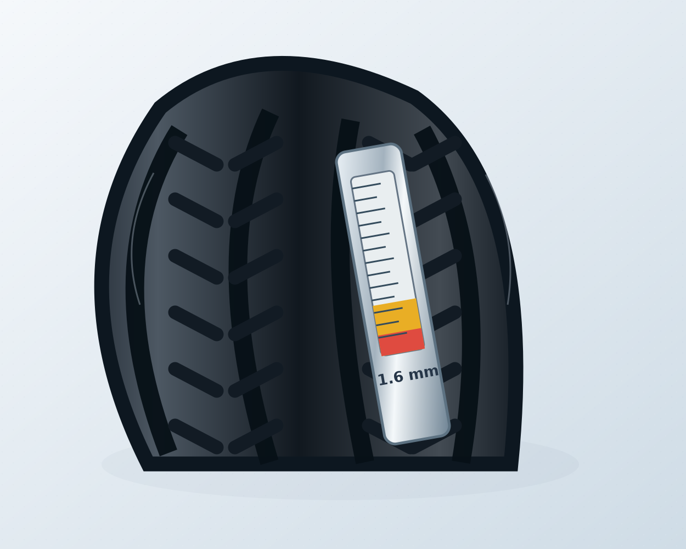

---

## gb-safety-014 — When is a good time to check your car's tyre pressures?

Content SHA-256: `7181061d9f9627e5e42c172cb689f78248341553a47dfb023609ed7ee02e0c14`

When is a good time to check your car's tyre pressures?

A. Immediately after a long high-speed journey
B. Only after tyre wear becomes visible
C. Only during a yearly service
D. Before driving, when the tyres are cold

**Correct:** D — Before driving, when the tyres are cold

The Highway Code advises weekly checks on cold tyres because heat can distort pressure readings.

Source: [Highway Code, Annex 6](https://www.gov.uk/guidance/the-highway-code/annex-6-vehicle-maintenance-safety-and-security)

Answer review: tyre-pressure; visible caption: Check tyre pressures; accessible description: Check tyre pressures

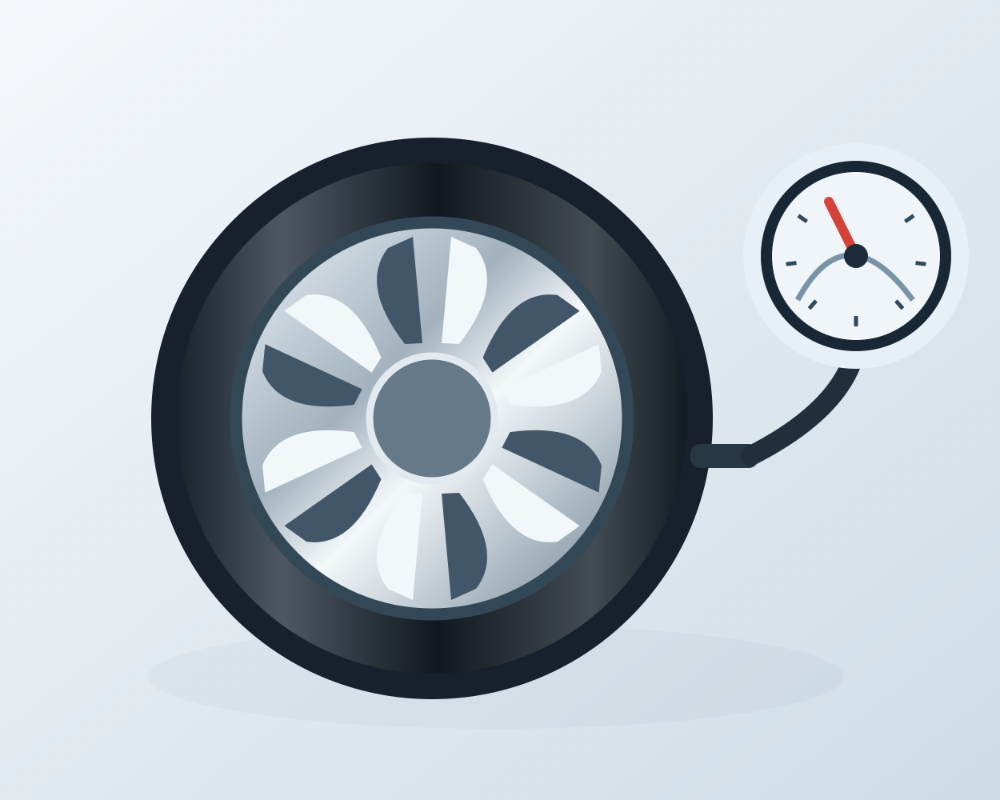

---

## gb-safety-015 — Your car pulls sharply to one side whenever you brake. What does this suggest?

Content SHA-256: `c2a2aefc9be054cfa80c672028ae834f95e1a9e03bbf510b022333d056626566`

Your car pulls sharply to one side whenever you brake. What does this suggest?

A. A normal feature of anti-lock brakes
B. That your headlights need adjustment
C. That the rear wiper is worn out
D. A possible braking fault or uneven tyre pressure needing prompt attention

**Correct:** D — A possible braking fault or uneven tyre pressure needing prompt attention

Pulling under braking may signal brake trouble or incorrect inflation and warrants professional inspection.

Source: [Highway Code, Annex 6](https://www.gov.uk/guidance/the-highway-code/annex-6-vehicle-maintenance-safety-and-security)

---

## gb-safety-016 — The engine has overheated. What should you do before opening the coolant filler cap?

Content SHA-256: `41db2fcc0e1df25a81398fc47c3f8550fe8b55c3daa7289272697174915432fe`

The engine has overheated. What should you do before opening the coolant filler cap?

A. Open the cap immediately to release pressure
B. Pour cold water onto the hot engine
C. Keep driving rapidly to cool it with airflow
D. Let the engine cool naturally

**Correct:** D — Let the engine cool naturally

Opening a hot cooling system can release dangerous hot fluid; let the engine cool before removing the cap.

Source: [Highway Code, Annex 6](https://www.gov.uk/guidance/the-highway-code/annex-6-vehicle-maintenance-safety-and-security)

Answer review: coolant; visible caption: Engine coolant reservoir; accessible description: Engine coolant reservoir

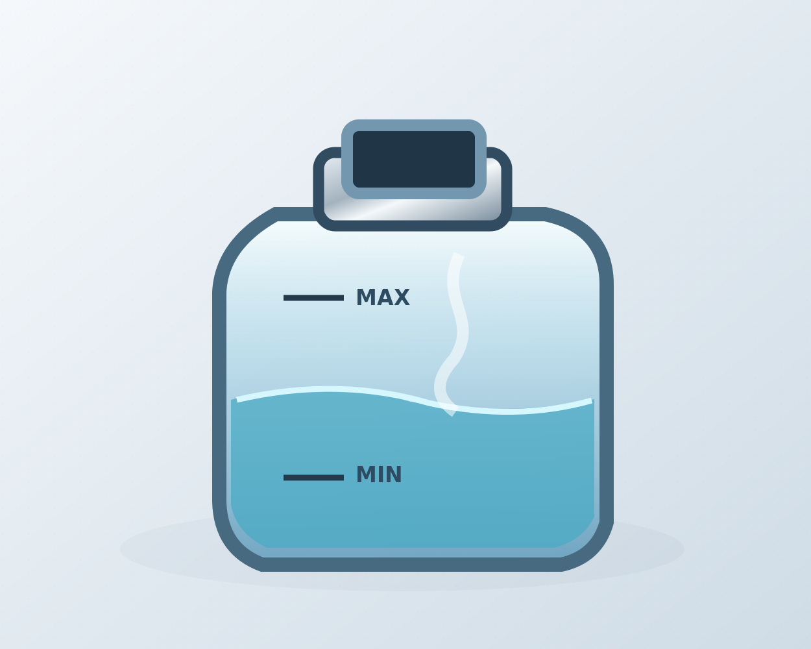

---

## gb-weather-001 — You start driving in heavy rain after a long spell of dry weather. What happens to normal braking distance?

Content SHA-256: `295e955b4768a26935aac2ecd4bf8fc85f57065bd4d26a981fe0317e99d620c2`

You start driving in heavy rain after a long spell of dry weather. What happens to normal braking distance?

A. It becomes shorter because rain cools the brakes
B. It stays unchanged on every road
C. It is reduced if your tyres are new
D. It can be at least twice the dry-road distance

**Correct:** D — It can be at least twice the dry-road distance

Wet surfaces reduce tyre grip; the Highway Code warns that stopping distances can at least double compared with dry conditions.

Source: [Highway Code, Rule 227](https://www.gov.uk/guidance/the-highway-code/driving-in-adverse-weather-conditions-226-to-237)

---

## gb-weather-002 — Spray from a large van makes it hard to see ahead. What should you do?

Content SHA-256: `4d550d426ae49e509f22faac7ca2e6f0036c6a5a9af30684bff467206b29c754`

Spray from a large van makes it hard to see ahead. What should you do?

A. Follow more closely to stay within its tyre tracks
B. Use main beam continuously at close range
C. Overtake immediately regardless of visibility
D. Increase your following distance and adjust speed so you can see and stop safely

**Correct:** D — Increase your following distance and adjust speed so you can see and stop safely

Spray restricts observation for everyone. More separation and lower speed provide time to react.

Source: [Highway Code, Rule 227](https://www.gov.uk/guidance/the-highway-code/driving-in-adverse-weather-conditions-226-to-237)

---

## gb-weather-003 — You see a shiny patch where a lorry appears to have spilt diesel during rain. What is the risk?

Content SHA-256: `1f96f2dfebe08b8ff1113f3d6b42f1366f5257229959b74ef995bc390205e2d1`

You see a shiny patch where a lorry appears to have spilt diesel during rain. What is the risk?

A. The patch always provides extra traction
B. Only the windscreen will be affected
C. The road may offer substantially less grip
D. The patch is safe if the road is level

**Correct:** C — The road may offer substantially less grip

Diesel mixed with surface water can make the carriageway very slippery, increasing the risk of skidding.

Source: [Highway Code, Rule 227](https://www.gov.uk/guidance/the-highway-code/driving-in-adverse-weather-conditions-226-to-237)

---

## gb-weather-004 — A roadside sign warns of fog ahead, but the next stretch looks clear. What should you anticipate?

Content SHA-256: `f8ceba845ed8878e1365f28c287dfe81e05c159c168ed90599f37d994345b1ee`

A roadside sign warns of fog ahead, but the next stretch looks clear. What should you anticipate?

A. A guarantee the fog has cleared completely
B. That fog lamps must be kept on for the entire journey
C. A sudden bank or drifting patch of fog farther along
D. A restriction that applies only to lorries

**Correct:** C — A sudden bank or drifting patch of fog farther along

Fog can be uneven and arrive without warning. The sign is reason to prepare even when visibility momentarily improves.

Source: [Highway Code, Rule 234](https://www.gov.uk/guidance/the-highway-code/driving-in-adverse-weather-conditions-226-to-237)

---

## gb-weather-005 — In fog, a driver follows your car uncomfortably closely. What should you avoid doing?

Content SHA-256: `c0a8dd39f222fda7f1e340fcccaff256e1dbf401cdbd56009e374d35752adfc8`

In fog, a driver follows your car uncomfortably closely. What should you avoid doing?

A. Checking your mirrors before slowing
B. Leaving extra space to the car in front
C. Accelerating merely to escape the tailgater
D. Using dipped headlights as needed

**Correct:** C — Accelerating merely to escape the tailgater

Speeding up to escape a close follower reduces your own ability to stop within the visible distance.

Source: [Highway Code, Rule 235](https://www.gov.uk/guidance/the-highway-code/driving-in-adverse-weather-conditions-226-to-237)

---

## gb-weather-006 — You approach a narrow junction in dense fog. What is the safe way to join the main road?

Content SHA-256: `402607e3fc3afc0dfb44463a74082842eb93757b24b46c3c36a9cc56c7774c8d`

You approach a narrow junction in dense fog. What is the safe way to join the main road?

A. Creep into the lane until someone sounds a horn
B. Keep the same speed to avoid delaying traffic
C. Follow another vehicle without looking
D. Stop at the correct position, listen and look carefully, then emerge only when safe

**Correct:** D — Stop at the correct position, listen and look carefully, then emerge only when safe

Limited visibility demands extra observation, including listening for traffic before emerging into the main road.

Source: [Highway Code, Rule 235](https://www.gov.uk/guidance/the-highway-code/driving-in-adverse-weather-conditions-226-to-237)

---

## gb-weather-007 — Your windscreen starts misting on the inside during a foggy journey. What should you use?

Content SHA-256: `1572d2561023770b87c58080b3662d324a921b023e9e59c450d31df9ecbad9ef`

Your windscreen starts misting on the inside during a foggy journey. What should you use?

A. Only the hazard warning lights
B. The handbrake to dry the glass
C. The demister and wipers as appropriate to restore clear vision
D. A cloth while travelling at normal speed

**Correct:** C — The demister and wipers as appropriate to restore clear vision

A clear windscreen is vital; demisters and wipers help restore the view needed to keep a safe stopping distance.

Source: [Highway Code, Rule 235](https://www.gov.uk/guidance/the-highway-code/driving-in-adverse-weather-conditions-226-to-237)

---

## gb-weather-008 — After fog clears, another motorist keeps their rear fog lamp on. Why is that a problem?

Content SHA-256: `c8f2fbbf5d2bb7e52eb1b2e5af4b18bdc9a1f89643d7bc3af5d6627fa4cb5420`

After fog clears, another motorist keeps their rear fog lamp on. Why is that a problem?

A. It can dazzle following drivers and hide the effect of brake lamps
B. It makes their tyres grip the road less
C. It prevents the indicators from working
D. It uses too little electrical power

**Correct:** A — It can dazzle following drivers and hide the effect of brake lamps

Rear fog lamps are bright and should be switched off when visibility improves to reduce glare.

Source: [Highway Code, Rule 236](https://www.gov.uk/guidance/the-highway-code/driving-in-adverse-weather-conditions-226-to-237)

---

## gb-weather-009 — You are passing a high-sided delivery vehicle on an exposed bridge. What hazard should you expect?

Content SHA-256: `e28be6f3dada2abc1d0a8aa97c79f7a91beb432104d8d4a9a0d2bf9d951da8fe`

You are passing a high-sided delivery vehicle on an exposed bridge. What hazard should you expect?

A. A guaranteed increase in tyre grip
B. That the bridge automatically becomes one-way
C. That the speed limit has been cancelled
D. Sudden crosswind effects when leaving the shelter of the larger vehicle

**Correct:** D — Sudden crosswind effects when leaving the shelter of the larger vehicle

Large vehicles and exposed structures change wind exposure; gusts can push road users sideways.

Source: [Highway Code, Rule 232](https://www.gov.uk/guidance/the-highway-code/driving-in-adverse-weather-conditions-226-to-237)

---

## gb-weather-010 — A motorcyclist is overtaking a tall lorry in strong wind. What should you allow?

Content SHA-256: `2cb749f2d84f382c56273d285b9233d01243d781807091bcd07e7e81e666af2c`

A motorcyclist is overtaking a tall lorry in strong wind. What should you allow?

A. Less room than you would give a car
B. No change in your following distance
C. A horn blast to steady the rider
D. Extra room and distance because turbulence can unsettle the motorcycle

**Correct:** D — Extra room and distance because turbulence can unsettle the motorcycle

Turbulence around high-sided vehicles can move motorcycles unexpectedly, so leave a safety margin.

Source: [Highway Code, Rule 233](https://www.gov.uk/guidance/the-highway-code/driving-in-adverse-weather-conditions-226-to-237)

---

## gb-weather-011 — You are driving for hours in very hot weather and feel increasingly sleepy. What should you do?

Content SHA-256: `3d9fa2014f01d77488b9325f7e1300728c1a69b11368508b22b30bdff709b10d`

You are driving for hours in very hot weather and feel increasingly sleepy. What should you do?

A. Turn up the heating to remain alert
B. Drive closer to the vehicle ahead to concentrate
C. Ignore fatigue until the journey ends
D. Keep the vehicle ventilated and take a safe rest break when needed

**Correct:** D — Keep the vehicle ventilated and take a safe rest break when needed

Heat can contribute to drowsiness; ventilation and planned breaks support alert driving.

Source: [Highway Code, Rule 237](https://www.gov.uk/guidance/the-highway-code/driving-in-adverse-weather-conditions-226-to-237)

---

## gb-weather-012 — Rain begins after weeks of dry summer weather. Why might the road be unexpectedly slippery?

Content SHA-256: `8e6ccdd4d4f2c62c54bf422fd4cc6361af780edc5284268cb0fcd47cc0cefb62`

Rain begins after weeks of dry summer weather. Why might the road be unexpectedly slippery?

A. Rain always removes all road deposits immediately
B. Tyres become wider when wet
C. Surface deposits can make the first rainfall reduce grip
D. Summer rain increases the legal speed limit

**Correct:** C — Surface deposits can make the first rainfall reduce grip

After a dry spell, the first rain can leave surface contamination slippery before it is washed away.

Source: [Highway Code, Rule 237](https://www.gov.uk/guidance/the-highway-code/driving-in-adverse-weather-conditions-226-to-237)

---

## gb-weather-013 — The low sun suddenly dazzles you on a straight road. What should you do?

Content SHA-256: `d8f313d1e03342eaa1393d40cee62c4b1a7d2d36470b40c86d6c3ea580444476`

The low sun suddenly dazzles you on a straight road. What should you do?

A. Speed up until you pass the bright section
B. Follow the tail-lights of the car ahead very closely
C. Slow down and stop safely if you cannot see well enough
D. Use the horn to warn the sunlit traffic

**Correct:** C — Slow down and stop safely if you cannot see well enough

If sunlight prevents safe observation, slowing or stopping is safer than continuing at a speed beyond your vision.

Source: [Highway Code, Rule 237](https://www.gov.uk/guidance/the-highway-code/driving-in-adverse-weather-conditions-226-to-237)

---

## gb-signs-001 — You are entering an area signed as a 20 mph zone. What should you expect?

Content SHA-256: `0962ad626537c98b8c6a831a33a1ff20f186f6aa2527d82459676400dafec003`

You are entering an area signed as a 20 mph zone. What should you expect?

A. A recommended minimum speed of 20 mph
B. Motorways only beyond the sign
C. A local speed restriction of 20 mph within the signed zone
D. A 20-minute parking limit

**Correct:** C — A local speed restriction of 20 mph within the signed zone

A 20 mph zone sign establishes a local speed limit; any relevant zone-ending signs tell you where it ceases.

Source: [Highway Code, Traffic signs](https://www.gov.uk/guidance/the-highway-code/traffic-signs)

---

## gb-signs-002 — You approach a circular sign bearing a car above a motorcycle inside a red border. What is it telling you?

Content SHA-256: `d859add1cccbc1218a3608ca77314694b9b494e8274690a8373aa07fe3233d63`

You approach a circular sign bearing a car above a motorcycle inside a red border. What is it telling you?

A. Only cars are permitted
B. Motorcycles have priority over cars
C. Motor vehicles are prohibited beyond the sign
D. All vehicles must turn around immediately

**Correct:** C — Motor vehicles are prohibited beyond the sign

The illustrated car-and-motorcycle prohibition sign means no motor vehicles, subject to any qualifying plate.

Source: [Highway Code, Traffic signs](https://www.gov.uk/guidance/the-highway-code/traffic-signs)

---

## gb-signs-003 — The road ahead is marked with a 'No entry' sign. What does that require?

Content SHA-256: `e3bf3f9d5b1cb99bf45304e230b054edf5951887ea185e5a8b9031357f3325b4`

The road ahead is marked with a 'No entry' sign. What does that require?

A. Do not drive a vehicle past that sign into the restricted road
B. Enter carefully if no other cars are approaching
C. Only cyclists must stop
D. You may enter if you use hazard lights

**Correct:** A — Do not drive a vehicle past that sign into the restricted road

A no-entry sign prohibits vehicular entry rather than merely advising caution.

Source: [Highway Code, Traffic signs](https://www.gov.uk/guidance/the-highway-code/traffic-signs)

Answer review: no-entry-example; visible caption: No entry for vehicular traffic; accessible description: No entry for vehicular traffic

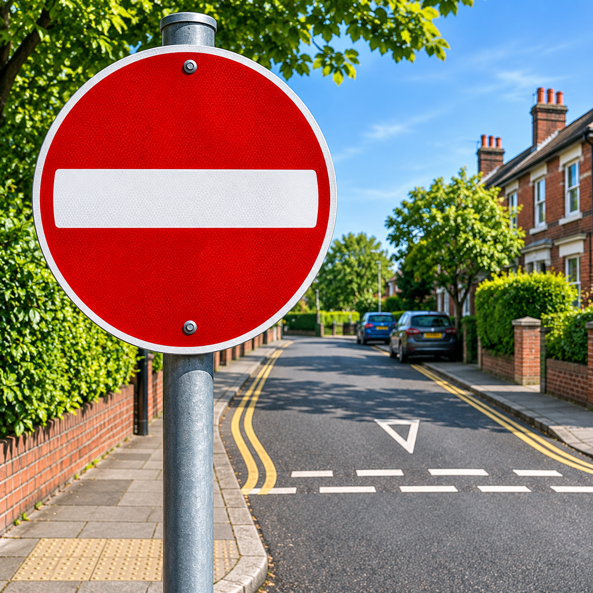

---

## gb-signs-004 — You see a blue circular sign with a white arrow pointing ahead. What is the usual instruction?

Content SHA-256: `a5130abf02a3e5b049d98d716bf7e822adbef4e1a4f183fd5080dfdff4bbc0c2`

You see a blue circular sign with a white arrow pointing ahead. What is the usual instruction?

A. Continue straight ahead in the direction shown
B. There is a sharp bend warning ahead
C. You may park along either kerb
D. It is an advisory tourist direction

**Correct:** A — Continue straight ahead in the direction shown

A blue mandatory-direction circle instructs permitted traffic to follow the arrow.

Source: [Highway Code, Traffic signs](https://www.gov.uk/guidance/the-highway-code/traffic-signs)

Answer review: ahead-example; visible caption: Follow the ahead-only instruction; accessible description: Follow the ahead-only instruction

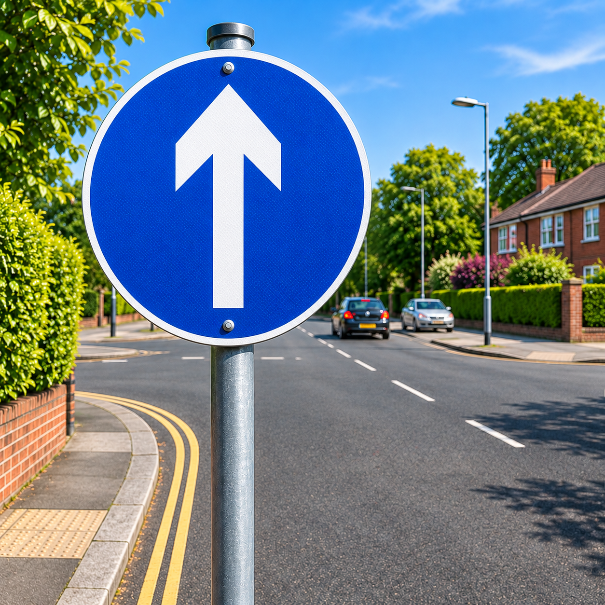

---

## gb-signs-005 — A blue circular sign shows a white arrow passing to the left of an obstruction. What should you do?

Content SHA-256: `eb423eda048961ae86550984bf94b1bd1a6ca7e5be256bf6277fdcb744a9c284`

A blue circular sign shows a white arrow passing to the left of an obstruction. What should you do?

A. Overtake the vehicle in front on the left
B. Turn left at the next road regardless of route
C. Keep to the right of the obstruction
D. Pass to the left as the sign directs

**Correct:** D — Pass to the left as the sign directs

Blue keep-left symbols direct vehicles around the specified side of an island or obstacle.

Source: [Highway Code, Traffic signs](https://www.gov.uk/guidance/the-highway-code/traffic-signs)

Answer review: keep-left-example; visible caption: Pass to the left of the obstruction; accessible description: Pass to the left of the obstruction

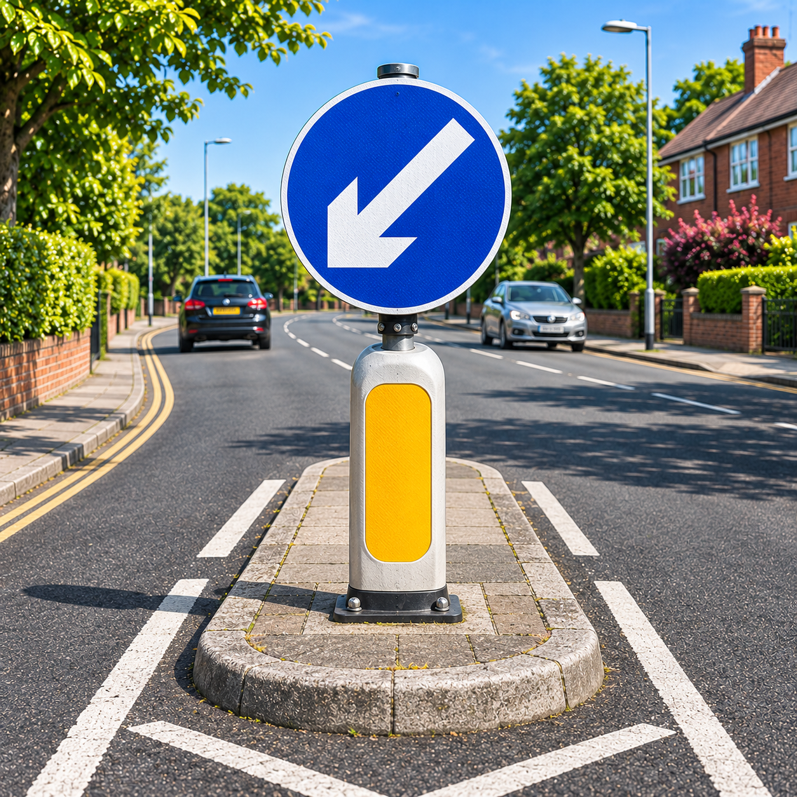

---

## gb-signs-006 — A circular sign with red border shows two cars, one black and one red. What is its usual meaning?

Content SHA-256: `6905bd6de7db29091a07355748098461a302e6508b390836f88878dda7673738`

A circular sign with red border shows two cars, one black and one red. What is its usual meaning?

A. Cars may only overtake on the left
B. There is a two-car parking bay ahead
C. Overtaking by motor vehicles is prohibited
D. The next road has two lanes

**Correct:** C — Overtaking by motor vehicles is prohibited

The 'No overtaking' regulatory sign restricts passing until the prohibition ends.

Source: [Highway Code, Traffic signs](https://www.gov.uk/guidance/the-highway-code/traffic-signs)

Answer review: no-overtaking-example; visible caption: No overtaking restriction; accessible description: No overtaking restriction

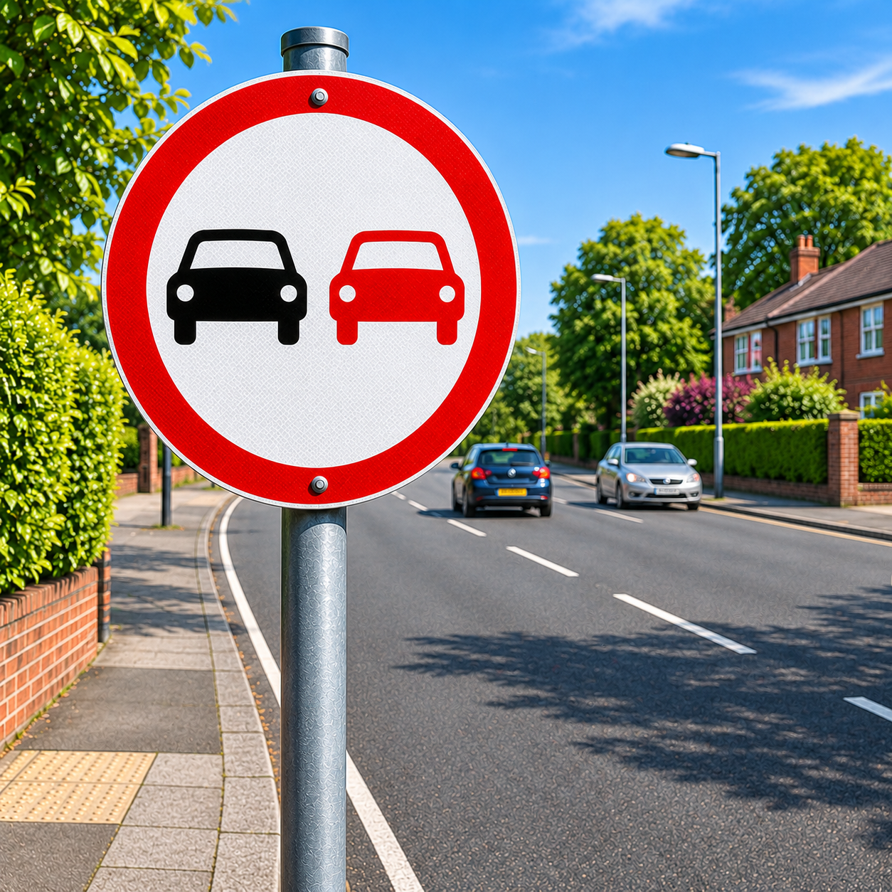

---

## gb-signs-007 — You see a sign telling you to give priority to vehicles from the opposite direction. What should you do at the narrow section?

Content SHA-256: `586c2cd3be7cda5e841092ff95bcadcca704d92f24d7e1715fc67d8aa17bd847`

You see a sign telling you to give priority to vehicles from the opposite direction. What should you do at the narrow section?

A. Accelerate first because you have priority
B. Stop only if a bus approaches
C. Wait and let oncoming traffic pass before entering when necessary
D. Ignore it when your vehicle is smaller

**Correct:** C — Wait and let oncoming traffic pass before entering when necessary

The priority sign requires you to let traffic from the opposing direction pass through a restricted width.

Source: [Highway Code, Traffic signs](https://www.gov.uk/guidance/the-highway-code/traffic-signs)

---

## gb-signs-008 — A circular prohibition sign shows 2.3 metres as a height limit. What should a driver of a taller vehicle do?

Content SHA-256: `90fae6187c1708e2c9a4b8507d6403778ebf11e96766ff2f5f0ecf213198aad1`

A circular prohibition sign shows 2.3 metres as a height limit. What should a driver of a taller vehicle do?

A. Proceed if travelling slowly
B. Deflate the tyres to fit under the limit
C. Only stop if the vehicle is wider than 2.3 metres
D. Choose another route rather than attempting to pass

**Correct:** D — Choose another route rather than attempting to pass

Height restrictions prevent vehicles above the displayed dimension from entering the restricted route.

Source: [Highway Code, Traffic signs](https://www.gov.uk/guidance/the-highway-code/traffic-signs)

---

## gb-signs-009 — A sign prohibits vehicles over a stated width. Which measurement matters?

Content SHA-256: `6b5c13f18e4baa686f13498165846a21710a8912b8228f84ae8ca4d19635ee08`

A sign prohibits vehicles over a stated width. Which measurement matters?

A. Only the distance between the tyres
B. The height of the driver's seat
C. The length of the wheelbase
D. The overall width of your vehicle and load

**Correct:** D — The overall width of your vehicle and load

A vehicle-width restriction concerns the complete vehicle and any projecting load.

Source: [Highway Code, Traffic signs](https://www.gov.uk/guidance/the-highway-code/traffic-signs)

---

## gb-signs-010 — A triangular sign shows the roadway narrowing on both sides. What should you prepare for?

Content SHA-256: `92bb88c3d64e7094c3c488b39aef109a9aa56b7be72253333febe6c328157265`

A triangular sign shows the roadway narrowing on both sides. What should you prepare for?

A. A wider road with a new overtaking lane
B. Less usable road width and possible conflict with approaching traffic
C. A compulsory right turn
D. The start of a motorway

**Correct:** B — Less usable road width and possible conflict with approaching traffic

A narrowing warning tells drivers to assess clearance and adjust speed or position in good time.

Source: [Highway Code, Traffic signs](https://www.gov.uk/guidance/the-highway-code/traffic-signs)

Answer review: narrowing-example; visible caption: Road narrows on both sides; accessible description: Road narrows on both sides

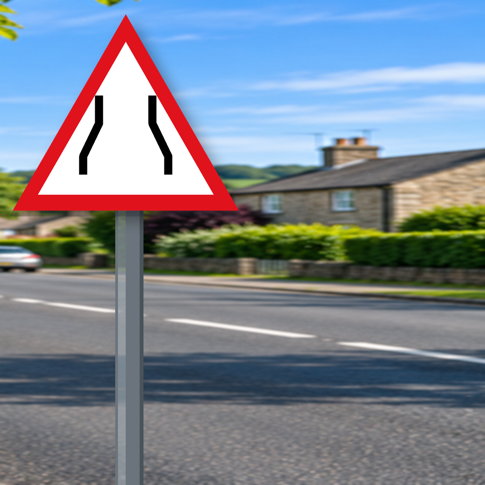

---

## gb-signs-011 — A warning triangle shows a double bend, first to the left. What should it prompt you to do?

Content SHA-256: `57f47171979d7acc1ba1632f7bc660745d6dede97a621efa78a529560c9d5433`

A warning triangle shows a double bend, first to the left. What should it prompt you to do?

A. Keep accelerating because the second bend is optional
B. Stop at the sign and reverse
C. Move to the centre line and wait
D. Reduce speed as appropriate and prepare for successive changes in direction

**Correct:** D — Reduce speed as appropriate and prepare for successive changes in direction

The double-bend warning alerts you to a sequence of bends that may limit your view ahead.

Source: [Highway Code, Traffic signs](https://www.gov.uk/guidance/the-highway-code/traffic-signs)

Answer review: double-bend-example; visible caption: Double bend, first to the left; accessible description: Double bend, first to the left

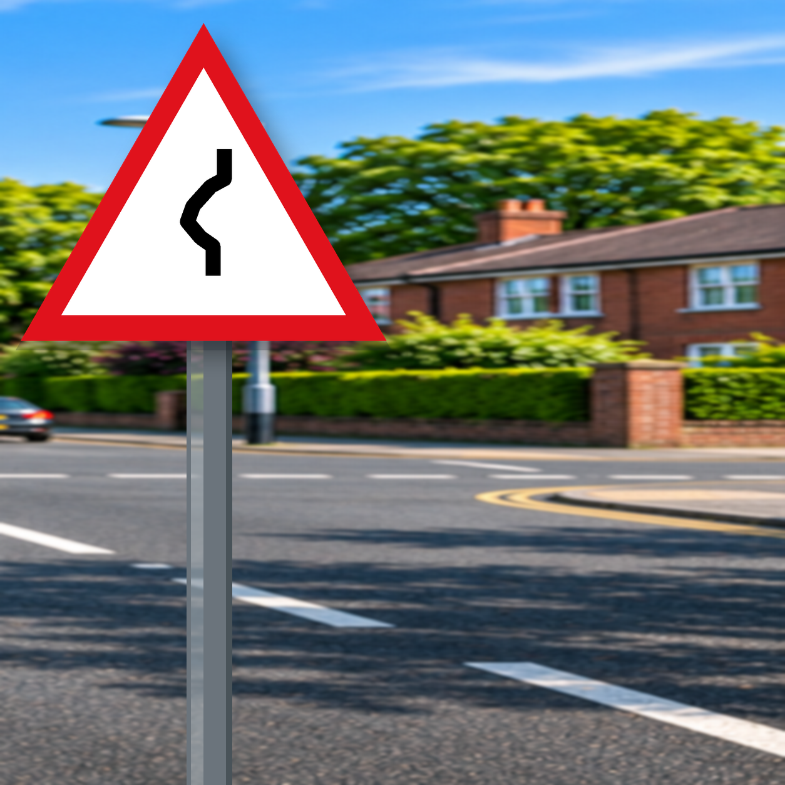

---

## gb-signs-012 — A steep descent warning appears before a long hill. What should you plan?

Content SHA-256: `7e194452da21ad476a07bca4df20f2aa4ecc741d63e20de674d0c9eeb1718e3b`

A steep descent warning appears before a long hill. What should you plan?

A. Coast in neutral to save fuel
B. Switch off the engine as you go downhill
C. Rely only on the handbrake to control speed
D. Use a controlled speed and a suitable gear before descending

**Correct:** D — Use a controlled speed and a suitable gear before descending

A steep downhill warning calls for early speed control and a gear that helps manage descent.

Source: [Highway Code, Traffic signs](https://www.gov.uk/guidance/the-highway-code/traffic-signs)

Answer review: steep-descent-example; visible caption: Prepare for a steep descent; accessible description: Prepare for a steep descent

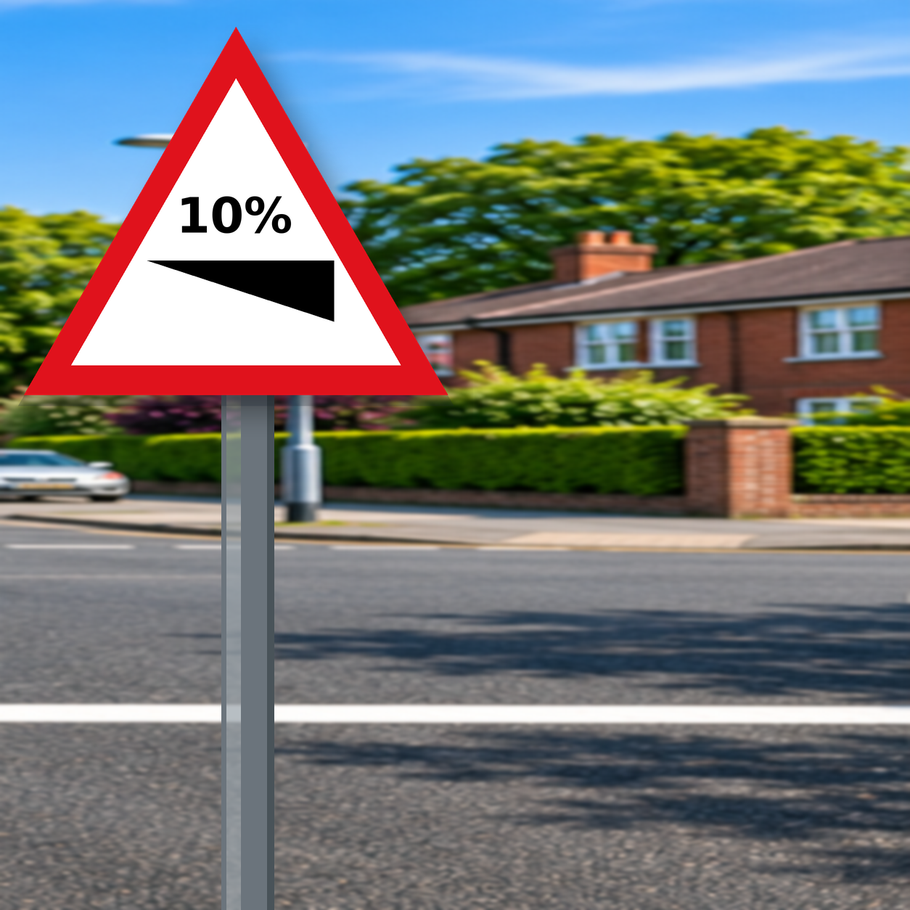

---

## gb-signs-013 — A triangular sign warns of a level crossing without a barrier. What should you expect?

Content SHA-256: `8895ecea2a7a9b0683a7dd2453f715629acbfcb494c776012bedc7a02a798bd3`

A triangular sign warns of a level crossing without a barrier. What should you expect?

A. A railway crossing that may not have a gate blocking road traffic
B. An airport runway reserved for cars
C. A crossing protected by full-width barriers at all times
D. A pedestrian-only subway

**Correct:** A — A railway crossing that may not have a gate blocking road traffic

Some level crossings lack physical barriers; approach cautiously and follow any crossing signals and signs.

Source: [Highway Code, Traffic signs](https://www.gov.uk/guidance/the-highway-code/traffic-signs)

---

## gb-signs-014 — A warning sign shows the edge of a quay or riverbank. What danger is it highlighting?

Content SHA-256: `abadeb93abaddecbda3649768705e4b1dbeddde04d965403d048e30e2d10a36d`

A warning sign shows the edge of a quay or riverbank. What danger is it highlighting?

A. A bridge with extra-high railings
B. A route where a vehicle could enter deep water
C. An automatic car-wash station
D. A safe place to drive into a river

**Correct:** B — A route where a vehicle could enter deep water

Quayside and riverbank warning signs alert drivers to an exposed waterside edge.

Source: [Highway Code, Traffic signs](https://www.gov.uk/guidance/the-highway-code/traffic-signs)

---

## gb-signs-015 — A triangular sign warns that pedestrians may be in the road ahead. What is the sensible response?

Content SHA-256: `aeb329b03a13c192524f1fbb23be27a9bf01cd8e10096cd022e85cb2bbcd9b99`

A triangular sign warns that pedestrians may be in the road ahead. What is the sensible response?

A. Sound the horn repeatedly to clear the road
B. Scan the road edges and be ready to slow or stop for pedestrians
C. Increase speed to pass before they cross
D. Assume pedestrians are confined to a footbridge

**Correct:** B — Scan the road edges and be ready to slow or stop for pedestrians

Pedestrian warnings are advance alerts to people potentially using the carriageway.

Source: [Highway Code, Traffic signs](https://www.gov.uk/guidance/the-highway-code/traffic-signs)

---

## gb-signs-016 — A direction sign has a green background on a primary road. What is the main purpose of the green colour?

Content SHA-256: `15e43ff88a80402ccb6b38e31ae171f521c848fd19920a248de66ae265dd27ae`

A direction sign has a green background on a primary road. What is the main purpose of the green colour?

A. To identify primary-route direction information
B. To announce that all vehicles must stop
C. To warn of an immediate railway crossing
D. To mark an emergency-only lane

**Correct:** A — To identify primary-route direction information

Primary-route direction signs typically use green backgrounds to distinguish route guidance from other sign families.

Source: [Highway Code, Traffic signs](https://www.gov.uk/guidance/the-highway-code/traffic-signs)

---

## gb-junction-001 — You want to leave a side road, but a long lorry is turning into it using much of the carriageway. What should you do?

Content SHA-256: `af7484cf849ca8091edbabd1707a97e9f6458c835f539a1e3ddab6fbd157aa2d`

You want to leave a side road, but a long lorry is turning into it using much of the carriageway. What should you do?

A. Move alongside its cab to hurry it along
B. Drive between the lorry and the kerb
C. Wait and allow room for the lorry's full turning movement
D. Assume the lorry will stay entirely in one lane

**Correct:** C — Wait and allow room for the lorry's full turning movement

Large vehicles may need more than one lane to turn; holding back prevents a dangerous squeeze.

Source: [Highway Code, Rule 170](https://www.gov.uk/guidance/the-highway-code/using-the-road-159-to-203)

---

## gb-junction-002 — At a side-road junction, a vehicle approaches from the right with its left indicator on. What should you do?

Content SHA-256: `d7ef9c03bee4e7a9fa4313265c05d730c7bc4d5dcf06fe546881a6a668da5ba0`

At a side-road junction, a vehicle approaches from the right with its left indicator on. What should you do?

A. Assume it must turn left and move immediately
B. Follow the vehicle ahead without checking
C. Wait until you can confirm its intentions and the junction is safe
D. Signal right to force it to slow

**Correct:** C — Wait until you can confirm its intentions and the junction is safe

An indicator does not guarantee the vehicle will turn; verify a safe gap before emerging.

Source: [Highway Code, Rule 170](https://www.gov.uk/guidance/the-highway-code/using-the-road-159-to-203)

---

## gb-junction-003 — You emerge from a Give Way junction marked with broken white lines. Whose traffic has priority?

Content SHA-256: `4c7c3c0a6b081bfd74e9b0cff561e953e90499bf9ad4716c0ee7382bcdcef829`

You emerge from a Give Way junction marked with broken white lines. Whose traffic has priority?

A. Any vehicle behind you on the side road
B. Traffic on the main road
C. Only vehicles approaching from your left
D. You always have priority if you signal

**Correct:** B — Traffic on the main road

At a Give Way line, let main-road traffic pass before joining when needed.

Source: [Highway Code, Rule 172](https://www.gov.uk/guidance/the-highway-code/using-the-road-159-to-203)

Answer review: give-way-example; visible caption: Give way to traffic on the major road; accessible description: Give way to traffic on the major road

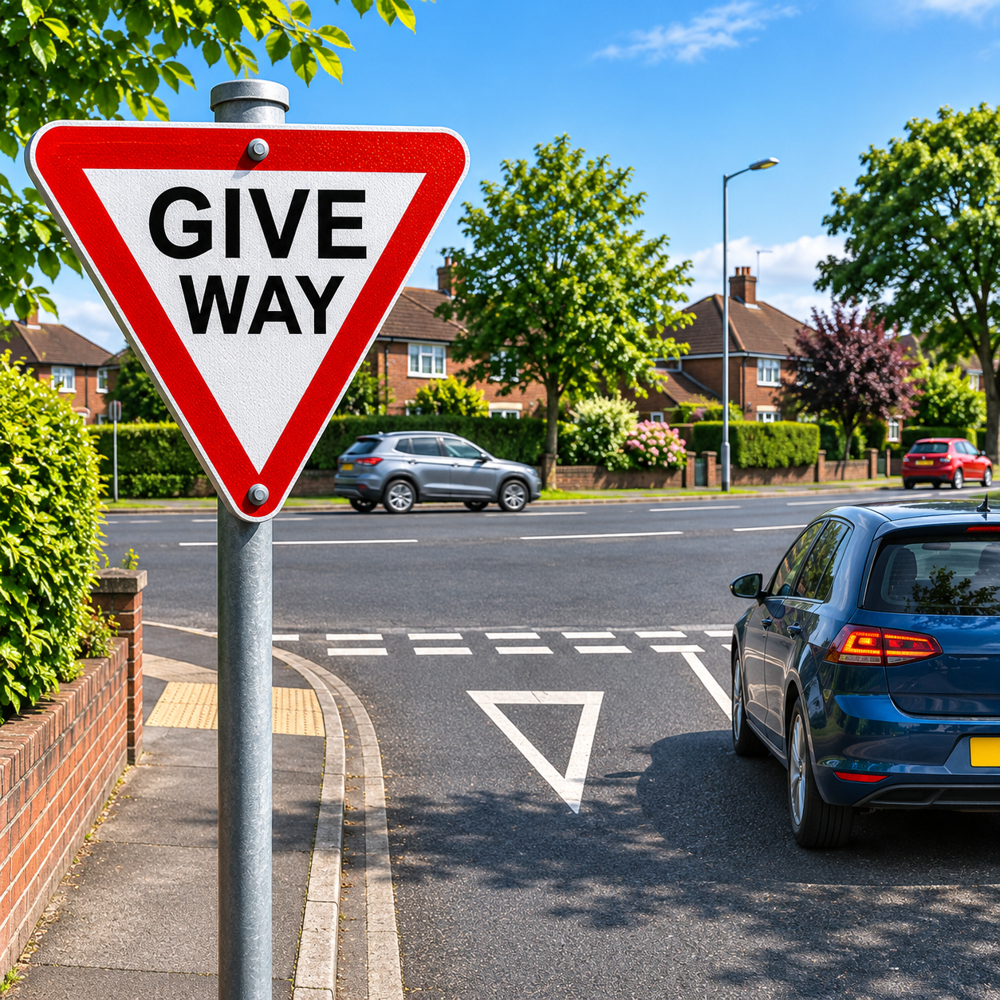

---

## gb-junction-004 — You need to cross a dual carriageway but the central reservation is too narrow for your entire car. What is safest?

Content SHA-256: `67f6edc15f9584474462382283c5f3b90057c1d4a016fa2d527a1c1ee63c1178`

You need to cross a dual carriageway but the central reservation is too narrow for your entire car. What is safest?

A. Wait until you can cross both halves in one safe movement
B. Stop with the rear of your car projecting into the first carriageway
C. Reverse into the opposing lane to create space
D. Rely on oncoming drivers to brake

**Correct:** A — Wait until you can cross both halves in one safe movement

A central refuge too short for your vehicle cannot protect it between traffic streams.

Source: [Highway Code, Rule 173](https://www.gov.uk/guidance/the-highway-code/using-the-road-159-to-203)

---

## gb-junction-005 — A central reservation can safely hold the full length of your vehicle. How may you treat a right turn across the dual carriageway?

Content SHA-256: `3e185e41030a5fb33927079b49cc331323a112a1d1f8c20afbdc4e430c6167e6`

A central reservation can safely hold the full length of your vehicle. How may you treat a right turn across the dual carriageway?

A. As two separate crossings, waiting in the middle for the next safe gap
B. As one continuous movement without checking the second carriageway
C. As permission to park in the reservation
D. As a way to turn left against traffic

**Correct:** A — As two separate crossings, waiting in the middle for the next safe gap

An adequately deep reservation allows you to assess each direction separately without obstructing traffic.

Source: [Highway Code, Rule 173](https://www.gov.uk/guidance/the-highway-code/using-the-road-159-to-203)

---

## gb-junction-006 — You approach a yellow box junction and stationary traffic fills the road beyond it. What should you do?

Content SHA-256: `ddd32d82062d2a592fb09af0ac9b43434de85a5aac656ed67864953d8614c9f2`

You approach a yellow box junction and stationary traffic fills the road beyond it. What should you do?

A. Wait before the box until you have a clear exit
B. Enter because your traffic light is green
C. Stop in the centre of the box to keep your place
D. Drive around the queue on the wrong side

**Correct:** A — Wait before the box until you have a clear exit

Normally you must not enter a yellow box unless you can exit it without stopping in the marked area.

Source: [Highway Code, Rule 174](https://www.gov.uk/guidance/the-highway-code/using-the-road-159-to-203)

Answer review: box-junction-example; visible caption: Keep the box clear; check the right-turn exception; accessible description: Keep the box clear; check the right-turn exception

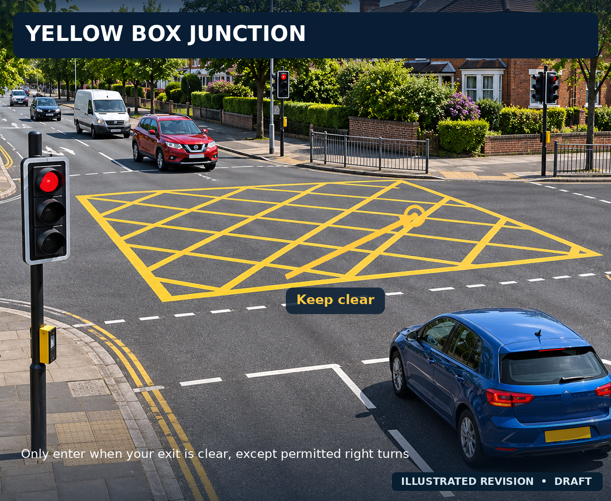

---

## gb-junction-007 — You want to turn right across oncoming traffic at an ordinary box junction. When can waiting inside the box be allowed?

Content SHA-256: `2ecf871190f1570db2f22d38808ef7e3794ef56e51760a5e8e5bae7528568146`

You want to turn right across oncoming traffic at an ordinary box junction. When can waiting inside the box be allowed?

A. Whenever the exit road is blocked by a stationary queue
B. When you wish to travel straight ahead
C. When only oncoming traffic or other right-turning vehicles prevent completion
D. Whenever you want to use the box as a waiting bay

**Correct:** C — When only oncoming traffic or other right-turning vehicles prevent completion

There is a limited right-turn exception, but it does not apply to a blocked exit unrelated to those vehicles.

Source: [Highway Code, Rule 174](https://www.gov.uk/guidance/the-highway-code/using-the-road-159-to-203)

Answer review: box-junction-example; visible caption: Keep the box clear; check the right-turn exception; accessible description: Keep the box clear; check the right-turn exception

---

## gb-junction-008 — An amber traffic light appears just as you reach its stop line, and braking now could cause a collision. What may you do?

Content SHA-256: `8701ea7d0f81ad39c658d49551fd7d8c474d6e73d085b7c61783c5dd7ae5f337`

An amber traffic light appears just as you reach its stop line, and braking now could cause a collision. What may you do?

A. Accelerate from far away to beat the light
B. Treat amber as an unrestricted green
C. Ignore the signal if the road is empty
D. Continue if you are already beyond the line or too close to stop safely

**Correct:** D — Continue if you are already beyond the line or too close to stop safely

The Highway Code permits proceeding at amber only in the specified circumstances where stopping would be unsafe.

Source: [Highway Code, Rule 175](https://www.gov.uk/guidance/the-highway-code/using-the-road-159-to-203)

---

## gb-junction-009 — Your light turns green but traffic ahead blocks the junction. What should you do?

Content SHA-256: `a8ca73f7e30c5e13e9f55da5403fe8b9c6b089d212505be8b0b7f05bbd69c9fa`

Your light turns green but traffic ahead blocks the junction. What should you do?

A. Wait until there is room to clear the junction safely
B. Enter and stop across the pedestrian crossing
C. Sound your horn and join the queue inside
D. Turn right without observing traffic

**Correct:** A — Wait until there is room to clear the junction safely

A green light does not remove the need to avoid blocking the junction.

Source: [Highway Code, Rule 176](https://www.gov.uk/guidance/the-highway-code/using-the-road-159-to-203)

---

## gb-junction-010 — The traffic lights at a crossroads are dark and appear to have failed. How should you proceed?

Content SHA-256: `e3a400a87c558e14d5cf3397e3c4a49bd58ca07e64df422cba9a8a40f23a2e87`

The traffic lights at a crossroads are dark and appear to have failed. How should you proceed?

A. Treat it as an unmarked junction and exercise exceptional care
B. Assume the failed lights give you priority
C. Accelerate because the restriction has ended
D. Let only buses proceed and ignore other vehicles

**Correct:** A — Treat it as an unmarked junction and exercise exceptional care

A failed signal requires careful judgement of traffic and gaps rather than assuming a right to go.

Source: [Highway Code, Rule 176](https://www.gov.uk/guidance/the-highway-code/using-the-road-159-to-203)

---

## gb-junction-011 — A green filter arrow lights up for left turns while the main red light remains on. What is permitted?

Content SHA-256: `864ecd05df71d6e2817942d3b9a5a4f5b4db6a95b3f44f93ac606ffd19929596`

A green filter arrow lights up for left turns while the main red light remains on. What is permitted?

A. Go straight ahead through the red signal
B. Turn right across all traffic
C. Proceed left in the indicated direction when it is safe
D. Use any lane to travel wherever you prefer

**Correct:** C — Proceed left in the indicated direction when it is safe

A green filter arrow applies only to its direction; other movements remain controlled by the main lights.

Source: [Highway Code, Rule 177](https://www.gov.uk/guidance/the-highway-code/using-the-road-159-to-203)

---

## gb-junction-012 — At a red light, two stop lines mark an advanced cyclist waiting area. Where should a car normally stop?

Content SHA-256: `fbcb77ef216fecbd54ba86a66e270f5b647e1c35efa3e08fc4961de0dcae7933`

At a red light, two stop lines mark an advanced cyclist waiting area. Where should a car normally stop?

A. Between the two lines in the cyclist area
B. Across the pedestrian crossing
C. As close to the vehicle ahead as possible
D. At the first line, before the cycle reservoir

**Correct:** D — At the first line, before the cycle reservoir

Advanced stop lines reserve a forward area for cycles; motor traffic must stop at the first line when the signal requires it.

Source: [Highway Code, Rule 178](https://www.gov.uk/guidance/the-highway-code/using-the-road-159-to-203)

---

## gb-junction-013 — You intend to turn right from a normal two-way road. Where should you usually position the car before turning?

Content SHA-256: `47d4ba789dc6983bf981ebafc401eb5e1be0c401fed8aabbeeb8cb478b74ceab`

You intend to turn right from a normal two-way road. Where should you usually position the car before turning?

A. Just left of the road centre or in a marked right-turn space
B. Against the left kerb no matter how wide the road
C. Across both carriageways
D. In a cycle lane to prevent cyclists passing

**Correct:** A — Just left of the road centre or in a marked right-turn space

Safe right-turn positioning helps other vehicles understand your intentions and may leave room to pass on the left.

Source: [Highway Code, Rule 179](https://www.gov.uk/guidance/the-highway-code/using-the-road-159-to-203)

---

## gb-junction-014 — Before completing a right turn, which final check is especially important?

Content SHA-256: `e1c6d287f5204c1adf539cff8a0728d03401defc20f3e4b492ed46be35f607a9`

Before completing a right turn, which final check is especially important?

A. Look only at the speedometer
B. Look for traffic overtaking you, including in the blind spot
C. Turn tightly across the corner to save time
D. Rely on your indicator to stop oncoming traffic

**Correct:** B — Look for traffic overtaking you, including in the blind spot

A vehicle or motorcycle may be passing while you wait; checking mirrors and blind spot avoids cutting across it.

Source: [Highway Code, Rule 180](https://www.gov.uk/guidance/the-highway-code/using-the-road-159-to-203)

---

## gb-junction-015 — You turn left across a cycle track. A cyclist is approaching along it from the opposite direction. What should you do?

Content SHA-256: `1ab0b52959c63d4c3b2038d3e528d103038cf8afb9e42098f7e319d41873dc60`

You turn left across a cycle track. A cyclist is approaching along it from the opposite direction. What should you do?

A. Expect the cyclist to stop because you are in a car
B. Enter the track to make the cyclist move away
C. Use the horn while continuing to turn
D. Give way before crossing the track

**Correct:** D — Give way before crossing the track

When turning across a cycle track or lane, give way to users of that route even when approaching from the other direction.

Source: [Highway Code, Rule 183](https://www.gov.uk/guidance/the-highway-code/using-the-road-159-to-203)

---

## gb-roundabout-001 — You are approaching an unfamiliar roundabout with lane arrows painted on the road. What should guide your choice of lane?

Content SHA-256: `69944f177df49750ff414d48c84738e1f5ae27a9d4d9d1f285d03223e22d6a49`

You are approaching an unfamiliar roundabout with lane arrows painted on the road. What should guide your choice of lane?

A. Only the lane occupied by the fastest car
B. The lane nearest the centre regardless of exit
C. The destination signs and the lane markings for your intended exit
D. Whichever lane lets you overtake first

**Correct:** C — The destination signs and the lane markings for your intended exit

Roundabout lanes can be allocated to particular exits, so read signs and markings early and plan your position.

Source: [Highway Code, Rule 184](https://www.gov.uk/guidance/the-highway-code/using-the-road-159-to-203)

---

## gb-roundabout-002 — As you approach a roundabout, when should you decide which exit to take?

Content SHA-256: `26e632d65fdcf0a27a1900d8d5651f8fc90ff64e9dd5c5ce45ac541b8594f8f5`

As you approach a roundabout, when should you decide which exit to take?

A. Only after passing the first exit
B. Before reaching it, so you can select the correct approach lane
C. Once you are level with the central island
D. After another driver sounds a horn

**Correct:** B — Before reaching it, so you can select the correct approach lane

Early route choice allows enough time for mirror checks, signals and safe lane positioning.

Source: [Highway Code, Rule 184](https://www.gov.uk/guidance/the-highway-code/using-the-road-159-to-203)

---

## gb-roundabout-003 — Why is the mirror-signal-manoeuvre routine useful at a roundabout?

Content SHA-256: `173ee4d3a9ae06a32361e5ff76e5ea69f2abdffd0c43ffdecd29f6092ed3a16c`

Why is the mirror-signal-manoeuvre routine useful at a roundabout?

A. It means you always have priority
B. It allows you to ignore lane arrows
C. It removes the need to check the right-hand side
D. It helps you track surrounding traffic and communicate your intended movements

**Correct:** D — It helps you track surrounding traffic and communicate your intended movements

Roundabouts involve multiple traffic streams, and systematic observation helps prevent unexpected conflicts.

Source: [Highway Code, Rule 184](https://www.gov.uk/guidance/the-highway-code/using-the-road-159-to-203)

---

## gb-roundabout-004 — A roundabout's signs and traffic lights are directing the entry differently from the usual rule. What should you follow?

Content SHA-256: `1dee6fd5a61a96818d7325d4f10c762019c49921b6b4ff76516f3a4fdecbac59`

A roundabout's signs and traffic lights are directing the entry differently from the usual rule. What should you follow?

A. The specific signs, signals and markings controlling that entrance
B. Always the rule that traffic from the right must stop
C. Only the vehicle directly in front
D. The centre line even if arrows disagree

**Correct:** A — The specific signs, signals and markings controlling that entrance

Traffic controls can alter the normal give-way arrangements, so follow the actual instructions at the junction.

Source: [Highway Code, Rule 185](https://www.gov.uk/guidance/the-highway-code/using-the-road-159-to-203)

---

## gb-roundabout-005 — You see an indicator flashing on a car already circulating on a roundabout. What is safest?

Content SHA-256: `83e5c9f3c2606e4a3fed714e62bb00c1cb9169d4e6144c6e5bddbd49ffa6e396`

You see an indicator flashing on a car already circulating on a roundabout. What is safest?

A. Judge its actual position and movement instead of trusting the indicator alone
B. Assume it will definitely exit immediately
C. Join because the other driver has signalled
D. Ignore all vehicles that are indicating

**Correct:** A — Judge its actual position and movement instead of trusting the indicator alone

Drivers may signal incorrectly or forget to cancel; observe before entering.

Source: [Highway Code, Rule 185](https://www.gov.uk/guidance/the-highway-code/using-the-road-159-to-203)

---

## gb-roundabout-006 — The car in front at a roundabout starts forward then brakes. What should you check before you move?

Content SHA-256: `ce7c9feb8d5f963c36ee15d4400384a0ab00bb13b1892e474f176d66d6f05d77`

The car in front at a roundabout starts forward then brakes. What should you check before you move?

A. Only whether the vehicle behind is close
B. That the space ahead is actually clear and the car has moved away
C. That your radio is turned off
D. Only the farthest exit sign

**Correct:** B — That the space ahead is actually clear and the car has moved away

Looking forward prevents a collision with the vehicle ahead when it unexpectedly stops again.

Source: [Highway Code, Rule 185](https://www.gov.uk/guidance/the-highway-code/using-the-road-159-to-203)

---

## gb-roundabout-007 — You are taking a right-hand exit at a roundabout without contrary lane markings. What should you normally signal on approach?

Content SHA-256: `36c799a02f9bb612cf100da930bc93706fa09efd30827d61142d6d72e4ba3de7`

You are taking a right-hand exit at a roundabout without contrary lane markings. What should you normally signal on approach?

A. Left from the start until leaving
B. No signal under any circumstances
C. Right, then left after passing the exit before yours
D. Hazard lights throughout the roundabout

**Correct:** C — Right, then left after passing the exit before yours

For a right-hand exit, a right signal on approach communicates intention; signal left before exiting at the proper point.

Source: [Highway Code, Rule 186](https://www.gov.uk/guidance/the-highway-code/using-the-road-159-to-203)

---

## gb-roundabout-008 — You are travelling to an intermediate exit straight ahead at a standard roundabout. What is usually correct on approach?

Content SHA-256: `d8543ecf9b7de9c2d418850bc26b9bf1d21070525ffb152a95e0e5e5395797fe`

You are travelling to an intermediate exit straight ahead at a standard roundabout. What is usually correct on approach?

A. Signal right throughout the roundabout
B. Select the suitable lane and normally do not signal until signalling left to leave
C. Signal left before the first exit even if you are passing it
D. Use hazard lights to show you are not turning

**Correct:** B — Select the suitable lane and normally do not signal until signalling left to leave

Intermediate exits generally call for the appropriate approach lane, then a left signal after the exit before yours.

Source: [Highway Code, Rule 186](https://www.gov.uk/guidance/the-highway-code/using-the-road-159-to-203)

---

## gb-roundabout-009 — When leaving a roundabout by the third exit, when should you normally begin signalling left?

Content SHA-256: `81bf81ff45269bd272267cc9005ecaaf5771afda8ef273d9df28aaf8326774b9`

When leaving a roundabout by the third exit, when should you normally begin signalling left?

A. Before entering the roundabout regardless of destination
B. After you have completely left the roundabout
C. After passing the exit immediately before the one you need
D. Only once another driver flashes headlights

**Correct:** C — After passing the exit immediately before the one you need

A well-timed left signal indicates which exit you will take without confusing drivers at earlier exits.

Source: [Highway Code, Rule 186](https://www.gov.uk/guidance/the-highway-code/using-the-road-159-to-203)

---

## gb-roundabout-010 — A cyclist is travelling around a roundabout in the same lane as you. What should you do?

Content SHA-256: `bb08d4377f19ed4f8c6c475dae415adee7093d2d341d919e367ac7889eb3a1be`

A cyclist is travelling around a roundabout in the same lane as you. What should you do?

A. Pass closely on the inside to avoid delay
B. Use your horn to make the cyclist move left
C. Assume the cyclist must leave at the next exit
D. Give space and do not overtake within that lane

**Correct:** D — Give space and do not overtake within that lane

Cyclists move more slowly and need room; overtaking them within the same roundabout lane risks cutting across their path.

Source: [Highway Code, Rule 186](https://www.gov.uk/guidance/the-highway-code/using-the-road-159-to-203)

---

## gb-roundabout-011 — A horse rider remains in the left-hand lane while continuing past an exit. How should you respond?

Content SHA-256: `0203f688198a504c46dc0bfcec6958fadbaa7423c820d66ba29a744ba5200c33`

A horse rider remains in the left-hand lane while continuing past an exit. How should you respond?

A. Allow them space and avoid cutting across their path
B. Assume they must take the next left exit
C. Move alongside and force a lane change
D. Sound the horn repeatedly until they turn

**Correct:** A — Allow them space and avoid cutting across their path

Horse riders may stay left while going around a roundabout, and drivers must anticipate their continuing movement.

Source: [Highway Code, Rule 186](https://www.gov.uk/guidance/the-highway-code/using-the-road-159-to-203)

---

## gb-roundabout-012 — A long articulated lorry is circulating ahead of you and appears to straddle two lanes. What should you do?

Content SHA-256: `c78422bcb2ad695bde5c36b4a7d33548fcb926c89968bcbb1f22ce42cc791c68`

A long articulated lorry is circulating ahead of you and appears to straddle two lanes. What should you do?

A. Overtake between the lorry and the central island
B. Move beside the trailer on the inside
C. Keep well clear and allow for its wider turning path
D. Assume its rear wheels follow the front exactly

**Correct:** C — Keep well clear and allow for its wider turning path

Long vehicles sometimes need extra space or multiple lanes to turn safely.

Source: [Highway Code, Rule 187](https://www.gov.uk/guidance/the-highway-code/using-the-road-159-to-203)

---

## gb-roundabout-013 — You are leaving a busy roundabout and see a pedestrian starting to cross the exit road. What should you do?

Content SHA-256: `31239a81b3c877ab54e805a9e32f94b7cec0ad3c9feff9a9cba740d5c6015bf0`

You are leaving a busy roundabout and see a pedestrian starting to cross the exit road. What should you do?

A. Be ready to yield and let the pedestrian cross safely
B. Accelerate out before the person reaches your lane
C. Use the horn to make them run
D. Drive into the crossing space and stop beside them

**Correct:** A — Be ready to yield and let the pedestrian cross safely

Roundabout exits require careful observation for people crossing; be ready to give way under the relevant junction priority rules.

Source: [Highway Code, Rule 187](https://www.gov.uk/guidance/the-highway-code/using-the-road-159-to-203)

---

## gb-roundabout-014 — You approach a mini-roundabout marked by a painted central circle. How should most vehicles pass it?

Content SHA-256: `3734bc632e0506acbe09d4251da0a8bba9f9c1e61619edb89994a8931433d2c3`

You approach a mini-roundabout marked by a painted central circle. How should most vehicles pass it?

A. Straight across the circle whenever the route is shortest
B. Against the direction of circulating traffic
C. Onto the pavement if the painted area is narrow
D. Around the centre markings unless the vehicle is too large to do so

**Correct:** D — Around the centre markings unless the vehicle is too large to do so

The central markings at a mini-roundabout must normally be circled, with limited practical exceptions for large vehicles.

Source: [Highway Code, Rule 188](https://www.gov.uk/guidance/the-highway-code/using-the-road-159-to-203)

---

## gb-roundabout-015 — Two mini-roundabouts are joined close together. How should you deal with them?

Content SHA-256: `8b598c6ccf7ada210ed7efb27b0254adc06ce071c7256305e4f087d27ebd5257`

Two mini-roundabouts are joined close together. How should you deal with them?

A. Treat both as one junction and ignore the second give-way point
B. Treat each as a separate roundabout, assessing traffic from the right at each
C. Stop between them regardless of conditions
D. Always take the right lane through both

**Correct:** B — Treat each as a separate roundabout, assessing traffic from the right at each

Every mini-roundabout has its own approach and priority decision.

Source: [Highway Code, Rule 189](https://www.gov.uk/guidance/the-highway-code/using-the-road-159-to-203)

---

## gb-overtaking-001 — Before overtaking a slow lorry, which condition should you verify?

Content SHA-256: `0f0ccb7021563c5aa4e22bf03e1fac8a77c9845e7f23f16b434094df56a70fda`

Before overtaking a slow lorry, which condition should you verify?

A. There is enough clear road and a safe gap to return to the left afterwards
B. The lorry's driver is looking straight ahead
C. Your car is capable of exceeding the speed limit
D. The road is dry even if oncoming traffic is near

**Correct:** A — There is enough clear road and a safe gap to return to the left afterwards

A safe overtake needs clear road ahead and a suitable space to move back without forcing another road user to brake.

Source: [Highway Code, Rule 162](https://www.gov.uk/guidance/the-highway-code/using-the-road-159-to-203)

---

## gb-overtaking-002 — You are about to overtake on a normal two-way road. What observation is important before moving out?

Content SHA-256: `38611bdd4bb626da9f0ee513913c844e5160b687990b9789df978e83eec434bb`

You are about to overtake on a normal two-way road. What observation is important before moving out?

A. Look only at the rear of the vehicle ahead
B. Assume nobody will approach from behind
C. Keep your indicator on without checking the road
D. Check mirrors and the blind spot for someone overtaking you

**Correct:** D — Check mirrors and the blind spot for someone overtaking you

Another road user may already be passing you; mirrors and blind-spot checks help avoid moving into their path.

Source: [Highway Code, Rule 163](https://www.gov.uk/guidance/the-highway-code/using-the-road-159-to-203)

---

## gb-overtaking-003 — You are overtaking a cyclist at up to 30 mph. What minimum lateral clearance is given as a guide?

Content SHA-256: `09f1c7f6acf3e289663f697ba91741afdeea0a7b33359461b8dbdfb834836100`

You are overtaking a cyclist at up to 30 mph. What minimum lateral clearance is given as a guide?

A. At least 1.5 metres, with more space at higher speeds
B. About 20 centimetres if you sound the horn
C. Exactly half a metre at any speed
D. No gap if the cyclist is close to the kerb

**Correct:** A — At least 1.5 metres, with more space at higher speeds

The Highway Code advises at least 1.5 metres when passing cyclists up to 30 mph and additional room at greater speed.

Source: [Highway Code, Rule 163](https://www.gov.uk/guidance/the-highway-code/using-the-road-159-to-203)

---

## gb-overtaking-004 — You need to pass a horse rider on a narrow road. What passing approach is advised?

Content SHA-256: `dfc270c17ea78e438937218708fb656c4ad0ec44a28f028574e0625f8027dd30`

You need to pass a horse rider on a narrow road. What passing approach is advised?

A. Stay at the speed limit and give half a metre
B. Travel below 10 mph and allow at least 2 metres of room
C. Sound the horn so the horse moves aside
D. Overtake very close and accelerate out

**Correct:** B — Travel below 10 mph and allow at least 2 metres of room

Horses may react unpredictably; use very low speed and generous clearance, and wait if there is not enough space.

Source: [Highway Code, Rule 163](https://www.gov.uk/guidance/the-highway-code/using-the-road-159-to-203)

---

## gb-overtaking-005 — There is a pedestrian walking in the road without a footway. What clearance should you generally leave when passing?

Content SHA-256: `f9de35d905f22ae930fabe51a90262c9c43796a2a196e1b39e43998fe8844388`

There is a pedestrian walking in the road without a footway. What clearance should you generally leave when passing?

A. A mirror's width so other cars can pass
B. At least 2 metres and a low speed where possible
C. No extra room if the pedestrian faces traffic
D. Only a one-second time gap

**Correct:** B — At least 2 metres and a low speed where possible

Pedestrians on the carriageway need additional protection; allow space and slow to minimise danger.

Source: [Highway Code, Rule 163](https://www.gov.uk/guidance/the-highway-code/using-the-road-159-to-203)

---

## gb-overtaking-006 — An oncoming car is approaching while you must pass parked vehicles on your side. What should you do?

Content SHA-256: `d8d4edf4d8f54859eb1603988270183d2de78e915b3cfc76ee73dc0578c8ae78`

An oncoming car is approaching while you must pass parked vehicles on your side. What should you do?

A. Force the oncoming vehicle to use the pavement
B. Overtake without reducing speed
C. Stop beside the parked cars blocking both directions
D. Give way to the oncoming vehicle before passing the obstruction

**Correct:** D — Give way to the oncoming vehicle before passing the obstruction

When obstructions are on your side, yielding to approaching traffic usually avoids a conflict in the narrow remaining space.

Source: [Highway Code, Rule 163](https://www.gov.uk/guidance/the-highway-code/using-the-road-159-to-203)

---

## gb-overtaking-007 — Why is it unwise to follow closely behind a tall lorry before overtaking?

Content SHA-256: `3839d9f3c4d9ce7c737e1ac9d771d487f4de66b4c25d4bed5897e9d14d90391a`

Why is it unwise to follow closely behind a tall lorry before overtaking?

A. It hides the road ahead and may put you outside the lorry driver's view
B. It increases your visibility of oncoming traffic
C. It makes the manoeuvre much shorter
D. It guarantees no other vehicle is ahead of the lorry

**Correct:** A — It hides the road ahead and may put you outside the lorry driver's view

Dropping back improves sight lines and lets the larger vehicle's driver notice you in their mirrors.

Source: [Highway Code, Rule 164](https://www.gov.uk/guidance/the-highway-code/using-the-road-159-to-203)

---

## gb-overtaking-008 — A car ahead starts overtaking a long articulated vehicle. Should you immediately follow it?

Content SHA-256: `94a5d863592a8caf4f00d921f4a316927f1dc289c27725f592cc0419adf82b63`

A car ahead starts overtaking a long articulated vehicle. Should you immediately follow it?

A. Yes; one gap is always enough for two vehicles
B. No; assess whether there is room and time for your own safe overtake
C. Yes; the first car guarantees the road ahead is clear
D. Only if you flash your headlights repeatedly

**Correct:** B — No; assess whether there is room and time for your own safe overtake

The first driver may need all the available gap, so a second driver must make an independent safety decision.

Source: [Highway Code, Rule 164](https://www.gov.uk/guidance/the-highway-code/using-the-road-159-to-203)

---

## gb-overtaking-009 — A vehicle in front has stopped at a pedestrian crossing. What must you avoid?

Content SHA-256: `140071c57b779d3b3e92bc0faffae6ecffc4f55485a468f2d6317f7741dce8c7`

A vehicle in front has stopped at a pedestrian crossing. What must you avoid?

A. Stopping behind it at a safe distance
B. Checking for people already crossing
C. Overtaking it while it is the nearest vehicle to the crossing
D. Waiting until the crossing is clear

**Correct:** C — Overtaking it while it is the nearest vehicle to the crossing

Passing the closest stopped vehicle at a crossing is prohibited and may conceal pedestrians.

Source: [Highway Code, Rule 165](https://www.gov.uk/guidance/the-highway-code/using-the-road-159-to-203)

---

## gb-overtaking-010 — You see a 'No Overtaking' sign. What does it require?

Content SHA-256: `7d0cba26ebe4858a0d0225b83c96034efe8c621c28c06e59e618d80da66b599c`

You see a 'No Overtaking' sign. What does it require?

A. Do not overtake until a sign or restriction ends that prohibition
B. Overtake only vehicles going below 20 mph
C. Overtake on the left if the road is quiet
D. Ignore it when your lane is wide

**Correct:** A — Do not overtake until a sign or restriction ends that prohibition

Regulatory no-overtaking signs restrict overtaking until the restriction is cancelled.

Source: [Highway Code, Rule 165](https://www.gov.uk/guidance/the-highway-code/using-the-road-159-to-203)

---

## gb-overtaking-011 — You are climbing towards the brow of a hill and cannot see beyond it. What should you do about overtaking?

Content SHA-256: `a05045862829a490b4c3df132415443295fa3b5944738e52058c72900ce7ebf1`

You are climbing towards the brow of a hill and cannot see beyond it. What should you do about overtaking?

A. Stay behind because oncoming traffic may be hidden
B. Pull out before reaching the top
C. Accelerate so the manoeuvre is over quickly
D. Use the horn and rely on the response

**Correct:** A — Stay behind because oncoming traffic may be hidden

A hill crest hides the road ahead, so the required sight distance for a safe overtake is missing.

Source: [Highway Code, Rule 166](https://www.gov.uk/guidance/the-highway-code/using-the-road-159-to-203)

---

## gb-overtaking-012 — A road is narrowing ahead and the car in front is slowing. Is this a good place to overtake?

Content SHA-256: `ddad49b948239ebd0f5499bd522ba931c0870e6bf11cf3ca9659c7fcf6bbaa2f`

A road is narrowing ahead and the car in front is slowing. Is this a good place to overtake?

A. Yes; narrowing always creates a faster lane
B. Yes; the slower car must move onto the verge
C. Only if you keep your hazard lights flashing
D. No; hold back because the narrowing could bring road users into conflict

**Correct:** D — No; hold back because the narrowing could bring road users into conflict

Passing where road width reduces can force others to change speed or direction unsafely.

Source: [Highway Code, Rule 167](https://www.gov.uk/guidance/the-highway-code/using-the-road-159-to-203)

---

## gb-overtaking-013 — You intend to turn left at a junction while following a cyclist going straight ahead. What should you do?

Content SHA-256: `2fab67d052b3bb40f4f207d6e2027815c3a3f78d65d4b1ff9e1e33eec1bf04ea`

You intend to turn left at a junction while following a cyclist going straight ahead. What should you do?

A. Stay behind rather than overtake and turn across the cyclist
B. Pass first and turn sharply in front
C. Enter the cycle lane and stop across it
D. Use the horn to make the cyclist wait

**Correct:** A — Stay behind rather than overtake and turn across the cyclist

Cutting left immediately after passing a cyclist creates a serious collision risk; allow them to continue.

Source: [Highway Code, Rule 167](https://www.gov.uk/guidance/the-highway-code/using-the-road-159-to-203)

---

## gb-overtaking-014 — A driver overtakes and then moves into the space ahead of you. What should you restore?

Content SHA-256: `5bbfce5550da7a583aa0c7f387e7c34af5de7a283b7c8d438b66432fb7f1a481`

A driver overtakes and then moves into the space ahead of you. What should you restore?

A. Your original speed regardless of the new gap
B. A position beside their rear wheel
C. A safe following distance behind the overtaking vehicle
D. A smaller gap so nobody else can enter

**Correct:** C — A safe following distance behind the overtaking vehicle

Dropping back helps restore reaction time after another vehicle moves into your stopping space.

Source: [Highway Code, Rule 168](https://www.gov.uk/guidance/the-highway-code/using-the-road-159-to-203)

---

## gb-overtaking-015 — You are driving a slow farm vehicle and a long queue forms behind you. What should you consider?

Content SHA-256: `cb724df32980080303c6692a2be6cdc6f315ada675c3a7b0c35c2b351c6ff056`

You are driving a slow farm vehicle and a long queue forms behind you. What should you consider?

A. Pulling into a safe place to let faster traffic pass
B. Driving on the wrong side to let cars through
C. Accelerating beyond the vehicle's safe speed
D. Ignoring mirrors for the rest of the journey

**Correct:** A — Pulling into a safe place to let faster traffic pass

Slow vehicles should check mirrors and use safe opportunities to allow following queues to pass.

Source: [Highway Code, Rule 169](https://www.gov.uk/guidance/the-highway-code/using-the-road-159-to-203)

---

## gb-crossings-001 — A driver is parked on zig-zag approach markings at a crossing. Why is this prohibited?

Content SHA-256: `66a9a0f069683ab1eb53c63e4154f22e3db0f85cdbbd3d922f91bd96e93f086c`

A driver is parked on zig-zag approach markings at a crossing. Why is this prohibited?

A. Zig-zags are reserved parking bays
B. The parked vehicle may hide people crossing and obstruct their view
C. It makes the vehicle more visible to drivers
D. The markings are intended only for heavy vehicles

**Correct:** B — The parked vehicle may hide people crossing and obstruct their view

Crossing zig-zags protect clear sight lines, and parking in the restricted area is prohibited.

Source: [Highway Code, Rule 191](https://www.gov.uk/guidance/the-highway-code/using-the-road-159-to-203)

---

## gb-crossings-002 — A moving car directly ahead is nearest to a pedestrian crossing. What must you not do?

Content SHA-256: `174c6498ebba744332f1c68ef88283634dd2bd656d76eebc9f309ffe8cb6fcd3`

A moving car directly ahead is nearest to a pedestrian crossing. What must you not do?

A. Keep a safe gap behind it
B. Check both pavements for people
C. Overtake that car as it approaches the crossing
D. Prepare to brake if necessary

**Correct:** C — Overtake that car as it approaches the crossing

Overtaking the moving vehicle nearest a crossing is prohibited because people may be concealed from view.

Source: [Highway Code, Rule 191](https://www.gov.uk/guidance/the-highway-code/using-the-road-159-to-203)

---

## gb-crossings-003 — Traffic is moving slowly, but the crossing ahead is occupied by a queue of cars. What is the safest choice?

Content SHA-256: `e57a4d341b16454d1c38a6845d6395ed06cab6b223ba94995c68e2c0ad9d9185`

Traffic is moving slowly, but the crossing ahead is occupied by a queue of cars. What is the safest choice?

A. Stop across the markings to hold your place
B. Wait until you can clear the entire crossing before entering it
C. Use the horn to move the queue
D. Drive up onto the pavement

**Correct:** B — Wait until you can clear the entire crossing before entering it

A blocked crossing prevents pedestrians from using it safely; do not enter unless you can get clear.

Source: [Highway Code, Rule 192](https://www.gov.uk/guidance/the-highway-code/using-the-road-159-to-203)

---

## gb-crossings-004 — An illegally parked van blocks your view of one end of a zebra crossing. What should you anticipate?

Content SHA-256: `fb1bcf996a4ffe722106ac9661eccc9cb152f7873dc2dd5e3ce57e6780173f00`

An illegally parked van blocks your view of one end of a zebra crossing. What should you anticipate?

A. The crossing is closed until the van moves
B. People may step into view from behind the van
C. Pedestrians must wait for you because you cannot see them
D. The speed limit is suspended

**Correct:** B — People may step into view from behind the van

Obstructed crossings demand particular caution because pedestrians may be hidden by parked or queuing vehicles.

Source: [Highway Code, Rule 193](https://www.gov.uk/guidance/the-highway-code/using-the-road-159-to-203)

---

## gb-crossings-005 — An older person is taking longer than expected to finish crossing. What should you do?

Content SHA-256: `feeae06e403595f33c920f441d6f44265b13c0d14e57a9a23cc7601ec8c060c2`

An older person is taking longer than expected to finish crossing. What should you do?

A. Wait patiently without edging forward or revving the engine
B. Move forward gently to encourage them
C. Sound your horn until they clear the road
D. Drive around them within the crossing

**Correct:** A — Wait patiently without edging forward or revving the engine

Crossing users should have time and space; intimidating them with noise or movement creates risk.

Source: [Highway Code, Rule 194](https://www.gov.uk/guidance/the-highway-code/using-the-road-159-to-203)

---

## gb-crossings-006 — A pedestrian has just stepped onto a zebra crossing. What is your duty?

Content SHA-256: `b5e1daef9b43b2c3f34144aacd26c94326e5f5617e878618ba7b11944d96e100`

A pedestrian has just stepped onto a zebra crossing. What is your duty?

A. Continue if you were approaching first
B. Flash headlights and keep moving
C. Give way and allow them to cross safely
D. Stop only when a red traffic light appears

**Correct:** C — Give way and allow them to cross safely

Once a person is on a zebra crossing, drivers must give way rather than treating it as optional courtesy.

Source: [Highway Code, Rule 195](https://www.gov.uk/guidance/the-highway-code/using-the-road-159-to-203)

---

## gb-crossings-007 — A pedestrian waits beside a zebra crossing but has not entered it. How should you respond?

Content SHA-256: `fc4047a9715fe68b1b5461615663a9aac6f5637e2c3f8cdb7c7058bbcd93f897`

A pedestrian waits beside a zebra crossing but has not entered it. How should you respond?

A. Ignore them until they step into your lane
B. Wave while maintaining your speed
C. Slow if needed and give way so they can cross
D. Overtake the vehicle slowing ahead

**Correct:** C — Slow if needed and give way so they can cross

The Highway Code advises giving way to those waiting to cross, with extra care around approaching pedestrians.

Source: [Highway Code, Rule 195](https://www.gov.uk/guidance/the-highway-code/using-the-road-159-to-203)

---

## gb-crossings-008 — Why should you avoid waving a pedestrian across a zebra crossing?

Content SHA-256: `725a97f88ecbef98bcb93e3eb22b197b4cef92fb9f7afa952f0dbc3a6a058bde`

Why should you avoid waving a pedestrian across a zebra crossing?

A. Because waving always turns your brake lights off
B. Because pedestrians cannot see hand signals
C. Because it makes the crossing officially one-way
D. Another vehicle may be approaching that the pedestrian has not seen

**Correct:** D — Another vehicle may be approaching that the pedestrian has not seen

A wave can give false reassurance about other traffic; the pedestrian must be able to judge the full situation.

Source: [Highway Code, Rule 195](https://www.gov.uk/guidance/the-highway-code/using-the-road-159-to-203)

---

## gb-crossings-009 — You approach a parallel crossing with cyclists waiting alongside pedestrians. What should you do?

Content SHA-256: `247812921b8f2486a1e071d06ee0d1580772f3dc4e74124d6455aaea90e06b59`

You approach a parallel crossing with cyclists waiting alongside pedestrians. What should you do?

A. Be prepared to stop and give way to the cyclists or pedestrians wishing to cross
B. Ignore cyclists because only pedestrians use that type of crossing
C. Keep the speed limit and sound the horn
D. Overtake a vehicle stopped at the crossing

**Correct:** A — Be prepared to stop and give way to the cyclists or pedestrians wishing to cross

Parallel crossings include a cycle route and give crossing priority to cyclists and pedestrians under the stated rules.

Source: [Highway Code, Rule 195](https://www.gov.uk/guidance/the-highway-code/using-the-road-159-to-203)

---

## gb-crossings-010 — A zebra crossing has a central island dividing the road into two sections. How is it treated?

Content SHA-256: `c5c23419d753f78187bd0ea5ee90ce3d1482e74050418ac00906fb473a9255ff`

A zebra crossing has a central island dividing the road into two sections. How is it treated?

A. As one crossing like a pelican crossing
B. As two separate crossings
C. As a place where pedestrians never have priority
D. As a roundabout for pedestrians

**Correct:** B — As two separate crossings

A central refuge divides a zebra crossing into two crossings; drivers must still watch for anyone using either half.

Source: [Highway Code, Rule 195](https://www.gov.uk/guidance/the-highway-code/using-the-road-159-to-203)

---

## gb-crossings-011 — At a pelican crossing, the traffic signal is flashing amber and a pedestrian is still crossing. What must you do?

Content SHA-256: `588a78c13230e8dc02cb209ec588cc0be9a4063979970f0d679df42b569b428e`

At a pelican crossing, the traffic signal is flashing amber and a pedestrian is still crossing. What must you do?

A. Accelerate because flashing amber always gives priority to cars
B. Sound the horn to hurry the person
C. Treat the amber as a full green light
D. Give way until the pedestrian has crossed

**Correct:** D — Give way until the pedestrian has crossed

A flashing amber at a pelican crossing allows progress only when pedestrians have cleared the crossing.

Source: [Highway Code, Rule 196](https://www.gov.uk/guidance/the-highway-code/using-the-road-159-to-203)

---

## gb-crossings-012 — The pelican crossing signal is flashing amber and nobody is crossing. What may you do?

Content SHA-256: `d858e5519ecf391d997049b846c3fb4ca6ec9f2e80cf170f2b40beb4b76ab35f`

The pelican crossing signal is flashing amber and nobody is crossing. What may you do?

A. Proceed cautiously if it is safe
B. Stop until the light becomes green
C. Drive at twice the usual limit
D. Enter without checking either side

**Correct:** A — Proceed cautiously if it is safe

When no pedestrian remains on a pelican crossing, flashing amber permits cautious progress.

Source: [Highway Code, Rule 196](https://www.gov.uk/guidance/the-highway-code/using-the-road-159-to-203)

---

## gb-crossings-013 — A pelican crossing includes a central refuge island in a single signal-controlled crossing. What must you allow for?

Content SHA-256: `cad7ee0fb204527be239c4b0a19f5050fec2b1a61b9f081f976f8edc113780c5`

A pelican crossing includes a central refuge island in a single signal-controlled crossing. What must you allow for?

A. That the crossing becomes two independent zebra crossings
B. Cars using the island as a parking space
C. Pedestrians still crossing from the opposite half
D. Cyclists driving on the island against traffic

**Correct:** C — Pedestrians still crossing from the opposite half

Unlike zebra crossings split by an island, a pelican crossing continuing straight across is treated as one crossing.

Source: [Highway Code, Rule 197](https://www.gov.uk/guidance/the-highway-code/using-the-road-159-to-203)

---

## gb-crossings-014 — Your light turns green, but someone is still completing a crossing. What should you do?

Content SHA-256: `eaf19fd5023f947e4580a0d5798323203bd8ec39167570574e0986c8b2d0c65b`

Your light turns green, but someone is still completing a crossing. What should you do?

A. Drive because green automatically cancels pedestrian priority
B. Sound your horn and accelerate
C. Wait for the person to finish crossing safely
D. Use the opposite lane to pass them

**Correct:** C — Wait for the person to finish crossing safely

A green signal does not justify driving through people who are still using the crossing.

Source: [Highway Code, Rule 198](https://www.gov.uk/guidance/the-highway-code/using-the-road-159-to-203)

---

## gb-crossings-015 — You approach a toucan crossing and see cyclists waiting with pedestrians. Which statement is correct?

Content SHA-256: `1d32acd2311cfc38a672ac91c6d1371e22eed5fb8fd6a55e294b0cf70ec83a99`

You approach a toucan crossing and see cyclists waiting with pedestrians. Which statement is correct?

A. Cyclists must dismount because only pedestrians may use it
B. All toucan crossings have a flashing amber phase
C. Drivers are never required to stop at a toucan crossing
D. Toucan crossings serve both cyclists and pedestrians and have no pelican-style flashing amber phase

**Correct:** D — Toucan crossings serve both cyclists and pedestrians and have no pelican-style flashing amber phase

Toucan signals accommodate cycles as well as pedestrians; the vehicle light sequence differs from a pelican crossing.

Source: [Highway Code, Rule 199](https://www.gov.uk/guidance/the-highway-code/using-the-road-159-to-203)

---

## gb-vulnerable-001 — Why should a car driver take particular responsibility when interacting with pedestrians or cyclists?

Content SHA-256: `ef5da87c2b373b4daa79c9ec7a974b670eac4adb8e0425a60e0f141ae8c6bd9f`

Why should a car driver take particular responsibility when interacting with pedestrians or cyclists?

A. A motor vehicle can cause greater harm, so its driver should reduce the risk to others
B. Pedestrians are always at fault in a collision
C. Cyclists are banned from most roads
D. Larger vehicles automatically have priority

**Correct:** A — A motor vehicle can cause greater harm, so its driver should reduce the risk to others

Those capable of causing the greatest injury have a greater responsibility to minimise danger to more vulnerable road users.

Source: [Highway Code, Rule 204](https://www.gov.uk/guidance/the-highway-code/road-users-requiring-extra-care-204-to-225)

---

## gb-vulnerable-002 — You pass a playground just as children are gathering near the kerb. What should you do?

Content SHA-256: `01e5e19976723ee82935edb67ee4bdc965b1eed79604214db3ea8219458fff6d`

You pass a playground just as children are gathering near the kerb. What should you do?

A. Maintain speed because children are on the pavement
B. Sound the horn continuously to keep them in place
C. Drive close to the kerb so nobody can cross
D. Slow down and be prepared for a child to enter the road unexpectedly

**Correct:** D — Slow down and be prepared for a child to enter the road unexpectedly

Children may misjudge traffic or move suddenly; a reduced speed increases reaction time.

Source: [Highway Code, Rule 205](https://www.gov.uk/guidance/the-highway-code/road-users-requiring-extra-care-204-to-225)

---

## gb-vulnerable-003 — You are about to reverse into a side street. What should you check first?

Content SHA-256: `30151ea674fd0cd4d5bed6f163e947b41a11d24d68d128dff4ffd94c36168418`

You are about to reverse into a side street. What should you check first?

A. Look all around and give way to pedestrians crossing the area
B. Look only in the interior mirror
C. Expect pedestrians to move out of the road
D. Reverse quickly to shorten the manoeuvre

**Correct:** A — Look all around and give way to pedestrians crossing the area

Pedestrians are easily hidden when reversing; observe the whole area and yield before moving.

Source: [Highway Code, Rule 206](https://www.gov.uk/guidance/the-highway-code/road-users-requiring-extra-care-204-to-225)

---

## gb-vulnerable-004 — An older pedestrian with a walking aid is crossing slowly. What is the appropriate reaction?

Content SHA-256: `b942ea79348d3fe66a695b4d89e370774b78d07c68f59756fc97d40d4eec6946`

An older pedestrian with a walking aid is crossing slowly. What is the appropriate reaction?

A. Use the horn to signal that the light will change
B. Edge the car forward to hurry them
C. Be patient and leave enough time for them to cross
D. Drive around them within the crossing

**Correct:** C — Be patient and leave enough time for them to cross

People with mobility difficulties may need more time, so drivers should avoid intimidating or rushing them.

Source: [Highway Code, Rule 207](https://www.gov.uk/guidance/the-highway-code/road-users-requiring-extra-care-204-to-225)

---

## gb-vulnerable-005 — A pedestrian uses a white cane with a red band. What does it commonly indicate?

Content SHA-256: `99bc2127b3e6cc0edc05c7c2bd5cce183ed90ba2d3e990057b5055e2d2e4b2d4`

A pedestrian uses a white cane with a red band. What does it commonly indicate?

A. They are a road worker directing traffic
B. They may be both deaf and blind
C. They are carrying a temporary parking permit
D. They are a learner driving instructor

**Correct:** B — They may be both deaf and blind

The Highway Code notes that a white cane with a red band can identify a deafblind pedestrian who may not notice signals.

Source: [Highway Code, Rule 207](https://www.gov.uk/guidance/the-highway-code/road-users-requiring-extra-care-204-to-225)

---

## gb-vulnerable-006 — A flashing amber warning appears below a school sign. What should you prepare for?

Content SHA-256: `ebfe84c249a42743ca02e8df50f8c23ed8b898665f436857f4651548c7318541`

A flashing amber warning appears below a school sign. What should you prepare for?

A. A road closed to all vehicles for the day
B. A speed limit that has automatically been removed
C. Children crossing ahead; drive very slowly until clear of the area
D. A compulsory left turn at the school gate

**Correct:** C — Children crossing ahead; drive very slowly until clear of the area

School warning lights can mean children are crossing or near the road; extra caution is needed.

Source: [Highway Code, Rule 208](https://www.gov.uk/guidance/the-highway-code/road-users-requiring-extra-care-204-to-225)

---

## gb-vulnerable-007 — You are passing a stationary school bus displaying a school-bus sign. What is especially likely?

Content SHA-256: `8bafcc9893bc2e0b2e2af178c1ba69e7b002ea83ae11757c2fa7cdc78f6ca83c`

You are passing a stationary school bus displaying a school-bus sign. What is especially likely?

A. The bus is about to overtake your car
B. Children may suddenly move into the road when boarding or leaving
C. The road is now a motorway
D. Only adults may emerge from the bus

**Correct:** B — Children may suddenly move into the road when boarding or leaving

Children may cross without careful observation near a stopped school bus, so pass slowly and watch closely.

Source: [Highway Code, Rule 209](https://www.gov.uk/guidance/the-highway-code/road-users-requiring-extra-care-204-to-225)

---

## gb-vulnerable-008 — A school crossing patrol holds a 'Stop for children' sign towards you. What must you do?

Content SHA-256: `b18599988c8bd1b6eb1991db35b346fde63a9b56e5ff83394bf23f9e93a7331f`

A school crossing patrol holds a 'Stop for children' sign towards you. What must you do?

A. Proceed when you cannot see pupils
B. Drive around the patrol on the wrong side
C. Flash your headlights instead of stopping
D. Stop and remain stopped as directed

**Correct:** D — Stop and remain stopped as directed

A school crossing patrol's stop signal is legally binding, even if you think the road appears clear.

Source: [Highway Code, Rule 210](https://www.gov.uk/guidance/the-highway-code/road-users-requiring-extra-care-204-to-225)

---

## gb-vulnerable-009 — You are waiting to turn right across slow traffic. What hidden road users should you check for?

Content SHA-256: `59fc79b3311dfd15fb02c63737bc3eb687929f256f66476354b77757568a33b0`

You are waiting to turn right across slow traffic. What hidden road users should you check for?

A. Cyclists and motorcyclists filtering along the traffic you must cross
B. Only heavy lorries ahead of the queue
C. No one, because the queue is stopped
D. Pedestrians inside your own vehicle

**Correct:** A — Cyclists and motorcyclists filtering along the traffic you must cross

Two-wheelers can move past slow or stationary traffic, including in places obscured from the driver's view.

Source: [Highway Code, Rule 211](https://www.gov.uk/guidance/the-highway-code/road-users-requiring-extra-care-204-to-225)

---

## gb-vulnerable-010 — A cyclist ahead looks over their shoulder. What might this indicate?

Content SHA-256: `3a1546e7459e321187add771418d60ecd475f1bb197d2c68211365743690aa6d`

A cyclist ahead looks over their shoulder. What might this indicate?

A. They have invited you to pass closely
B. They may be preparing to change course or turn
C. They are certain to stop immediately
D. They are signalling that the road is empty

**Correct:** B — They may be preparing to change course or turn

A shoulder check is often a clue that a rider is planning a move; allow time and room rather than overtaking tightly.

Source: [Highway Code, Rule 212](https://www.gov.uk/guidance/the-highway-code/road-users-requiring-extra-care-204-to-225)

---

## gb-vulnerable-011 — A cyclist rides in the centre of a narrow lane. What is the safest response?

Content SHA-256: `f7acab6358cdefbbdbdee0d5304326741e9c107dbeac609e71bde6ba55ccee88`

A cyclist rides in the centre of a narrow lane. What is the safest response?

A. Sound the horn until they ride in the gutter
B. Force your way past within the same lane
C. Assume they are deliberately breaking the law
D. Allow them to use that position and overtake only when safe

**Correct:** D — Allow them to use that position and overtake only when safe

Cyclists may take the lane to remain visible and avoid unsafe close passes on narrow roads.

Source: [Highway Code, Rule 213](https://www.gov.uk/guidance/the-highway-code/road-users-requiring-extra-care-204-to-225)

---

## gb-vulnerable-012 — A group of cyclists rides two abreast on a quiet narrow road. What should you consider?

Content SHA-256: `f627f51cec81fbca0e922a8a02eb0a6f7b11f5aad5408947a4f07fc9abf35569`

A group of cyclists rides two abreast on a quiet narrow road. What should you consider?

A. Two-abreast cycling always makes it safe to pass between them
B. They must immediately form a single line for every approaching car
C. You should overtake without leaving the lane
D. They may ride that way for safety; wait for a proper overtaking gap

**Correct:** D — They may ride that way for safety; wait for a proper overtaking gap

The Highway Code recognises that riding two abreast can help cyclists see and be seen in some road situations.

Source: [Highway Code, Rule 213](https://www.gov.uk/guidance/the-highway-code/road-users-requiring-extra-care-204-to-225)

---

## gb-vulnerable-013 — A group of sheep is blocking a rural road. What is the safest action?

Content SHA-256: `c5ba200edb74afb6f6ec632c6bba6db5380ed26bad4887a4135ed467d428ae9c`

A group of sheep is blocking a rural road. What is the safest action?

A. Rev your engine to push the animals aside
B. Sound your horn continually until they scatter
C. Stop and switch the engine off until the animals have left the road
D. Drive between the animals while accelerating

**Correct:** C — Stop and switch the engine off until the animals have left the road

Noise and movement may frighten animals, creating danger to them and nearby road users.

Source: [Highway Code, Rule 214](https://www.gov.uk/guidance/the-highway-code/road-users-requiring-extra-care-204-to-225)

---

## gb-vulnerable-014 — You are passing a horse being led along a country lane. How should you drive?

Content SHA-256: `a76a6d6642fb8f3e72199a1ac87ea2d32e97bbaf4b0bf41e6e3ebbc4f40bae13`

You are passing a horse being led along a country lane. How should you drive?

A. Accelerate to minimise time beside the horse
B. Move slowly, leave generous space and be ready to stop
C. Use the horn to announce yourself
D. Drive close because horses rarely move sideways

**Correct:** B — Move slowly, leave generous space and be ready to stop

Animals can startle and move unpredictably; gentle, unhurried passing reduces the chance of a dangerous reaction.

Source: [Highway Code, Rule 214](https://www.gov.uk/guidance/the-highway-code/road-users-requiring-extra-care-204-to-225)

---

## gb-winter-001 — Snow is falling heavily and your journey is not essential. What does the Highway Code advise?

Content SHA-256: `2031c71f0f43141663e83e4fe160369edc571a5fe2da6298188f85c7b8db7cd3`

Snow is falling heavily and your journey is not essential. What does the Highway Code advise?

A. Drive normally because modern cars cannot skid
B. Use only the motorway to avoid traffic
C. Travel late at night to find empty roads
D. Avoid driving until conditions are safer

**Correct:** D — Avoid driving until conditions are safer

Avoid unnecessary journeys in snow or ice; the risk remains high even with careful driving.

Source: [Highway Code, Rule 228](https://www.gov.uk/guidance/the-highway-code/driving-in-adverse-weather-conditions-226-to-237)

---

## gb-winter-002 — You must drive in winter weather and may become stranded. Which item would be sensible to carry?

Content SHA-256: `0be622ac8c067f5cd957dc6317404a2184094ff4f12a3523687c9e5978ede23b`

You must drive in winter weather and may become stranded. Which item would be sensible to carry?

A. Only a spare number plate
B. A bottle of oil for the windscreen
C. A metal bar for forcing open traffic gates
D. Warm clothing, a torch and basic emergency supplies

**Correct:** D — Warm clothing, a torch and basic emergency supplies

An emergency winter kit can help if your vehicle breaks down or you are delayed in severe conditions.

Source: [Highway Code, Rule 228](https://www.gov.uk/guidance/the-highway-code/driving-in-adverse-weather-conditions-226-to-237)

---

## gb-winter-003 — Your windscreen has a small clear patch but snow still covers the other windows. What must you do before moving?

Content SHA-256: `3ed7cdc52b83543511c1dba22dbac8a418ca02e73248b87c15aed4c66ed98d30`

Your windscreen has a small clear patch but snow still covers the other windows. What must you do before moving?

A. Drive slowly while the heater clears the rest
B. Clear the snow and ice from every window needed for visibility
C. Use the side mirror alone
D. Keep the horn sounding until the view improves

**Correct:** B — Clear the snow and ice from every window needed for visibility

Drivers must be able to see properly; snow and ice must be removed from windows before driving.

Source: [Highway Code, Rule 229](https://www.gov.uk/guidance/the-highway-code/driving-in-adverse-weather-conditions-226-to-237)

---

## gb-winter-004 — Frozen dirt and snow are covering your number plates and lights. What is required?

Content SHA-256: `56c7890e67ccef88198d9719759fe163f0bbdcb1ac970cb25d1cdabec1216992`

Frozen dirt and snow are covering your number plates and lights. What is required?

A. Leave the snow in place to protect the paint
B. Clean them so the lamps work and the plates remain legible
C. Use hazard lights to replace covered lamps
D. Remove the number plates for the journey

**Correct:** B — Clean them so the lamps work and the plates remain legible

Lights and registration plates must remain clean, visible and readable in winter conditions.

Source: [Highway Code, Rule 229](https://www.gov.uk/guidance/the-highway-code/driving-in-adverse-weather-conditions-226-to-237)

---

## gb-winter-005 — A thick layer of snow has collected on your car's roof. What should you do?

Content SHA-256: `c847b7fe4efe1f01a19cbe559accc48bb46ebea2a116f8c29cf7207903093b19`

A thick layer of snow has collected on your car's roof. What should you do?

A. Leave it to fall off while accelerating
B. Drive with hazard lights until it melts
C. Cover it with a plastic sheet and start driving
D. Remove snow that could slide or blow into the path of other road users

**Correct:** D — Remove snow that could slide or blow into the path of other road users

Loose roof snow can fall onto windscreens or create hazards for traffic following your vehicle.

Source: [Highway Code, Rule 229](https://www.gov.uk/guidance/the-highway-code/driving-in-adverse-weather-conditions-226-to-237)

---

## gb-winter-006 — Before leaving on a long journey during a snow warning, which check is most useful?

Content SHA-256: `b6f5e63035422717d400a92394a93b4990547dc7f28fb45e40f5c70a43e3b295`

Before leaving on a long journey during a snow warning, which check is most useful?

A. Check only whether the car radio works
B. Assume all roads are clear if your driveway is clear
C. Ignore updated travel bulletins
D. Check the route and forecast for closures or further snowfall

**Correct:** D — Check the route and forecast for closures or further snowfall

Winter roads can change quickly; forecasts and route information can prevent avoidable danger.

Source: [Highway Code, Rule 229](https://www.gov.uk/guidance/the-highway-code/driving-in-adverse-weather-conditions-226-to-237)

---

## gb-winter-007 — A gritted road looks dry, but the temperature is below freezing. What should you remember?

Content SHA-256: `d3445a4aff589fa3c4c8be82cfe57698a7bce5f9758a5ec2319231bd4b900ccc`

A gritted road looks dry, but the temperature is below freezing. What should you remember?

A. Gritting guarantees the road has full summer grip
B. You can brake as hard as in dry conditions
C. The car's tyres cannot lose traction
D. There may still be icy patches and you need to drive cautiously

**Correct:** D — There may still be icy patches and you need to drive cautiously

Treated roads can still be slippery; road surface conditions vary over short distances.

Source: [Highway Code, Rule 230](https://www.gov.uk/guidance/the-highway-code/driving-in-adverse-weather-conditions-226-to-237)

---

## gb-winter-008 — You want to pass a snowplough working ahead. When should you consider overtaking?

Content SHA-256: `54ff0326c467963b69559b92294bbc9d4497b910857a1914aa363dc3bd7cbf9a`

You want to pass a snowplough working ahead. When should you consider overtaking?

A. Only if the lane you intend to use has already been cleared and the manoeuvre is safe
B. Whenever you can see the plough's rear lights
C. When the snow is deepest in the overtaking lane
D. Only after flashing your headlights

**Correct:** A — Only if the lane you intend to use has already been cleared and the manoeuvre is safe

Snowploughs can throw snow sideways; using an uncleared lane to pass may be particularly dangerous.

Source: [Highway Code, Rule 230](https://www.gov.uk/guidance/the-highway-code/driving-in-adverse-weather-conditions-226-to-237)

---

## gb-winter-009 — A winter maintenance vehicle is spreading road salt. Why should you be careful around it?

Content SHA-256: `6434a6c2068189edb5943ff3e931f9dc35545c7a581545bc045070aeaaf67a96`

A winter maintenance vehicle is spreading road salt. Why should you be careful around it?

A. Its presence means the road is automatically closed
B. Loose salt and changing surface conditions can create hazards
C. You are required to follow within one metre
D. You may ignore normal lane markings

**Correct:** B — Loose salt and changing surface conditions can create hazards

Spreading vehicles and temporary differences in grip demand extra care, especially for two-wheelers.

Source: [Highway Code, Rule 230](https://www.gov.uk/guidance/the-highway-code/driving-in-adverse-weather-conditions-226-to-237)

---

## gb-winter-010 — A motorway variable message sign reports ice ahead. What should you do?

Content SHA-256: `1440fb50b5ed6fbb6dc13ef6882c0fe5ea60393e380ce8ef7a44f2dcd014446b`

A motorway variable message sign reports ice ahead. What should you do?

A. Take the warning seriously and allow for changing grip conditions
B. Maintain your previous speed until skidding begins
C. Switch off the headlights regardless of visibility
D. Assume the sign applies only to lorries

**Correct:** A — Take the warning seriously and allow for changing grip conditions

Electronic warnings can give advance notice of slippery sections that are not immediately visible.

Source: [Highway Code, Rule 230](https://www.gov.uk/guidance/the-highway-code/driving-in-adverse-weather-conditions-226-to-237)

---

## gb-winter-011 — When driving a manual car on an icy surface, which gear selection is generally advised?

Content SHA-256: `0c3630a8b19b4d1dd0cc0be0219cbb9df2c898eb1df00c57a90ece57581afbef`

When driving a manual car on an icy surface, which gear selection is generally advised?

A. The lowest gear with maximum acceleration
B. A relatively high gear at low speed to reduce wheel spin
C. Neutral while travelling downhill
D. Reverse gear if the road is level

**Correct:** B — A relatively high gear at low speed to reduce wheel spin

A high gear and gentle throttle can limit sudden torque at the driven wheels on ice.

Source: [Highway Code, Rule 231](https://www.gov.uk/guidance/the-highway-code/driving-in-adverse-weather-conditions-226-to-237)

---

## gb-winter-012 — You are approaching an icy bend. When should you reduce your speed?

Content SHA-256: `43671c678518326817fee1b2bde71789294fbd7d4dc73920ee453b2adb127707`

You are approaching an icy bend. When should you reduce your speed?

A. Before reaching the bend, preferably while travelling straight
B. Only once you are in the sharpest part of the bend
C. After the car begins to slide
D. By applying the handbrake while turning

**Correct:** A — Before reaching the bend, preferably while travelling straight

Braking gradually before a bend reduces the chance of losing grip when steering.

Source: [Highway Code, Rule 231](https://www.gov.uk/guidance/the-highway-code/driving-in-adverse-weather-conditions-226-to-237)

---

## gb-winter-013 — How should you operate the accelerator when starting on packed snow?

Content SHA-256: `37ef7540fb4ad00987554dd45689ab9a833b0d69aba9a95d6f4ce6b5a9b9ccfa`

How should you operate the accelerator when starting on packed snow?

A. Hard enough to spin the tyres until they grip
B. In repeated full-throttle bursts
C. Smoothly and gently to avoid wheel spin
D. Only after turning the steering wheel fully

**Correct:** C — Smoothly and gently to avoid wheel spin

Sudden acceleration can break tyre traction; gentle inputs help maintain control.

Source: [Highway Code, Rule 231](https://www.gov.uk/guidance/the-highway-code/driving-in-adverse-weather-conditions-226-to-237)

---

## gb-winter-014 — While travelling on ice, you notice that tyre noise has almost disappeared. What may this indicate?

Content SHA-256: `971667ab086e7181f2c937a6c13c0719c5d4e2e740ed9d40e2975fe5dfd7fb7d`

While travelling on ice, you notice that tyre noise has almost disappeared. What may this indicate?

A. Very little tyre grip on the surface
B. That the tyres have become warmer and safer
C. That the road has turned into a gravel surface
D. That the car's exhaust is blocked

**Correct:** A — Very little tyre grip on the surface

Tyres can make very little noise on ice, which may be a warning of the slippery surface.

Source: [Highway Code, Rule 231](https://www.gov.uk/guidance/the-highway-code/driving-in-adverse-weather-conditions-226-to-237)

---

## gb-winter-015 — You are unsure whether a quiet stretch of road is icy. How could you cautiously assess the available grip?

Content SHA-256: `056d661d1229403d620d1d140ae5c424e0311785c9a980bafd5c0b56a683e679`

You are unsure whether a quiet stretch of road is icy. How could you cautiously assess the available grip?

A. In a safe place, brake very gently and notice the response
B. Brake violently in a busy traffic lane
C. Accelerate hard and see whether the tyres spin
D. Steer sharply while close to the kerb

**Correct:** A — In a safe place, brake very gently and notice the response

The Highway Code describes cautiously testing grip with gentle braking in a safe place, not provoking a skid.

Source: [Highway Code, Rule 231](https://www.gov.uk/guidance/the-highway-code/driving-in-adverse-weather-conditions-226-to-237)

---

## gb-parking-001 — You are about to leave your car parked at the roadside. What must you do with its parking brake?

Content SHA-256: `a7465864100d149d47a5120bccd7e6e5a7055a2df4d2675ce5fc266c58a4b006`

You are about to leave your car parked at the roadside. What must you do with its parking brake?

A. Leave it released so the car can be pushed
B. Use it only when parked on steep hills
C. Replace it by turning the headlights on
D. Apply it securely before leaving the vehicle

**Correct:** D — Apply it securely before leaving the vehicle

The Highway Code requires the parking brake to be applied before a parked vehicle is left.

Source: [Highway Code, Rule 239](https://www.gov.uk/guidance/the-highway-code/waiting-and-parking-238-to-252)

---

## gb-parking-002 — Before opening the driver's door beside a cycle lane, how can you reduce the risk of striking a cyclist?

Content SHA-256: `7be578a42d57b6ef1e895c0f81b90a9967ffe68a19a1baef9ef28d4aa15cbbcb`

Before opening the driver's door beside a cycle lane, how can you reduce the risk of striking a cyclist?

A. Open the door quickly so it is visible
B. Sound the horn and open without looking
C. Check mirrors and look over your shoulder, ideally opening with the far hand
D. Wait until a cyclist is directly alongside the door

**Correct:** C — Check mirrors and look over your shoulder, ideally opening with the far hand

Looking all around, including over the shoulder, helps prevent 'dooring' passing cyclists or motorcyclists.

Source: [Highway Code, Rule 239](https://www.gov.uk/guidance/the-highway-code/waiting-and-parking-238-to-252)

---

## gb-parking-003 — Passengers are getting out of a parked car beside a busy road. Which side is generally safer?

Content SHA-256: `178fce668c6ab2ba542a2cc42412b3549dcf61e12c9958ebe7647ade97953e78`

Passengers are getting out of a parked car beside a busy road. Which side is generally safer?

A. The kerb side, away from moving traffic
B. The side next to the fastest vehicles
C. The side with the shortest door opening
D. Any side because parked cars have priority

**Correct:** A — The kerb side, away from moving traffic

Using the kerb-side door reduces exposure to passing traffic, especially for children.

Source: [Highway Code, Rule 239](https://www.gov.uk/guidance/the-highway-code/waiting-and-parking-238-to-252)

---

## gb-parking-004 — You park an electric vehicle beside a public charger. What extra hazard should you consider?

Content SHA-256: `43816547af03cbf7a325290be124a47bffc5f343ee7cfbd6b2095d55432a7d05`

You park an electric vehicle beside a public charger. What extra hazard should you consider?

A. The vehicle has no parking brake
B. The charger makes all nearby parking rules inapplicable
C. Pedestrians may not use the pavement at charging points
D. Loose charging cables could trip pedestrians

**Correct:** D — Loose charging cables could trip pedestrians

Keep charging cables tidy and avoid trailing them across the route used by pedestrians.

Source: [Highway Code, Rule 239](https://www.gov.uk/guidance/the-highway-code/waiting-and-parking-238-to-252)

---

## gb-parking-005 — Is it permitted to park within the marked zig-zag approach area of a pedestrian crossing?

Content SHA-256: `dd7182b9a885d8192774752638da678aaf9cd7b8daa5d1b8f50ff220bc0256f8`

Is it permitted to park within the marked zig-zag approach area of a pedestrian crossing?

A. Yes, if the engine is switched off
B. Yes, for a short phone call
C. No, the marked crossing area must be kept clear
D. Yes, as long as a passenger remains inside

**Correct:** C — No, the marked crossing area must be kept clear

Parking on a crossing or its restricted zig-zag approaches is prohibited and can obstruct visibility.

Source: [Highway Code, Rule 240](https://www.gov.uk/guidance/the-highway-code/waiting-and-parking-238-to-252)

---

## gb-parking-006 — You see a clearway sign on a stretch of road. What should you understand?

Content SHA-256: `4d647dca6ac5a46747f561e1f3f7c2581d1addb8d17d4b0d6281a5eca559848b`

You see a clearway sign on a stretch of road. What should you understand?

A. Stopping on the carriageway is generally prohibited by the clearway restriction
B. The road is only for vehicles over 7.5 tonnes
C. You may park whenever traffic is light
D. The road is a designated loading bay

**Correct:** A — Stopping on the carriageway is generally prohibited by the clearway restriction

Clearways restrict stopping, with any exceptions indicated by the relevant signs.

Source: [Highway Code, Rule 240](https://www.gov.uk/guidance/the-highway-code/waiting-and-parking-238-to-252)

---

## gb-parking-007 — A tram lane is in operation and not available to ordinary cars. May you stop and park in it?

Content SHA-256: `dec7a3c33f247bd9f79ba63e8c6a0243cecf15b9037eda2a9ae253a346ce4257`

A tram lane is in operation and not available to ordinary cars. May you stop and park in it?

A. Yes, provided hazard lights are flashing
B. No, parking or stopping in the operating tram lane is prohibited
C. Only if you are collecting a parcel
D. Yes, when tram traffic is not visible

**Correct:** B — No, parking or stopping in the operating tram lane is prohibited

The Highway Code prohibits stopping or parking in restricted tram or cycle lanes during their period of operation.

Source: [Highway Code, Rule 240](https://www.gov.uk/guidance/the-highway-code/waiting-and-parking-238-to-252)

---

## gb-parking-008 — A parking bay is marked for Blue Badge holders only. When may you use it?

Content SHA-256: `a28806dab2ecb5bb1956c44ad04fcd625f1a8964d7bb5ae892fbc68c4d8cb064`

A parking bay is marked for Blue Badge holders only. When may you use it?

A. When you are entitled to do so under the bay's restrictions
B. Whenever every ordinary parking bay is occupied
C. If you intend to park for less than five minutes
D. Anytime if you leave a phone number on the dashboard

**Correct:** A — When you are entitled to do so under the bay's restrictions

Reserved bays are for authorised users only; inconvenience is not a valid reason to occupy them.

Source: [Highway Code, Rule 241](https://www.gov.uk/guidance/the-highway-code/waiting-and-parking-238-to-252)

---

## gb-parking-009 — You park partly across a narrow entrance so that vehicles cannot reach an emergency access road. What is wrong?

Content SHA-256: `de21d249b2ae7488c5da4ab6885b5f0a687bbb3c1e4e3c209035b8c85bc98156`

You park partly across a narrow entrance so that vehicles cannot reach an emergency access road. What is wrong?

A. The car may be causing an unnecessary obstruction or danger
B. It is acceptable when the engine is off
C. Emergency access must be provided only after sunset
D. It is safe if there are no vehicles currently waiting

**Correct:** A — The car may be causing an unnecessary obstruction or danger

Vehicles must not be left where they cause dangerous or unnecessary obstruction.

Source: [Highway Code, Rule 242](https://www.gov.uk/guidance/the-highway-code/waiting-and-parking-238-to-252)

---

## gb-parking-010 — You are considering stopping at the entrance of a fire station. What is the safest decision?

Content SHA-256: `1497f52dd7d6373c4c1027448b0d5cb6c79c4772933b57d692f0b4253895e6bc`

You are considering stopping at the entrance of a fire station. What is the safest decision?

A. Do not obstruct access used by emergency services
B. Stop briefly if no fire engine is visible
C. Leave the car with hazard lights on
D. Park there only on Sundays

**Correct:** A — Do not obstruct access used by emergency services

The Code advises never stopping or parking where you would prevent emergency vehicles from entering or leaving.

Source: [Highway Code, Rule 243](https://www.gov.uk/guidance/the-highway-code/waiting-and-parking-238-to-252)

---

## gb-parking-011 — You are parking in London or Scotland and intend to leave half the car on the pavement. Which rule applies?

Content SHA-256: `77e5a754aec9345093349665404936bedd6a93da4fcf90991450c8cbe7e38ee1`

You are parking in London or Scotland and intend to leave half the car on the pavement. Which rule applies?

A. It is always allowed if you leave one metre for pedestrians
B. It is legal whenever you pay a parking meter
C. Pavement parking is generally prohibited, subject to limited exceptions
D. Pavement parking restrictions apply only at night

**Correct:** C — Pavement parking is generally prohibited, subject to limited exceptions

London and Scotland generally prohibit pavement parking, with limited exemptions; it can obstruct wheelchair users and pedestrians.

Source: [Highway Code, Rule 244](https://www.gov.uk/guidance/the-highway-code/waiting-and-parking-238-to-252)

---

## gb-parking-012 — You drive into a Controlled Parking Zone. Where can you find the usual times of its waiting restrictions?

Content SHA-256: `5cd7cd81f8b6877204dfdce25da7c29aecb5861130f702e3d7878795430ecf2d`

You drive into a Controlled Parking Zone. Where can you find the usual times of its waiting restrictions?

A. Only on a supermarket receipt
B. On the nearest vehicle's number plate
C. By looking at the colour of the kerb alone
D. On the signs at the zone entrance, with separate bay signs where relevant

**Correct:** D — On the signs at the zone entrance, with separate bay signs where relevant

Controlled Parking Zone entry signs state the time restrictions applying across that zone unless other specific signs apply.

Source: [Highway Code, Rule 245](https://www.gov.uk/guidance/the-highway-code/waiting-and-parking-238-to-252)

---

## gb-parking-013 — Your car is parked on a road with a 40 mph limit after dark. What lighting requirement should you check?

Content SHA-256: `9ca3893fb207d249ed0202f113783323cb0c138cefb8252dd09b1ff463eea007`

Your car is parked on a road with a 40 mph limit after dark. What lighting requirement should you check?

A. All lamps must remain off
B. Parking lights must be displayed
C. Only the interior light should be on
D. Use the horn instead of parking lights

**Correct:** B — Parking lights must be displayed

On a road or lay-by with a limit above 30 mph, parked vehicles must display parking lights.

Source: [Highway Code, Rule 249](https://www.gov.uk/guidance/the-highway-code/waiting-and-parking-238-to-252)

---

## sign-recognition-001 — What does the illustrated STOP sign require you to do?

Content SHA-256: `fa939971be397833b4c055f9f2020a60725494b54a4e891fc0488abd6fd6caba`

What does the illustrated STOP sign require you to do?

A. Stop at the line and give way before proceeding
B. Slow down only if another car is approaching
C. Stop only when pedestrians are nearby
D. Give way without coming to a complete stop

**Correct:** A — Stop at the line and give way before proceeding

You must stop at a STOP sign and solid white line. Proceed only when it is safe.

Source: [Highway Code, Rule 171](https://www.gov.uk/guidance/the-highway-code/using-the-road-159-to-203)

Unanswered question: stop-sign; visible caption: (hidden); accessible description: Red octagonal sign bearing white STOP lettering

Answer review: stop-example; visible caption: STOP: stop at the line before proceeding safely; accessible description: STOP: stop at the line before proceeding safely

---

## sign-recognition-002 — What does the illustrated red sign with a horizontal white bar mean?

Content SHA-256: `b0597c4b089e484015a1d7f5ff7f86c89853581f4bb767d86aaf8226f5980e81`

What does the illustrated red sign with a horizontal white bar mean?

A. No stopping
B. No entry for vehicular traffic
C. End of restriction
D. One-way traffic ahead

**Correct:** B — No entry for vehicular traffic

The no-entry sign prohibits vehicular traffic from entering that road from your direction.

Source: [Highway Code, Traffic signs: signs giving orders](https://www.gov.uk/guidance/the-highway-code/traffic-signs)

Unanswered question: no-entry; visible caption: (hidden); accessible description: Red circular sign with a horizontal white bar

Answer review: no-entry-example; visible caption: No entry for vehicular traffic; accessible description: No entry for vehicular traffic

---

## sign-recognition-003 — What does the illustrated inverted triangular sign mean?

Content SHA-256: `5457a2b56048fe91ed59828c94b27c1cc09c6d8a62d1823cb8d2c9cb16873f5c`

What does the illustrated inverted triangular sign mean?

A. You have priority over traffic on the main road
B. Stop for three seconds regardless of traffic
C. Give way to traffic on the major road
D. End of all traffic restrictions

**Correct:** C — Give way to traffic on the major road

The give-way sign instructs you to give way to traffic on the major road. Stop if necessary.

Source: [Highway Code, Traffic signs: signs giving orders](https://www.gov.uk/guidance/the-highway-code/traffic-signs)

Unanswered question: give-way; visible caption: (hidden); accessible description: Downward-pointing white triangle with a red border

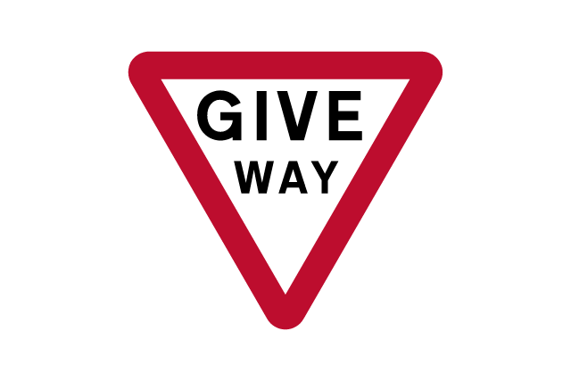

Answer review: give-way-example; visible caption: Give way to traffic on the major road; accessible description: Give way to traffic on the major road

---

## sign-recognition-004 — What is the maximum speed indicated by the illustrated sign?

Content SHA-256: `26a7cf3db76f3919ecf95f1e435c49333c582ad3ccbd1d7d31c55f5ad7f3ae1b`

What is the maximum speed indicated by the illustrated sign?

A. 30 kilometres per hour
B. 30 miles per hour
C. 50 miles per hour
D. The national speed limit

**Correct:** B — 30 miles per hour

A red-bordered circular 30 sign indicates a maximum speed of 30 mph unless another lawful instruction applies.

Source: [Highway Code, Traffic signs: signs giving orders](https://www.gov.uk/guidance/the-highway-code/traffic-signs)

Unanswered question: speed-limit-30; visible caption: (hidden); accessible description: White circular sign with a red border and black number 30

Answer review: speed-30-example; visible caption: 30 mph maximum speed; accessible description: 30 mph maximum speed

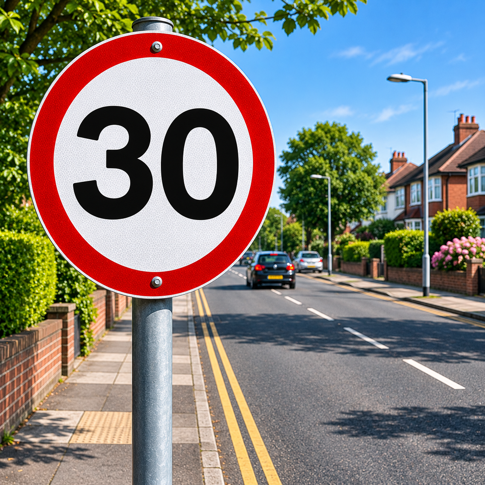

---

## sign-recognition-005 — When the pictured speed-limit sign applies, what is the highest permissible speed for a car?

Content SHA-256: `421cc8b9dee75c9ac4c8a0c6d1ca0af31c1042a9d1ef7b67af34f003370a33eb`

When the pictured speed-limit sign applies, what is the highest permissible speed for a car?

A. 50 miles per hour
B. 50 kilometres per hour
C. 60 miles per hour
D. A minimum speed of 50 mph

**Correct:** A — 50 miles per hour

The red-bordered 50 sign indicates a maximum permitted speed of 50 mph, not a target speed.

Source: [Highway Code, Traffic signs: signs giving orders](https://www.gov.uk/guidance/the-highway-code/traffic-signs)

Unanswered question: speed-limit-50; visible caption: (hidden); accessible description: White circular sign with a red border and black number 50

Answer review: speed-50-example; visible caption: 50 mph maximum speed; accessible description: 50 mph maximum speed

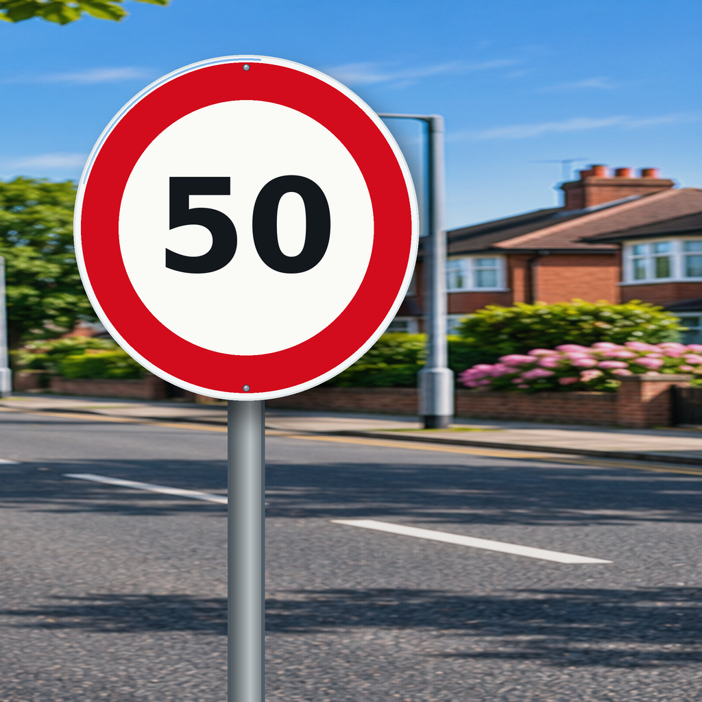

---

## sign-recognition-006 — What does the illustrated white circle with a diagonal black stripe mean?

Content SHA-256: `6507473bf366b3cf693c56d5713d350bc167b3670f414566feb4daf6f0a9254f`

What does the illustrated white circle with a diagonal black stripe mean?

A. Maximum speed 50 mph everywhere
B. The national speed limit applies
C. No overtaking
D. End of a motorway

**Correct:** B — The national speed limit applies

The national speed limit applies. The actual maximum depends on the vehicle and type of road.

Source: [Highway Code, Traffic signs: signs giving orders](https://www.gov.uk/guidance/the-highway-code/traffic-signs)

Unanswered question: national-speed-limit; visible caption: (hidden); accessible description: White circular sign with a black diagonal stripe

Answer review: national-limit-example; visible caption: National speed limit applies; accessible description: National speed limit applies

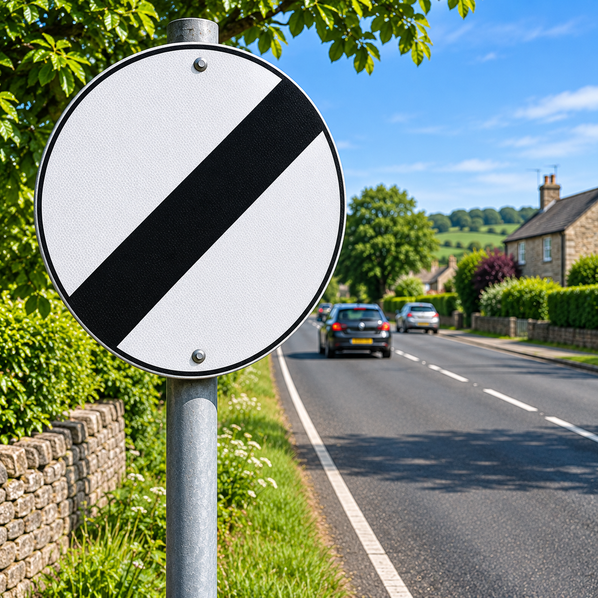

---

## sign-recognition-007 — What instruction does this blue circular sign give?

Content SHA-256: `56d47fdaa61ecd637b49d098998de1e4e58374e02bfdb8e7a49ca1430c37fdb8`

What instruction does this blue circular sign give?

A. Turn left at the next junction
B. Keep to the left of the obstruction
C. There is a one-way road to the left
D. Left lane closed ahead

**Correct:** B — Keep to the left of the obstruction

A blue circular keep-left sign requires traffic to pass to the left of the sign or obstruction.

Source: [Highway Code, Traffic signs: signs giving orders](https://www.gov.uk/guidance/the-highway-code/traffic-signs)

Unanswered question: keep-left; visible caption: (hidden); accessible description: Blue circle with a white arrow pointing diagonally down to the left

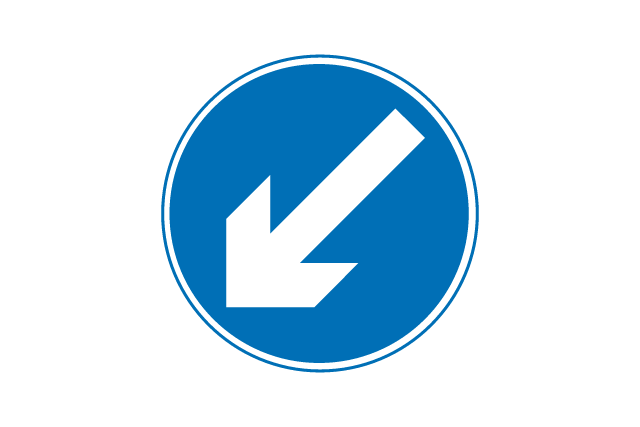

Answer review: keep-left-example; visible caption: Pass to the left of the obstruction; accessible description: Pass to the left of the obstruction

---

## sign-recognition-008 — What hazard does this red triangular warning sign indicate?

Content SHA-256: `42cdc5c03054326a83cb1e1ece00e7b85c652446076da91959f29780b6f01a6e`

What hazard does this red triangular warning sign indicate?

A. Traffic signals ahead
B. A railway level crossing
C. A mandatory stop at this sign
D. Parking controls begin

**Correct:** A — Traffic signals ahead

A red triangular sign depicting traffic lights warns that traffic signals are ahead. Adjust your speed and be ready to stop.

Source: [Know Your Traffic Signs, Warning signs](https://www.gov.uk/guidance/the-highway-code/traffic-signs)

Unanswered question: signals-ahead; visible caption: (hidden); accessible description: Upright red-bordered triangle containing a traffic-light symbol

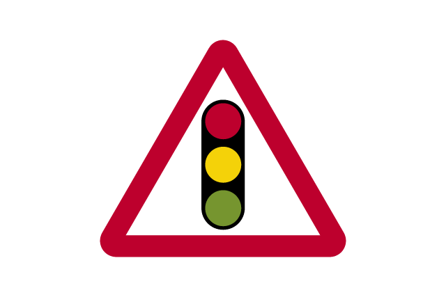

Answer review: signals-example; visible caption: Traffic signals ahead; accessible description: Traffic signals ahead

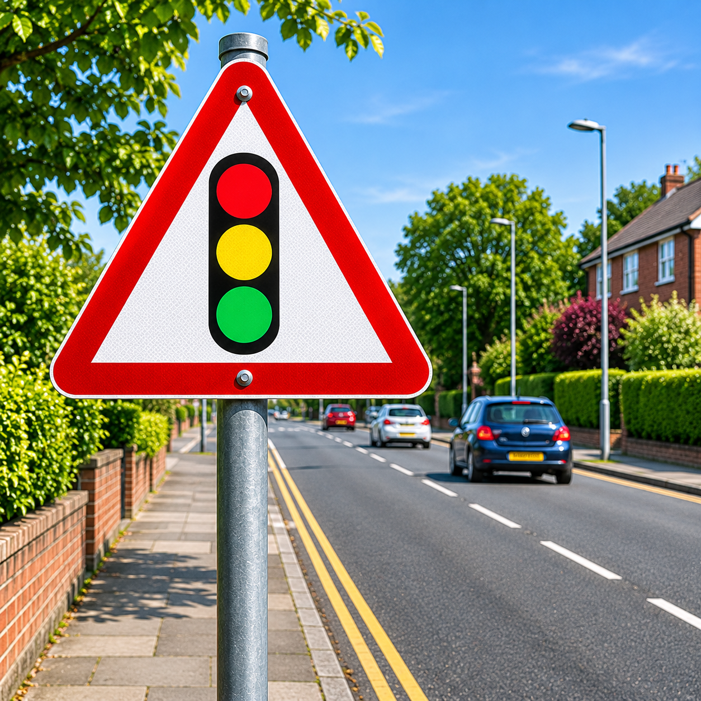

---

## illustrated-dashboard-001 — This red warning appears while a petrol engine is running. What should you do?

Content SHA-256: `170c1e647657393b8395f97ac7b13fcca790ce697fef6b279d008808d4f0c092`

This red warning appears while a petrol engine is running. What should you do?

A. Stop safely and switch off the engine
B. Accelerate to make the warning disappear
C. Wait until the next routine service
D. Keep driving if the fuel gauge is full

**Correct:** A — Stop safely and switch off the engine

An oil-pressure warning needs prompt attention. Stop safely, turn the engine off and follow the handbook; a normal oil level does not rule out a pressure fault.

Source: [Highway Code, Annex 6: warning displays; manufacturer indicator guide](https://www.gov.uk/guidance/the-highway-code/annex-6-vehicle-maintenance-safety-and-security)

Unanswered question: dash-oil; visible caption: (hidden); accessible description: Red oil-can outline with a droplet

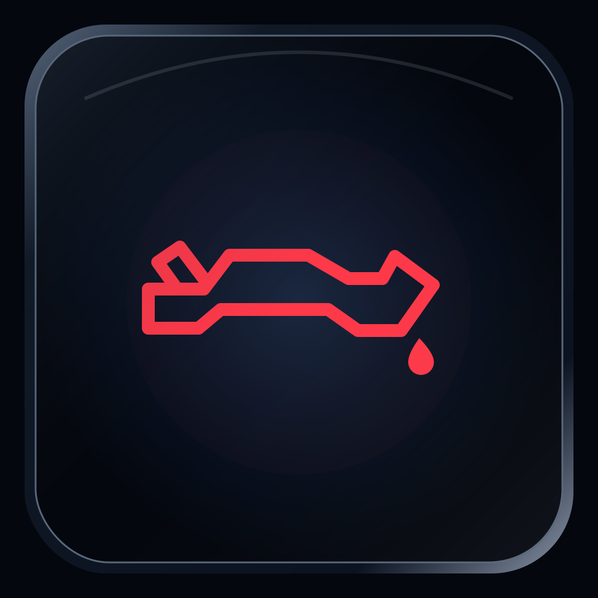

Answer review: dash-oil; visible caption: Oil pressure warning; accessible description: Oil pressure warning

---

## illustrated-dashboard-002 — The pictured warning stays on with the engine running. Which system commonly needs checking?

Content SHA-256: `9dfea766cc285f6f0bbfaa5e8bf18b6643475490d911a9613c685cd6f2116e49`

The pictured warning stays on with the engine running. Which system commonly needs checking?

A. The windscreen washer system
B. The battery charging system
C. The fuel-tank filler flap
D. The head-restraint adjustment

**Correct:** B — The battery charging system

This symbol commonly signals a charging fault. Follow the vehicle handbook and arrange inspection; it is not simply a reminder to replace a key-fob battery.

Source: [Highway Code, Annex 6: warning displays; manufacturer indicator guide](https://www.gov.uk/guidance/the-highway-code/annex-6-vehicle-maintenance-safety-and-security)

Unanswered question: dash-battery; visible caption: (hidden); accessible description: Red rectangle with plus and minus markings

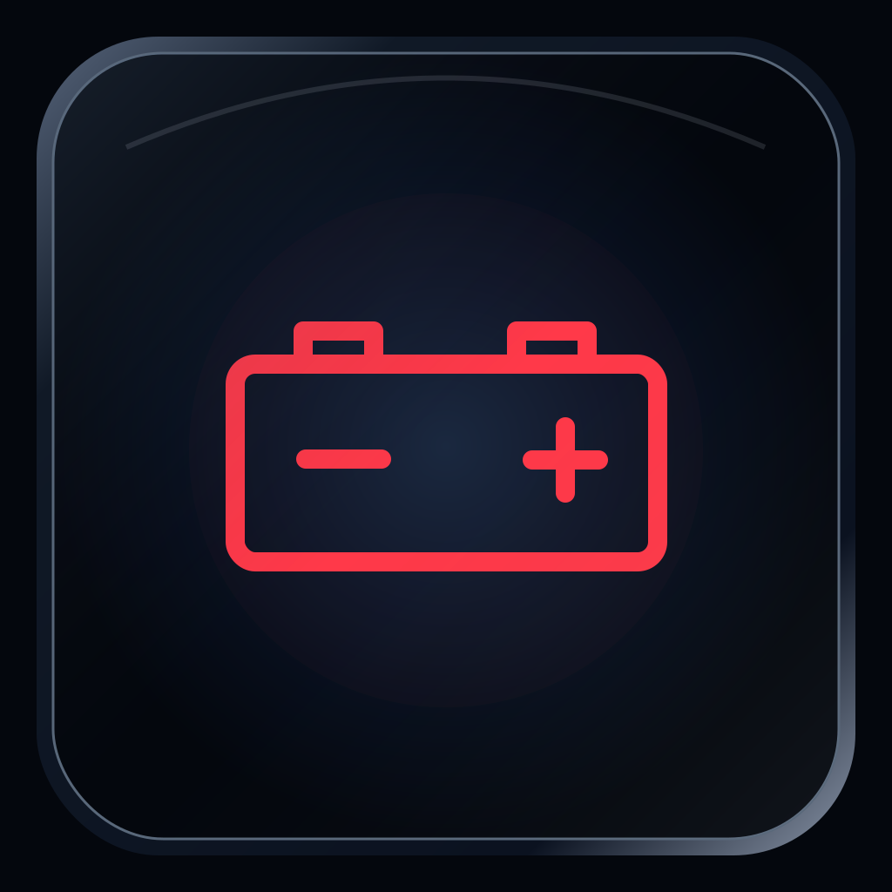

Answer review: dash-battery; visible caption: Charging-system warning; accessible description: Charging-system warning

---

## illustrated-dashboard-003 — This warning remains illuminated during a journey. Which function may have a fault?

Content SHA-256: `73bd530d93eb2243f9cbef0177f07260da20e7cac05642049a180e3f2526a24e`

This warning remains illuminated during a journey. Which function may have a fault?

A. Automatic window demisting
B. Air conditioning
C. Anti-lock braking
D. Adaptive head restraints

**Correct:** C — Anti-lock braking

The ABS indicator relates to anti-lock braking. A persistent warning needs assessment; check the handbook for the particular vehicle.

Source: [Highway Code, Annex 6: warning displays; manufacturer indicator guide](https://www.gov.uk/guidance/the-highway-code/annex-6-vehicle-maintenance-safety-and-security)

Unanswered question: dash-abs; visible caption: (hidden); accessible description: Amber circle containing the letters ABS

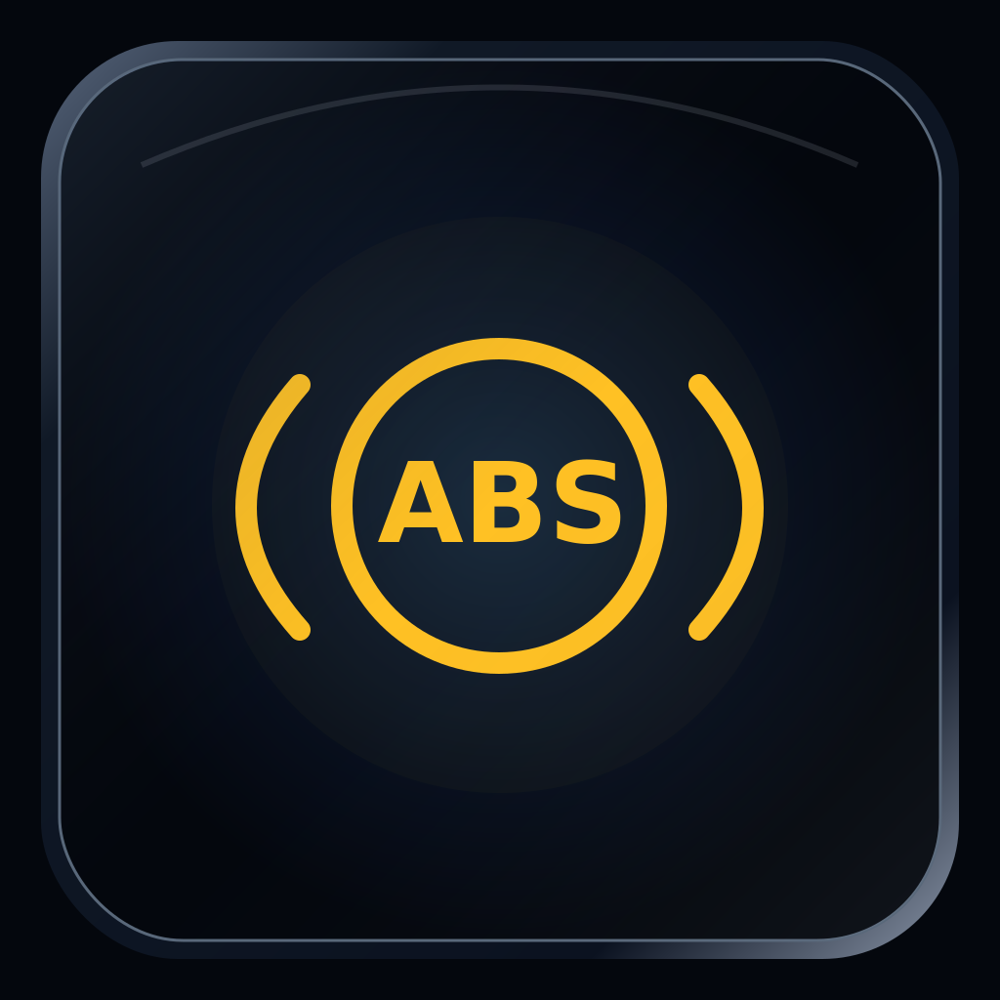

Answer review: dash-abs; visible caption: Anti-lock braking system warning; accessible description: Anti-lock braking system warning

---

## illustrated-dashboard-004 — Which check is most directly connected with the pictured warning symbol?

Content SHA-256: `2fe1243d1382e59ca1ba08eb1fef85127a3ac44d650ff4890d99ea0dc2c5721c`

Which check is most directly connected with the pictured warning symbol?

A. Checking the windscreen washer level
B. Checking the roof-rack height
C. Checking the radio settings
D. Checking tyre pressures and the monitoring-system instructions

**Correct:** D — Checking tyre pressures and the monitoring-system instructions

The tyre-pressure warning calls for a pressure check and the handbook instructions. Flashing and steady indications can have different meanings.

Source: [Highway Code, Annex 6: warning displays; manufacturer indicator guide](https://www.gov.uk/guidance/the-highway-code/annex-6-vehicle-maintenance-safety-and-security)

Unanswered question: dash-tyres; visible caption: (hidden); accessible description: Amber open-topped outline containing an exclamation mark

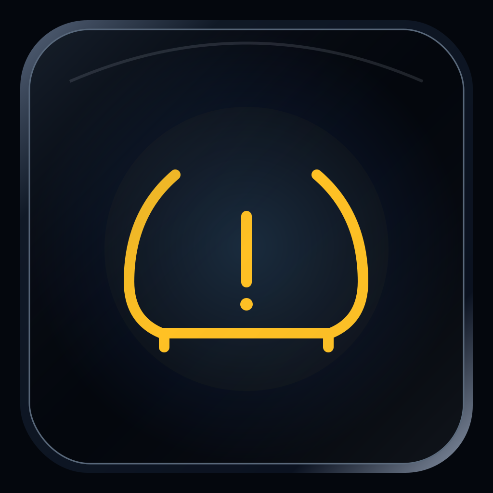

Answer review: dash-tyres; visible caption: Tyre-pressure monitoring warning; accessible description: Tyre-pressure monitoring warning

---

## illustrated-dashboard-005 — The amber symbol shown remains on after the engine starts. Which interpretation is sensible?

Content SHA-256: `ef9012e770ceb2e2f082f68c0ac0087b0bbec171f76b159253addb365f74c541`

The amber symbol shown remains on after the engine starts. Which interpretation is sensible?

A. An engine-management or emissions-related fault needs checking
B. The main-beam headlights are switched on
C. The rear seat belt is fastened
D. The coolant has definitely reached the correct level

**Correct:** A — An engine-management or emissions-related fault needs checking

The engine-shaped warning needs diagnosis. Consult the handbook and obtain the appropriate inspection; the symbol alone does not identify the failed part.

Source: [Highway Code, Annex 6: warning displays; manufacturer indicator guide](https://www.gov.uk/guidance/the-highway-code/annex-6-vehicle-maintenance-safety-and-security)

Unanswered question: dash-engine; visible caption: (hidden); accessible description: Amber outline with a rectangular centre and a projecting side

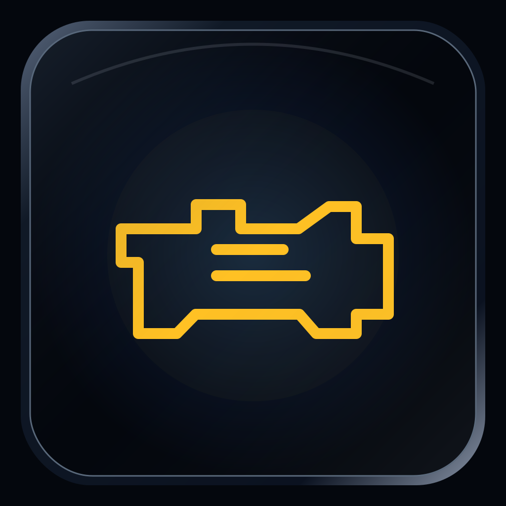

Answer review: dash-engine; visible caption: Engine-management warning; accessible description: Engine-management warning

---

## illustrated-dashboard-006 — This red warning stays on after the parking brake has been fully released. What is the safest response?

Content SHA-256: `9c29eed65fd33ac70de64744677d1aa1f5fe4b53ad248c88d01efe9f10e60dcb`

This red warning stays on after the parking brake has been fully released. What is the safest response?

A. Carry on because the parking brake is off
B. Stop safely and have the brake system checked
C. Disconnect the warning lamp
D. Accelerate and test the brakes at high speed

**Correct:** B — Stop safely and have the brake system checked

A brake warning after release of the parking brake can indicate a serious fault. Stop safely and seek the checks specified by the handbook.

Source: [Highway Code, Annex 6: warning displays; manufacturer indicator guide](https://www.gov.uk/guidance/the-highway-code/annex-6-vehicle-maintenance-safety-and-security)

Unanswered question: dash-brakes; visible caption: (hidden); accessible description: Red circle with an exclamation mark and curved brackets

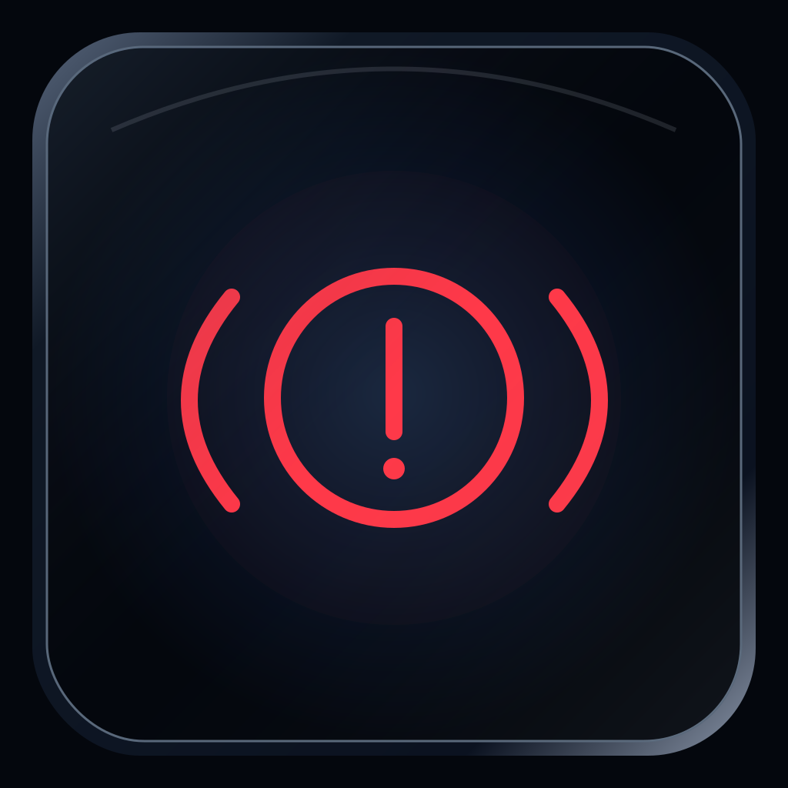

Answer review: dash-brakes; visible caption: Brake-system warning; accessible description: Brake-system warning

---

## illustrated-dashboard-007 — The red thermometer warning appears during a drive. What should you do?

Content SHA-256: `9ea5786555045e3be28348e1bc75f072699ac30ff2780f15c491970a8edbc66c`

The red thermometer warning appears during a drive. What should you do?

A. Open the hot coolant cap immediately
B. Increase engine speed to clear the light
C. Stop safely, turn off the engine and let it cool
D. Ignore it if the air conditioning works

**Correct:** C — Stop safely, turn off the engine and let it cool

An engine-temperature warning requires attention to overheating. Stop safely and follow the handbook; never open a pressurised coolant cap while it is hot.

Source: [Highway Code, Annex 6: warning displays; manufacturer indicator guide](https://www.gov.uk/guidance/the-highway-code/annex-6-vehicle-maintenance-safety-and-security)

Unanswered question: dash-temperature; visible caption: (hidden); accessible description: Red thermometer above wavy lines

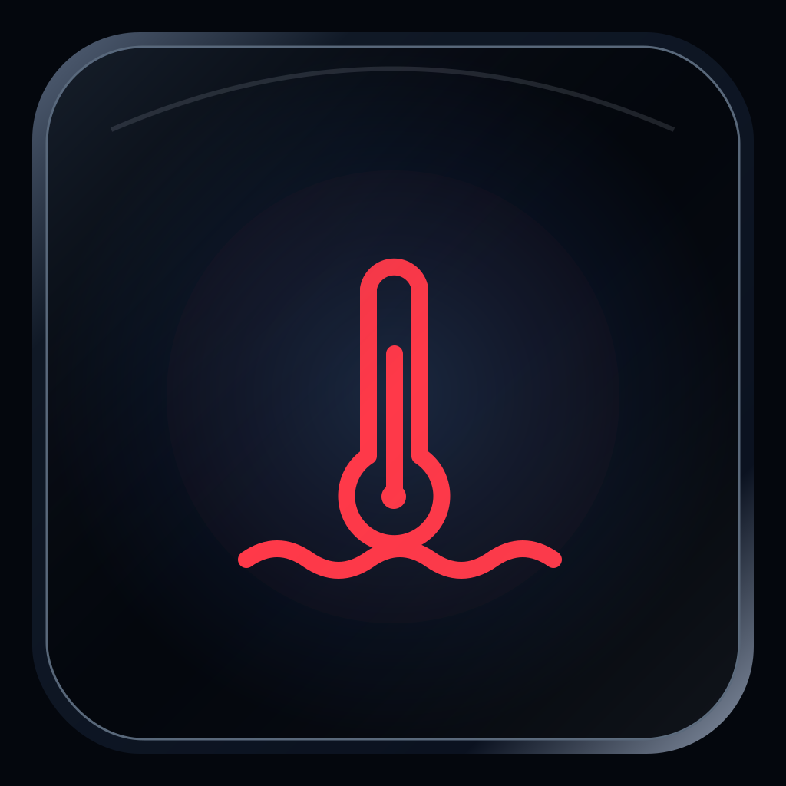

Answer review: dash-temperature; visible caption: Engine temperature warning; accessible description: Engine temperature warning

---

## illustrated-dashboard-008 — The pictured warning stays lit after the normal start-up checks. Which system needs professional assessment?

Content SHA-256: `087e08ab2596b144bcdf320b1203b07d4b8a37e9257c6174cf24dd0d1a3c201d`

The pictured warning stays lit after the normal start-up checks. Which system needs professional assessment?

A. The fuel-gauge sender only
B. The windscreen washer pump
C. The rear-window heater only
D. The airbag or supplementary restraint system

**Correct:** D — The airbag or supplementary restraint system

The seated-person and circle symbol relates to the airbag system. A persistent warning needs the inspection specified for that vehicle.

Source: [Highway Code, Annex 6: warning displays; manufacturer indicator guide](https://www.gov.uk/guidance/the-highway-code/annex-6-vehicle-maintenance-safety-and-security)

Unanswered question: dash-airbag; visible caption: (hidden); accessible description: Amber seated figure with a large circle in front

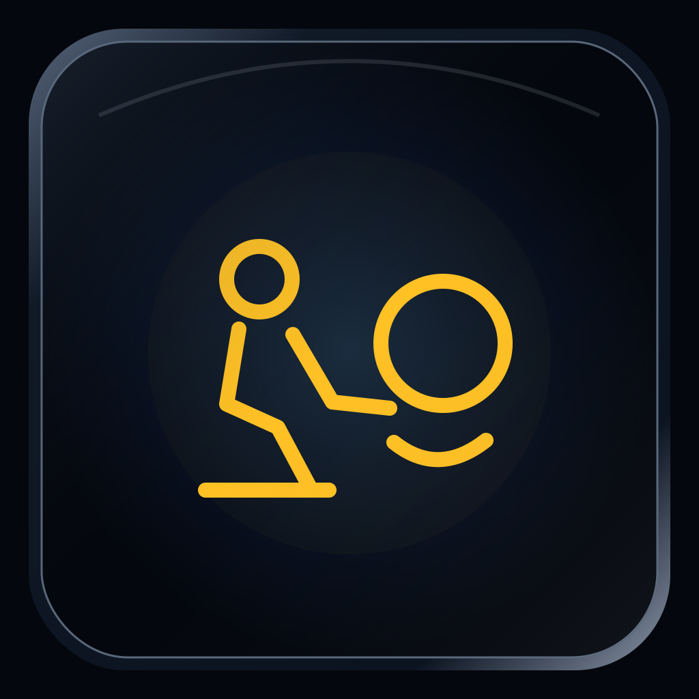

Answer review: dash-airbag; visible caption: Airbag-system warning; accessible description: Airbag-system warning

---

## illustrated-dashboard-009 — You notice this reminder before setting off. What should you check?

Content SHA-256: `27faf8f57a393fa261356c9f0de054c2f69afd5abb1ca22e9c2cb829a7180aeb`

You notice this reminder before setting off. What should you check?

A. That the required seat belts and restraints are correctly fastened
B. That the rear fog lamps are on
C. That every window is closed
D. That the steering wheel is at full lock

**Correct:** A — That the required seat belts and restraints are correctly fastened

This is a seat-belt reminder. Check the required restraints before moving and follow the vehicle instructions if the reminder remains on.

Source: [Highway Code, Annex 6: warning displays; manufacturer indicator guide](https://www.gov.uk/guidance/the-highway-code/annex-6-vehicle-maintenance-safety-and-security)

Unanswered question: dash-seatbelt; visible caption: (hidden); accessible description: Red seated figure with a diagonal strap

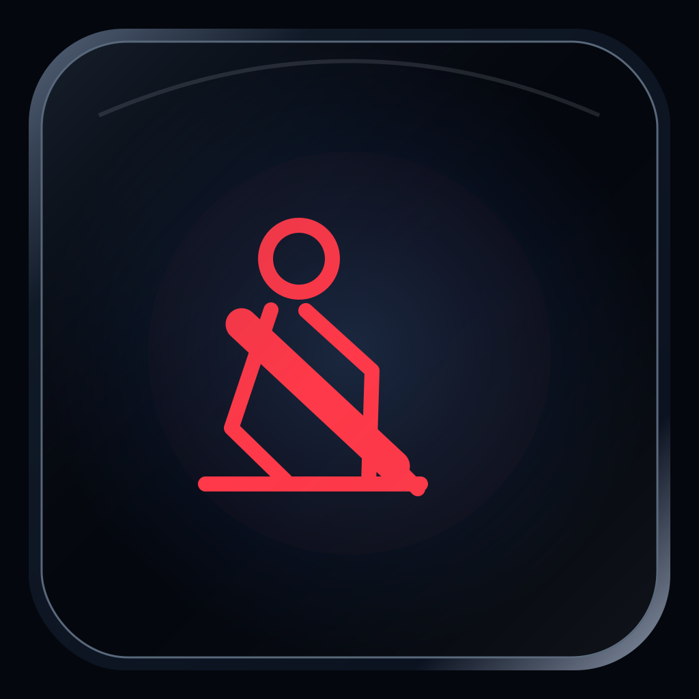

Answer review: dash-seatbelt; visible caption: Seat-belt reminder; accessible description: Seat-belt reminder

---

## illustrated-dashboard-010 — The amber symbol shown flashes briefly on a slippery surface. What can that indicate?

Content SHA-256: `39c4d761830ecfab495701e31ecbdaede7822262c18b3fba0d1b965d4eddb1cf`

The amber symbol shown flashes briefly on a slippery surface. What can that indicate?

A. The main-beam headlights are operating
B. The stability or traction-control system is intervening
C. The fuel tank has just become full
D. The washer reservoir is being filled

**Correct:** B — The stability or traction-control system is intervening

This symbol concerns stability or traction control. Flashing can accompany intervention; a steady warning or an OFF indicator needs its own handbook check.

Source: [Highway Code, Annex 6: warning displays; manufacturer indicator guide](https://www.gov.uk/guidance/the-highway-code/annex-6-vehicle-maintenance-safety-and-security)

Unanswered question: dash-stability; visible caption: (hidden); accessible description: Amber vehicle outline above two wavy tracks

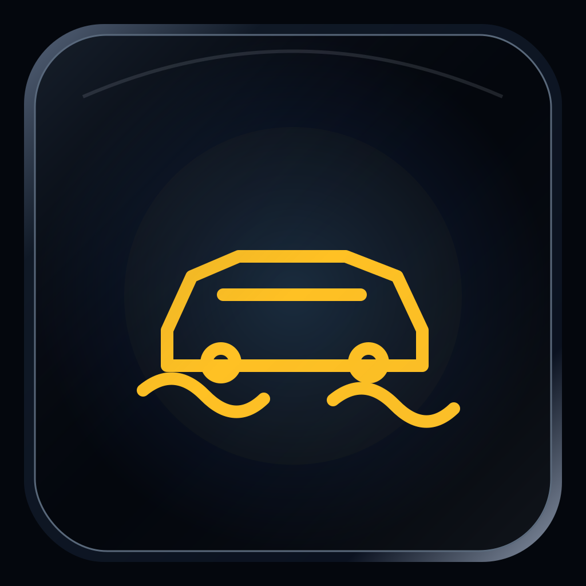

Answer review: dash-stability; visible caption: Stability and traction control; accessible description: Stability and traction control

---

## illustrated-dashboard-011 — This amber warning appears during a long trip. What should you plan?

Content SHA-256: `8f2fc5021883e3f8a64095eef6035f4ed6daf6a31d0ea909186c2d459f73c590`

This amber warning appears during a long trip. What should you plan?

A. A stop in a live motorway lane
B. A coolant top-up with the engine hot
C. A safe stop at a suitable refuelling location
D. A tyre change solely because this lamp is on

**Correct:** C — A safe stop at a suitable refuelling location

The fuel-pump symbol is a low-fuel warning. Arrange a suitable refuelling stop rather than relying on an assumed remaining range.

Source: [Highway Code, Annex 6: warning displays; manufacturer indicator guide](https://www.gov.uk/guidance/the-highway-code/annex-6-vehicle-maintenance-safety-and-security)

Unanswered question: dash-fuel; visible caption: (hidden); accessible description: Amber rectangular pump outline with a hose

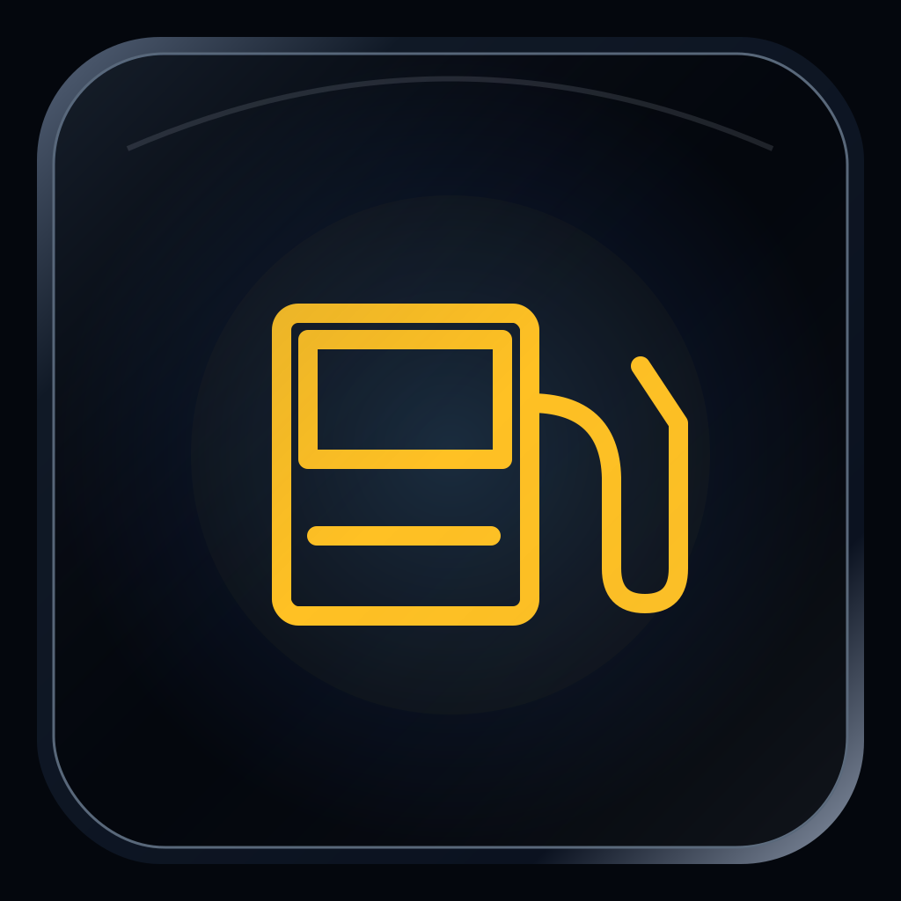

Answer review: dash-fuel; visible caption: Low fuel warning; accessible description: Low fuel warning

---

## illustrated-dashboard-012 — What does this blue indicator commonly tell a driver?

Content SHA-256: `b4ed2ed8ef389b4621612a9f8816f23ad66d44f1e624f1a6009fe231714c306a`

What does this blue indicator commonly tell a driver?

A. The rear fog lamp has failed
B. The engine oil pressure is low
C. The parking brake is applied
D. The main-beam headlights are on

**Correct:** D — The main-beam headlights are on

Blue straight-ray headlamp indications commonly identify main beam. Dip the lights when needed to avoid dazzling other road users.

Source: [Highway Code, Annex 6: warning displays; manufacturer indicator guide](https://www.gov.uk/guidance/the-highway-code/annex-6-vehicle-maintenance-safety-and-security)

Unanswered question: dash-main-beam; visible caption: (hidden); accessible description: Blue lamp outline with straight horizontal rays

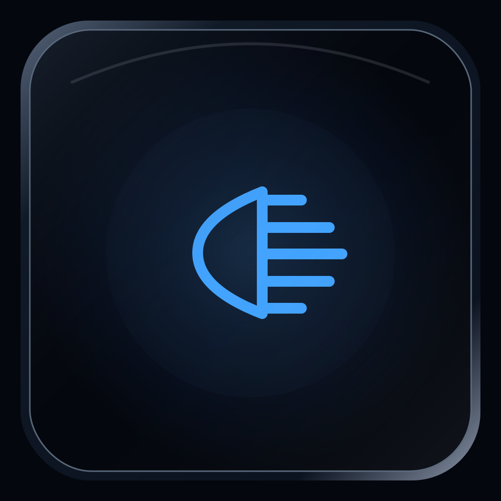

Answer review: dash-main-beam; visible caption: Main-beam indicator; accessible description: Main-beam indicator

---

## illustrated-vehicle-001 — You are checking the engine oil using the illustrated component. Which reading should you compare?

Content SHA-256: `357065b483417915d9cc1d6cf51f544081ed6de90e89f60e336bf89f37015b52`

You are checking the engine oil using the illustrated component. Which reading should you compare?

A. The fuel level against the tyre pressure
B. The oil level against the minimum and maximum marks
C. The coolant temperature against the odometer
D. The windscreen washer level against engine speed

**Correct:** B — The oil level against the minimum and maximum marks

Use the dipstick or oil-level indicator according to the vehicle instructions and check the level against its marked limits.

Source: [DVSA vehicle-safety guidance, engine oil check](https://www.gov.uk/government/publications/car-show-me-tell-me-vehicle-safety-questions/car-show-me-tell-me-vehicle-safety-questions)

Unanswered question: oil-dipstick; visible caption: (hidden); accessible description: Yellow-handled rod beside an engine housing

Answer review: oil-dipstick; visible caption: Checking engine oil with a dipstick; accessible description: Checking engine oil with a dipstick

---

## illustrated-vehicle-002 — During a parked under-bonnet check, how would you assess the fluid level in this reservoir?

Content SHA-256: `6928f50c4b976d76d1255f70d36ea361334ac85a990dde84241f741cc247ecc3`

During a parked under-bonnet check, how would you assess the fluid level in this reservoir?

A. Fill it to the cap regardless of the marks
B. Judge it only from the fuel gauge
C. Compare it with the reservoir high and low markings
D. Ignore the level if the horn works

**Correct:** C — Compare it with the reservoir high and low markings

Check hydraulic brake fluid against the reservoir markings. The correct fluid and any further action must follow the vehicle instructions.

Source: [DVSA vehicle-safety guidance, hydraulic brake-fluid check](https://www.gov.uk/government/publications/car-show-me-tell-me-vehicle-safety-questions/car-show-me-tell-me-vehicle-safety-questions)

Unanswered question: brake-fluid; visible caption: (hidden); accessible description: Small translucent fluid container with upper and lower marks

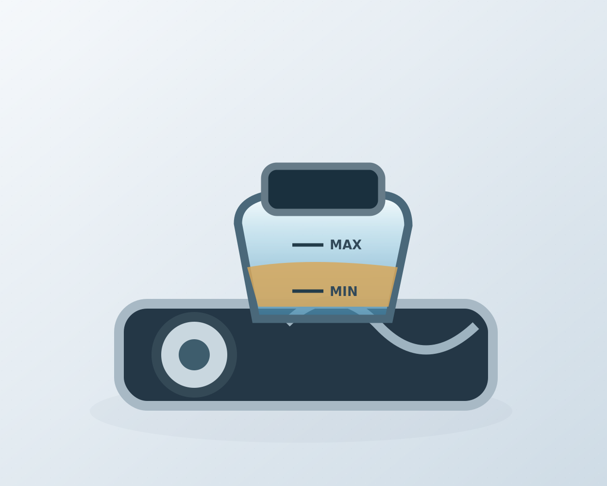

Answer review: brake-fluid; visible caption: Checking the brake-fluid reservoir; accessible description: Checking the brake-fluid reservoir

---

## illustrated-vehicle-003 — Regular checks of the windscreen-washer equipment shown help you maintain what?

Content SHA-256: `81943deae5a0eab3cb2d3b7a97c1a37fa13752c9cb2178b45d768e0339dc06e3`

Regular checks of the windscreen-washer equipment shown help you maintain what?

A. The correct hydraulic brake pressure
B. The engine oil pressure
C. The correct fuel-injection timing
D. A clear view through the windscreen

**Correct:** D — A clear view through the windscreen

The drawing shows a washer-fluid reservoir. Working washers help keep the windscreen clear; identify the correct filler using the vehicle handbook.

Source: [Highway Code, Annex 6: washers and clear vision](https://www.gov.uk/guidance/the-highway-code/annex-6-vehicle-maintenance-safety-and-security)

Unanswered question: screenwash; visible caption: (hidden); accessible description: Fluid container with a drop-and-spray marking

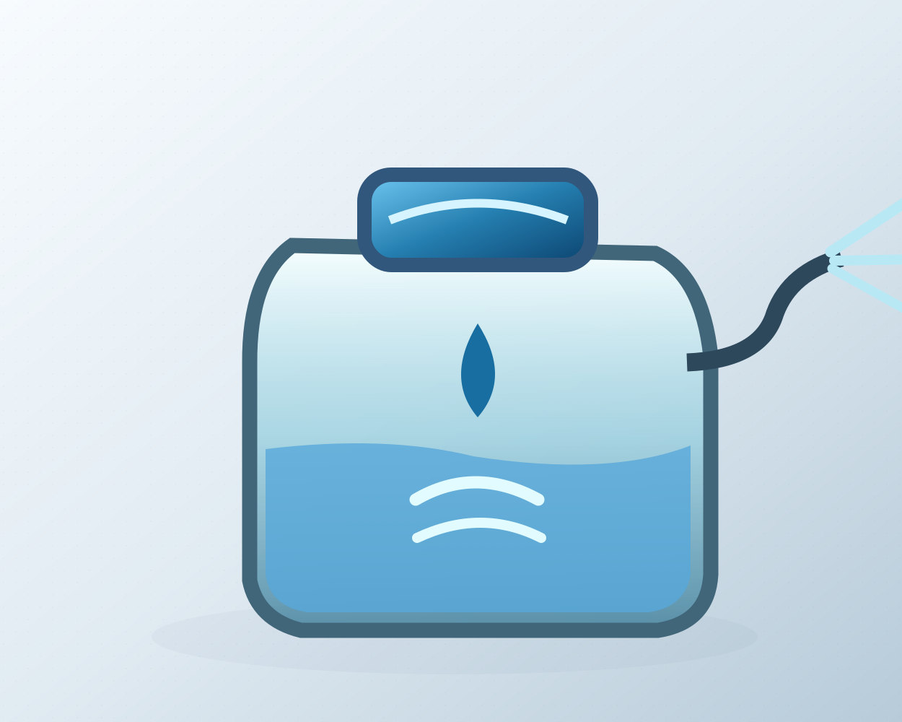

Answer review: screenwash; visible caption: Windscreen washer reservoir; accessible description: Windscreen washer reservoir

---

## illustrated-vehicle-004 — Rain is leaving streaks across the glass even while the pictured equipment is operating. What should you do?

Content SHA-256: `99a7b1738457453789f03a18947d572ce55e6f8a97a5266f01b224ae15c97579`

Rain is leaving streaks across the glass even while the pictured equipment is operating. What should you do?

A. Check the wipers and restore a clear view before continuing
B. Drive faster to avoid looking through the streaks
C. Rely only on the side mirrors
D. Turn off the headlamps to remove the streaks

**Correct:** A — Check the wipers and restore a clear view before continuing

Wipers and washers must work effectively. Stop somewhere safe if necessary to restore visibility rather than continuing with an obstructed view.

Source: [Highway Code, Annex 6: wipers and visibility](https://www.gov.uk/guidance/the-highway-code/annex-6-vehicle-maintenance-safety-and-security)

Unanswered question: wiper-blade; visible caption: (hidden); accessible description: Single wiper blade across a wet windscreen

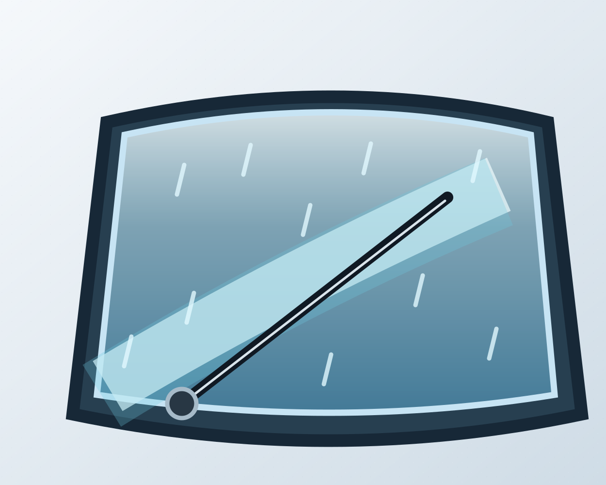

Answer review: wiper-blade; visible caption: Clear vision through the windscreen; accessible description: Clear vision through the windscreen

---

## illustrated-vehicle-005 — The driver shown is making only a short local journey. What is the normal requirement for the fitted restraint?

Content SHA-256: `b1e4fb50174402668df16e0bc67532e63db313f70a596d7d9fac77c1bde655c2`

The driver shown is making only a short local journey. What is the normal requirement for the fitted restraint?

A. Wear it only above 30 mph
B. Wear the seat belt unless a lawful exemption applies
C. Use it only on motorways
D. Fasten it behind the seat to silence the reminder

**Correct:** B — Wear the seat belt unless a lawful exemption applies

A short journey does not remove the normal seat-belt requirement. Ensure that the fitted belt is used correctly, subject to lawful exemptions.

Source: [Highway Code, Rule 99](https://www.gov.uk/guidance/the-highway-code/rules-for-drivers-and-motorcyclists-89-to-102)

Unanswered question: seatbelt-fit; visible caption: (hidden); accessible description: Seated person with a diagonal belt and a buckle

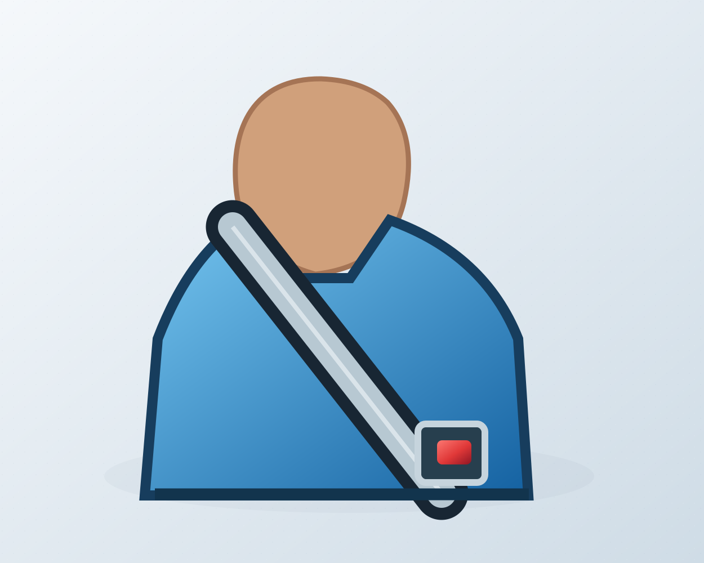

Answer review: seatbelt-fit; visible caption: Wear the fitted seat belt correctly; accessible description: Wear the fitted seat belt correctly

---

## illustrated-vehicle-006 — Before driving with a child in the illustrated restraint, what should the driver check?

Content SHA-256: `4cbe0e6d5605af44a5d11d06d69e64a9d0043a2fc35d1a9474fd4c78adcb9225`

Before driving with a child in the illustrated restraint, what should the driver check?

A. That an adult can hold the child instead
B. That the harness is left loose for every journey
C. That the suitable restraint is fitted and adjusted to its instructions
D. That a cushion replaces the required child restraint

**Correct:** C — That the suitable restraint is fitted and adjusted to its instructions

Use the suitable child restraint and its fitting instructions. The driver is responsible for ensuring children under 14 use the required restraint.

Source: [Highway Code, Rules 100 and 102](https://www.gov.uk/guidance/the-highway-code/rules-for-drivers-and-motorcyclists-89-to-102)

Unanswered question: child-harness; visible caption: (hidden); accessible description: Child seated in a restraint with a shoulder harness

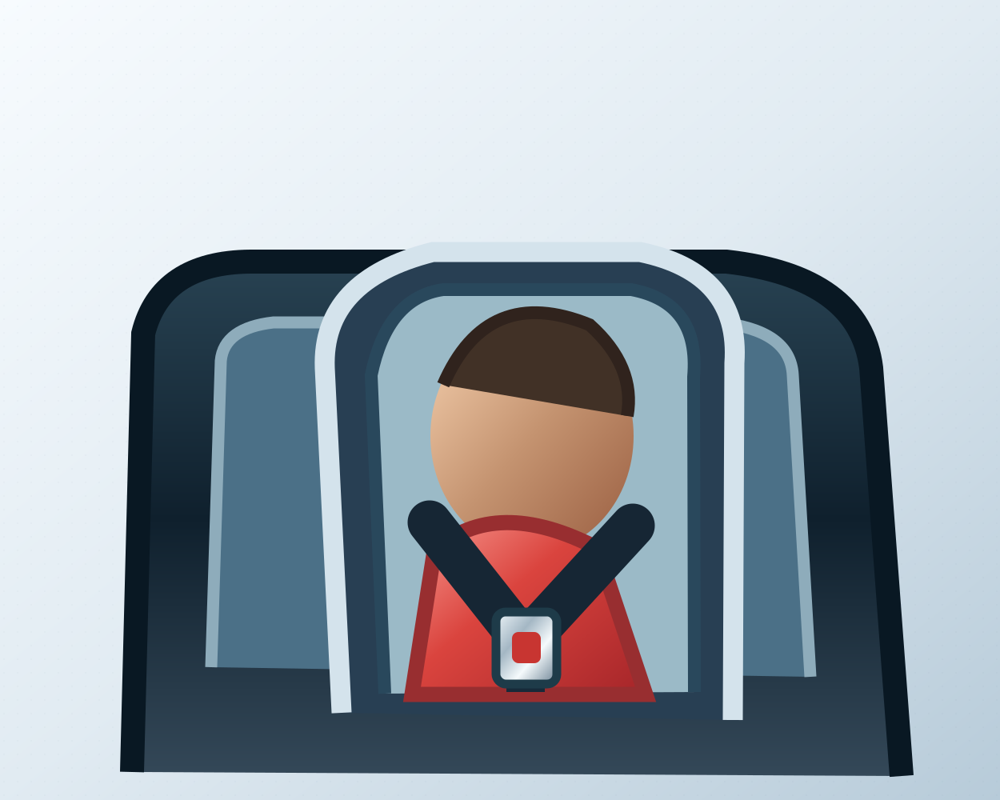

Answer review: child-harness; visible caption: A correctly fitted child restraint; accessible description: A correctly fitted child restraint

---

## illustrated-vehicle-007 — Why should the items shown be secured before the journey starts?

Content SHA-256: `b556c0db7f05b18f3f15a55210f310a30465f56af16b6516ab925a63eaefe1b8`

Why should the items shown be secured before the journey starts?

A. To make the vehicle exempt from speed limits
B. To remove the need to check the tyres
C. To make a loose load safe during sudden braking
D. To prevent the load moving and creating a hazard

**Correct:** D — To prevent the load moving and creating a hazard

Luggage must be securely stowed. Secure items so that braking or a change of direction does not turn them into a hazard.

Source: [Highway Code, Annex 6: securely stowed luggage](https://www.gov.uk/guidance/the-highway-code/annex-6-vehicle-maintenance-safety-and-security)

Unanswered question: secure-luggage; visible caption: (hidden); accessible description: Luggage in an open boot held by straps

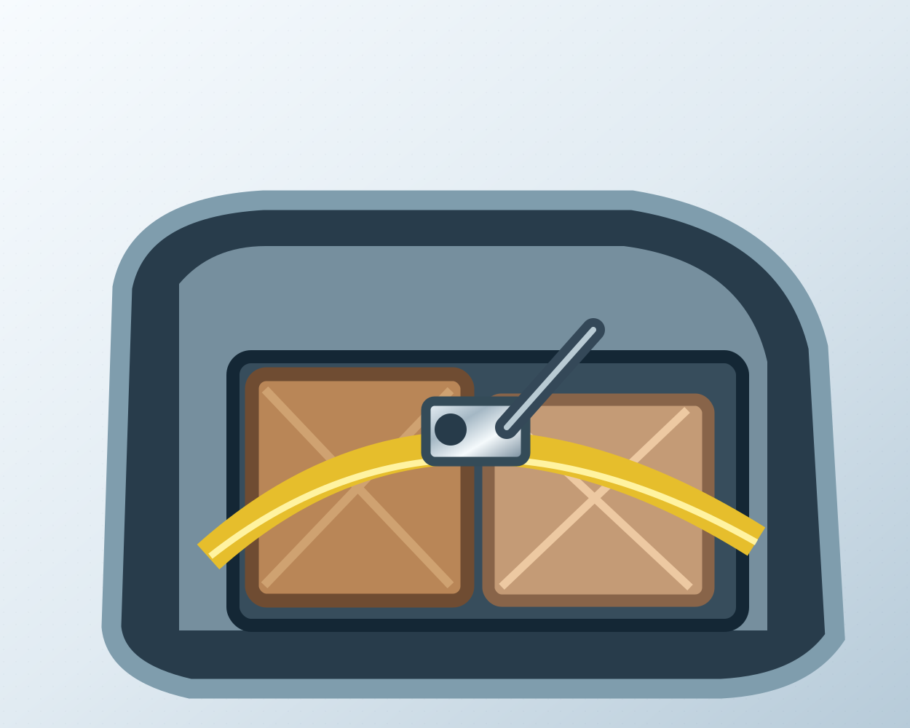

Answer review: secure-luggage; visible caption: Secure luggage before travelling; accessible description: Secure luggage before travelling

---

## illustrated-vehicle-008 — Before moving off, what should you do with the item shown?

Content SHA-256: `94796b37cbba7a413b5fb541d3fd9f4196e2e55a8c5c82d9b54be9af32d93769`

Before moving off, what should you do with the item shown?

A. Adjust it to give an appropriate rearward view from your driving position
B. Adjust it only after reaching a motorway
C. Point it at the rear passengers throughout the trip
D. Use it as a substitute for every blind-spot check

**Correct:** A — Adjust it to give an appropriate rearward view from your driving position

Adjust the mirrors before driving. A correctly adjusted mirror helps observation but does not remove the need for other checks.

Source: [Highway Code, Annex 6: mirror adjustment](https://www.gov.uk/guidance/the-highway-code/annex-6-vehicle-maintenance-safety-and-security)

Unanswered question: rearview-adjustment; visible caption: (hidden); accessible description: Interior mirror showing a vehicle behind

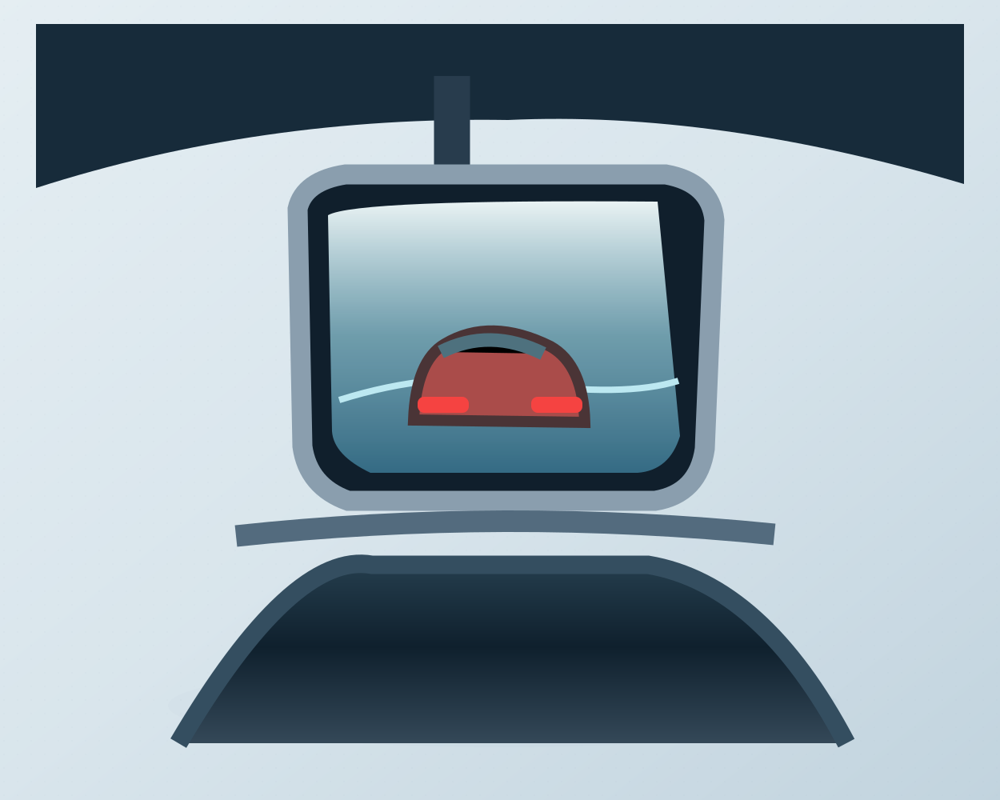

Answer review: rearview-adjustment; visible caption: Adjust mirrors before moving; accessible description: Adjust mirrors before moving

---

## course-foundations-001 — A friend lends you a car. What must you establish about insurance before driving?

Content SHA-256: `077bcba84a678c9a697c92596bf413a350d80ad2dccb5503fa29eb1e66fac26b`

A friend lends you a car. What must you establish about insurance before driving?

A. That a valid policy covers your use of that car
B. That the owner pays any insurance premium
C. That the car has an MOT certificate
D. That you have driven a similar car before

**Correct:** A — That a valid policy covers your use of that car

The owner being insured does not automatically insure every borrower. Check cover for your own use.

Source: [Highway Code, Annex 3](https://www.gov.uk/guidance/the-highway-code/annex-3-motor-vehicle-documentation-and-learner-driver-requirements)

---

## course-foundations-002 — What is the minimum motor insurance required for using a car on the road?

Content SHA-256: `8019b91407daa3b14a3425bab740b687be2a9784f144d145baa4b664ca50fc2a`

What is the minimum motor insurance required for using a car on the road?

A. Cover only for theft of your car
B. Cover for injury or damage caused to third parties
C. A repair warranty
D. Breakdown recovery membership

**Correct:** B — Cover for injury or damage caused to third parties

Third-party insurance is the legal minimum. Recovery cover and warranties serve different purposes.

Source: [Highway Code, Annex 3](https://www.gov.uk/guidance/the-highway-code/annex-3-motor-vehicle-documentation-and-learner-driver-requirements)

---

## course-foundations-003 — A car has a current MOT certificate but a badly damaged tyre. What should happen before it is driven?

Content SHA-256: `45d53bf04789f260cfb32497268af9dbda69fbb4524a5c9dc8470d7c99afd650`

A car has a current MOT certificate but a badly damaged tyre. What should happen before it is driven?

A. Wait until the next MOT
B. Drive only below the speed limit
C. Repair the defect and ensure it is roadworthy
D. Rely on the certificate regardless of its condition

**Correct:** C — Repair the defect and ensure it is roadworthy

An MOT records a test at a point in time. The driver remains responsible for roadworthiness whenever the car is used.

Source: [Highway Code, Rule 97 and Annex 3](https://www.gov.uk/guidance/the-highway-code/rules-for-drivers-and-motorcyclists-89-to-102)

---

## course-foundations-004 — A learner passes theory but has not passed the practical test. What may they do?

Content SHA-256: `0648f087ca55c779bf148edc80864b52b9f73e3eb64677aae343256f1ecf53fa`

A learner passes theory but has not passed the practical test. What may they do?

A. Drive alone on quiet roads
B. Drive alone during daylight
C. Drive alone if displaying L plates
D. Continue learning with an eligible supervisor

**Correct:** D — Continue learning with an eligible supervisor

A theory pass does not remove the requirement to pass the practical test before driving unaccompanied.

Source: [Highway Code, Annex 3](https://www.gov.uk/guidance/the-highway-code/annex-3-motor-vehicle-documentation-and-learner-driver-requirements)

---

## course-foundations-005 — Who meets the basic age and experience requirements to privately supervise a learner car driver?

Content SHA-256: `292788878754bf985eebe137040e10c0cdddccc258fd9b8c2f86b3e402979f68`

Who meets the basic age and experience requirements to privately supervise a learner car driver?

A. Someone at least 21 with a suitable full licence held for at least three years
B. A 19-year-old with two years of driving experience
C. Any adult with a theory pass
D. A provisional licence holder over 25

**Correct:** A — Someone at least 21 with a suitable full licence held for at least three years

Supervisors need the appropriate full licence, at least three years of holding it, and must be at least 21. Insurance and vehicle rules also apply.

Source: [Highway Code, Annex 3](https://www.gov.uk/guidance/the-highway-code/annex-3-motor-vehicle-documentation-and-learner-driver-requirements)

---

## course-foundations-006 — Which learner plates may be used in Wales?

Content SHA-256: `36480017a2a81f7553b660b4f26718a5d88ba18f07894eb085eedda0d17ef56c`

Which learner plates may be used in Wales?

A. A handwritten rear-window notice alone
B. Clearly visible red L plates, red D plates, or both
C. Only green plates
D. No plates when supervised by a parent

**Correct:** B — Clearly visible red L plates, red D plates, or both

Learner plates must be visible front and rear. Wales permits red D plates as an alternative to red L plates.

Source: [Highway Code, Annex 3](https://www.gov.uk/guidance/the-highway-code/annex-3-motor-vehicle-documentation-and-learner-driver-requirements)

---

## course-foundations-007 — You change your home address. What must you do about your driving licence?

Content SHA-256: `494c1ab5dc9e6fe2517e11117c7f12cf65e3ae35c635dd07d2098510a4ca526a`

You change your home address. What must you do about your driving licence?

A. Wait for the next practical test
B. Tell only the breakdown company
C. Notify DVLA
D. Make no change while the photocard is in date

**Correct:** C — Notify DVLA

DVLA must be told when the licence holder changes name or address, even if the photocard has not expired.

Source: [Highway Code, Annex 3](https://www.gov.uk/guidance/the-highway-code/annex-3-motor-vehicle-documentation-and-learner-driver-requirements)

---

## course-foundations-008 — Police request driving documents that you cannot produce immediately. What may be required?

Content SHA-256: `b845cf9ac841d1850b951ddf7ef7e53b5192853b558177ca368c1d3282fab535`

Police request driving documents that you cannot produce immediately. What may be required?

A. Waiting until insurance renewal
B. Providing only a vehicle photograph
C. Ignoring the request if no collision occurred
D. Production at a police station within seven days

**Correct:** D — Production at a police station within seven days

Annex 3 explains that requested licence, insurance and applicable MOT documents may have to be produced within seven days.

Source: [Highway Code, Annex 3](https://www.gov.uk/guidance/the-highway-code/annex-3-motor-vehicle-documentation-and-learner-driver-requirements)

---

## course-foundations-009 — A driver behind pressures you while a queue ahead moves unpredictably. What is the safest response?

Content SHA-256: `98e6de01a61f96b09b1b361d016cc7537ac78e55fc1dd974d77935f43bf41ae8`

A driver behind pressures you while a queue ahead moves unpredictably. What is the safest response?

A. Keep a safe gap and make unhurried decisions
B. Copy the following driver’s speed
C. Close every gap ahead
D. Use the horn to express annoyance

**Correct:** A — Keep a safe gap and make unhurried decisions

Pressure does not justify removing a safety margin. Space and patience provide time for developing hazards.

Source: [Highway Code, Rules 126 and 147](https://www.gov.uk/guidance/the-highway-code/general-rules-techniques-and-advice-for-all-drivers-and-riders-103-to-158)

---

## course-foundations-010 — A ball rolls out between parked cars. What should you anticipate?

Content SHA-256: `b372ea68ebe28025cef9554b16ccb1d10aed8348aa8aee9b6a6393f9aa5d723a`

A ball rolls out between parked cars. What should you anticipate?

A. The road beyond must be clear
B. A child may follow it
C. Only moving vehicles matter
D. The ball is the only hazard

**Correct:** B — A child may follow it

A small visible clue can predict a hidden road user. Reduce speed and prepare to stop before a child appears.

Source: [Highway Code, Rules 205 to 208](https://www.gov.uk/guidance/the-highway-code/road-users-requiring-extra-care-204-to-225)

---

## course-foundations-011 — Why make a final blind-spot check before moving away from the kerb?

Content SHA-256: `b57193c1c2d8217e1dc7cdf45b7a06a2cd6e3b6cfc9d1c3c12654d3de5672937`

Why make a final blind-spot check before moving away from the kerb?

A. It replaces mirror checks
B. It gives you priority
C. A road user may be outside the mirrors’ view
D. It always removes the need to signal

**Correct:** C — A road user may be outside the mirrors’ view

Mirrors leave unseen areas. Check all around before moving off, then proceed only when safe.

Source: [Highway Code, Rule 159](https://www.gov.uk/guidance/the-highway-code/using-the-road-159-to-203)

---

## course-foundations-012 — Another driver makes a mistake and gestures angrily. What should you do?

Content SHA-256: `784a4ed6e37f8bded83741e76101f821d654e6740210d9188d81ba808278711f`

Another driver makes a mistake and gestures angrily. What should you do?

A. Follow to explain the rules
B. Flash repeatedly in retaliation
C. Block their next lane change
D. Allow space and avoid an argument

**Correct:** D — Allow space and avoid an argument

Considerate driving avoids confrontation. Another driver’s error does not justify creating a new danger.

Source: [Highway Code, Rule 147](https://www.gov.uk/guidance/the-highway-code/general-rules-techniques-and-advice-for-all-drivers-and-riders-103-to-158)

---

## course-foundations-013 — A cyclist’s intentions near a junction are unclear. How should you plan?

Content SHA-256: `6a0ca59d636adc10b3d5d3712ddfd7ca32995167c1660197a942ac1231ddee96`

A cyclist’s intentions near a junction are unclear. How should you plan?

A. Keep room to react if their position changes
B. Assume their position cannot change
C. Overtake before finding out
D. Sound the horn until they move

**Correct:** A — Keep room to react if their position changes

Allow for uncertainty instead of guessing. A safe gap protects the cyclist and gives you time to respond.

Source: [Highway Code, Rules 211 to 213](https://www.gov.uk/guidance/the-highway-code/road-users-requiring-extra-care-204-to-225)

---

## course-foundations-014 — A message arrives while you wait at a red traffic light. What should you do?

Content SHA-256: `44af93576f3845d207c7f5450cb1cea3ab7d73a56a2eead1e80dafd6dd3de528`

A message arrives while you wait at a red traffic light. What should you do?

A. Read it because the car is stationary
B. Leave the phone alone and park safely before handling it
C. Hold it below the steering wheel
D. Ask the driver behind to warn you when lights change

**Correct:** B — Leave the phone alone and park safely before handling it

The hand-held device restriction applies while driving, including waiting at lights or in queues. Limited exceptions are not routine permission to read messages.

Source: [Highway Code, Rule 149](https://www.gov.uk/guidance/the-highway-code/general-rules-techniques-and-advice-for-all-drivers-and-riders-103-to-158)

---

## course-foundations-015 — A pedestrian does not react to your car. What must you avoid assuming?

Content SHA-256: `3ce489b5ec538d58d56baf1e4367954821f7de44aa4d9819f48d15b713ecefbd`

A pedestrian does not react to your car. What must you avoid assuming?

A. That slowing may help
B. That extra space is useful
C. That they have seen or heard you
D. That caution is appropriate

**Correct:** C — That they have seen or heard you

Some people cannot see or hear an approaching car. Protect them rather than relying on a response.

Source: [Highway Code, Rules 204 to 207](https://www.gov.uk/guidance/the-highway-code/road-users-requiring-extra-care-204-to-225)

---

## course-foundations-016 — A bend hides the road ahead. What should determine your approach speed?

Content SHA-256: `ab7e67f51f41f0d83c655e7964b7e6bf5b930327ef5694f306abdbd421a1f189`

A bend hides the road ahead. What should determine your approach speed?

A. The speed of the following car
B. The legal maximum alone
C. How familiar the road name sounds
D. Whether you can stop within the distance visible to be clear

**Correct:** D — Whether you can stop within the distance visible to be clear

A hidden obstruction may occupy the unseen road. A legal maximum is not a target when the view is restricted.

Source: [Highway Code, Rules 125 and 126](https://www.gov.uk/guidance/the-highway-code/general-rules-techniques-and-advice-for-all-drivers-and-riders-103-to-158)

---

## course-foundations-017 — Which plan supports a safer long journey?

Content SHA-256: `697b2657fc65aa08b11b278e95ac26330f6a23ad7fc439cf374cbbb8316f5a1f`

Which plan supports a safer long journey?

A. Allow extra time and suitable rest stops
B. Remove breaks to avoid arriving late
C. Rely on speeding to recover delays
D. Start tired while roads are quiet

**Correct:** A — Allow extra time and suitable rest stops

Planning breaks, fuel or charge and possible delays reduces pressure to hurry and helps manage fatigue.

Source: [Highway Code, Rules 91 and 97](https://www.gov.uk/guidance/the-highway-code/rules-for-drivers-and-motorcyclists-89-to-102)

---

## course-foundations-018 — You expect to wait parked on a public road for several minutes. What should you generally do?

Content SHA-256: `4ecd4e89b9d1ee726b89052a1c1881038795003eb66f81efbf2d47f65c536034`

You expect to wait parked on a public road for several minutes. What should you generally do?

A. Keep it running to show occupancy
B. Switch off the engine instead of idling unnecessarily
C. Rev it periodically
D. Keep it running whenever windows are closed

**Correct:** B — Switch off the engine instead of idling unnecessarily

Unnecessary stationary running creates emissions and noise. Rule 123 distinguishes this from being stationary in traffic or diagnosing faults.

Source: [Highway Code, Rule 123](https://www.gov.uk/guidance/the-highway-code/general-rules-techniques-and-advice-for-all-drivers-and-riders-103-to-158)

---

## course-foundations-019 — Which driving approach supports economy while retaining control?

Content SHA-256: `3949361be2d6915c684987fbf624b695cd689f2c7d2a0d20f999c9c591c9cc15`

Which driving approach supports economy while retaining control?

A. Alternate hard acceleration and late braking
B. Coast downhill in neutral
C. Look ahead and accelerate and slow smoothly
D. Tailgate to reduce wind resistance

**Correct:** C — Look ahead and accelerate and slow smoothly

Planning avoids wasteful speed changes. Coasting reduces control and tailgating removes reaction space.

Source: [Highway Code, Rules 122 and 123](https://www.gov.uk/guidance/the-highway-code/general-rules-techniques-and-advice-for-all-drivers-and-riders-103-to-158)

---

## course-foundations-020 — Before a motorway journey in an electric car, what should you plan?

Content SHA-256: `fc4809a2e84ae73173479346d27b245e042a616ce483be1cf0859192cbc7c1c1`

Before a motorway journey in an electric car, what should you plan?

A. An emergency-area charging stop
B. Driving until charge is exhausted
C. Charging only after entering a closed lane
D. Sufficient charge and suitable recharging opportunities

**Correct:** D — Sufficient charge and suitable recharging opportunities

Rule 97 recommends enough fuel or charge, particularly on motorways. Emergency stopping places are not routine charging stops.

Source: [Highway Code, Rule 97](https://www.gov.uk/guidance/the-highway-code/rules-for-drivers-and-motorcyclists-89-to-102)

---

## course-foundations-021 — A sat nav directs you into a road signed No entry. What should you follow?

Content SHA-256: `45d9b931a2251af1751c68beffb75cf874c182f65cb2330f68f71322936a1821`

A sat nav directs you into a road signed No entry. What should you follow?

A. The traffic sign and a safe alternative route
B. The shorter sat-nav route
C. The sat nav if someone follows
D. Whichever route avoids delay

**Correct:** A — The traffic sign and a safe alternative route

Traffic signs giving orders must be obeyed. Navigation equipment does not override them.

Source: [Highway Code, Rules 109 and 150](https://www.gov.uk/guidance/the-highway-code/general-rules-techniques-and-advice-for-all-drivers-and-riders-103-to-158)

---

## course-foundations-022 — Why deal with unnecessary weight and unsecured items before setting off?

Content SHA-256: `8eda43a18374bc932f37b25aeebe85de6907682f093608f7c7ddacc1b874f251`

Why deal with unnecessary weight and unsecured items before setting off?

A. They increase the legal speed limit
B. Load affects handling and loose items can injure occupants
C. They remove the need for pressure checks
D. Loose luggage protects people in sudden stops

**Correct:** B — Load affects handling and loose items can injure occupants

Stow luggage securely and follow load and tyre-pressure guidance. Items can move violently when the car slows.

Source: [Highway Code, Rule 98 and Annex 6](https://www.gov.uk/guidance/the-highway-code/rules-for-drivers-and-motorcyclists-89-to-102)

---

## course-foundations-023 — Severe snow is forecast and your trip can be postponed. What is sensible?

Content SHA-256: `995eb3d77046c8b74348935c36e0095c713d672efe7fb75bbbd3597e6a4306b7`

Severe snow is forecast and your trip can be postponed. What is sensible?

A. Leave without checking the route
B. Drive faster to outrun the weather
C. Avoid the non-essential journey
D. Follow any vehicle regardless of conditions

**Correct:** C — Avoid the non-essential journey

Rule 228 advises against driving in icy or snowy weather unless the journey is essential.

Source: [Highway Code, Rule 228](https://www.gov.uk/guidance/the-highway-code/driving-in-adverse-weather-conditions-226-to-237)

---

## course-foundations-024 — Why are tyre-pressure checks part of economical and safe driving?

Content SHA-256: `4737bb81bb4b6ab3fb0d6319b90dfb37ae2c71c2f1dd7c6bc69e3d58a3d61d88`

Why are tyre-pressure checks part of economical and safe driving?

A. Soft tyres make gentle braking unnecessary
B. One pressure suits every car and load
C. Only the spare tyre needs checking
D. Incorrect inflation affects handling, wear and efficient operation

**Correct:** D — Incorrect inflation affects handling, wear and efficient operation

Check cold tyres against manufacturer guidance for the load. Incorrect inflation can harm control and increase unnecessary wear and fuel use.

Source: [Highway Code, Rule 123 and Annex 6](https://www.gov.uk/guidance/the-highway-code/annex-6-vehicle-maintenance-safety-and-security)

---

## course-incidents-001 — A motorway car develops a problem but can still reach the next service area safely. Where should it stop?

Content SHA-256: `1484bceaff6362443f9cca89eb9b407bb8c81f77687ebcf8b7d28b47d4f10ed6`

A motorway car develops a problem but can still reach the next service area safely. Where should it stop?

A. In the service area away from moving traffic
B. In a live lane beside a sign
C. On the central reservation
D. At the narrowest hard-shoulder point

**Correct:** A — In the service area away from moving traffic

A designed parking location offers greater separation from fast traffic. Reach relative safety if possible.

Source: [Highway Code, Rules 275 to 278](https://www.gov.uk/guidance/the-highway-code/breakdowns-and-incidents-274-to-287)

---

## course-incidents-002 — You stop on a motorway hard shoulder and can safely leave the car. Where should passengers go?

Content SHA-256: `57756bd38507fb4374fb1303e3be2b631f547b1d8214174c44b2375440762189`

You stop on a motorway hard shoulder and can safely leave the car. Where should passengers go?

A. Between its rear bumper and traffic
B. Out on the side away from traffic, then well away from the vehicle
C. Beside the traffic-side door
D. Onto the barrier next to the car

**Correct:** B — Out on the side away from traffic, then well away from the vehicle

If safe and possible, exit furthest from traffic and wait well away, behind a barrier where present while checking for hazards beyond it.

Source: [Highway Code, Rules 275 to 278](https://www.gov.uk/guidance/the-highway-code/breakdowns-and-incidents-274-to-287)

---

## course-incidents-003 — Occupants of a car stopped in a motorway live lane cannot leave safely. What should they do?

Content SHA-256: `bf4d7b228d15b26807d4c28c287d26b09983e049ac206e02f2d54b5e8fdd1fc4`

Occupants of a car stopped in a motorway live lane cannot leave safely. What should they do?

A. Run across the lanes
B. Stand behind the car to wave traffic away
C. Keep belts and hazards on and call 999 for police immediately
D. Try a repair before contacting anyone

**Correct:** C — Keep belts and hazards on and call 999 for police immediately

If a safe exit away from traffic is not possible, remain belted with hazards on and seek immediate police help.

Source: [Highway Code, Rule 277](https://www.gov.uk/guidance/the-highway-code/breakdowns-and-incidents-274-to-287)

---

## course-incidents-004 — Why must you not place a warning triangle on a motorway?

Content SHA-256: `629c155cd4068742499f6955d98df62c8ef85de48694e4901b2637f2ff29bc80`

Why must you not place a warning triangle on a motorway?

A. Triangles are only for fog
B. It would cancel the hazard lights
C. Recovery staff are always already present
D. Placing it would expose you to fast-moving traffic

**Correct:** D — Placing it would expose you to fast-moving traffic

Never use a warning triangle on a motorway. Do not enter the carriageway to warn traffic or retrieve items.

Source: [Highway Code, Rules 276 and 277](https://www.gov.uk/guidance/the-highway-code/breakdowns-and-incidents-274-to-287)

---

## course-incidents-005 — A suitcase falls from your car into a motorway lane. What should you do?

Content SHA-256: `cc50bfd546b6b6301be7778cfde6b1b3490c5e1d0d5eb7d9e4a0bc52f928cf8d`

A suitcase falls from your car into a motorway lane. What should you do?

A. Reach relative safety and call emergency services; do not retrieve it
B. Walk back along the lane
C. Reverse to shield it
D. Send a passenger to collect it

**Correct:** A — Reach relative safety and call emergency services; do not retrieve it

Do not remove obstructions yourself from a motorway or other high-speed road. Report them from a place of relative safety.

Source: [Highway Code, Rule 280](https://www.gov.uk/guidance/the-highway-code/breakdowns-and-incidents-274-to-287)

---

## course-incidents-006 — Before rejoining from a motorway emergency area after a breakdown, what must you do?

Content SHA-256: `7d473d0aabcc13b2e84c6630864ce4f69630c24b1e5b9f412682630bc4408ccf`

Before rejoining from a motorway emergency area after a breakdown, what must you do?

A. Follow a passenger’s hand signal alone
B. Use the emergency telephone and follow the operator’s exit advice
C. Reverse into the nearest lane
D. Wait for another broken-down car to follow

**Correct:** B — Use the emergency telephone and follow the operator’s exit advice

Rule 278 requires use of the telephone and compliance with exit advice. A lane closure may be needed.

Source: [Highway Code, Rule 278](https://www.gov.uk/guidance/the-highway-code/breakdowns-and-incidents-274-to-287)

---

## course-incidents-007 — A disability prevents safe exit from a broken-down motorway car. What is advised?

Content SHA-256: `0ad87e17cfd7b5c3b1a4e86d06d2783a7aaa298229eae9add7dadee83a52d58c`

A disability prevents safe exit from a broken-down motorway car. What is advised?

A. Ask a passing driver to lift you into traffic
B. Walk along the carriageway
C. Stay belted with hazards on and call 999 for police
D. Wait without contacting anyone

**Correct:** C — Stay belted with hazards on and call 999 for police

Rule 279 advises remaining belted, using hazards and seeking police help when normal safe-exit advice cannot be followed.

Source: [Highway Code, Rule 279](https://www.gov.uk/guidance/the-highway-code/breakdowns-and-incidents-274-to-287)

---

## course-incidents-008 — What most helps emergency services locate a motorway breakdown?

Content SHA-256: `b8509f630a39db62f1233f530c55a348df4f6f85b592d225d81ee4a0e7936d0a`

What most helps emergency services locate a motorway breakdown?

A. Only the car’s colour
B. Only the last town passed
C. Only the intended destination
D. Road number, direction and nearby location-marker details

**Correct:** D — Road number, direction and nearby location-marker details

Direction of travel and driver-location signs or marker posts help identify the correct carriageway and position.

Source: [Highway Code, Rule 277](https://www.gov.uk/guidance/the-highway-code/breakdowns-and-incidents-274-to-287)

---

## course-incidents-009 — You approach flashing emergency lights around a bend. What should you do?

Content SHA-256: `5cf4f1447fc0f6f3435fc2d6633ff81d39b00cccbe119a0762b7baab9d1c7e67`

You approach flashing emergency lights around a bend. What should you do?

A. Slow early, watch for workers and debris and follow directions
B. Maintain speed until the damaged vehicle appears
C. Look mainly at the incident
D. Assume every lane is open

**Correct:** A — Slow early, watch for workers and debris and follow directions

People and obstructions may be in the road before they become visible. Follow police and traffic-officer directions.

Source: [Highway Code, Rule 281](https://www.gov.uk/guidance/the-highway-code/breakdowns-and-incidents-274-to-287)

---

## course-incidents-010 — An incident is on the opposite carriageway. What should you avoid?

Content SHA-256: `224d62034c48ad1313882df63872a5c5a9777031789c21f7db379942a40b012c`

An incident is on the opposite carriageway. What should you avoid?

A. Watching your own road
B. Slowing unnecessarily to stare
C. Keeping a safe gap
D. Checking for hazards affecting your lane

**Correct:** B — Slowing unnecessarily to stare

Rubbernecking distracts drivers and can create another collision or queue. Stay alert without unnecessary slowing.

Source: [Highway Code, Rule 282](https://www.gov.uk/guidance/the-highway-code/breakdowns-and-incidents-274-to-287)

---

## course-incidents-011 — You are involved in a collision causing injury or property damage. What is the immediate legal requirement?

Content SHA-256: `fa47bbb3e42e704447920c191b2972ec379d17dbeb915bf9677ed6f2c0e41a29`

You are involved in a collision causing injury or property damage. What is the immediate legal requirement?

A. Continue if your own car looks undamaged
B. Wait until home to leave a message
C. Stop
D. Drive away if another person is upset

**Correct:** C — Stop

You must stop after an incident causing the injury or damage covered by Rule 286, then address safety, assistance and required details.

Source: [Highway Code, Rule 286](https://www.gov.uk/guidance/the-highway-code/breakdowns-and-incidents-274-to-287)

---

## course-incidents-012 — Someone reasonably requests your details after a damage collision. What should you provide?

Content SHA-256: `2785282c269aecee7d959914b3856c2ecf6e2c5aa3ce665a69d5d00e88ddaf44`

Someone reasonably requests your details after a damage collision. What should you provide?

A. Only a social-media username
B. Only your garage’s name
C. Only an estimated repair cost
D. Name, address, registration and relevant owner details

**Correct:** D — Name, address, registration and relevant owner details

Rule 286 requires specified identifying details when reasonably requested. Police reporting duties apply if details cannot be given.

Source: [Highway Code, Rule 286](https://www.gov.uk/guidance/the-highway-code/breakdowns-and-incidents-274-to-287)

---

## course-incidents-013 — You cannot provide required details after a collision. When must it be reported to police?

Content SHA-256: `b6d84563f29fc1ea3bbbc661b5082e5e57a3abcffabd81d73acccd3a6d075e90`

You cannot provide required details after a collision. When must it be reported to police?

A. As soon as reasonably practicable and within 24 hours
B. At the next insurance renewal
C. Within a month
D. Only if the car cannot be driven

**Correct:** A — As soon as reasonably practicable and within 24 hours

Rule 286 requires reporting as soon as reasonably practicable and in any case within 24 hours when details are not given.

Source: [Highway Code, Rule 286](https://www.gov.uk/guidance/the-highway-code/breakdowns-and-incidents-274-to-287)

---

## course-incidents-014 — Why ask people not to smoke at a collision scene?

Content SHA-256: `325025c55abf8e427fa2937a5a6ab31038174f6570f58604844b8c6cc9ac6cae`

Why ask people not to smoke at a collision scene?

A. Smoke automatically prevents insurance claims
B. Fuel or other flammable material may be present
C. It stops every engine restarting
D. It replaces calling emergency services

**Correct:** B — Fuel or other flammable material may be present

Fire and further collisions are key dangers. Avoid ignition sources and get appropriate help from safety.

Source: [Highway Code, Rule 283 and Annex 7](https://www.gov.uk/guidance/the-highway-code/annex-7-first-aid-on-the-road)

---

## course-incidents-015 — A goods vehicle with hazardous-material markings has crashed. What is the safe priority?

Content SHA-256: `cd81b582888b198478f4ed21ef107130218edb2c115e0acdc3d20d0869ee4897`

A goods vehicle with hazardous-material markings has crashed. What is the safe priority?

A. Open the containers
B. Touch spills to identify them
C. Keep away and report the markings to emergency services if safely visible
D. Stand in fumes to direct traffic

**Correct:** C — Keep away and report the markings to emergency services if safely visible

Do not handle dangerous substances or take exposure risks. Tell emergency services what can be observed from safety.

Source: [Highway Code, Rules 284 and 285](https://www.gov.uk/guidance/the-highway-code/breakdowns-and-incidents-274-to-287)

---

## course-incidents-016 — Where should uninjured people wait after a collision, if they can be moved safely?

Content SHA-256: `99481fbe6be08d6f1e3f1cab83b5deaaeb8107d1c8bcb4d8bf909acabba1fb8c`

Where should uninjured people wait after a collision, if they can be moved safely?

A. Between damaged vehicles
B. Beside leaking fuel
C. In the lane emergency vehicles will use
D. In relative safety away from vehicles and traffic

**Correct:** D — In relative safety away from vehicles and traffic

Move uninjured people away from further impact and other dangers. Injured people should not be moved unless in immediate danger.

Source: [Highway Code, Rule 283](https://www.gov.uk/guidance/the-highway-code/breakdowns-and-incidents-274-to-287)

---

## course-incidents-017 — Before approaching an injured person after a road collision, what comes first?

Content SHA-256: `1d7b42fc4b1b4e0011558c3438de424d778aa35f732e4e3a8e96c9aebdfdbb98`

Before approaching an injured person after a road collision, what comes first?

A. Check whether the scene is safe to approach
B. Check the vehicle’s tax
C. Ask their intended destination
D. Take photographs for social media

**Correct:** A — Check whether the scene is safe to approach

Check moving traffic, fire, fuel and other dangers. Creating another casualty makes the emergency worse.

Source: [Highway Code, Annex 7: Deal with danger](https://www.gov.uk/guidance/the-highway-code/annex-7-first-aid-on-the-road)

---

## course-incidents-018 — What casualty information should an emergency caller give?

Content SHA-256: `888abaaa2d9cf8191c55d722aa7cf1f9ef8ed7d5ceae800e7aaa8a467769f5e8`

What casualty information should an emergency caller give?

A. A guessed diagnosis only
B. Location and observed problems such as entrapment or no response
C. Only the repair cost
D. Only which driver seemed at fault

**Correct:** B — Location and observed problems such as entrapment or no response

Describe observations such as difficulty breathing, serious bleeding, entrapment or unresponsiveness, and give an accurate location.

Source: [Highway Code, Annex 7: Get help](https://www.gov.uk/guidance/the-highway-code/annex-7-first-aid-on-the-road)

---

## course-incidents-019 — An injured motorcyclist still has a helmet on. What should an untrained helper normally do?

Content SHA-256: `38804646be8f66ee15d43ae83abdb19bc0c4698f4e5d04426a21f2f60ea3683f`

An injured motorcyclist still has a helmet on. What should an untrained helper normally do?

A. Remove it to help conversation
B. Twist it loose before checking danger
C. Leave it in place and follow emergency-service instructions
D. Use it as a road marker

**Correct:** C — Leave it in place and follow emergency-service instructions

Do not remove a helmet unless essential; Rule 283 also specifies training. Obtain professional guidance instead of attempting an unfamiliar procedure.

Source: [Highway Code, Rule 283 and Annex 7](https://www.gov.uk/guidance/the-highway-code/breakdowns-and-incidents-274-to-287)

---

## course-incidents-020 — An injured occupant is inside a vehicle without immediate danger from its position. What should you normally avoid?

Content SHA-256: `3e5959c4edfa277a13c16e9cd62984c8b1b6e469d41bbaf4b85dc75a7644b035`

An injured occupant is inside a vehicle without immediate danger from its position. What should you normally avoid?

A. Offering reassurance
B. Calling for an ambulance
C. Explaining their position to the operator
D. Moving them out

**Correct:** D — Moving them out

Moving a casualty may worsen injury. Do not move injured people unless there is immediate danger.

Source: [Highway Code, Rule 283 and Annex 7](https://www.gov.uk/guidance/the-highway-code/breakdowns-and-incidents-274-to-287)

---

## course-incidents-021 — An injured person asks for a drink while awaiting an ambulance. What should you do?

Content SHA-256: `6635f75487eb28b6acb69b4cf97565b6ae030c241466203b4462b9be7d64946a`

An injured person asks for a drink while awaiting an ambulance. What should you do?

A. Do not give food or drink; reassure them and follow professional instructions
B. Offer alcohol to reduce shock
C. Give a large meal
D. Give whatever drink is available

**Correct:** A — Do not give food or drink; reassure them and follow professional instructions

Annex 7 advises against giving casualties food or drink. Keep them comfortable and follow the emergency operator.

Source: [Highway Code, Annex 7: Help those involved](https://www.gov.uk/guidance/the-highway-code/annex-7-first-aid-on-the-road)

---

## course-incidents-022 — How can a bystander help while emergency services are coming?

Content SHA-256: `f962714c732290783f0635a4f5304df75706780b5e719d967cf3af0e9ad41274`

How can a bystander help while emergency services are coming?

A. Encourage walking in traffic
B. Give reassurance and help keep casualties warm and dry without unsafe movement
C. Leave to look for someone to blame
D. Promise medical help is unnecessary

**Correct:** B — Give reassurance and help keep casualties warm and dry without unsafe movement

Calm reassurance and protection from cold and rain can help. Do not make unsupported medical promises or allow people to wander into traffic.

Source: [Highway Code, Annex 7: Help those involved](https://www.gov.uk/guidance/the-highway-code/annex-7-first-aid-on-the-road)

---

## course-incidents-023 — A casualty does not respond when spoken to. What should an untrained helper do?

Content SHA-256: `12fdda0a71d9fa42d23516066f1e21dc1a5987fa005901ce490d27e7524d3534`

A casualty does not respond when spoken to. What should an untrained helper do?

A. Assume they are asleep and leave
B. Give food to wake them
C. Tell the emergency operator and follow their instructions
D. Move each limb repeatedly

**Correct:** C — Tell the emergency operator and follow their instructions

Unresponsiveness is important information for emergency services. Seek urgent professional guidance; an app is not practical first-aid training.

Source: [Highway Code, Annex 7: Get help and emergency care](https://www.gov.uk/guidance/the-highway-code/annex-7-first-aid-on-the-road)

---

## course-incidents-024 — Why is reading a first-aid summary different from being trained?

Content SHA-256: `a40def5e03df5d549fbf68f2bf6e861f58d143407314c34b8c31c52624d9f2cf`

Why is reading a first-aid summary different from being trained?

A. Reading authorises every procedure
B. Reading removes the need for emergency services
C. Reading guarantees recovery
D. Emergencies require practical skills and professional guidance

**Correct:** D — Emergencies require practical skills and professional guidance

Annex 7 gives general guidance and recommends proper training. A revision lesson cannot certify practical first-aid competence.

Source: [Highway Code, Annex 7: Be prepared](https://www.gov.uk/guidance/the-highway-code/annex-7-first-aid-on-the-road)

---

## course-loading-001 — Before adding a heavy roof load, what should you check?

Content SHA-256: `9423d18dcd7c40a8a1ddff28da8afd59a11007bd22950d001dbdab415a60f896`

Before adding a heavy roof load, what should you check?

A. Vehicle and carrier load limits and how to secure it
B. Only whether the boot is full
C. Only the destination’s weather
D. Only whether the aerial is hidden

**Correct:** A — Vehicle and carrier load limits and how to secure it

Secure the load and do not overload the vehicle or carrier. Follow manufacturer limits and fitting instructions.

Source: [Highway Code, Rule 98](https://www.gov.uk/guidance/the-highway-code/rules-for-drivers-and-motorcyclists-89-to-102)

---

## course-loading-002 — You add passengers and heavy luggage. Which setting may need adjustment?

Content SHA-256: `3355cecad1a24c2838a92f806b2e6aa702ff6220d31756d8cfeb823e54f15897`

You add passengers and heavy luggage. Which setting may need adjustment?

A. The speedometer to read lower
B. Tyre pressures according to manufacturer guidance for that load
C. The seat-belt alarm to stay off
D. The legal tread-depth limit

**Correct:** B — Tyre pressures according to manufacturer guidance for that load

Tyre pressures must suit the vehicle and load. Use the handbook or vehicle label rather than guessing.

Source: [Highway Code, Annex 6: Tyres](https://www.gov.uk/guidance/the-highway-code/annex-6-vehicle-maintenance-safety-and-security)

---

## course-loading-003 — Where should heavy items normally be distributed in a caravan or trailer?

Content SHA-256: `7c5472465bd2703408ebb90e26613d8cb33427ee10c29713e2142ae3e077e45e`

Where should heavy items normally be distributed in a caravan or trailer?

A. At the very back
B. All on one side
C. Evenly, with heavy items over the axle area within specified limits
D. Loose near the door

**Correct:** C — Evenly, with heavy items over the axle area within specified limits

Rule 98 recommends even distribution, heavy items over the axles and the correct tow-ball load. Excess rear weight can contribute to instability.

Source: [Highway Code, Rule 98](https://www.gov.uk/guidance/the-highway-code/rules-for-drivers-and-motorcyclists-89-to-102)

---

## course-loading-004 — Which statement about towing entitlement is correct?

Content SHA-256: `6ad8c02fcb6683a6c99156ca0863339f0368c7e113010d9f90738a1cb5db97d5`

Which statement about towing entitlement is correct?

A. Any car licence permits every trailer
B. Only the trailer’s colour matters
C. A theory pass grants every entitlement
D. Check that your licence permits the proposed combination

**Correct:** D — Check that your licence permits the proposed combination

Do not tow more than the licence permits. Check current GOV.UK entitlement and vehicle limits before choosing a combination; do not rely on assumptions about licence dates.

Source: [Highway Code, Rule 98](https://www.gov.uk/guidance/the-highway-code/rules-for-drivers-and-motorcyclists-89-to-102)

---

## course-loading-005 — Why secure a load even for a short trip?

Content SHA-256: `bad5e08bd473c5d3eda218c23498581a9cbb91e7caff40f129ac4154c50b6242`

Why secure a load even for a short trip?

A. It can move during braking or cornering and endanger people
B. Loads move only on motorways
C. Short trips suspend load rules
D. Loose items improve steering

**Correct:** A — It can move during braking or cornering and endanger people

Distance does not remove the risk. Stow and restrain items so normal or emergency driving cannot release them.

Source: [Highway Code, Rule 98 and Annex 6](https://www.gov.uk/guidance/the-highway-code/rules-for-drivers-and-motorcyclists-89-to-102)

---

## course-loading-006 — Before towing, which trailer check is necessary?

Content SHA-256: `066c1837684bb7dc36d312e7f7882d915aeea4d7001ce0ebcf6dc9eec34e5155`

Before towing, which trailer check is necessary?

A. Only the paintwork
B. Its tyres, lights and braking system where fitted
C. Only that the coupling is near the car
D. Only the caravan window height

**Correct:** B — Its tyres, lights and braking system where fitted

Both the towing vehicle and trailer must be roadworthy. Rule 98 specifically identifies trailer tyres, lights and brakes.

Source: [Highway Code, Rule 98](https://www.gov.uk/guidance/the-highway-code/rules-for-drivers-and-motorcyclists-89-to-102)

---

## course-loading-007 — How does towing affect decisions about gaps and manoeuvres?

Content SHA-256: `5f96defcc47170fd3951a6a821ccd14f4ac44d2a66436f1b65d15d46d60f4b5c`

How does towing affect decisions about gaps and manoeuvres?

A. Assume braking is always shorter
B. Use any gap suitable for the car alone
C. Allow more time and space for the whole combination
D. Ignore extra length when turning

**Correct:** C — Allow more time and space for the whole combination

Extra length and weight affect manoeuvring, acceleration and braking. Plan for the whole combination.

Source: [Highway Code, Rule 160](https://www.gov.uk/guidance/the-highway-code/using-the-road-159-to-203)

---

## course-loading-008 — Luggage blocks the view and a loose bag rests on the parcel shelf. What should happen before departure?

Content SHA-256: `98a2ff71cecc5b1e7749f17b3fc5ee204a260aa23e8b37d1e3e236374692073d`

Luggage blocks the view and a loose bag rests on the parcel shelf. What should happen before departure?

A. Drive slowly without changing it
B. Ask passengers to hold it throughout
C. Remove a mirror for a better forward view
D. Rearrange and secure the load for adequate vision and control

**Correct:** D — Rearrange and secure the load for adequate vision and control

Secure luggage and maintain the view needed for safe driving. A loose item can become dangerous in a sudden stop.

Source: [Highway Code, Rule 98 and Annex 6](https://www.gov.uk/guidance/the-highway-code/rules-for-drivers-and-motorcyclists-89-to-102)

---

## course-handling-001 — At night, how should speed relate to the road illuminated ahead?

Content SHA-256: `ba476e756236570ffd05078d8c756baadedc8d00a56d05cf7c26d1c7af86e85c`

At night, how should speed relate to the road illuminated ahead?

A. Allow stopping within the distance visible to be clear
B. Match the furthest reflector you notice
C. Use the maximum regardless of view
D. Use one fixed speed for dipped headlights

**Correct:** A — Allow stopping within the distance visible to be clear

Reduced visibility leaves less distance to deal with an obstruction. Choose a speed that permits stopping within the clear view.

Source: [Highway Code, Rules 125 and 126](https://www.gov.uk/guidance/the-highway-code/general-rules-techniques-and-advice-for-all-drivers-and-riders-103-to-158)

---

## course-handling-002 — What makes a road a dual carriageway for ordinary speed-limit purposes?

Content SHA-256: `6cadfeead101e6e6118dc813e8285ef95c75cfb05dc1e45a5a8a5895699cda59`

What makes a road a dual carriageway for ordinary speed-limit purposes?

A. Two painted lanes each way alone
B. A central reservation separating opposing directions
C. Width greater than one car
D. A 40 mph sign

**Correct:** B — A central reservation separating opposing directions

A central reservation defines a dual carriageway. Lane count alone does not determine the road type.

Source: [Highway Code, Rule 136](https://www.gov.uk/guidance/the-highway-code/general-rules-techniques-and-advice-for-all-drivers-and-riders-103-to-158)

---

## course-handling-003 — What national limit applies to a normal car without a trailer on a single carriageway?

Content SHA-256: `f23a4d4daff776daeea0d33f2913a34cbf41d240a5705713dc46617908ba8792`

What national limit applies to a normal car without a trailer on a single carriageway?

A. 70 mph
B. 50 mph
C. 60 mph
D. 40 mph

**Correct:** C — 60 mph

The national maximum is 60 mph for this vehicle on a single carriageway. Conditions may require a much lower speed.

Source: [Highway Code, Rule 124: Speed limits](https://www.gov.uk/guidance/the-highway-code/general-rules-techniques-and-advice-for-all-drivers-and-riders-103-to-158)

---

## course-handling-004 — What national motorway limit applies to a car towing a trailer?

Content SHA-256: `23dad37e0d02e1ff4624141793da59abe5cd13eea7c137553d6939afb925d91f`

What national motorway limit applies to a car towing a trailer?

A. 70 mph
B. 50 mph
C. 40 mph
D. 60 mph

**Correct:** D — 60 mph

A car towing a trailer has a national motorway maximum of 60 mph. Lower signs and conditions still govern the safe speed.

Source: [Highway Code, Rule 124: Speed limits](https://www.gov.uk/guidance/the-highway-code/general-rules-techniques-and-advice-for-all-drivers-and-riders-103-to-158)

---

## course-handling-005 — Why should you avoid coasting downhill in neutral?

Content SHA-256: `8d832939d3b92aa27af15a77785f1b525cc69f004a8fd8b481affe08f2b3abd9`

Why should you avoid coasting downhill in neutral?

A. It removes engine braking and reduces control
B. It guarantees a tyre will burst
C. It stops every brake light working
D. It changes the legal speed limit

**Correct:** A — It removes engine braking and reduces control

Coasting can let speed increase, increase reliance on the footbrake and make selecting the right gear harder.

Source: [Highway Code, Rule 122](https://www.gov.uk/guidance/the-highway-code/general-rules-techniques-and-advice-for-all-drivers-and-riders-103-to-158)

---

## course-handling-006 — In an emergency stop in an ABS-equipped car, what is the usual advice subject to its handbook?

Content SHA-256: `aa08bc7756e297eed38bca13730b84eac4758499fdf3f4ec73e72c1d2d378aa5`

In an emergency stop in an ABS-equipped car, what is the usual advice subject to its handbook?

A. Pump continuously
B. Apply the footbrake firmly and maintain pressure until sufficiently slowed
C. Release whenever ABS operates
D. Use only the parking brake

**Correct:** B — Apply the footbrake firmly and maintain pressure until sufficiently slowed

Rule 120 advises sustained firm footbrake pressure. ABS helps retain steering control but does not guarantee a shorter stop.

Source: [Highway Code, Rule 120](https://www.gov.uk/guidance/the-highway-code/general-rules-techniques-and-advice-for-all-drivers-and-riders-103-to-158)

---

## course-handling-007 — A driver follows too closely. What gives you more room to slow gradually if needed?

Content SHA-256: `03dc1c2365c6ad3e3740ed900cd87a4d3968738e1b48c02ac68cffd64d336907`

A driver follows too closely. What gives you more room to slow gradually if needed?

A. Brake sharply in retaliation
B. Exceed the speed limit
C. Increase the gap from the vehicle ahead
D. Keep looking behind instead of ahead

**Correct:** C — Increase the gap from the vehicle ahead

More space ahead reduces dependence on sudden braking. Do not retaliate or speed to escape pressure.

Source: [Highway Code, Rules 126 and 147](https://www.gov.uk/guidance/the-highway-code/general-rules-techniques-and-advice-for-all-drivers-and-riders-103-to-158)

---

## course-handling-008 — Your navigation route needs changing while driving. What should you do?

Content SHA-256: `b94fc5de150b12874a75d7c1fbee3afdbc8943e71c90d4e9e2baabad5339e63a`

Your navigation route needs changing while driving. What should you do?

A. Study the screen through the next junction
B. Ask another driver to hold your lane
C. Program it while tailgating
D. Find a safe place to stop before adjusting it

**Correct:** D — Find a safe place to stop before adjusting it

Navigation equipment can distract from observation and control. Make route changes while safely stopped.

Source: [Highway Code, Rules 149 and 150](https://www.gov.uk/guidance/the-highway-code/general-rules-techniques-and-advice-for-all-drivers-and-riders-103-to-158)

---

## course-sharing-001 — A bus signals to leave a stop. What should you do when safe?

Content SHA-256: `bf726b55951cd8ec98fe8496eb7b50ffdc470abc030d297179bc9d674f4c9d4c`

A bus signals to leave a stop. What should you do when safe?

A. Give it priority and watch for people crossing nearby
B. Accelerate into the gap
C. Assume passengers can see through the bus
D. Sound the horn and maintain speed regardless

**Correct:** A — Give it priority and watch for people crossing nearby

Give buses priority when safely possible, especially when leaving stops. People may emerge from behind or ahead of them.

Source: [Highway Code, Rule 223](https://www.gov.uk/guidance/the-highway-code/road-users-requiring-extra-care-204-to-225)

---

## course-sharing-002 — A long lorry starts a left turn from away from the kerb. What should you avoid?

Content SHA-256: `2429f4de548feb0d67912b8017aa6a63f8e551213821b4cf9d166c5a6c01ec3e`

A long lorry starts a left turn from away from the kerb. What should you avoid?

A. Waiting at a safe distance
B. Passing through the gap on its left
C. Giving it extra room
D. Preparing to stop

**Correct:** B — Passing through the gap on its left

Large vehicles need turning space and may have blind spots beside them. Do not enter a squeeze point.

Source: [Highway Code, Rule 221](https://www.gov.uk/guidance/the-highway-code/road-users-requiring-extra-care-204-to-225)

---

## course-sharing-003 — A tall coach blocks your view ahead. What improves your view and planning?

Content SHA-256: `3c5944657ac886bbf05a2c449e265a438b1ac83f5a23b6906dc87a0a16636d22`

A tall coach blocks your view ahead. What improves your view and planning?

A. Move closer to its bumper
B. Move across the centre line without a clear view
C. Drop back to increase separation
D. Rely only on its brake lights

**Correct:** C — Drop back to increase separation

A larger gap helps you see around the vehicle and react to hazards hidden beyond it.

Source: [Highway Code, Rule 222](https://www.gov.uk/guidance/the-highway-code/road-users-requiring-extra-care-204-to-225)

---

## course-sharing-004 — An ambulance approaches while you wait at a red light. What should you do?

Content SHA-256: `f27b57e85644bdd6cc34031dcd6ce7698bdff95300815ef276b2216c1ca20ae7`

An ambulance approaches while you wait at a red light. What should you do?

A. Automatically drive through red
B. Immediately mount the pavement
C. Stop watching pedestrians
D. Make room if safely possible while obeying the signal

**Correct:** D — Make room if safely possible while obeying the signal

Help emergency vehicles without breaking traffic signs or endangering others. Do not panic or make unsafe movements.

Source: [Highway Code, Rule 219](https://www.gov.uk/guidance/the-highway-code/road-users-requiring-extra-care-204-to-225)

---

## course-sharing-005 — Your route crosses an approaching tram’s track. What is important to remember?

Content SHA-256: `d1cfc1cf2f8c5883857b5b5ca43543ce97919867a79637ce810bdd2b1aeb8802`

Your route crosses an approaching tram’s track. What is important to remember?

A. The tram cannot steer around you
B. It can swerve like a car
C. It can always stop instantly
D. Its route follows the nearest car

**Correct:** A — The tram cannot steer around you

Trams are confined to tracks and can be quiet. Respect signals and leave space rather than expecting them to swerve.

Source: [Highway Code, Rule 224](https://www.gov.uk/guidance/the-highway-code/road-users-requiring-extra-care-204-to-225)

---

## course-sharing-006 — A vehicle ahead has a flashing amber beacon. What should you anticipate?

Content SHA-256: `9299ec6519e9e33040b726c0350c2d41b321d3bd56f45c669a1a93ed1dabfcc2`

A vehicle ahead has a flashing amber beacon. What should you anticipate?

A. It invites immediate overtaking
B. It may be slow, stationary or working
C. It means the same as a green light
D. It guarantees an empty road

**Correct:** B — It may be slow, stationary or working

Amber beacons may mark slow vehicles, road work or incident-support activity. Approach cautiously and assess space.

Source: [Highway Code, Rule 225](https://www.gov.uk/guidance/the-highway-code/road-users-requiring-extra-care-204-to-225)

---

## course-sharing-007 — A small mobility vehicle is on the road without a visible amber beacon. What should you do?

Content SHA-256: `5f8baf1adc13b1abb7f94bc4992d13238595edbf7368f44839cf5b6feb65eba1`

A small mobility vehicle is on the road without a visible amber beacon. What should you do?

A. Assume it travels as fast as a car
B. Pass closely because it is narrow
C. Allow for low speed and the occupant’s vulnerability
D. Expect a beacon on every road

**Correct:** C — Allow for low speed and the occupant’s vulnerability

Not every mobility vehicle displays a beacon on every road. Its low speed and vulnerable occupant still require patience and room.

Source: [Highway Code, Rules 204 and 220](https://www.gov.uk/guidance/the-highway-code/road-users-requiring-extra-care-204-to-225)

---

## course-sharing-008 — A large vehicle travels below your car’s permitted speed. What should you consider?

Content SHA-256: `a9051c3be15384e2c80d0b222f6a564bdd58a691a4dfa1ffa02e7f8ca29af54d`

A large vehicle travels below your car’s permitted speed. What should you consider?

A. It must be obstructing deliberately
B. Your limit forces it to accelerate
C. Tailgating will improve its visibility
D. Its legal limit or speed limiter may be lower

**Correct:** D — Its legal limit or speed limiter may be lower

Large vehicles can have lower limits or speed limiters. Be patient and overtake only when safe and legal.

Source: [Highway Code, Rule 222](https://www.gov.uk/guidance/the-highway-code/road-users-requiring-extra-care-204-to-225)

---

## case-zebra-001 — In the video, why does the blue car stop before the zebra crossing?

Content SHA-256: `889b2b84f85a953fe7b91ed8ddcc7825d49d8314f1ae158e72cf862828d2f174`

In the video, why does the blue car stop before the zebra crossing?

A. To give way to the person waiting to cross
B. To let a car overtake on the crossing
C. To park beside the crossing
D. To ask the pedestrian for directions

**Correct:** A — To give way to the person waiting to cross

The person is waiting at the zebra crossing. Drivers should give way to people waiting to cross and must give way once a pedestrian has moved onto the crossing.

Source: [Highway Code, Rule 195 and Rule H2](https://www.gov.uk/guidance/the-highway-code/using-the-road-159-to-203)

[Play linked video: A town road](../../src/assets/case-studies/town-crossing.mp4)

---

## case-zebra-002 — The pedestrian is walking across the road in the video. What must the blue car driver do?

Content SHA-256: `29d856ca347356967d63745c62ad8e21846cc0579d451abf94d93232b73f0905`

The pedestrian is walking across the road in the video. What must the blue car driver do?

A. Move forward if the opposite car is stationary
B. Sound the horn to make the person hurry
C. Continue giving way while the person is on the crossing
D. Drive around the pedestrian if there is space

**Correct:** C — Continue giving way while the person is on the crossing

A pedestrian on a zebra crossing must be given way to. A stopped vehicle in the other direction does not make it safe to drive through the crossing.

Source: [Highway Code, Rule 195](https://www.gov.uk/guidance/the-highway-code/using-the-road-159-to-203)

[Play linked video: A town road](../../src/assets/case-studies/town-crossing.mp4)

---

## case-zebra-003 — After the person in the video has crossed, what should the blue car driver check before moving on?

Content SHA-256: `6f238719af1592f7b1f965b98d68d47b4621ce44f7b88ee2146333b30d90c991`

After the person in the video has crossed, what should the blue car driver check before moving on?

A. Whether the driver behind wants to overtake
B. That the crossing is clear and nobody else is waiting or crossing
C. Only whether the opposite car has started moving
D. Whether there is room to stop on the crossing

**Correct:** B — That the crossing is clear and nobody else is waiting or crossing

Check the whole crossing and both approaches for other pedestrians. The movement of another vehicle is not a substitute for checking that it is safe to proceed.

Source: [Highway Code, Rule 195](https://www.gov.uk/guidance/the-highway-code/using-the-road-159-to-203)

[Play linked video: A town road](../../src/assets/case-studies/town-crossing.mp4)

---

## case-wet-001 — Which condition shown in the video affects how much space the blue car should leave?

Content SHA-256: `351d94041373d26ac6f9bfbba7895e879ad2afb3993744fcd3686ea247a630e6`

Which condition shown in the video affects how much space the blue car should leave?

A. A closed tunnel
B. Deep snow covering the lanes
C. Dry road markings in bright sunshine
D. Rain and a wet road surface

**Correct:** D — Rain and a wet road surface

Rain and the wet surface are visible. Wet conditions increase stopping distances, so the driver needs more space behind the vehicle in front.

Source: [Highway Code, Rule 126](https://www.gov.uk/guidance/the-highway-code/general-rules-techniques-and-advice-for-all-drivers-and-riders-103-to-158)

[Play linked video: A wet dual carriageway](../../src/assets/case-studies/wet-following-gap.mp4)

---

## case-wet-002 — When travelling at high speed in the wet conditions shown, what minimum following time should the blue car driver allow?

Content SHA-256: `f228bd13ff665429926d75fd01dc9e1a6ad0eb45593a5dd479fc991ffde79045`

When travelling at high speed in the wet conditions shown, what minimum following time should the blue car driver allow?

A. One second
B. Two seconds
C. At least four seconds
D. The same small gap at every speed

**Correct:** C — At least four seconds

On high-speed roads the usual two-second gap should be at least doubled when the road is wet. A fixed roadside point can help judge the time gap.

Source: [Highway Code, Rule 126](https://www.gov.uk/guidance/the-highway-code/general-rules-techniques-and-advice-for-all-drivers-and-riders-103-to-158)

[Play linked video: A wet dual carriageway](../../src/assets/case-studies/wet-following-gap.mp4)

---

## case-wet-003 — Why is the growing space between the blue car and the car ahead useful in the video?

Content SHA-256: `2447e067598e3d78d358159fd06655e329d4ced6a65e9e15e2e112f16ca5a512`

Why is the growing space between the blue car and the car ahead useful in the video?

A. It gives the following driver more time to react and stop
B. It removes the need to watch the vehicle ahead
C. It makes the road dry more quickly
D. It gives the blue car permission to exceed the speed limit

**Correct:** A — It gives the following driver more time to react and stop

A larger following gap provides time to respond if the vehicle ahead slows. It does not replace observation or change the speed limit.

Source: [Highway Code, Rule 126](https://www.gov.uk/guidance/the-highway-code/general-rules-techniques-and-advice-for-all-drivers-and-riders-103-to-158)

[Play linked video: A wet dual carriageway](../../src/assets/case-studies/wet-following-gap.mp4)

---

## case-cyclist-001 — What visible hazard makes the blue car driver wait behind the cyclist before overtaking?

Content SHA-256: `2cc93bf1e19a6e598f5038fa1cb91176e2a8ac72d8993efd96ec96e90f4ba933`

What visible hazard makes the blue car driver wait behind the cyclist before overtaking?

A. A red traffic signal
B. A car approaching in the opposite direction
C. A level-crossing barrier
D. A motorway exit lane

**Correct:** B — A car approaching in the opposite direction

The approaching car uses the space needed for a safe overtake. Stay back until the road ahead is clear and there is enough room to pass the cyclist safely.

Source: [Highway Code, Rules 162 and 163](https://www.gov.uk/guidance/the-highway-code/using-the-road-159-to-203)

[Play linked video: A road with parked vehicles](../../src/assets/case-studies/cyclist-and-parked-vehicles.mp4)

---

## case-cyclist-002 — Why should the blue car driver expect the cyclist in the video to move farther from the left edge?

Content SHA-256: `7d85273c78c7010b9d16a3ac7f2bafe2c8602b11831e7e56751f3c1e975e7270`

Why should the blue car driver expect the cyclist in the video to move farther from the left edge?

A. Cyclists must always use the opposite lane
B. The cyclist has to signal the car to pass
C. Parked vehicles can create a door-opening hazard
D. A cyclist should ride as close to parked cars as possible

**Correct:** C — Parked vehicles can create a door-opening hazard

A cyclist may need space away from parked vehicles to avoid an opening door. Drivers should allow for that movement and leave enough room rather than squeezing past.

Source: [Highway Code, Rule 213](https://www.gov.uk/guidance/the-highway-code/road-users-requiring-extra-care-204-to-225)

[Play linked video: A road with parked vehicles](../../src/assets/case-studies/cyclist-and-parked-vehicles.mp4)

---

## case-cyclist-003 — If overtaking the cyclist at up to 30 mph, how much passing space should the blue car driver allow?

Content SHA-256: `b99de0011b27b29866261f71d49678f4fcb18a2f813ce9eb3b658c8212a04b8f`

If overtaking the cyclist at up to 30 mph, how much passing space should the blue car driver allow?

A. Only the width of the cycle handlebars
B. Half a metre whenever the road is narrow
C. No extra space once the horn is sounded
D. At least 1.5 metres, and more at higher speeds

**Correct:** D — At least 1.5 metres, and more at higher speeds

Leave at least 1.5 metres when overtaking a cyclist at speeds up to 30 mph, with more room at higher speeds. If that space is not available, wait behind.

Source: [Highway Code, Rule 163](https://www.gov.uk/guidance/the-highway-code/using-the-road-159-to-203)

[Play linked video: A road with parked vehicles](../../src/assets/case-studies/cyclist-and-parked-vehicles.mp4)

