# Road-sign notes and quizzes — independent review copy

Review every entry against current primary sources, its presentation and linked media. Record judgement in `SIGN_NOTE_REVIEW_TRACKER.csv`; do not approve by sampling.

## red-ring — Red-bordered circle

Content SHA-256: `a269b370b7919d230d84455d25ed2b44db07950a9315606b25cc9f2b319a994b`

A circular sign outlined in red commonly tells you about an action that is banned or restricted.

**Takeaway:** Look for prohibitions, such as a restricted turn or speed limit.

Quiz: A circular sign with a red border will usually mean…

A. An instruction or restriction
B. A picnic site
C. A tourist route
D. Only advance warning

Correct: A — An instruction or restriction

Reference: [DfT Know Your Traffic Signs — The signing system](https://www.gov.uk/government/publications/know-your-traffic-signs/the-signing-system)

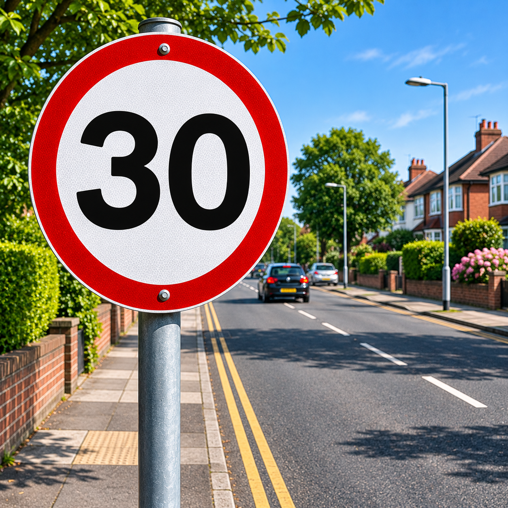

---

## blue-circle — Blue circle

Content SHA-256: `b5db1799ec20616f43e85ef37a9f6123064e55f17be5680cdfc71068b73515fc`

A solid blue circular sign usually tells drivers to follow a particular direction or to use a designated route.

**Takeaway:** Many blue circles give positive instructions.

Quiz: What does a blue circular sign usually indicate?

A. A junction warning
B. A positive instruction or designated route
C. A parking charge
D. A place-name direction

Correct: B — A positive instruction or designated route

Reference: [DfT Know Your Traffic Signs — The signing system](https://www.gov.uk/government/publications/know-your-traffic-signs/the-signing-system)

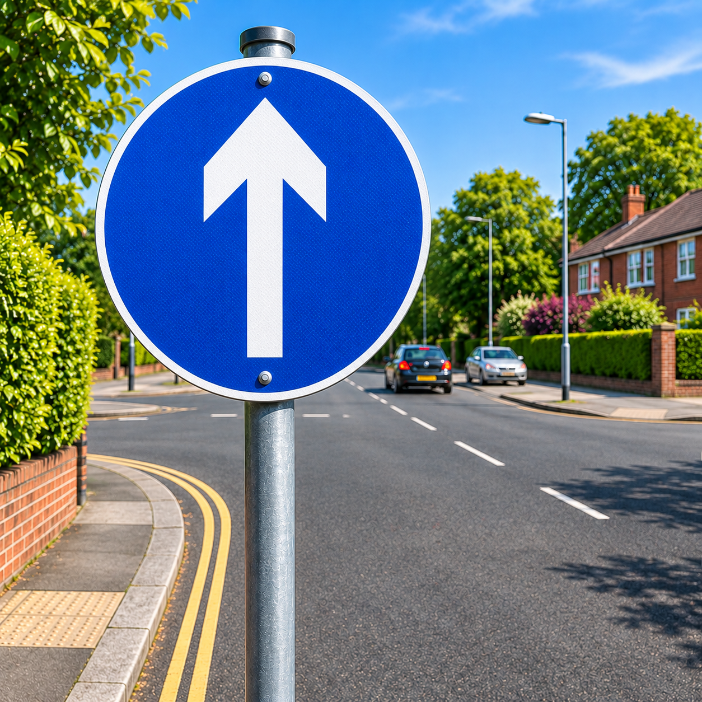

---

## stop — STOP sign

Content SHA-256: `1aee7141df79b6de0019050d7ccb4b7187bfbcb868c6f1539789c88b392403a8`

An eight-sided STOP sign is intentionally different in shape from most other order signs.

**Takeaway:** Stop before crossing the stop line and check that it is safe to proceed.

Quiz: When you reach a STOP sign with a stop line, you must…

A. Slow if traffic is light
B. Stop only if someone is crossing
C. Come to a complete stop before the line
D. Sound your horn

Correct: C — Come to a complete stop before the line

Reference: [DfT Know Your Traffic Signs — Regulatory signs](https://www.gov.uk/government/publications/know-your-traffic-signs/regulatory-signs)

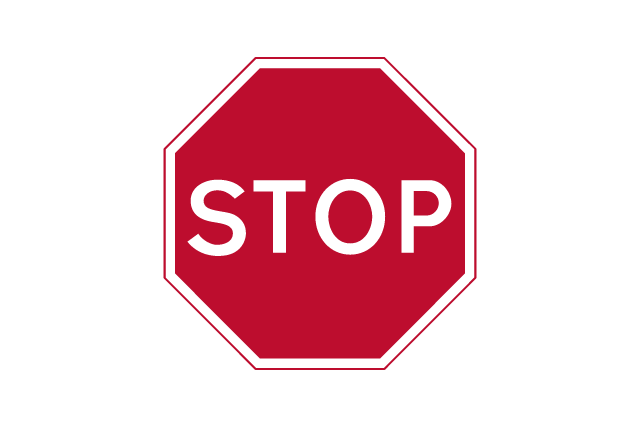

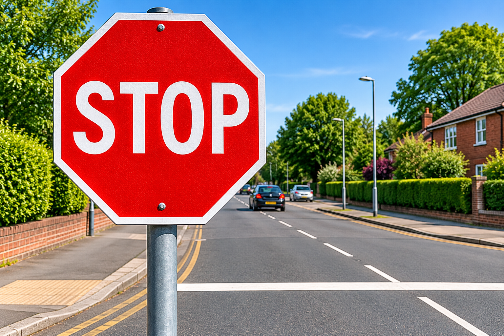

---

## give-way — GIVE WAY sign

Content SHA-256: `b2423daaa89cdf033f2c8f57eaebf95746f5394207c5188fc88ca16f0cc9b4ac`

This sign is shaped like an upside-down triangle to make it easily recognisable.

**Takeaway:** Give priority to traffic on the major road.

Quiz: At a GIVE WAY sign, what is your duty?

A. Stop for exactly ten seconds
B. Always drive through first
C. Ignore road markings
D. Give priority to traffic on the major road

Correct: D — Give priority to traffic on the major road

Reference: [DfT Know Your Traffic Signs — Regulatory signs](https://www.gov.uk/government/publications/know-your-traffic-signs/regulatory-signs)

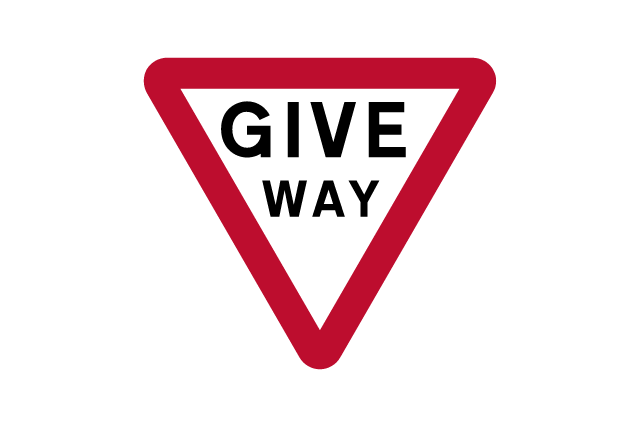

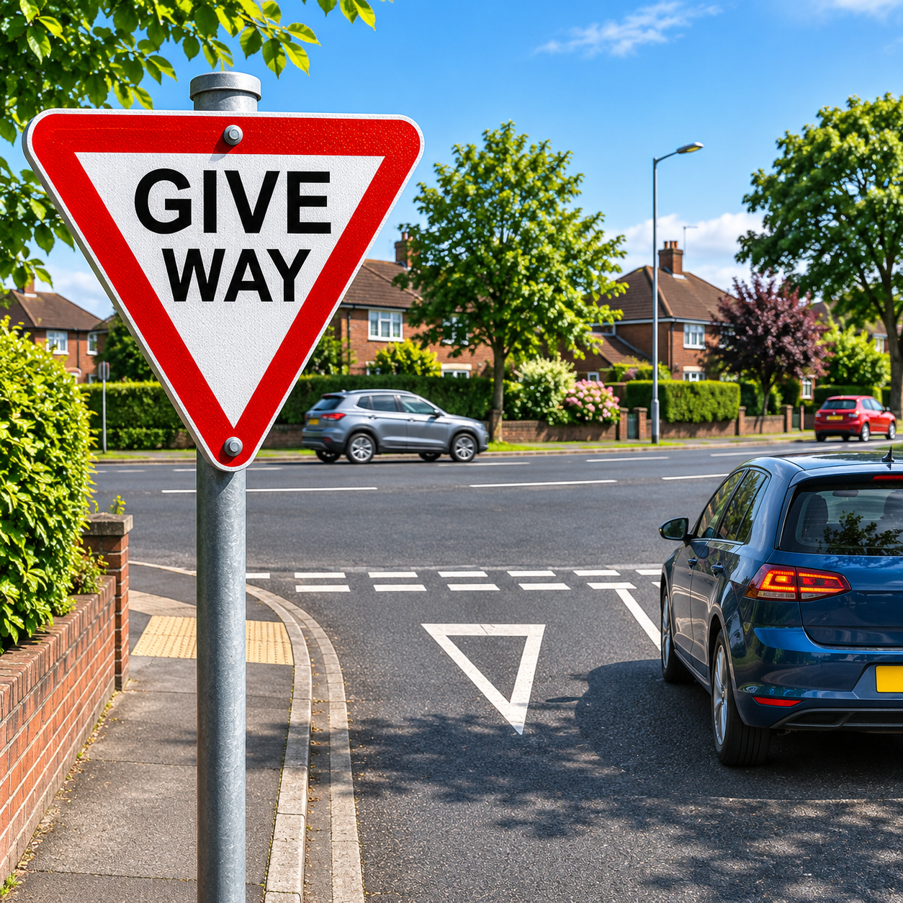

---

## no-u-turn — No U-turn

Content SHA-256: `7dfa7170ce1db4676ddc542b93211c09d173e44fac151f5aa38762c3d1554072`

A prohibited turn is commonly shown inside a red circular border with a bar across the turning symbol.

**Takeaway:** Do not make the displayed prohibited turn.

Quiz: What does a No U-turn sign tell you?

A. You must not make a U-turn
B. The route is one-way only
C. Make a U-turn at the next junction
D. Turn only if the road is empty

Correct: A — You must not make a U-turn

Reference: [DfT Know Your Traffic Signs — Regulatory signs](https://www.gov.uk/government/publications/know-your-traffic-signs/regulatory-signs)

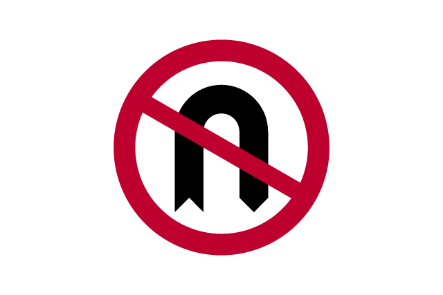

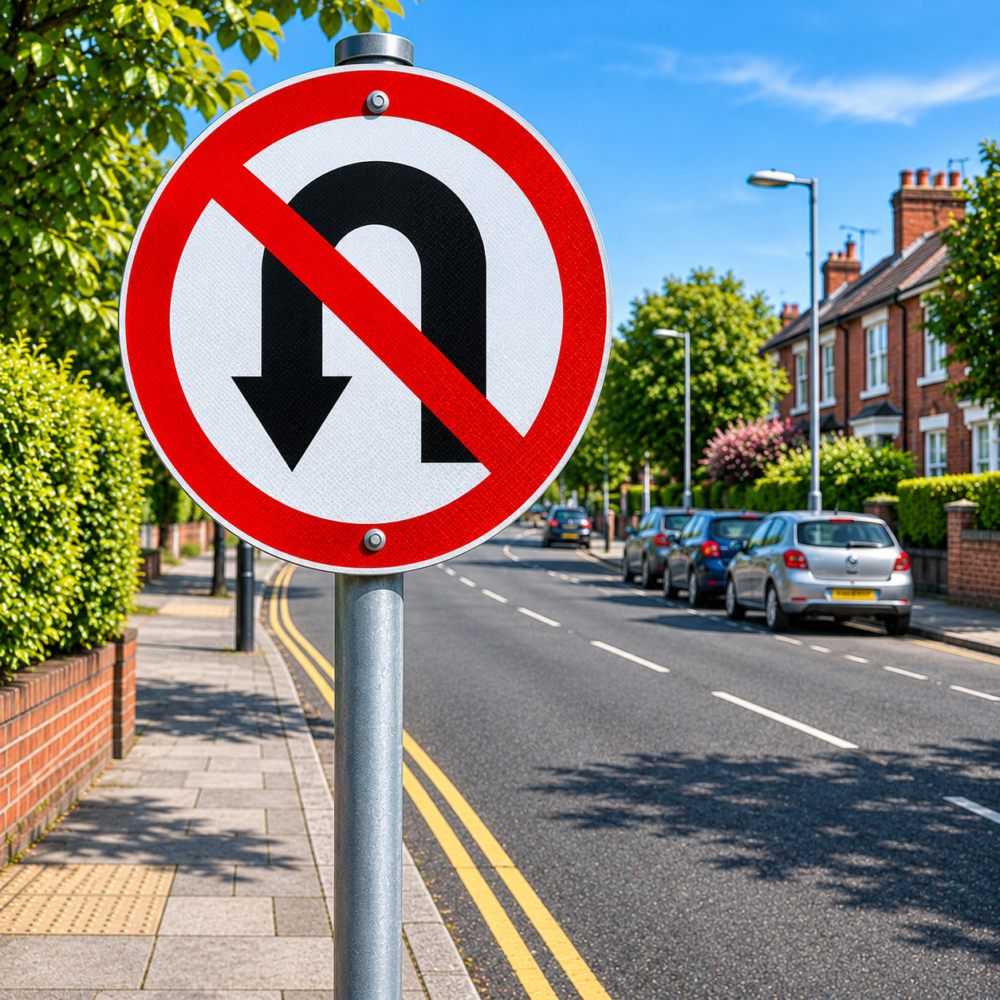

---

## warning-triangle — Red-bordered triangle

Content SHA-256: `ef9c7e7fbfdb98d7bc5ba79d7cad086483d1addb72c5f3ce3f458a2064c05a59`

An upright triangle with a red border commonly warns of a hazard or special road condition ahead.

**Takeaway:** Scan the road ahead and be ready to adapt your driving.

Quiz: What is the usual purpose of an upright red-bordered triangle?

A. Motorway direction
B. Warn about a hazard
C. Compulsory direction
D. Car park location

Correct: B — Warn about a hazard

Reference: [DfT Know Your Traffic Signs — The signing system](https://www.gov.uk/government/publications/know-your-traffic-signs/the-signing-system)

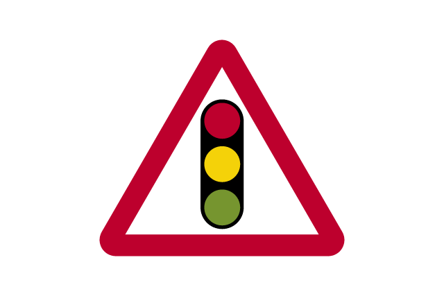

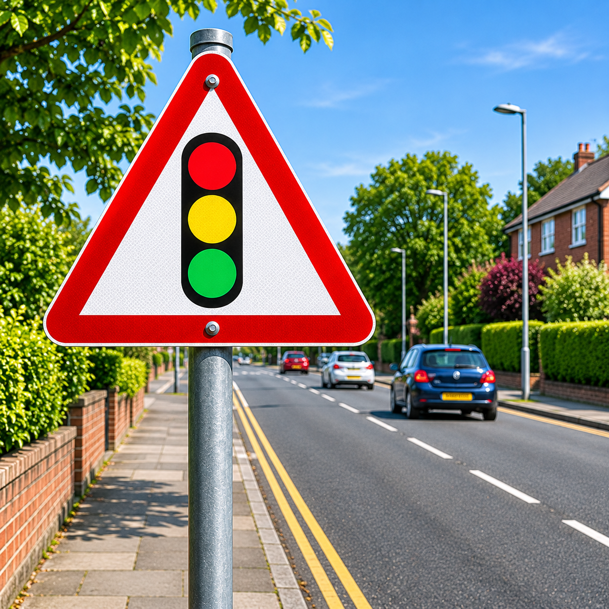

---

## warning-bend — Bend warning

Content SHA-256: `d91c48656acf2d7617b5b56a021590d57194de3b0ff8579c6983751fefa55c46`

A triangular bend-warning sign warns that the road changes direction ahead.

**Takeaway:** Check the bend and adjust speed to the conditions before reaching it.

Quiz: What should you consider when you see a bend-warning sign?

A. Overtake before the bend
B. Turn on hazard lights
C. Adjust your speed for the bend ahead
D. Stop in the traffic lane

Correct: C — Adjust your speed for the bend ahead

Reference: [DfT Know Your Traffic Signs — Warning signs](https://www.gov.uk/government/publications/know-your-traffic-signs/warning-signs)

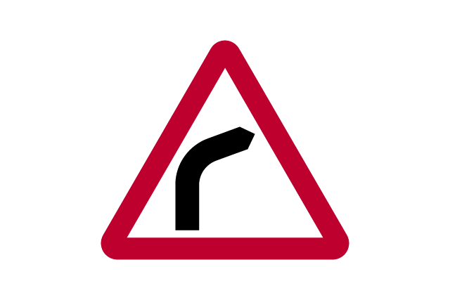

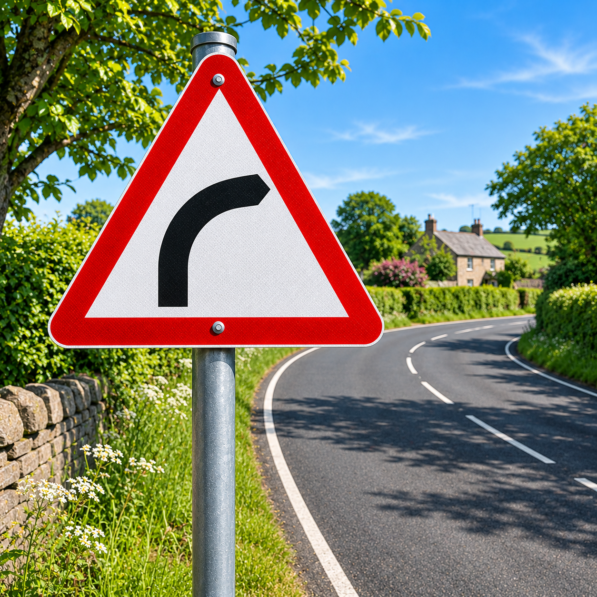

---

## warning-crossing — Pedestrian crossing warning

Content SHA-256: `be4a79ff3142b41534c7b77dcda000e7b19218ad7f68db3b58e1ebe60bd5f4b9`

A warning sign can alert drivers to pedestrians or a crossing ahead.

**Takeaway:** Watch the crossing area and be prepared to stop.

Quiz: A crossing-warning sign should make you…

A. Accelerate
B. Ignore the pavement
C. Change lanes immediately
D. Look for pedestrians and be ready to stop

Correct: D — Look for pedestrians and be ready to stop

Reference: [DfT Know Your Traffic Signs — Warning signs](https://www.gov.uk/government/publications/know-your-traffic-signs/warning-signs)

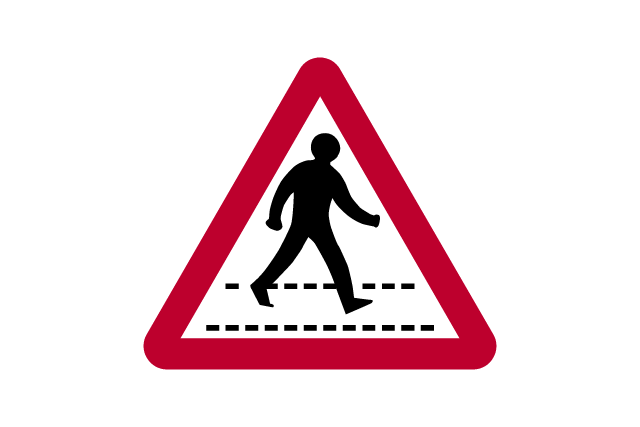

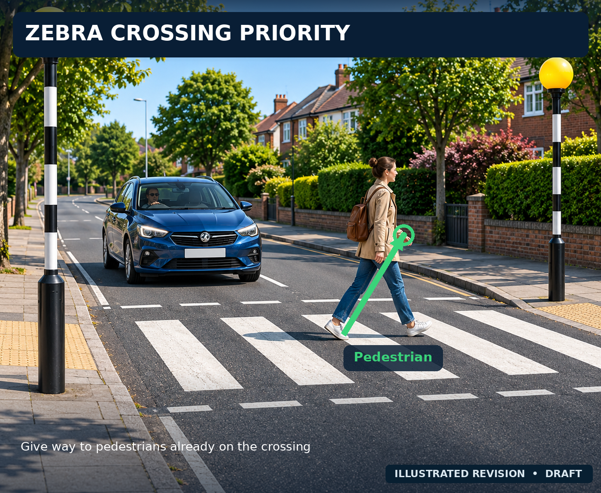

---

## motorway-blue — Motorway direction signs

Content SHA-256: `5d1c293de2f68593855fc522476363326b7445b65326c66db8a2ce8a6322e750`

Blue rectangular backgrounds are used for direction information on motorways.

**Takeaway:** Use the signs to plan your lane and exit safely.

Quiz: Motorway direction signs typically have which background colour?

A. Blue
B. Brown
C. Purple
D. Pink

Correct: A — Blue

Reference: [DfT Know Your Traffic Signs — The signing system](https://www.gov.uk/government/publications/know-your-traffic-signs/the-signing-system)

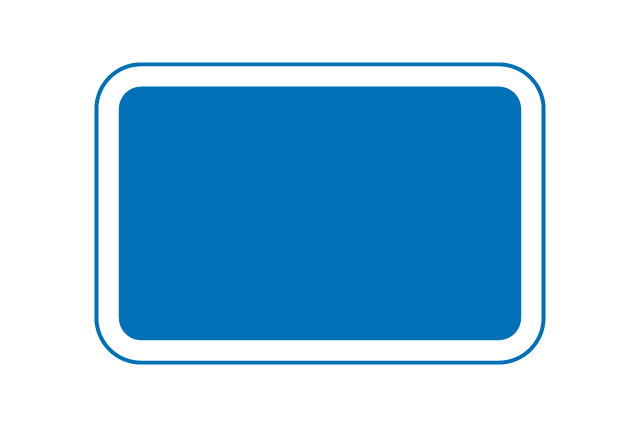

---

## primary-green — Primary route directions

Content SHA-256: `44a5f74d45aaaaca1d7bd5611d6034809216a9748c65f7b725497fe985979e15`

Green rectangular backgrounds are used for route directions on primary roads.

**Takeaway:** Green backgrounds help identify a primary-route direction sign.

Quiz: A green direction sign commonly identifies…

A. A temporary closure only
B. A primary route
C. An emergency vehicle
D. A no-entry order

Correct: B — A primary route

Reference: [DfT Know Your Traffic Signs — The signing system](https://www.gov.uk/government/publications/know-your-traffic-signs/the-signing-system)

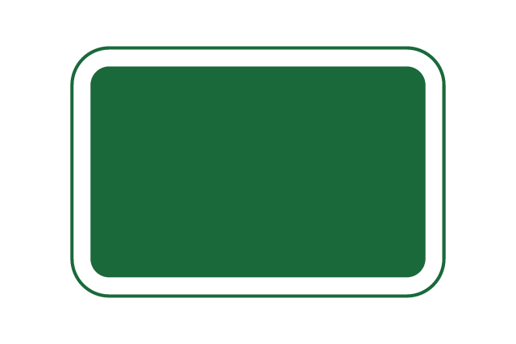

---

## nonprimary-white — Non-primary route directions

Content SHA-256: `41f415d7382b699326e1ee9b93422dad8a1b4e1a67b6e9758ffe20d0afea4bd0`

White rectangular signs are used for directions on non-primary roads and supplementary plates.

**Takeaway:** White is often a direction-sign background away from primary routes.

Quiz: Which background is generally used for non-primary route directions?

A. Red
B. Green
C. White
D. Black

Correct: C — White

Reference: [DfT Know Your Traffic Signs — The signing system](https://www.gov.uk/government/publications/know-your-traffic-signs/the-signing-system)

---

## information-blue — Blue information rectangles

Content SHA-256: `75cf616868a85a4e0d1ddaf604e8a99c1162b9e0ac2f5d4f2b0498540ffe97bd`

Outside the motorway direction-sign context, blue rectangular signs commonly provide road-user information.

**Takeaway:** Think information rather than a red-ring restriction.

Quiz: A blue rectangular sign off the motorway will usually…

A. Ban every type of vehicle
B. Always warn of a sharp bend
C. Require an emergency stop
D. Give useful information

Correct: D — Give useful information

Reference: [DfT Know Your Traffic Signs — The signing system](https://www.gov.uk/government/publications/know-your-traffic-signs/the-signing-system)

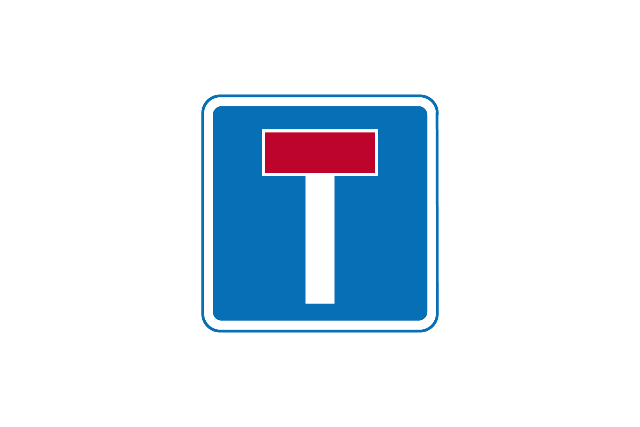

---

## no-entry — No entry

Content SHA-256: `23f7f9acd5f9efe79b261040e7b13ba94a4a759d2067763fb4abe6fc9505d788`

Vehicular traffic must not enter from this direction.

**Takeaway:** Check for a signed exception.

Quiz: What does this sign prohibit?

A. Vehicular entry
B. Parking only
C. Overtaking only
D. Pedestrian access

Correct: A — Vehicular entry

Reference: [DfT Know Your Traffic Signs — Regulatory signs](https://www.gov.uk/government/publications/know-your-traffic-signs/regulatory-signs)

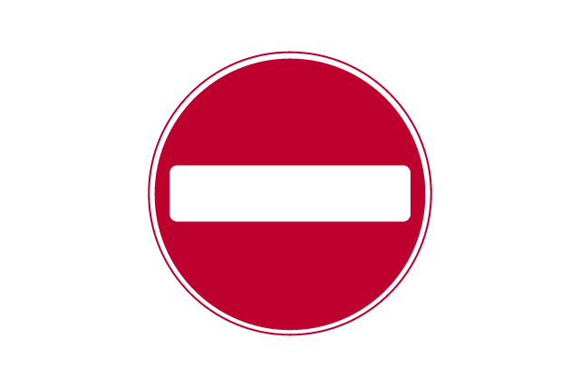

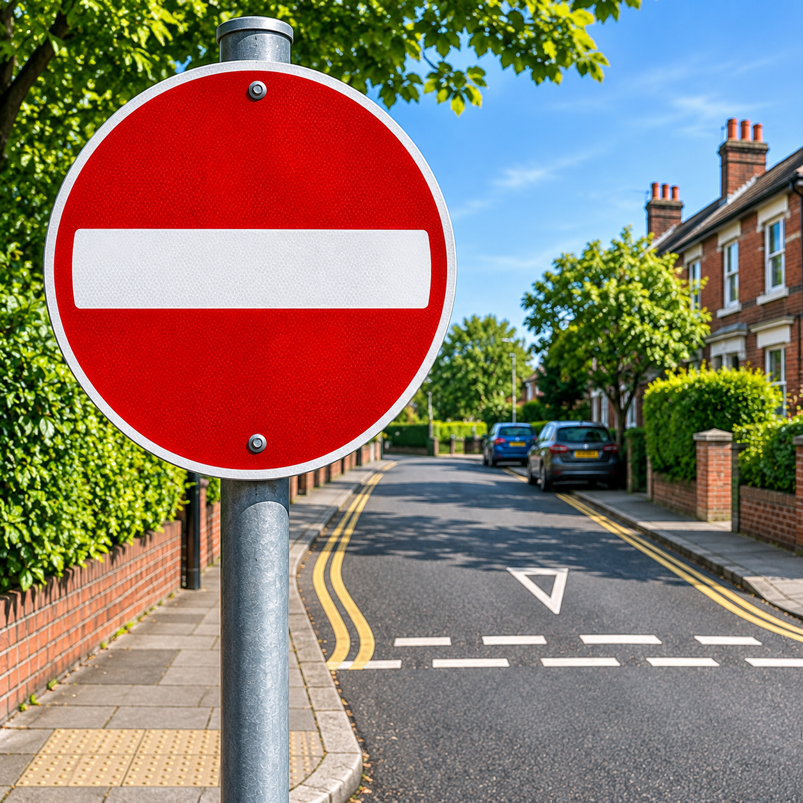

---

## keep-left — Keep left

Content SHA-256: `9bf0468896476c99155d78779959172f36272322c71363d13486d53d0b46834c`

Pass to the left of the obstruction.

**Takeaway:** Follow the arrow.

Quiz: Which side should you pass?

A. Either side
B. Right
C. Left
D. Use the pavement

Correct: C — Left

Reference: [DfT Know Your Traffic Signs — Regulatory signs](https://www.gov.uk/government/publications/know-your-traffic-signs/regulatory-signs)

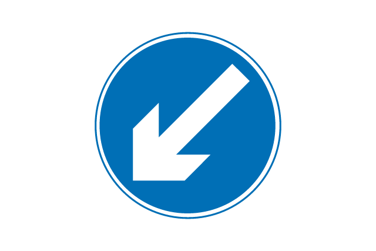

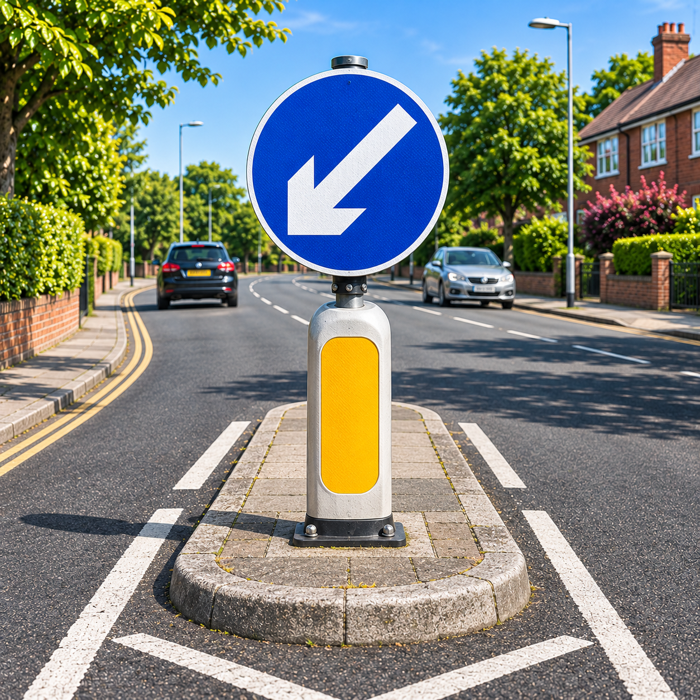

---

## signals-ahead — Traffic signals ahead

Content SHA-256: `897f2353f824444c49fa2b0054864e18e693830c1db2fb378b2dc928e17ba986`

Traffic lights control the road ahead.

**Takeaway:** Check the lights and approaching traffic.

Quiz: What lies ahead?

A. A toll booth
B. Traffic signals
C. A level crossing
D. A tunnel

Correct: B — Traffic signals

Reference: [DfT Know Your Traffic Signs — Warning signs](https://www.gov.uk/government/publications/know-your-traffic-signs/warning-signs)

---

## national-speed-limit — National speed limit

Content SHA-256: `8f5620f3f5b076ebfa52465b6010a14e49983b02517fd882c4dcfe61388c0337`

The national limit for your vehicle and road type applies.

**Takeaway:** It is not always 70 mph.

Quiz: What determines the applicable limit?

A. Your engine size
B. Your journey length
C. The weather alone
D. Vehicle class and road type

Correct: D — Vehicle class and road type

Reference: [DfT Know Your Traffic Signs — Speed limit signs](https://www.gov.uk/government/publications/know-your-traffic-signs/speed-limit-signs)

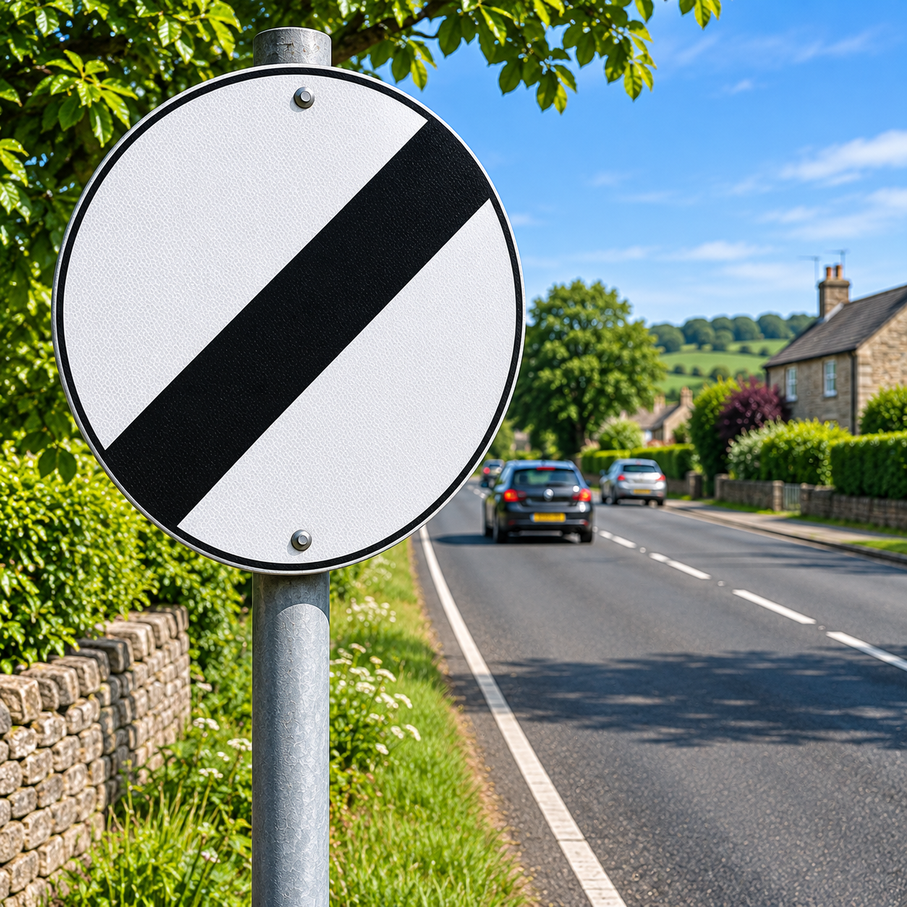

---

## speed-40 — 40 mph maximum

Content SHA-256: `07ad51c64bbc3d69c47c9f306405adbac62f280adc9253821b7df667859c3284`

The signed maximum is 40 mph.

**Takeaway:** Drive more slowly when conditions require.

Quiz: What is the signed maximum?

A. 20 mph
B. 30 mph
C. 40 mph
D. 50 mph

Correct: C — 40 mph

Reference: [DfT Know Your Traffic Signs — Speed limit signs](https://www.gov.uk/government/publications/know-your-traffic-signs/speed-limit-signs)

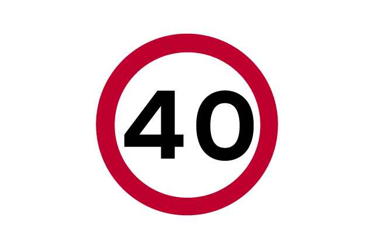

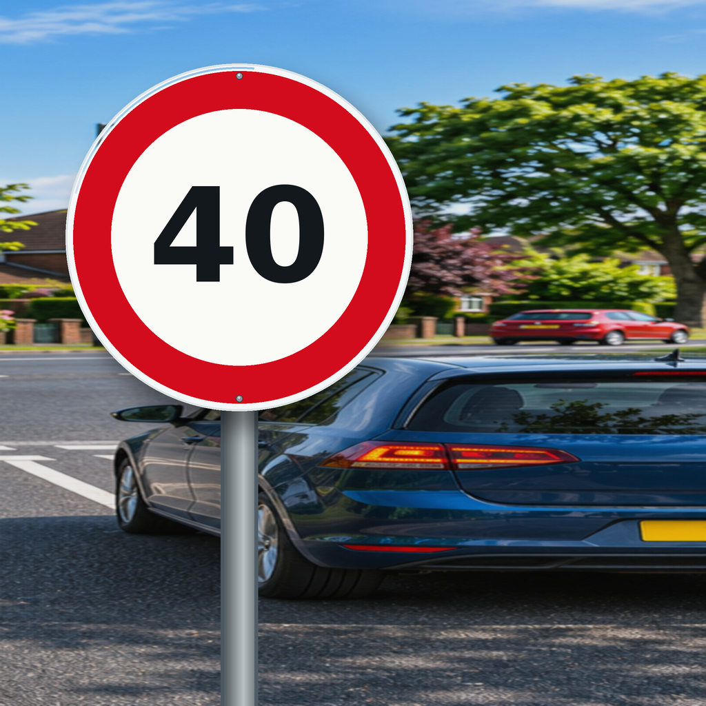

---

## no-motor-vehicles — No motor vehicles

Content SHA-256: `8f7e01efa659f180feaef3cbfa605e20afd64a03799c1b488a48f4ae68df04ba`

Motor vehicles are prohibited.

**Takeaway:** Read any exception plate.

Quiz: Which traffic is prohibited?

A. Motor vehicles
B. Only lorries
C. Only motorcycles
D. Only cars

Correct: A — Motor vehicles

Reference: [DfT Know Your Traffic Signs — Regulatory signs](https://www.gov.uk/government/publications/know-your-traffic-signs/regulatory-signs)

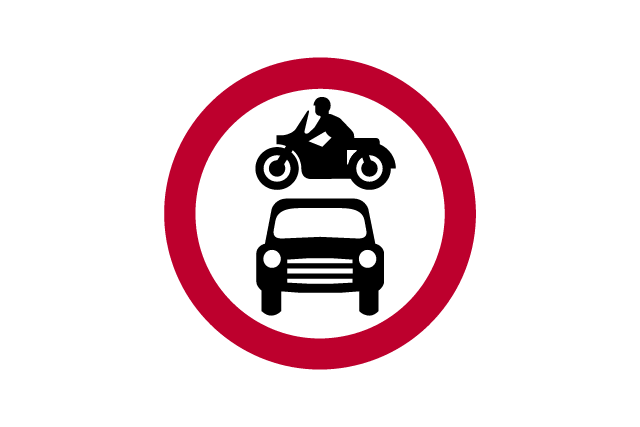

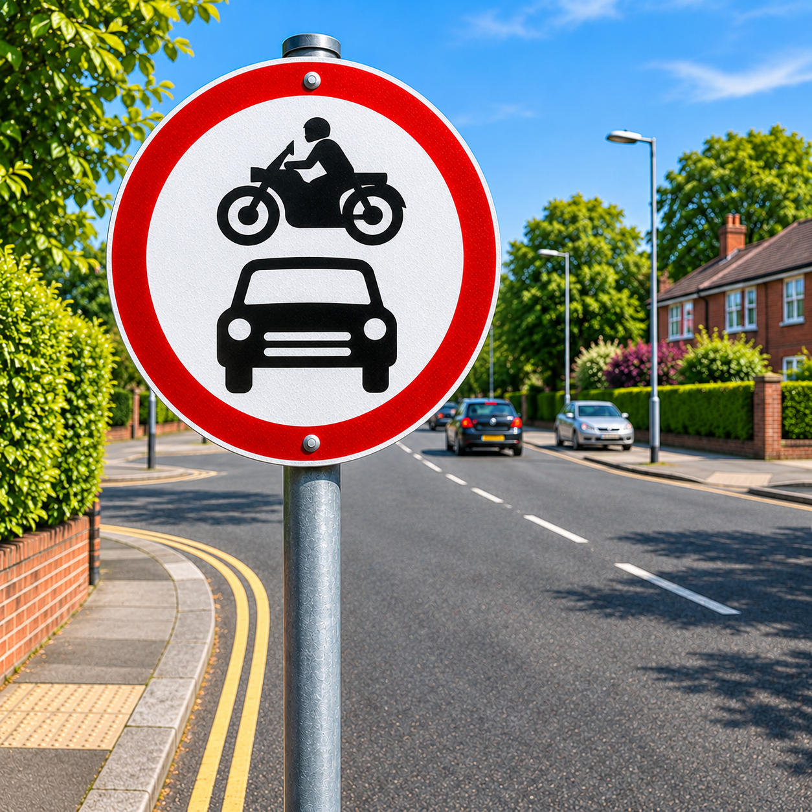

---

## no-overtaking — No overtaking

Content SHA-256: `2b886ed73f5b1285164573bac36b1480164766985e20c59ff064e09594466456`

This sign prohibits overtaking.

**Takeaway:** Wait until overtaking is permitted and safe.

Quiz: What does this sign prohibit?

A. Parking
B. Overtaking
C. Turning left
D. Reversing only

Correct: B — Overtaking

Reference: [DfT Know Your Traffic Signs — Regulatory signs](https://www.gov.uk/government/publications/know-your-traffic-signs/regulatory-signs)

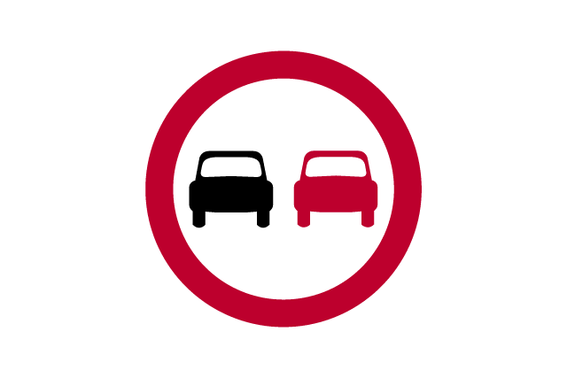

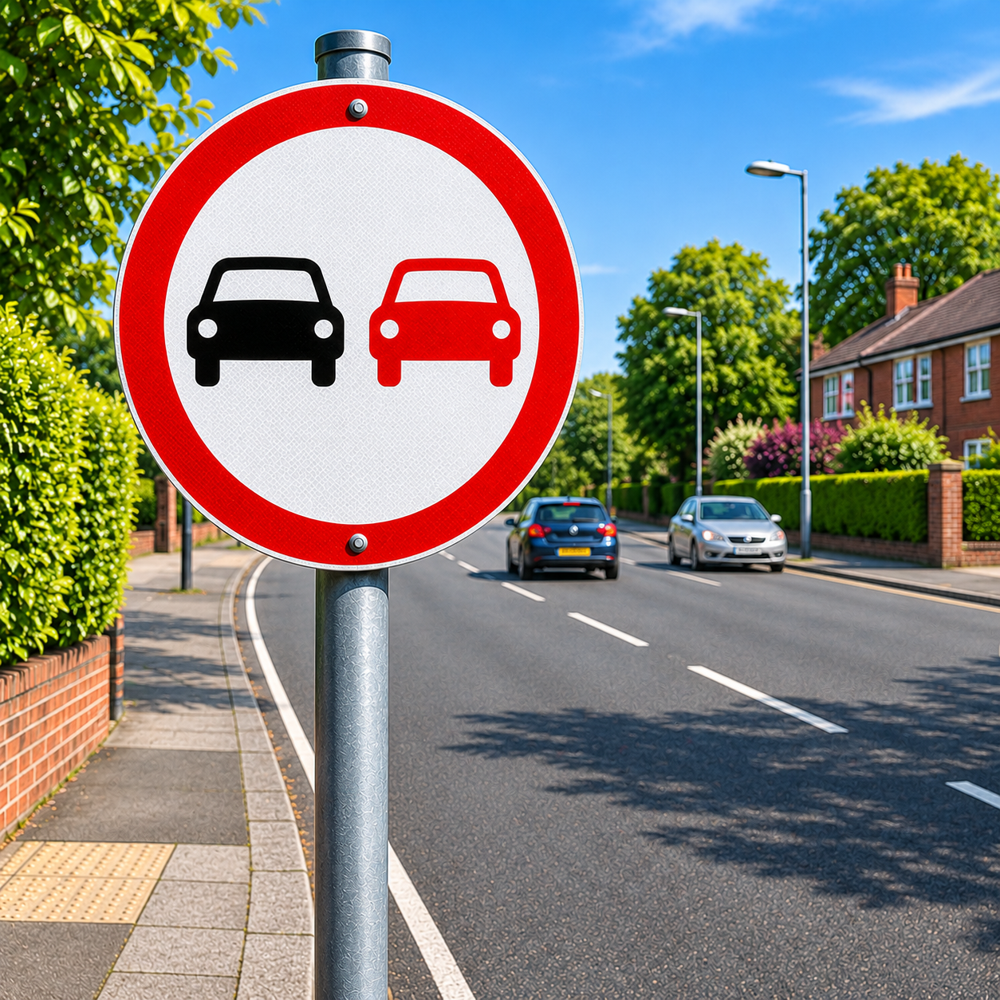

---

## oncoming-priority — Give way to oncoming vehicles

Content SHA-256: `b1047e3b5415fb1f22c10eff8d3a1985e630ad4ee24af5989d4dfb8b389f6b68`

Oncoming traffic has priority through the restriction.

**Takeaway:** Wait for a safe gap.

Quiz: Who has priority here?

A. You always do
B. The faster vehicle
C. Oncoming traffic
D. Only buses

Correct: C — Oncoming traffic

Reference: [DfT Know Your Traffic Signs — Regulatory signs](https://www.gov.uk/government/publications/know-your-traffic-signs/regulatory-signs)

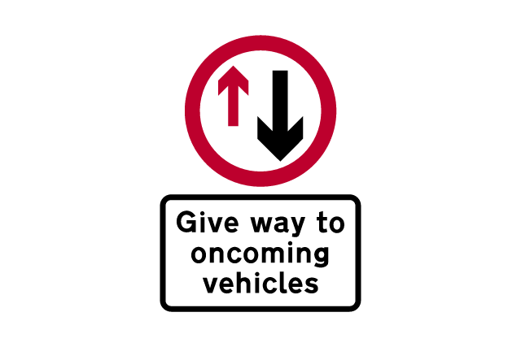

---

## turn-left — Turn left ahead

Content SHA-256: `678e23e1c45e83a6dd198fb365ab10c369668b5c90249cbf4770fb13107e384c`

You must turn left at the junction ahead.

**Takeaway:** Plan your position and signal.

Quiz: What is required ahead?

A. Turn right
B. Continue straight
C. Make a U-turn
D. Turn left

Correct: D — Turn left

Reference: [DfT Know Your Traffic Signs — Regulatory signs](https://www.gov.uk/government/publications/know-your-traffic-signs/regulatory-signs)

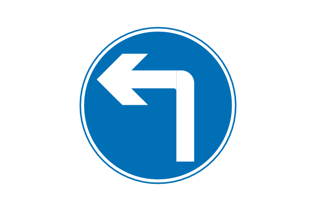

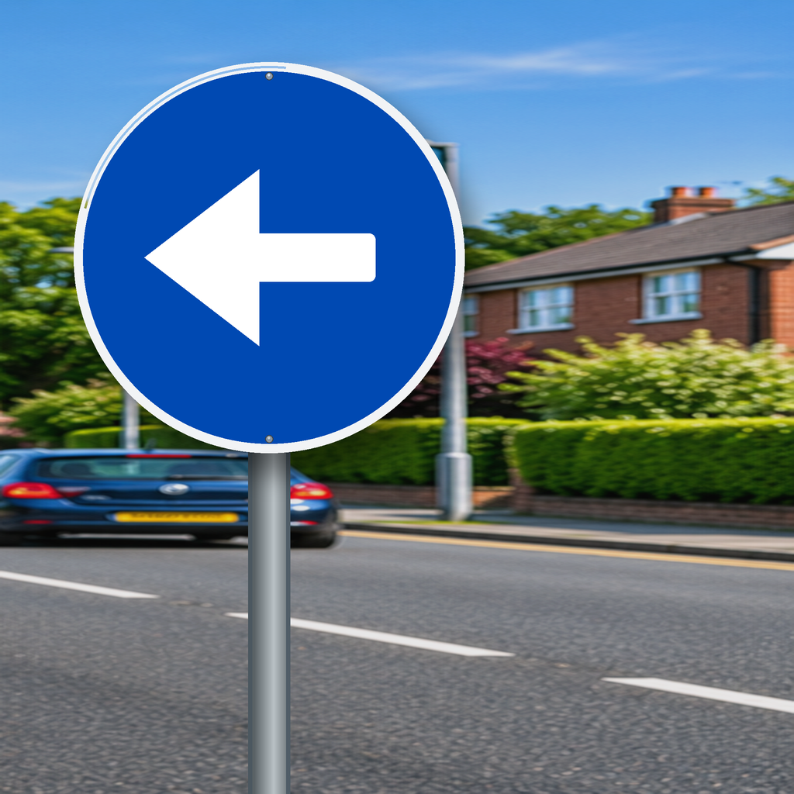

---

## crossroads — Crossroads ahead

Content SHA-256: `4fb621d393fadbdf829e75f7faad38b3312b999e98c0e752ae2cb994179e2f1b`

A crossroads is ahead; the broader line indicates priority.

**Takeaway:** Check for emerging traffic.

Quiz: Which junction is shown?

A. Crossroads
B. Roundabout
C. Motorway exit
D. Dead end

Correct: A — Crossroads

Reference: [DfT Know Your Traffic Signs — Warning signs](https://www.gov.uk/government/publications/know-your-traffic-signs/warning-signs)

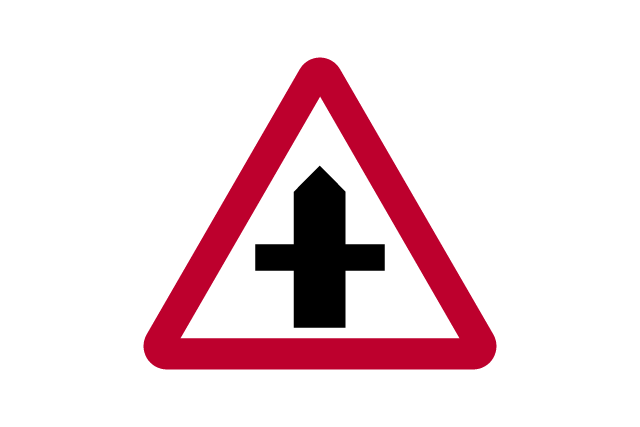

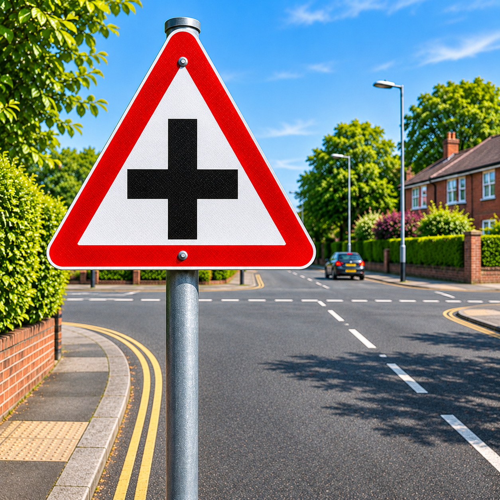

---

## roundabout-warning — Roundabout ahead

Content SHA-256: `b720e8f20005a1a9b0265040d5bc7145524fcb2749d96b6e5e2d474af75d65fb`

The road approaches a roundabout.

**Takeaway:** Read the lane signs and adjust speed.

Quiz: What is ahead?

A. Traffic lights
B. Roundabout
C. Road works
D. Level crossing

Correct: B — Roundabout

Reference: [DfT Know Your Traffic Signs — Warning signs](https://www.gov.uk/government/publications/know-your-traffic-signs/warning-signs)

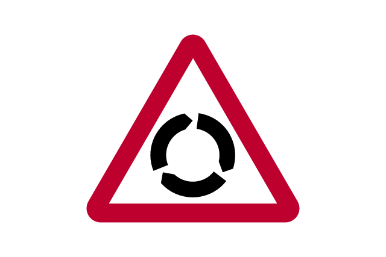

---

## road-narrows — Road narrows on both sides

Content SHA-256: `05461550867de233def2b27042e3232509150545986f128ec4b5a85b3f622792`

The carriageway becomes narrower from both sides.

**Takeaway:** Allow room and watch approaching traffic.

Quiz: What changes ahead?

A. Road widens
B. One-way traffic begins
C. Road narrows
D. Motorway starts

Correct: C — Road narrows

Reference: [DfT Know Your Traffic Signs — Warning signs](https://www.gov.uk/government/publications/know-your-traffic-signs/warning-signs)

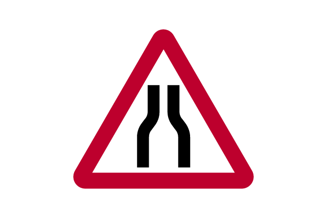

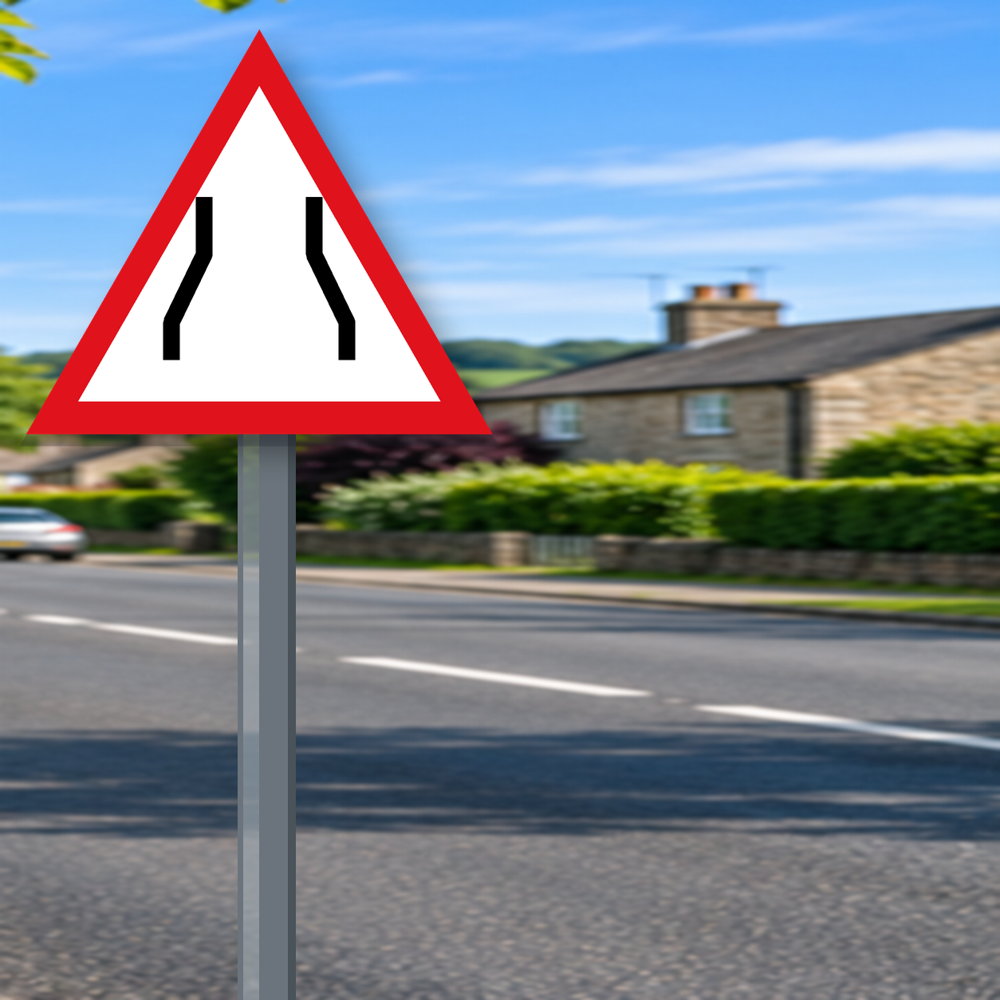

---

## two-way — Two-way traffic

Content SHA-256: `813eb8e052e8e94bd3ccfae9acfa4b6c1fa27704451698a1227a72ff8af5fd49`

Traffic travels in opposing directions ahead.

**Takeaway:** Keep to your side of the road.

Quiz: What should you expect?

A. Only bicycles
B. One-way traffic
C. No vehicles
D. Oncoming traffic

Correct: D — Oncoming traffic

Reference: [DfT Know Your Traffic Signs — Warning signs](https://www.gov.uk/government/publications/know-your-traffic-signs/warning-signs)

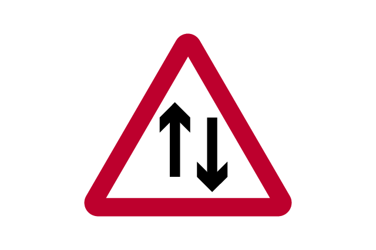

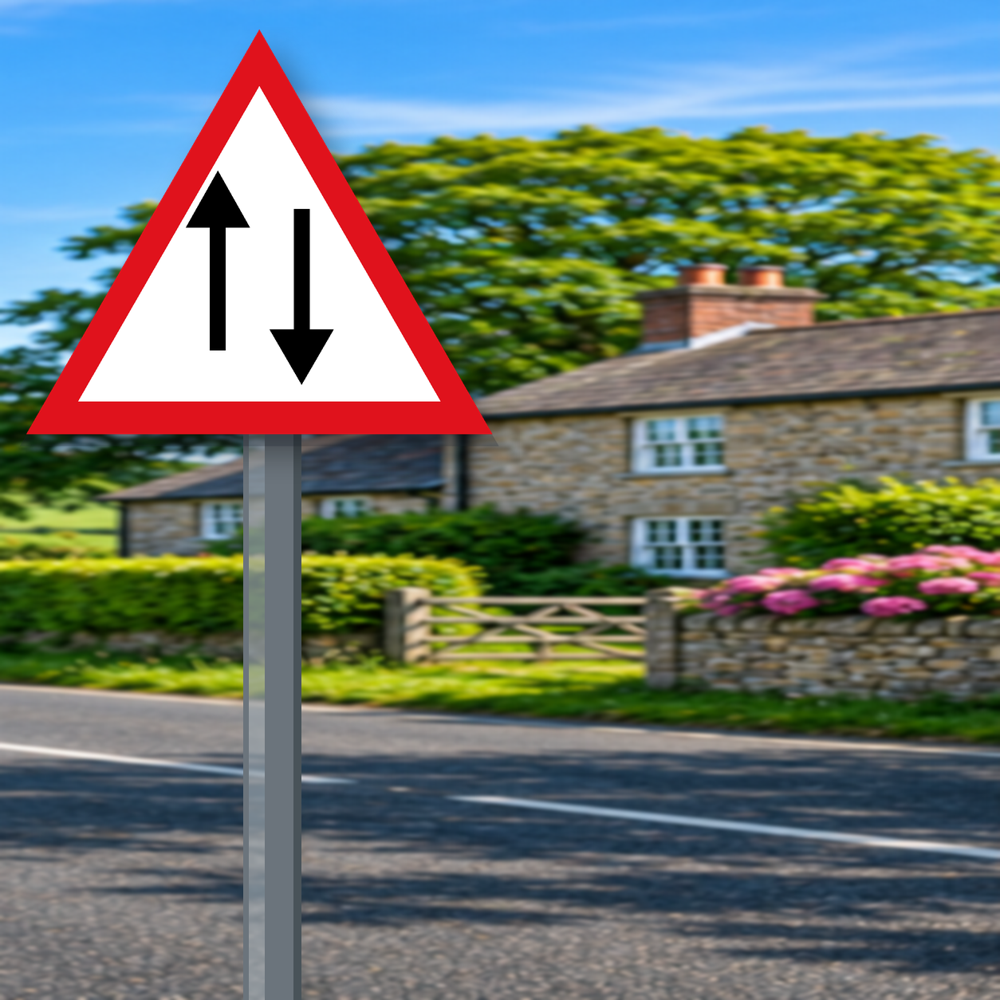

---

## slippery-road — Slippery road

Content SHA-256: `70396ff25e78e4907f086dfb3d5b2ef0d898c67e215b25c11318ff5f10b40fcb`

The road surface may offer reduced grip.

**Takeaway:** Use smooth steering and braking.

Quiz: What is the hazard?

A. Slippery surface
B. A bridge
C. Falling rocks
D. Low aircraft

Correct: A — Slippery surface

Reference: [DfT Know Your Traffic Signs — Warning signs](https://www.gov.uk/government/publications/know-your-traffic-signs/warning-signs)

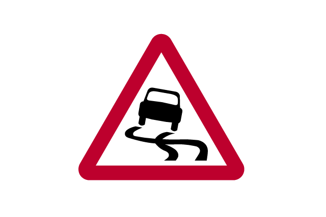

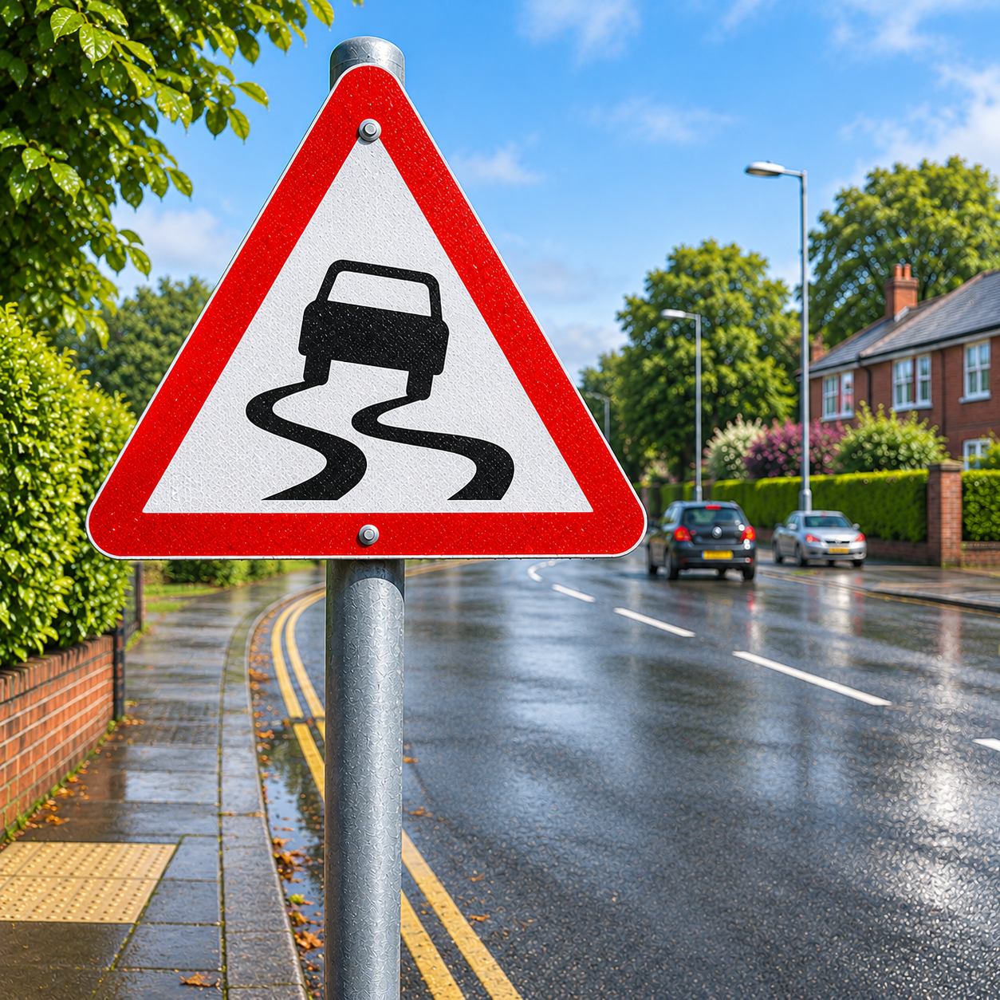

---

## school — School warning

Content SHA-256: `693543b35e5ddb31924f76782c0934ef7de26054a6d1df3efa216fe2504f1c30`

Children may be going to or from school.

**Takeaway:** Watch the pavement and crossing points.

Quiz: Who may be nearby?

A. Deer
B. School children
C. Horse riders
D. Road workers

Correct: B — School children

Reference: [DfT Know Your Traffic Signs — Warning signs](https://www.gov.uk/government/publications/know-your-traffic-signs/warning-signs)

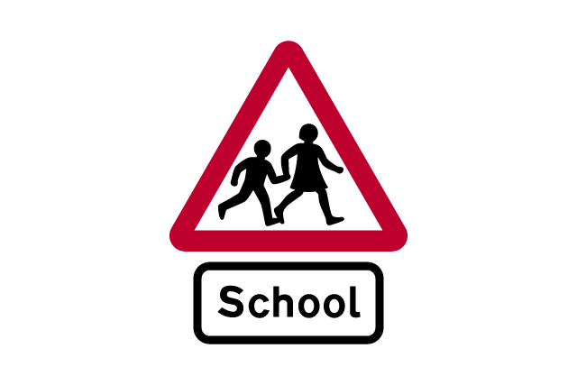

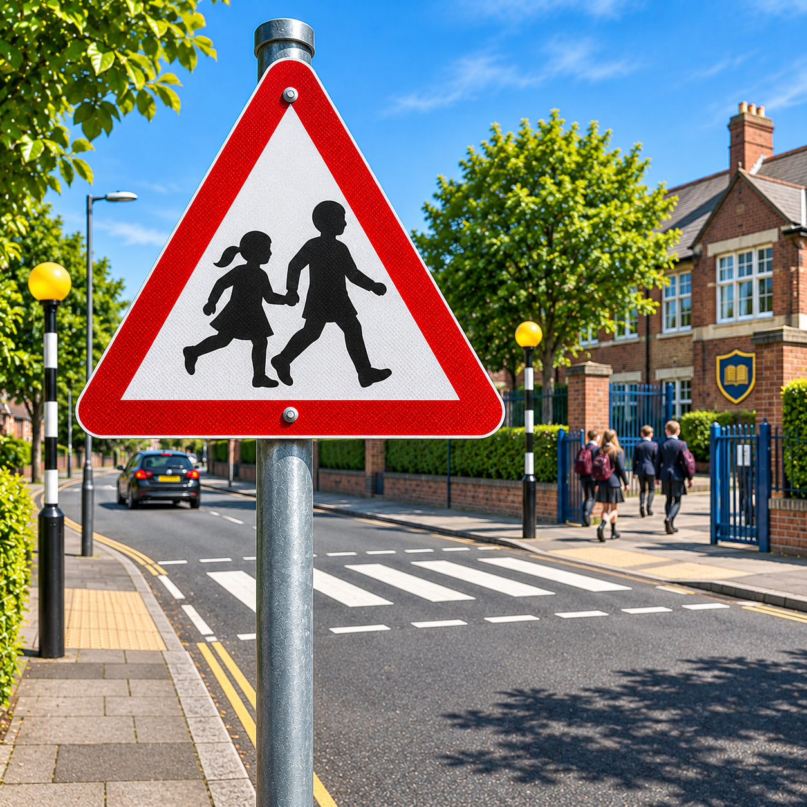

---

## no-through-road — No through road

Content SHA-256: `d52db899b7e6644a780a76a914596896c9d5838f2410f6fd8a79a7e093961586`

There is no through route for vehicular traffic.

**Takeaway:** Use another route to travel beyond it.

Quiz: What does this sign indicate?

A. No parking
B. Hospital
C. No through road
D. Motorway end

Correct: C — No through road

Reference: [DfT Know Your Traffic Signs — Information signs](https://www.gov.uk/government/publications/know-your-traffic-signs/information-signs)

---

## parking — Parking place

Content SHA-256: `f8c99ce29b766a93218f0ab42895fbb71845321bc3c157b5bc2316552d8264cf`

This sign identifies a parking place.

**Takeaway:** Check local conditions and restrictions.

Quiz: What is indicated?

A. Police station
B. Pedestrian route
C. Petrol station
D. Parking place

Correct: D — Parking place

Reference: [DfT Know Your Traffic Signs — Information signs](https://www.gov.uk/government/publications/know-your-traffic-signs/information-signs)

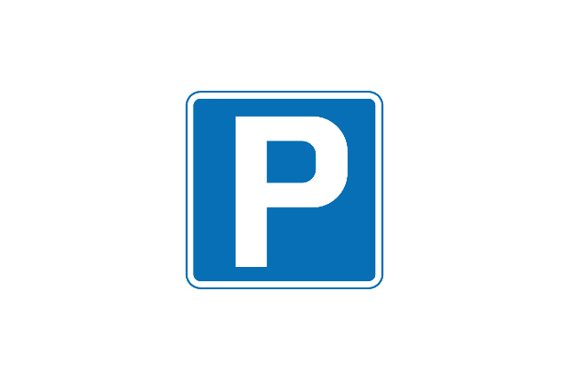

---

## motorway-start — Start of motorway

Content SHA-256: `22934741c2d7ae6b99d31887ee7851b8f0547a37b65ed5b7b096368febcf6f56`

Motorway regulations begin at this sign.

**Takeaway:** Check that you and your vehicle are permitted.

Quiz: What begins here?

A. Motorway regulations
B. A 30 mph zone
C. A cycle route
D. A clearway only

Correct: A — Motorway regulations

Reference: [DfT Know Your Traffic Signs — Speed limit signs](https://www.gov.uk/government/publications/know-your-traffic-signs/speed-limit-signs)

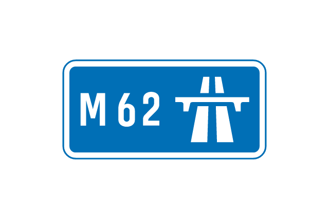

